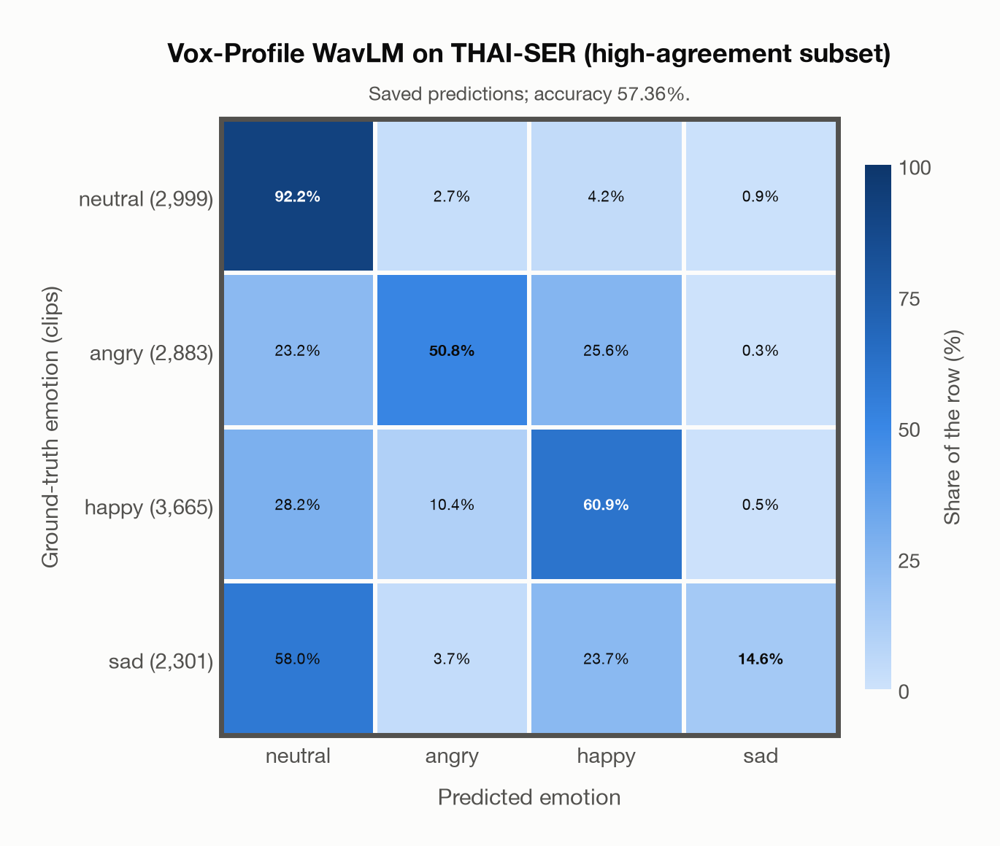
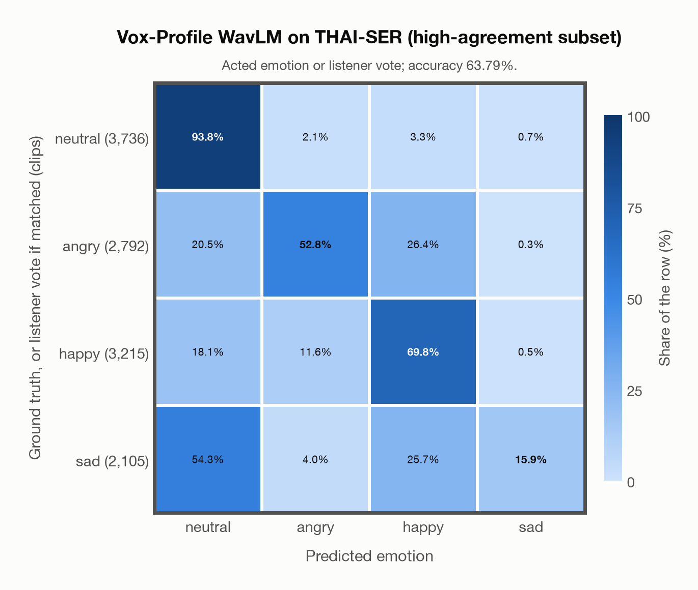

# Vox-Profile WavLM on THAI-SER (high-agreement subset)

Regenerated offline from saved CSV/JSON by `scripts/evaluation/refresh_reports.py`. This refresh performs no model inference or API requests.

## Summary

| Metric | Recomputed value |
|---|---:|
| Clips | 11,848 |
| Accuracy: acted emotion | 57.36% |
| UAR: mean ground-truth-row recall | 54.61% |
| Macro F1 | 52.16% |
| Weighted F1: true-support weighted | 54.19% |
| Accuracy: all model classes | 53.60% |
| Accuracy: acted emotion or listener vote | 63.79% |
| Single listener vote vs acted emotion | 77.23% |
| Model vs single listener vote | 58.09% |

## Imported run and verification

- Source: [prediction CSV](../../outputs/vox_profile_wavlm/thai_ser_predictions.csv) and [metadata JSON](../../outputs/vox_profile_wavlm/thai_ser_predictions.json); both remain byte-for-byte unchanged.
- Original execution date recorded in JSON: `2026-11-07`.
- Dataset scope recorded in JSON: **THAI-SER (high-agreement subset)**, Thai; 11,848 / 11,848 clips.
- Ground-truth column: `acted_emotion`. Candidate classes: neutral, angry, happy, sad.
- Row counts, unique audio paths, correctness flags and saved metrics were checked against the CSV. Metric agreement tolerance is 0.000001 (six-decimal metadata).
- Weighted F1 weights each class's F1 by its true support, using the same resolved truth as macro F1; invalid answers remain errors. New metrics absent from the source JSON are recorded in the offline audit and summaries; the source JSON is preserved.
- Original execution/client runtime metadata (reported by the imported run, not measured by this refresh): `{"device": "mps", "hardware": "Apple M4 Max", "seconds": 5282.9, "ms_per_clip": 445.9, "on_cpu": 0}`.

## Results per emotion

| Ground-truth emotion | Clips | Recall | Acted-or-listener recall |
|---|---:|---:|---:|
| neutral | 2,999 | 92.16% | 92.30% |
| angry | 2,883 | 50.82% | 54.32% |
| happy | 3,665 | 60.90% | 73.48% |
| sad | 2,301 | 14.56% | 23.08% |

Precision/F1 use the same resolved-truth convention as the evaluation script. Weighted F1 uses the resolved-truth clip counts below as weights.

| Predicted emotion | Resolved-truth clips | Precision | Recall | F1 |
|---|---:|---:|---:|---:|
| neutral | 2,999 | 47.63% | 92.16% | 62.80% |
| angry | 2,883 | 72.78% | 50.82% | 59.84% |
| happy | 3,665 | 61.25% | 60.90% | 61.08% |
| sad | 2,301 | 86.34% | 14.56% | 24.92% |

## Confusion matrix: acted emotion

| Ground truth \ Predicted | neutral | angry | happy | sad |
|---|---|---|---|---|
| neutral (2,999) | **92.2%** | 2.7% | 4.2% | 0.9% |
| angry (2,883) | 23.2% | **50.8%** | 25.6% | 0.3% |
| happy (3,665) | 28.2% | 10.4% | **60.9%** | 0.5% |
| sad (2,301) | 58.0% | 3.7% | 23.7% | **14.6%** |

## Confusion matrix: acted emotion or listener vote

A prediction accepted only through the listener vote is placed in that predicted emotion's row; other clips keep their original ground-truth row. Row supports can therefore change.

| Ground truth \ Predicted | neutral | angry | happy | sad |
|---|---|---|---|---|
| neutral (3,736) | **93.8%** | 2.1% | 3.3% | 0.7% |
| angry (2,792) | 20.5% | **52.8%** | 26.4% | 0.3% |
| happy (3,215) | 18.1% | 11.6% | **69.8%** | 0.5% |
| sad (2,105) | 54.3% | 4.0% | 25.7% | **15.9%** |

## Caveats

- **Training involvement for Vox-Profile WavLM: No corpus-specific evidence**. Source: SER adaptation on MSP-Podcast v1.12; WavLM-large backbone trained on Libri-Light, GigaSpeech and VoxPopuli; no clip-level overlap audit. Direct use and upstream teacher use both count as training involvement. No pattern: no corpus-specific evidence, not verified unseen. Corpus use is not test-clip leakage.
- Internal CSV/JSON consistency does not authenticate the original model or remote request logs.

[Offline validation audit](thai_ser_offline_audit.json)
