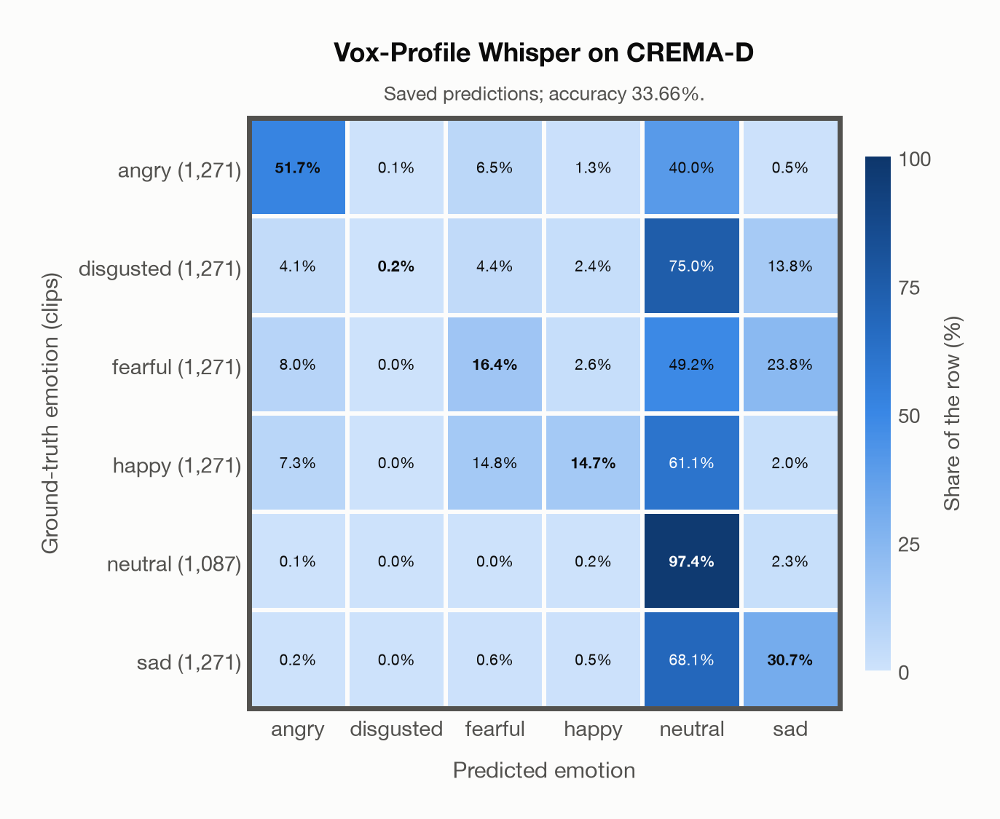
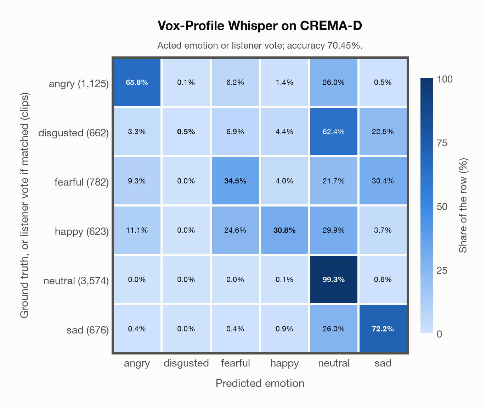

# Vox-Profile Whisper on CREMA-D

Regenerated offline from saved CSV/JSON by `scripts/evaluation/refresh_reports.py`. This refresh performs no model inference or API requests.

## Summary

| Metric | Recomputed value |
|---|---:|
| Clips | 7,442 |
| Accuracy: acted emotion | 33.66% |
| UAR: mean ground-truth-row recall | 35.20% |
| Macro F1 | 29.93% |
| Weighted F1: true-support weighted | 29.78% |
| Accuracy: all model classes | 30.72% |
| Accuracy: acted emotion or listener vote | 70.45% |
| Single listener vote vs acted emotion | 45.59% |
| Model vs single listener vote | 63.86% |

## Imported run and verification

- Source: [prediction CSV](../../outputs/vox_profile_whisper/crema_d_predictions.csv) and [metadata JSON](../../outputs/vox_profile_whisper/crema_d_predictions.json); both remain byte-for-byte unchanged.
- Original execution date recorded in JSON: `2026-10-29`.
- Dataset scope recorded in JSON: **CREMA-D**, English; 7,442 / 7,442 clips.
- Ground-truth column: `acted_emotion`. Candidate classes: angry, disgusted, fearful, happy, neutral, sad.
- Row counts, unique audio paths, correctness flags and saved metrics were checked against the CSV. Metric agreement tolerance is 0.000001 (six-decimal metadata).
- Weighted F1 weights each class's F1 by its true support, using the same resolved truth as macro F1; invalid answers remain errors. New metrics absent from the source JSON are recorded in the offline audit and summaries; the source JSON is preserved.
- Original execution/client runtime metadata (reported by the imported run, not measured by this refresh): `{"device": "mps", "hardware": "Apple M4 Max", "seconds": 1510.9, "ms_per_clip": 203.0, "on_cpu": 0}`.

## Results per emotion

| Ground-truth emotion | Clips | Recall | Acted-or-listener recall |
|---|---:|---:|---:|
| angry | 1,271 | 51.69% | 69.71% |
| disgusted | 1,271 | 0.24% | 48.15% |
| fearful | 1,271 | 16.44% | 59.72% |
| happy | 1,271 | 14.71% | 66.09% |
| neutral | 1,087 | 97.42% | 97.79% |
| sad | 1,271 | 30.68% | 85.21% |

Precision/F1 use the same resolved-truth convention as the evaluation script. Weighted F1 uses the resolved-truth clip counts below as weights.

| Predicted emotion | Resolved-truth clips | Precision | Recall | F1 |
|---|---:|---:|---:|---:|
| angry | 1,271 | 72.36% | 51.69% | 60.30% |
| disgusted | 1,271 | 75.00% | 0.24% | 0.47% |
| fearful | 1,271 | 38.56% | 16.44% | 23.06% |
| happy | 1,271 | 67.75% | 14.71% | 24.18% |
| neutral | 1,087 | 22.12% | 97.42% | 36.06% |
| sad | 1,271 | 42.16% | 30.68% | 35.52% |

## Confusion matrix: acted emotion

| Ground truth \ Predicted | angry | disgusted | fearful | happy | neutral | sad |
|---|---|---|---|---|---|---|
| angry (1,271) | **51.7%** | 0.1% | 6.5% | 1.3% | 40.0% | 0.5% |
| disgusted (1,271) | 4.1% | **0.2%** | 4.4% | 2.4% | 75.0% | 13.8% |
| fearful (1,271) | 8.0% | 0.0% | **16.4%** | 2.6% | 49.2% | 23.8% |
| happy (1,271) | 7.3% | 0.0% | 14.8% | **14.7%** | 61.1% | 2.0% |
| neutral (1,087) | 0.1% | 0.0% | 0.0% | 0.2% | **97.4%** | 2.3% |
| sad (1,271) | 0.2% | 0.0% | 0.6% | 0.5% | 68.1% | **30.7%** |

## Confusion matrix: acted emotion or listener vote

A prediction accepted only through the listener vote is placed in that predicted emotion's row; other clips keep their original ground-truth row. Row supports can therefore change.

| Ground truth \ Predicted | angry | disgusted | fearful | happy | neutral | sad |
|---|---|---|---|---|---|---|
| angry (1,125) | **65.8%** | 0.1% | 6.2% | 1.4% | 26.0% | 0.5% |
| disgusted (662) | 3.3% | **0.5%** | 6.9% | 4.4% | 62.4% | 22.5% |
| fearful (782) | 9.3% | 0.0% | **34.5%** | 4.0% | 21.7% | 30.4% |
| happy (623) | 11.1% | 0.0% | 24.6% | **30.8%** | 29.9% | 3.7% |
| neutral (3,574) | 0.0% | 0.0% | 0.0% | 0.1% | **99.3%** | 0.6% |
| sad (676) | 0.4% | 0.0% | 0.4% | 0.9% | 26.0% | **72.2%** |

## Caveats

- **Training involvement for Vox-Profile Whisper: No corpus-specific evidence**. Source: SER adaptation on MSP-Podcast v1.12; retained Whisper-large-v3 pretraining sources incompletely disclosed. Direct use and upstream teacher use both count as training involvement. No pattern: no corpus-specific evidence, not verified unseen. Corpus use is not test-clip leakage.
- The known empty CREMA-D recording 1076_MTI_SAD_XX.wav is retained in the saved predictions, matching the existing project evaluation scope.
- Internal CSV/JSON consistency does not authenticate the original model or remote request logs.

[Offline validation audit](crema_d_offline_audit.json)
