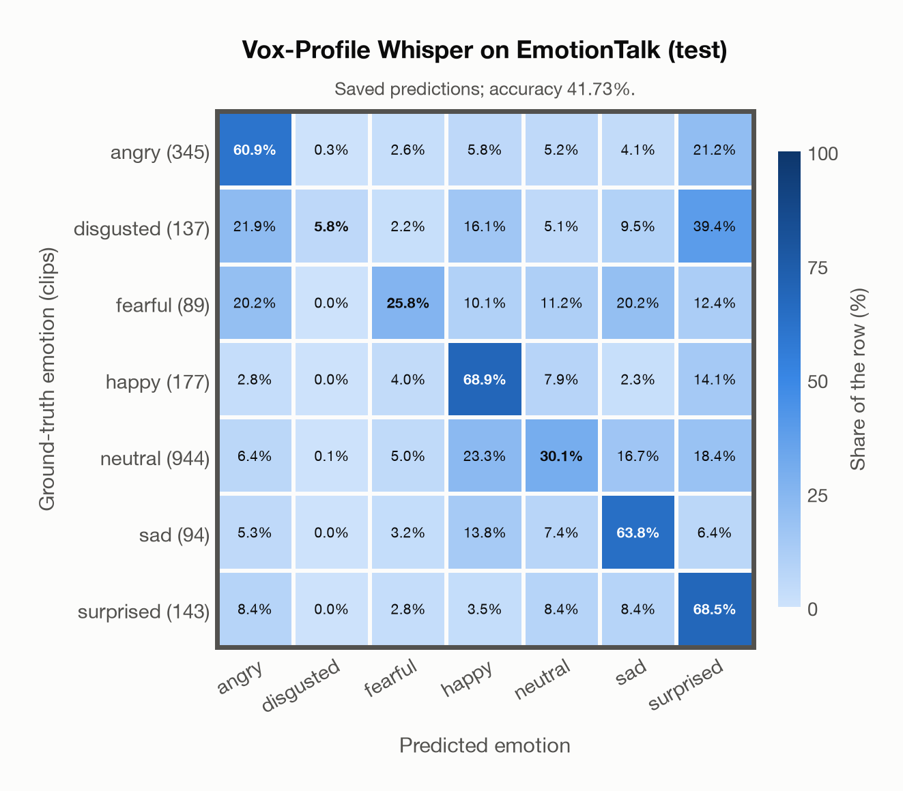

# Vox-Profile Whisper on EmotionTalk (test)

Regenerated offline from saved CSV/JSON by `scripts/evaluation/refresh_reports.py`. This refresh performs no model inference or API requests.

## Summary

| Metric | Recomputed value |
|---|---:|
| Clips | 1,929 |
| Accuracy: acted emotion | 41.73% |
| UAR: mean ground-truth-row recall | 46.27% |
| Macro F1 | 35.45% |
| Weighted F1: true-support weighted | 42.20% |
| Accuracy: all model classes | 40.28% |

## Imported run and verification

- Source: [prediction CSV](../../outputs/vox_profile_whisper/emotiontalk_predictions.csv) and [metadata JSON](../../outputs/vox_profile_whisper/emotiontalk_predictions.json); both remain byte-for-byte unchanged.
- Original execution date recorded in JSON: `2026-11-11`.
- Dataset scope recorded in JSON: **EmotionTalk (test)**, Mandarin; 1,929 / 1,929 clips.
- Ground-truth column: `acted_emotion`. Candidate classes: angry, disgusted, fearful, happy, neutral, sad, surprised.
- Row counts, unique audio paths, correctness flags and saved metrics were checked against the CSV. Metric agreement tolerance is 0.000001 (six-decimal metadata).
- Weighted F1 weights each class's F1 by its true support, using the same resolved truth as macro F1; invalid answers remain errors. New metrics absent from the source JSON are recorded in the offline audit and summaries; the source JSON is preserved.
- Original execution/client runtime metadata (reported by the imported run, not measured by this refresh): `{"device": "mps", "hardware": "Apple M3 Pro", "seconds": 986.2, "ms_per_clip": 511.2, "on_cpu": 0}`.

## Results per emotion

| Ground-truth emotion | Clips | Recall | Acted-or-listener recall |
|---|---:|---:|---:|
| angry | 345 | 60.87% | — |
| disgusted | 137 | 5.84% | — |
| fearful | 89 | 25.84% | — |
| happy | 177 | 68.93% | — |
| neutral | 944 | 30.08% | — |
| sad | 94 | 63.83% | — |
| surprised | 143 | 68.53% | — |

Precision/F1 use the same resolved-truth convention as the evaluation script. Weighted F1 uses the resolved-truth clip counts below as weights.

| Predicted emotion | Resolved-truth clips | Precision | Recall | F1 |
|---|---:|---:|---:|---:|
| angry | 345 | 61.76% | 60.87% | 61.31% |
| disgusted | 137 | 80.00% | 5.84% | 10.88% |
| fearful | 89 | 23.96% | 25.84% | 24.86% |
| happy | 177 | 29.68% | 68.93% | 41.50% |
| neutral | 944 | 80.68% | 30.08% | 43.83% |
| sad | 94 | 21.51% | 63.83% | 32.17% |
| surprised | 143 | 22.22% | 68.53% | 33.56% |

## Confusion matrix: acted emotion

| Ground truth \ Predicted | angry | disgusted | fearful | happy | neutral | sad | surprised |
|---|---|---|---|---|---|---|---|
| angry (345) | **60.9%** | 0.3% | 2.6% | 5.8% | 5.2% | 4.1% | 21.2% |
| disgusted (137) | 21.9% | **5.8%** | 2.2% | 16.1% | 5.1% | 9.5% | 39.4% |
| fearful (89) | 20.2% | 0.0% | **25.8%** | 10.1% | 11.2% | 20.2% | 12.4% |
| happy (177) | 2.8% | 0.0% | 4.0% | **68.9%** | 7.9% | 2.3% | 14.1% |
| neutral (944) | 6.4% | 0.1% | 5.0% | 23.3% | **30.1%** | 16.7% | 18.4% |
| sad (94) | 5.3% | 0.0% | 3.2% | 13.8% | 7.4% | **63.8%** | 6.4% |
| surprised (143) | 8.4% | 0.0% | 2.8% | 3.5% | 8.4% | 8.4% | **68.5%** |

## Caveats

- **Training involvement for Vox-Profile Whisper: No corpus-specific evidence**. Source: SER adaptation on MSP-Podcast v1.12; retained Whisper-large-v3 pretraining sources incompletely disclosed. Direct use and upstream teacher use both count as training involvement. No pattern: no corpus-specific evidence, not verified unseen. Corpus use is not test-clip leakage.
- Internal CSV/JSON consistency does not authenticate the original model or remote request logs.

[Offline validation audit](emotiontalk_offline_audit.json)
