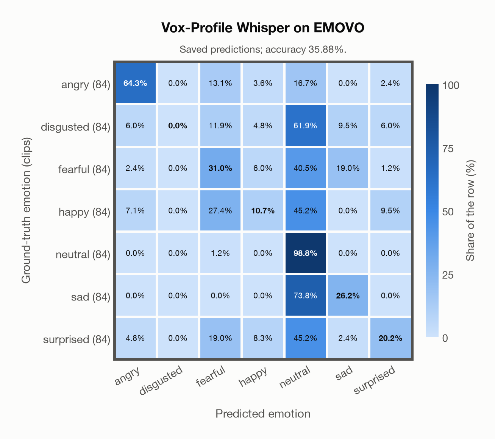

# Vox-Profile Whisper on EMOVO

Regenerated offline from saved CSV/JSON by `scripts/evaluation/refresh_reports.py`. This refresh performs no model inference or API requests.

## Summary

| Metric | Recomputed value |
|---|---:|
| Clips | 588 |
| Accuracy: acted emotion | 35.88% |
| UAR: mean ground-truth-row recall | 35.88% |
| Macro F1 | 31.36% |
| Weighted F1: true-support weighted | 31.36% |
| Accuracy: all model classes | 35.88% |

## Imported run and verification

- Source: [prediction CSV](../../outputs/vox_profile_whisper/emovo_predictions.csv) and [metadata JSON](../../outputs/vox_profile_whisper/emovo_predictions.json); both remain byte-for-byte unchanged.
- Original execution date recorded in JSON: `2026-11-06`.
- Dataset scope recorded in JSON: **EMOVO**, Italian; 588 / 588 clips.
- Ground-truth column: `acted_emotion`. Candidate classes: angry, disgusted, fearful, happy, neutral, sad, surprised.
- Row counts, unique audio paths, correctness flags and saved metrics were checked against the CSV. Metric agreement tolerance is 0.000001 (six-decimal metadata).
- Weighted F1 weights each class's F1 by its true support, using the same resolved truth as macro F1; invalid answers remain errors. New metrics absent from the source JSON are recorded in the offline audit and summaries; the source JSON is preserved.
- Original execution/client runtime metadata (reported by the imported run, not measured by this refresh): `{"device": "mps", "hardware": "Apple M4 Max", "seconds": 138.6, "ms_per_clip": 235.7, "on_cpu": 0}`.

## Results per emotion

| Ground-truth emotion | Clips | Recall | Acted-or-listener recall |
|---|---:|---:|---:|
| angry | 84 | 64.29% | — |
| disgusted | 84 | 0.00% | — |
| fearful | 84 | 30.95% | — |
| happy | 84 | 10.71% | — |
| neutral | 84 | 98.81% | — |
| sad | 84 | 26.19% | — |
| surprised | 84 | 20.24% | — |

Precision/F1 use the same resolved-truth convention as the evaluation script. Weighted F1 uses the resolved-truth clip counts below as weights.

| Predicted emotion | Resolved-truth clips | Precision | Recall | F1 |
|---|---:|---:|---:|---:|
| angry | 84 | 76.06% | 64.29% | 69.68% |
| disgusted | 84 | 0.00% | 0.00% | 0.00% |
| fearful | 84 | 29.89% | 30.95% | 30.41% |
| happy | 84 | 32.14% | 10.71% | 16.07% |
| neutral | 84 | 25.86% | 98.81% | 40.99% |
| sad | 84 | 45.83% | 26.19% | 33.33% |
| surprised | 84 | 51.52% | 20.24% | 29.06% |

## Confusion matrix: acted emotion

| Ground truth \ Predicted | angry | disgusted | fearful | happy | neutral | sad | surprised |
|---|---|---|---|---|---|---|---|
| angry (84) | **64.3%** | 0.0% | 13.1% | 3.6% | 16.7% | 0.0% | 2.4% |
| disgusted (84) | 6.0% | **0.0%** | 11.9% | 4.8% | 61.9% | 9.5% | 6.0% |
| fearful (84) | 2.4% | 0.0% | **31.0%** | 6.0% | 40.5% | 19.0% | 1.2% |
| happy (84) | 7.1% | 0.0% | 27.4% | **10.7%** | 45.2% | 0.0% | 9.5% |
| neutral (84) | 0.0% | 0.0% | 1.2% | 0.0% | **98.8%** | 0.0% | 0.0% |
| sad (84) | 0.0% | 0.0% | 0.0% | 0.0% | 73.8% | **26.2%** | 0.0% |
| surprised (84) | 4.8% | 0.0% | 19.0% | 8.3% | 45.2% | 2.4% | **20.2%** |

## Caveats

- **Training involvement for Vox-Profile Whisper: No corpus-specific evidence**. Source: SER adaptation on MSP-Podcast v1.12; retained Whisper-large-v3 pretraining sources incompletely disclosed. Direct use and upstream teacher use both count as training involvement. No pattern: no corpus-specific evidence, not verified unseen. Corpus use is not test-clip leakage.
- Internal CSV/JSON consistency does not authenticate the original model or remote request logs.

[Offline validation audit](emovo_offline_audit.json)
