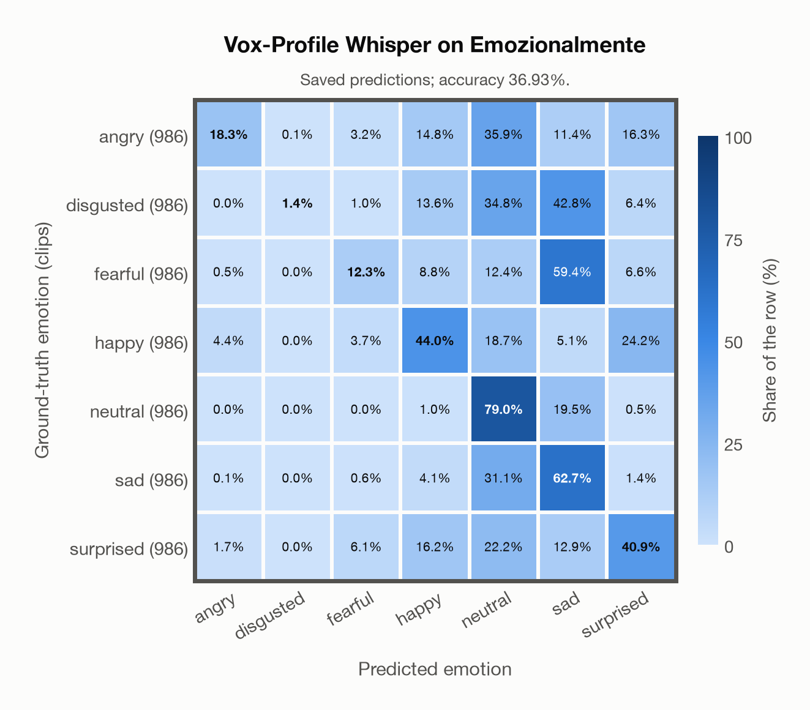
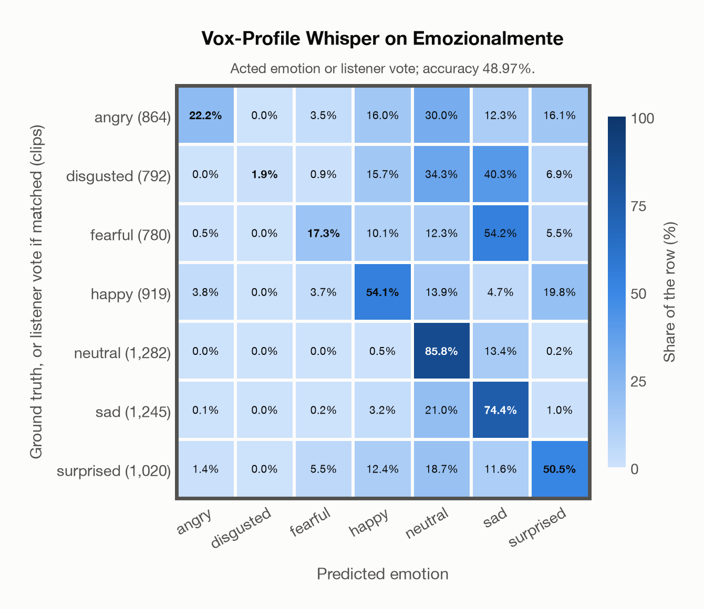

# Vox-Profile Whisper on Emozionalmente

Regenerated offline from saved CSV/JSON by `scripts/evaluation/refresh_reports.py`. This refresh performs no model inference or API requests.

## Summary

| Metric | Recomputed value |
|---|---:|
| Clips | 6,902 |
| Accuracy: acted emotion | 36.93% |
| UAR: mean ground-truth-row recall | 36.93% |
| Macro F1 | 31.96% |
| Weighted F1: true-support weighted | 31.96% |
| Accuracy: all model classes | 36.87% |
| Accuracy: acted emotion or listener vote | 48.97% |
| Single listener vote vs acted emotion | 81.22% |
| Model vs single listener vote | 44.79% |

## Imported run and verification

- Source: [prediction CSV](../../outputs/vox_profile_whisper/emozionalmente_predictions.csv) and [metadata JSON](../../outputs/vox_profile_whisper/emozionalmente_predictions.json); both remain byte-for-byte unchanged.
- Original execution date recorded in JSON: `2026-11-06`.
- Dataset scope recorded in JSON: **Emozionalmente**, Italian; 6,902 / 6,902 clips.
- Ground-truth column: `acted_emotion`. Candidate classes: angry, disgusted, fearful, happy, neutral, sad, surprised.
- Row counts, unique audio paths, correctness flags and saved metrics were checked against the CSV. Metric agreement tolerance is 0.000001 (six-decimal metadata).
- Weighted F1 weights each class's F1 by its true support, using the same resolved truth as macro F1; invalid answers remain errors. New metrics absent from the source JSON are recorded in the offline audit and summaries; the source JSON is preserved.
- Original execution/client runtime metadata (reported by the imported run, not measured by this refresh): `{"device": "mps", "hardware": "Apple M4 Max", "seconds": 1460.0, "ms_per_clip": 211.5, "on_cpu": 0}`.

## Results per emotion

| Ground-truth emotion | Clips | Recall | Acted-or-listener recall |
|---|---:|---:|---:|
| angry | 986 | 18.26% | 31.85% |
| disgusted | 986 | 1.42% | 21.20% |
| fearful | 986 | 12.27% | 34.58% |
| happy | 986 | 44.02% | 57.20% |
| neutral | 986 | 79.01% | 81.54% |
| sad | 986 | 62.68% | 67.65% |
| surprised | 986 | 40.87% | 48.78% |

Precision/F1 use the same resolved-truth convention as the evaluation script. Weighted F1 uses the resolved-truth clip counts below as weights.

| Predicted emotion | Resolved-truth clips | Precision | Recall | F1 |
|---|---:|---:|---:|---:|
| angry | 986 | 73.17% | 18.26% | 29.22% |
| disgusted | 986 | 93.33% | 1.42% | 2.80% |
| fearful | 986 | 45.66% | 12.27% | 19.34% |
| happy | 986 | 42.93% | 44.02% | 43.47% |
| neutral | 986 | 33.75% | 79.01% | 47.30% |
| sad | 986 | 29.33% | 62.68% | 39.96% |
| surprised | 986 | 42.42% | 40.87% | 41.63% |

## Confusion matrix: acted emotion

| Ground truth \ Predicted | angry | disgusted | fearful | happy | neutral | sad | surprised |
|---|---|---|---|---|---|---|---|
| angry (986) | **18.3%** | 0.1% | 3.2% | 14.8% | 35.9% | 11.4% | 16.3% |
| disgusted (986) | 0.0% | **1.4%** | 1.0% | 13.6% | 34.8% | 42.8% | 6.4% |
| fearful (986) | 0.5% | 0.0% | **12.3%** | 8.8% | 12.4% | 59.4% | 6.6% |
| happy (986) | 4.4% | 0.0% | 3.7% | **44.0%** | 18.7% | 5.1% | 24.2% |
| neutral (986) | 0.0% | 0.0% | 0.0% | 1.0% | **79.0%** | 19.5% | 0.5% |
| sad (986) | 0.1% | 0.0% | 0.6% | 4.1% | 31.1% | **62.7%** | 1.4% |
| surprised (986) | 1.7% | 0.0% | 6.1% | 16.2% | 22.2% | 12.9% | **40.9%** |

## Confusion matrix: acted emotion or listener vote

A prediction accepted only through the listener vote is placed in that predicted emotion's row; other clips keep their original ground-truth row. Row supports can therefore change.

| Ground truth \ Predicted | angry | disgusted | fearful | happy | neutral | sad | surprised |
|---|---|---|---|---|---|---|---|
| angry (864) | **22.2%** | 0.0% | 3.5% | 16.0% | 30.0% | 12.3% | 16.1% |
| disgusted (792) | 0.0% | **1.9%** | 0.9% | 15.7% | 34.3% | 40.3% | 6.9% |
| fearful (780) | 0.5% | 0.0% | **17.3%** | 10.1% | 12.3% | 54.2% | 5.5% |
| happy (919) | 3.8% | 0.0% | 3.7% | **54.1%** | 13.9% | 4.7% | 19.8% |
| neutral (1,282) | 0.0% | 0.0% | 0.0% | 0.5% | **85.8%** | 13.4% | 0.2% |
| sad (1,245) | 0.1% | 0.0% | 0.2% | 3.2% | 21.0% | **74.4%** | 1.0% |
| surprised (1,020) | 1.4% | 0.0% | 5.5% | 12.4% | 18.7% | 11.6% | **50.5%** |

## Caveats

- **Training involvement for Vox-Profile Whisper: No corpus-specific evidence**. Source: SER adaptation on MSP-Podcast v1.12; retained Whisper-large-v3 pretraining sources incompletely disclosed. Direct use and upstream teacher use both count as training involvement. No pattern: no corpus-specific evidence, not verified unseen. Corpus use is not test-clip leakage.
- Internal CSV/JSON consistency does not authenticate the original model or remote request logs.

[Offline validation audit](emozionalmente_offline_audit.json)
