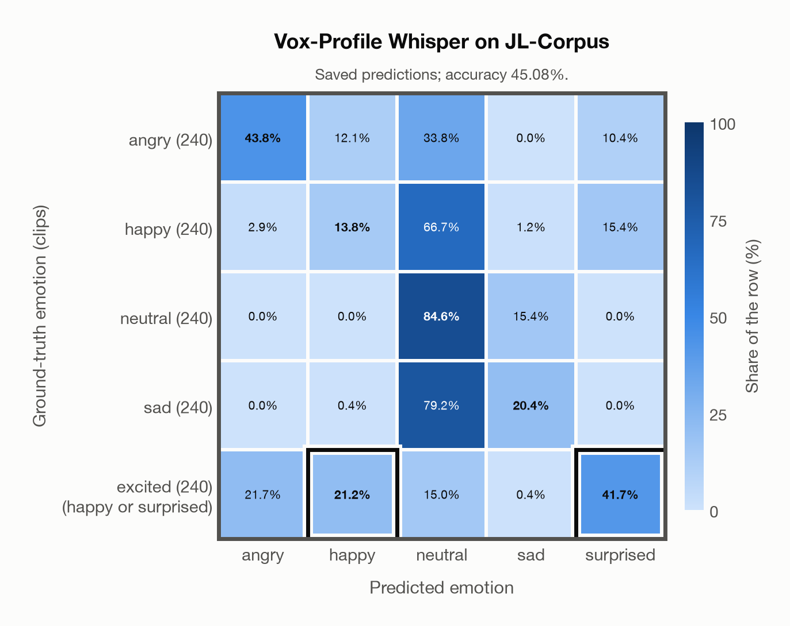

# Vox-Profile Whisper on JL-Corpus

Regenerated offline from saved CSV/JSON by `scripts/evaluation/refresh_reports.py`. This refresh performs no model inference or API requests.

## Summary

| Metric | Recomputed value |
|---|---:|
| Clips | 1,200 |
| Accuracy: acted emotion | 45.08% |
| UAR: mean ground-truth-row recall | 45.08% |
| Macro F1 | 47.33% |
| Weighted F1: true-support weighted | 42.39% |
| Accuracy: all model classes | 43.58% |

## Imported run and verification

- Source: [prediction CSV](../../outputs/vox_profile_whisper/jl_corpus_predictions.csv) and [metadata JSON](../../outputs/vox_profile_whisper/jl_corpus_predictions.json); both remain byte-for-byte unchanged.
- Original execution date recorded in JSON: `2026-10-29`.
- Dataset scope recorded in JSON: **JL-Corpus**, English (New Zealand); 1,200 / 1,200 clips.
- Ground-truth column: `acted_emotion`. Candidate classes: angry, happy, neutral, sad, surprised.
- Row counts, unique audio paths, correctness flags and saved metrics were checked against the CSV. Metric agreement tolerance is 0.000001 (six-decimal metadata).
- Weighted F1 weights each class's F1 by its true support, using the same resolved truth as macro F1; invalid answers remain errors. New metrics absent from the source JSON are recorded in the offline audit and summaries; the source JSON is preserved.
- Original execution/client runtime metadata (reported by the imported run, not measured by this refresh): `{"device": "mps", "hardware": "Apple M4 Max", "seconds": 240.9, "ms_per_clip": 200.8, "on_cpu": 0}`.
- Composite labels follow the existing accepted-label rule: excited accepts happy or surprised. F1 resolves a correct composite to the predicted class, otherwise to its first accepted class. Weighted F1 uses the resulting resolved-truth support, which can depend on the predictions.

## Results per emotion

| Ground-truth emotion | Clips | Recall | Acted-or-listener recall |
|---|---:|---:|---:|
| angry | 240 | 43.75% | — |
| happy | 240 | 13.75% | — |
| neutral | 240 | 84.58% | — |
| sad | 240 | 20.42% | — |
| excited (happy or surprised) | 240 | 62.92% | — |

Precision/F1 use the same resolved-truth convention as the evaluation script. Weighted F1 uses the resolved-truth clip counts below as weights.

| Predicted emotion | Resolved-truth clips | Precision | Recall | F1 |
|---|---:|---:|---:|---:|
| angry | 240 | 64.02% | 43.75% | 51.98% |
| happy | 380 | 73.68% | 22.11% | 34.01% |
| neutral | 240 | 30.30% | 84.58% | 44.62% |
| sad | 240 | 54.44% | 20.42% | 29.70% |
| surprised | 100 | 61.73% | 100.00% | 76.34% |

## Confusion matrix: acted emotion

| Ground truth \ Predicted | angry | happy | neutral | sad | surprised |
|---|---|---|---|---|---|
| angry (240) | **43.8%** | 12.1% | 33.8% | 0.0% | 10.4% |
| happy (240) | 2.9% | **13.8%** | 66.7% | 1.2% | 15.4% |
| neutral (240) | 0.0% | 0.0% | **84.6%** | 15.4% | 0.0% |
| sad (240) | 0.0% | 0.4% | 79.2% | **20.4%** | 0.0% |
| excited (happy or surprised) (240) | 21.7% | **21.2%** | 15.0% | 0.4% | **41.7%** |

## Caveats

- **Training involvement for Vox-Profile Whisper: No corpus-specific evidence**. Source: SER adaptation on MSP-Podcast v1.12; retained Whisper-large-v3 pretraining sources incompletely disclosed. Direct use and upstream teacher use both count as training involvement. No pattern: no corpus-specific evidence, not verified unseen. Corpus use is not test-clip leakage.
- Internal CSV/JSON consistency does not authenticate the original model or remote request logs.

[Offline validation audit](jl_corpus_offline_audit.json)
