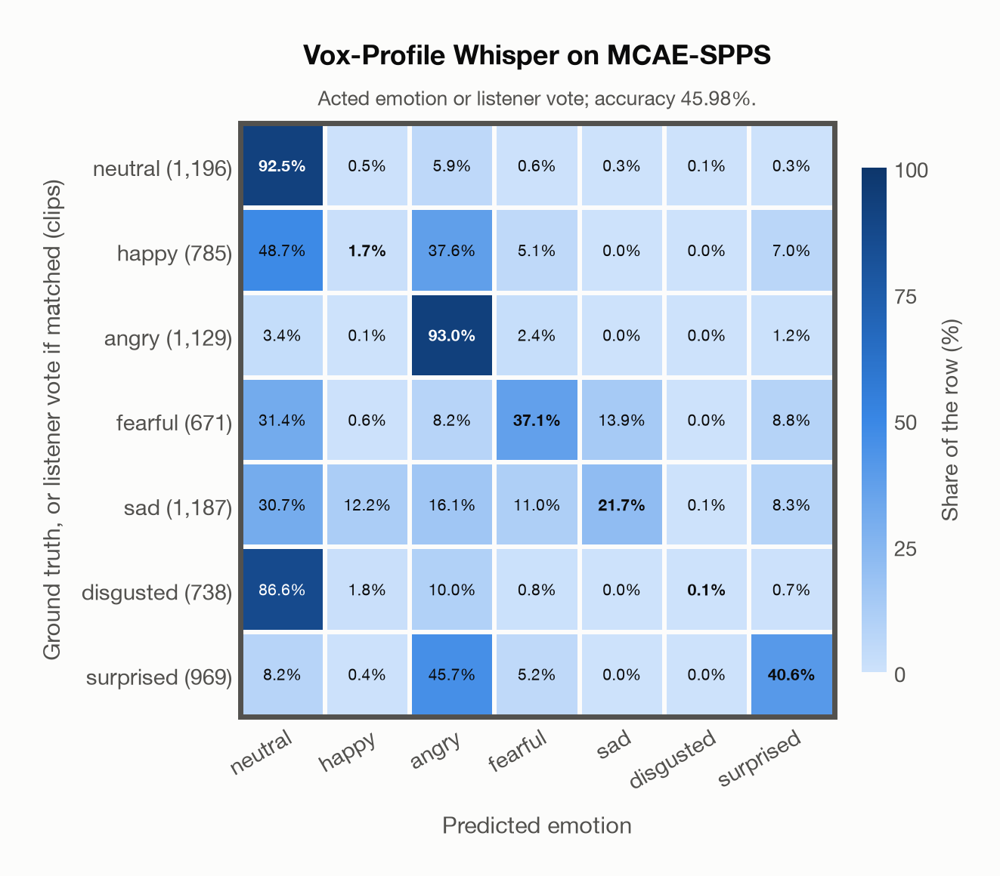

# Vox-Profile Whisper on MCAE-SPPS

Regenerated offline from saved CSV/JSON by `scripts/evaluation/refresh_reports.py`. This refresh performs no model inference or API requests.

## Summary

| Metric | Recomputed value |
|---|---:|
| Clips | 6,675 |
| Accuracy: acted emotion | 45.98% |
| UAR: mean ground-truth-row recall | 40.94% |
| Macro F1 | 35.20% |
| Weighted F1: true-support weighted | 38.28% |
| Accuracy: all model classes | 45.98% |
| Accuracy: acted emotion or listener vote | 45.98% |
| Single listener vote vs acted emotion | 100.00% |
| Model vs single listener vote | 45.98% |

## Imported run and verification

- Source: [prediction CSV](../../outputs/vox_profile_whisper/mcae_spps_predictions.csv) and [metadata JSON](../../outputs/vox_profile_whisper/mcae_spps_predictions.json); both remain byte-for-byte unchanged.
- Original execution date recorded in JSON: `2026-10-29`.
- Dataset scope recorded in JSON: **MCAE-SPPS**, Mandarin; 6,675 / 6,675 clips.
- Ground-truth column: `acted_emotion`. Candidate classes: neutral, happy, angry, fearful, sad, disgusted, surprised.
- Row counts, unique audio paths, correctness flags and saved metrics were checked against the CSV. Metric agreement tolerance is 0.000001 (six-decimal metadata).
- Weighted F1 weights each class's F1 by its true support, using the same resolved truth as macro F1; invalid answers remain errors. New metrics absent from the source JSON are recorded in the offline audit and summaries; the source JSON is preserved.
- Original execution/client runtime metadata (reported by the imported run, not measured by this refresh): `{"device": "mps", "hardware": "Apple M4 Max", "seconds": 1351.1, "ms_per_clip": 202.4, "on_cpu": 0}`.

## Results per emotion

| Ground-truth emotion | Clips | Recall | Acted-or-listener recall |
|---|---:|---:|---:|
| neutral | 1,196 | 92.47% | 92.47% |
| happy | 785 | 1.66% | 1.66% |
| angry | 1,129 | 93.00% | 93.00% |
| fearful | 671 | 37.11% | 37.11% |
| sad | 1,187 | 21.65% | 21.65% |
| disgusted | 738 | 0.14% | 0.14% |
| surprised | 969 | 40.56% | 40.56% |

Precision/F1 use the same resolved-truth convention as the evaluation script. Weighted F1 uses the resolved-truth clip counts below as weights.

| Predicted emotion | Resolved-truth clips | Precision | Recall | F1 |
|---|---:|---:|---:|---:|
| neutral | 1,196 | 39.23% | 92.47% | 55.09% |
| happy | 785 | 6.99% | 1.66% | 2.68% |
| angry | 1,129 | 48.21% | 93.00% | 63.50% |
| fearful | 671 | 48.92% | 37.11% | 42.20% |
| sad | 1,187 | 72.80% | 21.65% | 33.38% |
| disgusted | 738 | 33.33% | 0.14% | 0.27% |
| surprised | 969 | 62.68% | 40.56% | 49.25% |

## Confusion matrix: acted emotion

| Ground truth \ Predicted | neutral | happy | angry | fearful | sad | disgusted | surprised |
|---|---|---|---|---|---|---|---|
| neutral (1,196) | **92.5%** | 0.5% | 5.9% | 0.6% | 0.3% | 0.1% | 0.3% |
| happy (785) | 48.7% | **1.7%** | 37.6% | 5.1% | 0.0% | 0.0% | 7.0% |
| angry (1,129) | 3.4% | 0.1% | **93.0%** | 2.4% | 0.0% | 0.0% | 1.2% |
| fearful (671) | 31.4% | 0.6% | 8.2% | **37.1%** | 13.9% | 0.0% | 8.8% |
| sad (1,187) | 30.7% | 12.2% | 16.1% | 11.0% | **21.7%** | 0.1% | 8.3% |
| disgusted (738) | 86.6% | 1.8% | 10.0% | 0.8% | 0.0% | **0.1%** | 0.7% |
| surprised (969) | 8.2% | 0.4% | 45.7% | 5.2% | 0.0% | 0.0% | **40.6%** |

## Confusion matrix: acted emotion or listener vote

A prediction accepted only through the listener vote is placed in that predicted emotion's row; other clips keep their original ground-truth row. Row supports can therefore change.

| Ground truth \ Predicted | neutral | happy | angry | fearful | sad | disgusted | surprised |
|---|---|---|---|---|---|---|---|
| neutral (1,196) | **92.5%** | 0.5% | 5.9% | 0.6% | 0.3% | 0.1% | 0.3% |
| happy (785) | 48.7% | **1.7%** | 37.6% | 5.1% | 0.0% | 0.0% | 7.0% |
| angry (1,129) | 3.4% | 0.1% | **93.0%** | 2.4% | 0.0% | 0.0% | 1.2% |
| fearful (671) | 31.4% | 0.6% | 8.2% | **37.1%** | 13.9% | 0.0% | 8.8% |
| sad (1,187) | 30.7% | 12.2% | 16.1% | 11.0% | **21.7%** | 0.1% | 8.3% |
| disgusted (738) | 86.6% | 1.8% | 10.0% | 0.8% | 0.0% | **0.1%** | 0.7% |
| surprised (969) | 8.2% | 0.4% | 45.7% | 5.2% | 0.0% | 0.0% | **40.6%** |

## Caveats

- **Training involvement for Vox-Profile Whisper: No corpus-specific evidence**. Source: SER adaptation on MSP-Podcast v1.12; retained Whisper-large-v3 pretraining sources incompletely disclosed. Direct use and upstream teacher use both count as training involvement. No pattern: no corpus-specific evidence, not verified unseen. Corpus use is not test-clip leakage.
- Internal CSV/JSON consistency does not authenticate the original model or remote request logs.

[Offline validation audit](mcae_spps_offline_audit.json)
