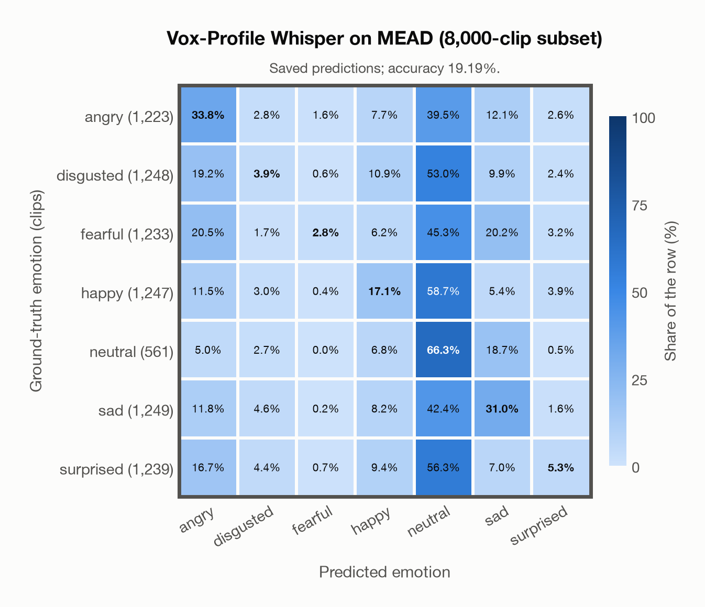

# Vox-Profile Whisper on MEAD (8,000-clip subset)

Regenerated offline from saved CSV/JSON by `scripts/evaluation/refresh_reports.py`. This refresh performs no model inference or API requests.

## Summary

| Metric | Recomputed value |
|---|---:|
| Clips | 8,000 |
| Accuracy: acted emotion | 19.19% |
| UAR: mean ground-truth-row recall | 22.89% |
| Macro F1 | 17.30% |
| Weighted F1: true-support weighted | 17.38% |
| Accuracy: all model classes | 18.16% |

## Imported run and verification

- Source: [prediction CSV](../../outputs/vox_profile_whisper/mead_predictions.csv) and [metadata JSON](../../outputs/vox_profile_whisper/mead_predictions.json); both remain byte-for-byte unchanged.
- Original execution date recorded in JSON: `2026-11-06`.
- Dataset scope recorded in JSON: **MEAD (8,000-clip subset)**, English; 8,000 / 8,000 clips.
- Ground-truth column: `acted_emotion`. Candidate classes: angry, disgusted, fearful, happy, neutral, sad, surprised.
- Row counts, unique audio paths, correctness flags and saved metrics were checked against the CSV. Metric agreement tolerance is 0.000001 (six-decimal metadata).
- Weighted F1 weights each class's F1 by its true support, using the same resolved truth as macro F1; invalid answers remain errors. New metrics absent from the source JSON are recorded in the offline audit and summaries; the source JSON is preserved.
- Original execution/client runtime metadata (reported by the imported run, not measured by this refresh): `{"device": "mps", "hardware": "Apple M4 Max", "seconds": 1762.7, "ms_per_clip": 220.3, "on_cpu": 0}`.

## Results per emotion

| Ground-truth emotion | Clips | Recall | Acted-or-listener recall |
|---|---:|---:|---:|
| angry | 1,223 | 33.77% | — |
| disgusted | 1,248 | 3.93% | — |
| fearful | 1,233 | 2.84% | — |
| happy | 1,247 | 17.08% | — |
| neutral | 561 | 66.31% | — |
| sad | 1,249 | 30.98% | — |
| surprised | 1,239 | 5.33% | — |

Precision/F1 use the same resolved-truth convention as the evaluation script. Weighted F1 uses the resolved-truth clip counts below as weights.

| Predicted emotion | Resolved-truth clips | Precision | Recall | F1 |
|---|---:|---:|---:|---:|
| angry | 1,223 | 28.82% | 33.77% | 31.10% |
| disgusted | 1,248 | 18.22% | 3.93% | 6.46% |
| fearful | 1,233 | 44.87% | 2.84% | 5.34% |
| happy | 1,247 | 27.41% | 17.08% | 21.05% |
| neutral | 561 | 9.22% | 66.31% | 16.18% |
| sad | 1,249 | 33.16% | 30.98% | 32.04% |
| surprised | 1,239 | 27.50% | 5.33% | 8.92% |

## Confusion matrix: acted emotion

| Ground truth \ Predicted | angry | disgusted | fearful | happy | neutral | sad | surprised |
|---|---|---|---|---|---|---|---|
| angry (1,223) | **33.8%** | 2.8% | 1.6% | 7.7% | 39.5% | 12.1% | 2.6% |
| disgusted (1,248) | 19.2% | **3.9%** | 0.6% | 10.9% | 53.0% | 9.9% | 2.4% |
| fearful (1,233) | 20.5% | 1.7% | **2.8%** | 6.2% | 45.3% | 20.2% | 3.2% |
| happy (1,247) | 11.5% | 3.0% | 0.4% | **17.1%** | 58.7% | 5.4% | 3.9% |
| neutral (561) | 5.0% | 2.7% | 0.0% | 6.8% | **66.3%** | 18.7% | 0.5% |
| sad (1,249) | 11.8% | 4.6% | 0.2% | 8.2% | 42.4% | **31.0%** | 1.6% |
| surprised (1,239) | 16.7% | 4.4% | 0.7% | 9.4% | 56.3% | 7.0% | **5.3%** |

## Caveats

- **Training involvement for Vox-Profile Whisper: No corpus-specific evidence**. Source: SER adaptation on MSP-Podcast v1.12; retained Whisper-large-v3 pretraining sources incompletely disclosed. Direct use and upstream teacher use both count as training involvement. No pattern: no corpus-specific evidence, not verified unseen. Corpus use is not test-clip leakage.
- Internal CSV/JSON consistency does not authenticate the original model or remote request logs.

[Offline validation audit](mead_offline_audit.json)
