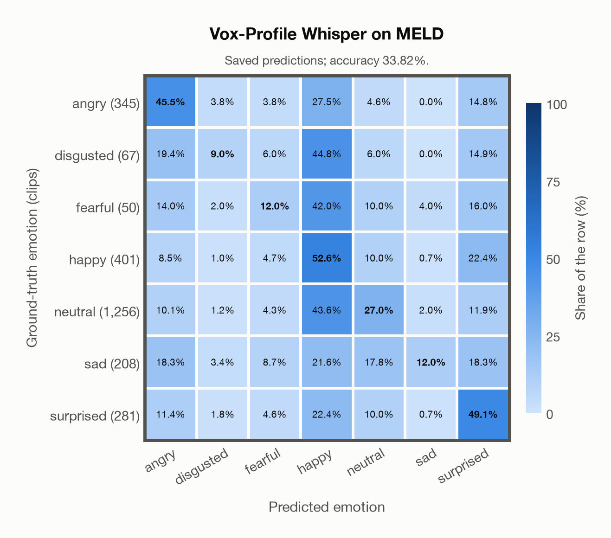

# Vox-Profile Whisper on MELD

Generated by `scripts/evaluation/evaluate.py` on 2026-11-06.

## Summary

| Metric | Value |
|---|---|
| Clips evaluated | 2,608 (English) |
| **Accuracy: prediction matches the acted emotion** | **33.8%** |
| Unweighted accuracy (mean recall of the 7 acted emotions) | 29.6% |
| Macro F1 (acted emotion) | 26.1% |
| Accuracy, all 9 model classes (acted emotion) | 32.6% |
| Chance level (7 emotions) | 14.3% |

## Setup

- **Model**: Vox-Profile Whisper (`tiantiaf/whisper-large-v3-msp-podcast-emotion`) as released (no fine-tuning), transformers 5.18.0, loaded by `scripts/models/vox_profile.py`. Each clip (at most 15 s) becomes Whisper log-mel features padded with silence to 15 s, the model's fixed input; the encoder output is averaged over the clip's own frames only, as in the official code. float32 on every device. The model card warns that clips shorter than 3 s give unreliable predictions (it was trained on clips of 3-15 s); clips are used as they are, not padded to 3 s.
- **Data**: 2,608 clips of MELD (English) from `data/meld/`.
- **Ground truth (acted emotion)**: the label of each utterance (`Emotion` in `test_sent_emo.csv`): the majority of three annotators who watched the video and read the transcript; the speakers were not asked to act an emotion.
- Label mapping: anger = angry, disgust = disgusted, fear = fearful, joy = happy, neutral = neutral, sadness = sad, surprise = surprised.
- Only the official **test split** (2,610 utterances of 280 dialogues): it is the standard split for reporting results, and the train and dev splits were used to train several of the models.
- Utterances from the TV series *Friends*, converted from the test videos to 16 kHz mono WAV by scripts/common/download_data.py. Left out: `dia38_utt4` (joy) and `dia220_utt0` (disgust), whose time stamps are wrong (each clip holds 4–5 minutes of the episode for one short line).
- **7 emotions**: the prediction is the most probable of the 7 emotions in this dataset (angry, disgusted, fearful, happy, neutral, sad, surprised); the model's other classes (`contempt`, `other`) are ignored. **All 9 model classes**: the prediction is the most probable of all 9 model classes, so choosing a class that the dataset does not have counts as wrong.
- **Hardware**: Apple M4 Max, device `mps`, PyTorch 2.7.1. Inference took 9.5 min (219 ms per clip).
- **Per-clip predictions**: `outputs/vox_profile_whisper/meld_predictions.csv` (in git, so the results can be checked clip by clip). The JSON file next to it describes the columns.

## Results per emotion

Rows: acted emotion. Precision, recall and F1 compare the prediction with the acted emotion.

| Emotion | Clips | Precision | Recall | F1 |
|---|---|---|---|---|
| angry | 345 | 38.5% | 45.5% | 41.7% |
| disgusted | 67 | 11.8% | 9.0% | 10.2% |
| fearful | 50 | 4.7% | 12.0% | 6.8% |
| happy | 401 | 20.8% | 52.6% | 29.9% |
| neutral | 1,256 | 72.3% | 27.0% | 39.3% |
| sad | 208 | 43.9% | 12.0% | 18.9% |
| surprised | 281 | 28.5% | 49.1% | 36.1% |

## Confusion matrix: acted emotion

The same numbers as a table. Rows: acted emotion. Columns: predicted emotion. Each row adds up to 100%.

| Acted \ Predicted | angry | disgusted | fearful | happy | neutral | sad | surprised |
|---|---|---|---|---|---|---|---|
| angry (345) | **45.5%** | 3.8% | 3.8% | 27.5% | 4.6% | 0.0% | 14.8% |
| disgusted (67) | 19.4% | **9.0%** | 6.0% | 44.8% | 6.0% | 0.0% | 14.9% |
| fearful (50) | 14.0% | 2.0% | **12.0%** | 42.0% | 10.0% | 4.0% | 16.0% |
| happy (401) | 8.5% | 1.0% | 4.7% | **52.6%** | 10.0% | 0.7% | 22.4% |
| neutral (1,256) | 10.1% | 1.2% | 4.3% | 43.6% | **27.0%** | 2.0% | 11.9% |
| sad (208) | 18.3% | 3.4% | 8.7% | 21.6% | 17.8% | **12.0%** | 18.3% |
| surprised (281) | 11.4% | 1.8% | 4.6% | 22.4% | 10.0% | 0.7% | **49.1%** |

Most frequent confusions: disgusted predicted as happy (44.8%), neutral predicted as happy (43.6%), fearful predicted as happy (42.0%).

## Predictions outside the 7 emotions

With all 9 model classes, the model chose a class that this dataset does not have for 117 clips (4.5%): `contempt` 91, `other` 26.

## Caveats

- **Training involvement for Vox-Profile Whisper: No corpus-specific evidence**. Source: SER adaptation on MSP-Podcast v1.12; retained Whisper-large-v3 pretraining sources incompletely disclosed. Direct use and upstream teacher use both count as training involvement. No pattern: no corpus-specific evidence, not verified unseen. Corpus use is not test-clip leakage.
- **In-the-wild speech with noisy labels.** The annotators saw the video and the transcript, not the voice alone, and agreed moderately (Fleiss' kappa 0.43); the classes are very unbalanced (48% neutral, 2% fear).
- Several speakers, laughter of the studio audience and background music can be heard in a clip; a third of the clips are shorter than 2 s.
- MELD's train split is in the training data of MERaLiON-SER-v1 and of EmoBox (emotion2vec+), so these models have heard the same speakers and show.
- The clips come from a copyrighted TV show (the authors rely on fair use); the repository is GPL-3.0.
