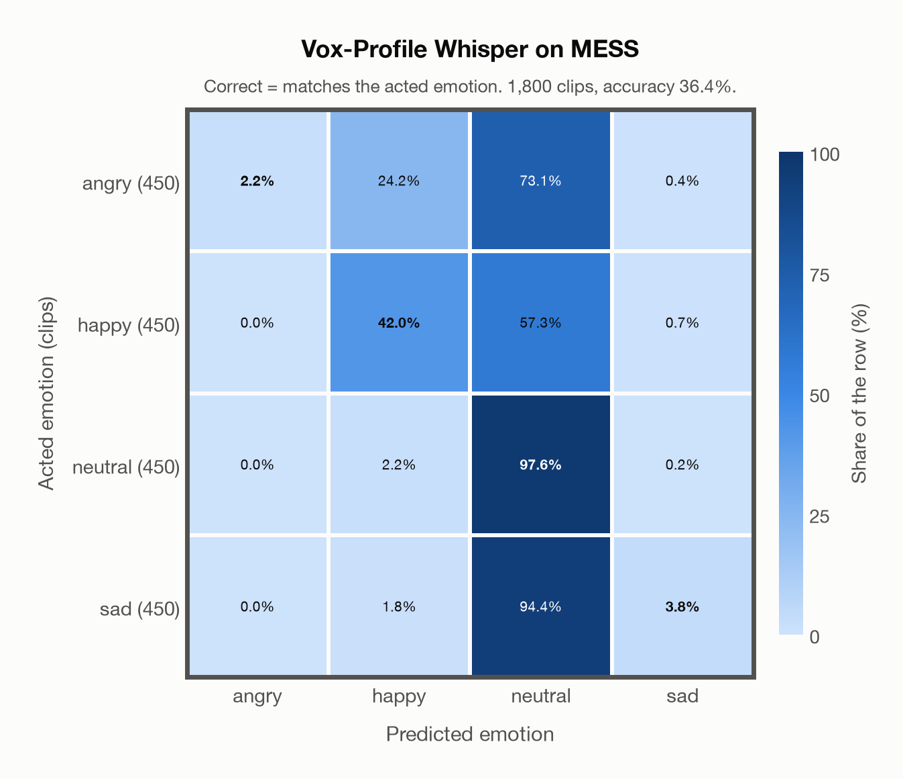

# Vox-Profile Whisper on MESS

Generated by `scripts/evaluation/evaluate.py` on 2026-10-29.

## Summary

| Metric | Value |
|---|---|
| Clips evaluated | 1,800 (English) |
| **Accuracy: prediction matches the acted emotion** | **36.4%** |
| Unweighted accuracy (mean recall of the 4 acted emotions) | 36.4% |
| Macro F1 (acted emotion) | 26.8% |
| Accuracy, all 9 model classes (acted emotion) | 35.8% |
| Chance level (4 emotions) | 25.0% |

## Setup

- **Model**: Vox-Profile Whisper (`tiantiaf/whisper-large-v3-msp-podcast-emotion`) as released (no fine-tuning), transformers 5.18.0, loaded by `scripts/models/vox_profile.py`. Each clip (at most 15 s) becomes Whisper log-mel features padded with silence to 15 s, the model's fixed input; the encoder output is averaged over the clip's own frames only, as in the official code. float32 on every device. The model card warns that clips shorter than 3 s give unreliable predictions (it was trained on clips of 3-15 s); clips are used as they are, not padded to 3 s.
- **Data**: 1,800 clips of MESS (English) from `data/mess/`.
- **Ground truth (acted emotion)**: the emotion each speaker was asked to portray, from the first letter of the file name (`A`ngry, `C`alm, `H`appy, `S`ad).
- Label mapping: angry = angry, happy = happy, sad = sad, and **calm = neutral** (the project's emotions have no *calm*).
- **4 emotions**: the prediction is the most probable of the 4 emotions in this dataset (angry, happy, neutral, sad); the model's other classes (`contempt`, `disgusted`, `fearful`, `surprised`, `other`) are ignored. **All 9 model classes**: the prediction is the most probable of all 9 model classes, so choosing a class that the dataset does not have counts as wrong.
- **Hardware**: Apple M4 Max, device `mps`, PyTorch 2.5.1. Inference took 6.2 min (208 ms per clip).
- **Per-clip predictions**: `outputs/vox_profile_whisper/mess_predictions.csv` (not in git; re-run the script to recreate it). The JSON file next to it describes the columns.

## Results per emotion

Rows: acted emotion. Precision, recall and F1 compare the prediction with the acted emotion.

| Emotion | Clips | Precision | Recall | F1 |
|---|---|---|---|---|
| angry | 450 | 100.0% | 2.2% | 4.3% |
| happy | 450 | 59.8% | 42.0% | 49.3% |
| neutral | 450 | 30.3% | 97.6% | 46.2% |
| sad | 450 | 73.9% | 3.8% | 7.2% |

## Confusion matrix: acted emotion

The same numbers as a table. Rows: acted emotion. Columns: predicted emotion. Each row adds up to 100%.

| Acted \ Predicted | angry | happy | neutral | sad |
|---|---|---|---|---|
| angry (450) | **2.2%** | 24.2% | 73.1% | 0.4% |
| happy (450) | 0.0% | **42.0%** | 57.3% | 0.7% |
| neutral (450) | 0.0% | 2.2% | **97.6%** | 0.2% |
| sad (450) | 0.0% | 1.8% | 94.4% | **3.8%** |

Most frequent confusions: sad predicted as neutral (94.4%), angry predicted as neutral (73.1%), happy predicted as neutral (57.3%).

## Predictions outside the 4 emotions

With all 9 model classes, the model chose a class that this dataset does not have for 55 clips (3.1%): `contempt` 15, `disgusted` 10, `fearful` 22, `surprised` 8, `other` 0.

## Caveats

- **Not in Vox-Profile Whisper's training data** (MSP-Podcast).
- *Calm* is not quite *neutral*: calm clips predicted as neutral count as correct.
- The public version has 1,800 clips and acted labels only; the listeners' ratings are available from the author on request. Audio is sampled at 24,414 Hz, resampled to 16 kHz.
