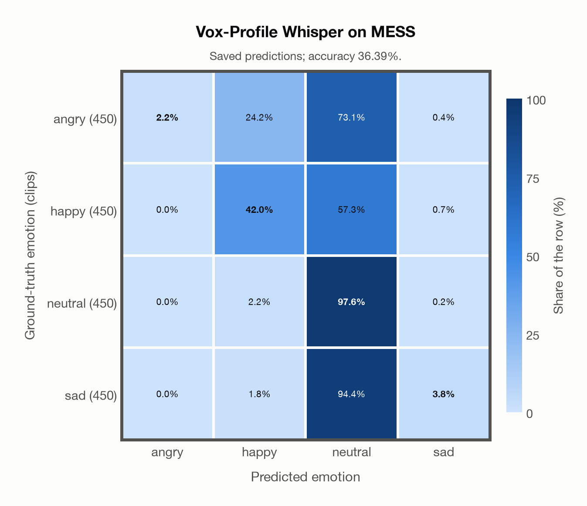

# Vox-Profile Whisper on MESS

Regenerated offline from saved CSV/JSON by `scripts/evaluation/refresh_reports.py`. This refresh performs no model inference or API requests.

## Summary

| Metric | Recomputed value |
|---|---:|
| Clips | 1,800 |
| Accuracy: acted emotion | 36.39% |
| UAR: mean ground-truth-row recall | 36.39% |
| Macro F1 | 26.77% |
| Weighted F1: true-support weighted | 26.77% |
| Accuracy: all model classes | 35.78% |

## Imported run and verification

- Source: [prediction CSV](../../outputs/vox_profile_whisper/mess_predictions.csv) and [metadata JSON](../../outputs/vox_profile_whisper/mess_predictions.json); both remain byte-for-byte unchanged.
- Original execution date recorded in JSON: `2026-10-29`.
- Dataset scope recorded in JSON: **MESS**, English; 1,800 / 1,800 clips.
- Ground-truth column: `acted_emotion`. Candidate classes: angry, happy, neutral, sad.
- Row counts, unique audio paths, correctness flags and saved metrics were checked against the CSV. Metric agreement tolerance is 0.000001 (six-decimal metadata).
- Weighted F1 weights each class's F1 by its true support, using the same resolved truth as macro F1; invalid answers remain errors. New metrics absent from the source JSON are recorded in the offline audit and summaries; the source JSON is preserved.
- Original execution/client runtime metadata (reported by the imported run, not measured by this refresh): `{"device": "mps", "hardware": "Apple M4 Max", "seconds": 373.9, "ms_per_clip": 207.7, "on_cpu": 0}`.

## Results per emotion

| Ground-truth emotion | Clips | Recall | Acted-or-listener recall |
|---|---:|---:|---:|
| angry | 450 | 2.22% | — |
| happy | 450 | 42.00% | — |
| neutral | 450 | 97.56% | — |
| sad | 450 | 3.78% | — |

Precision/F1 use the same resolved-truth convention as the evaluation script. Weighted F1 uses the resolved-truth clip counts below as weights.

| Predicted emotion | Resolved-truth clips | Precision | Recall | F1 |
|---|---:|---:|---:|---:|
| angry | 450 | 100.00% | 2.22% | 4.35% |
| happy | 450 | 59.81% | 42.00% | 49.35% |
| neutral | 450 | 30.25% | 97.56% | 46.19% |
| sad | 450 | 73.91% | 3.78% | 7.19% |

## Confusion matrix: acted emotion

| Ground truth \ Predicted | angry | happy | neutral | sad |
|---|---|---|---|---|
| angry (450) | **2.2%** | 24.2% | 73.1% | 0.4% |
| happy (450) | 0.0% | **42.0%** | 57.3% | 0.7% |
| neutral (450) | 0.0% | 2.2% | **97.6%** | 0.2% |
| sad (450) | 0.0% | 1.8% | 94.4% | **3.8%** |

## Caveats

- **Training involvement for Vox-Profile Whisper: No corpus-specific evidence**. Source: SER adaptation on MSP-Podcast v1.12; retained Whisper-large-v3 pretraining sources incompletely disclosed. Direct use and upstream teacher use both count as training involvement. No pattern: no corpus-specific evidence, not verified unseen. Corpus use is not test-clip leakage.
- Internal CSV/JSON consistency does not authenticate the original model or remote request logs.

[Offline validation audit](mess_offline_audit.json)
