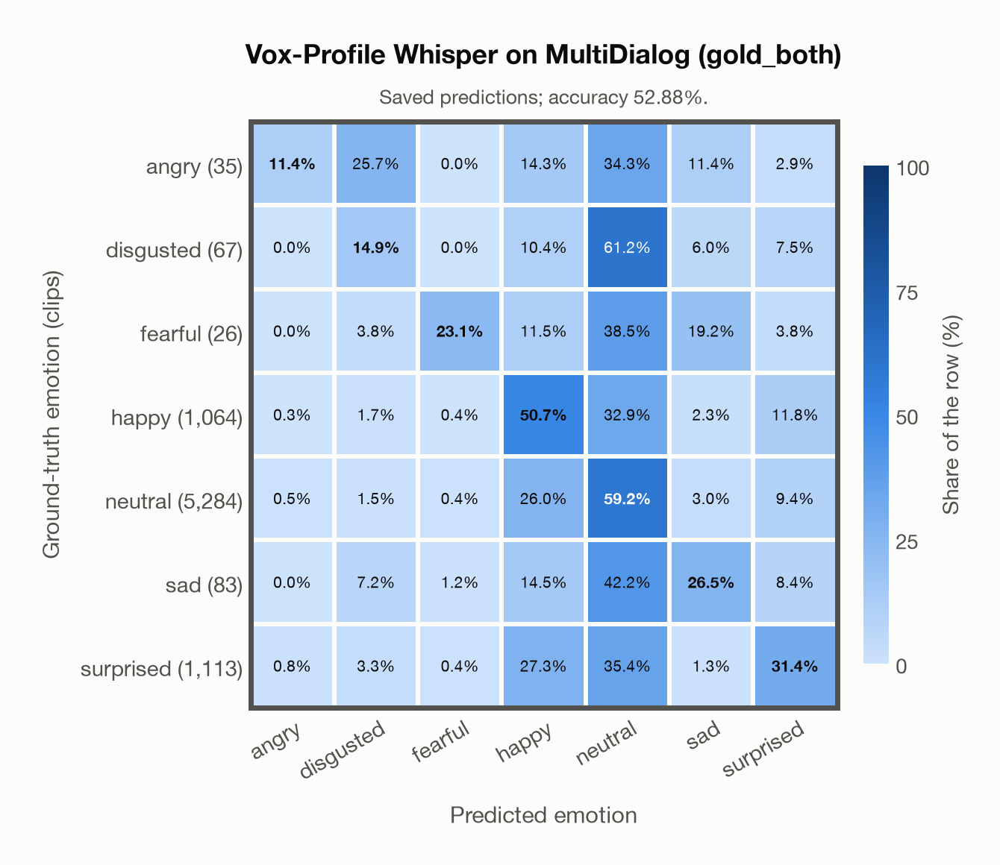

# Vox-Profile Whisper on MultiDialog (gold_both)

Regenerated offline from saved CSV/JSON by `scripts/evaluation/refresh_reports.py`. This refresh performs no model inference or API requests.

## Summary

| Metric | Recomputed value |
|---|---:|
| Clips | 7,672 |
| Accuracy: acted emotion | 52.88% |
| UAR: mean ground-truth-row recall | 31.02% |
| Macro F1 | 26.46% |
| Weighted F1: true-support weighted | 56.23% |
| Accuracy: all model classes | 52.06% |

## Imported run and verification

- Source: [prediction CSV](../../outputs/vox_profile_whisper/multidialog_predictions.csv) and [metadata JSON](../../outputs/vox_profile_whisper/multidialog_predictions.json); both remain byte-for-byte unchanged.
- Original execution date recorded in JSON: `2026-11-11`.
- Dataset scope recorded in JSON: **MultiDialog (gold_both)**, English; 7,672 / 7,672 clips.
- Ground-truth column: `acted_emotion`. Candidate classes: angry, disgusted, fearful, happy, neutral, sad, surprised.
- Row counts, unique audio paths, correctness flags and saved metrics were checked against the CSV. Metric agreement tolerance is 0.000001 (six-decimal metadata).
- Weighted F1 weights each class's F1 by its true support, using the same resolved truth as macro F1; invalid answers remain errors. New metrics absent from the source JSON are recorded in the offline audit and summaries; the source JSON is preserved.
- Original execution/client runtime metadata (reported by the imported run, not measured by this refresh): `{"device": "mps", "hardware": "Apple M3 Pro", "seconds": 3900.1, "ms_per_clip": 508.3, "on_cpu": 0}`.

## Results per emotion

| Ground-truth emotion | Clips | Recall | Acted-or-listener recall |
|---|---:|---:|---:|
| angry | 35 | 11.43% | — |
| disgusted | 67 | 14.93% | — |
| fearful | 26 | 23.08% | — |
| happy | 1,064 | 50.66% | — |
| neutral | 5,284 | 59.18% | — |
| sad | 83 | 26.51% | — |
| surprised | 1,113 | 31.36% | — |

Precision/F1 use the same resolved-truth convention as the evaluation script. Weighted F1 uses the resolved-truth clip counts below as weights.

| Predicted emotion | Resolved-truth clips | Precision | Recall | F1 |
|---|---:|---:|---:|---:|
| angry | 35 | 9.76% | 11.43% | 10.53% |
| disgusted | 67 | 6.33% | 14.93% | 8.89% |
| fearful | 26 | 15.38% | 23.08% | 18.46% |
| happy | 1,064 | 24.00% | 50.66% | 32.57% |
| neutral | 5,284 | 78.79% | 59.18% | 67.59% |
| sad | 83 | 9.48% | 26.51% | 13.97% |
| surprised | 1,113 | 35.36% | 31.36% | 33.24% |

## Confusion matrix: acted emotion

| Ground truth \ Predicted | angry | disgusted | fearful | happy | neutral | sad | surprised |
|---|---|---|---|---|---|---|---|
| angry (35) | **11.4%** | 25.7% | 0.0% | 14.3% | 34.3% | 11.4% | 2.9% |
| disgusted (67) | 0.0% | **14.9%** | 0.0% | 10.4% | 61.2% | 6.0% | 7.5% |
| fearful (26) | 0.0% | 3.8% | **23.1%** | 11.5% | 38.5% | 19.2% | 3.8% |
| happy (1,064) | 0.3% | 1.7% | 0.4% | **50.7%** | 32.9% | 2.3% | 11.8% |
| neutral (5,284) | 0.5% | 1.5% | 0.4% | 26.0% | **59.2%** | 3.0% | 9.4% |
| sad (83) | 0.0% | 7.2% | 1.2% | 14.5% | 42.2% | **26.5%** | 8.4% |
| surprised (1,113) | 0.8% | 3.3% | 0.4% | 27.3% | 35.4% | 1.3% | **31.4%** |

## Caveats

- **Training involvement for Vox-Profile Whisper: No corpus-specific evidence**. Source: SER adaptation on MSP-Podcast v1.12; retained Whisper-large-v3 pretraining sources incompletely disclosed. Direct use and upstream teacher use both count as training involvement. No pattern: no corpus-specific evidence, not verified unseen. Corpus use is not test-clip leakage.
- Internal CSV/JSON consistency does not authenticate the original model or remote request logs.

[Offline validation audit](multidialog_offline_audit.json)
