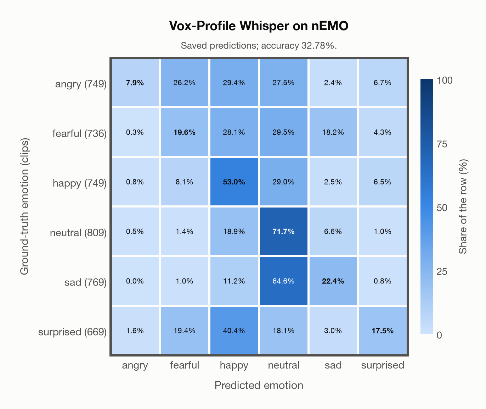

# Vox-Profile Whisper on nEMO

Generated by `scripts/evaluation/evaluate.py` on 2026-11-06.

## Summary

| Metric | Value |
|---|---|
| Clips evaluated | 4,481 (Polish) |
| **Accuracy: prediction matches the acted emotion** | **32.8%** |
| Unweighted accuracy (mean recall of the 6 acted emotions) | 32.0% |
| Macro F1 (acted emotion) | 28.8% |
| Accuracy, all 9 model classes (acted emotion) | 32.6% |
| Chance level (6 emotions) | 16.7% |

## Setup

- **Model**: Vox-Profile Whisper (`tiantiaf/whisper-large-v3-msp-podcast-emotion`) as released (no fine-tuning), transformers 5.18.0, loaded by `scripts/models/vox_profile.py`. Each clip (at most 15 s) becomes Whisper log-mel features padded with silence to 15 s, the model's fixed input; the encoder output is averaged over the clip's own frames only, as in the official code. float32 on every device. The model card warns that clips shorter than 3 s give unreliable predictions (it was trained on clips of 3-15 s); clips are used as they are, not padded to 3 s.
- **Data**: 4,481 clips of nEMO (Polish) from `data/nemo/`.
- **Ground truth (acted emotion)**: the emotion each speaker was asked to portray (`emotion`).
- Label mapping: anger = angry, fear = fearful, happiness = happy, sadness = sad, surprised = surprised, neutral = neutral.
- **6 emotions**: the prediction is the most probable of the 6 emotions in this dataset (angry, fearful, happy, neutral, sad, surprised); the model's other classes (`contempt`, `disgusted`, `other`) are ignored. **All 9 model classes**: the prediction is the most probable of all 9 model classes, so choosing a class that the dataset does not have counts as wrong.
- **Hardware**: Apple M4 Max, device `mps`, PyTorch 2.7.1. Inference took 15.2 min (203 ms per clip).
- **Per-clip predictions**: `outputs/vox_profile_whisper/nemo_predictions.csv` (in git, so the results can be checked clip by clip). The JSON file next to it describes the columns.

## Results per emotion

Rows: acted emotion. Precision, recall and F1 compare the prediction with the acted emotion.

| Emotion | Clips | Precision | Recall | F1 |
|---|---|---|---|---|
| angry | 749 | 72.0% | 7.9% | 14.2% |
| fearful | 736 | 26.2% | 19.6% | 22.4% |
| happy | 749 | 29.8% | 53.0% | 38.1% |
| neutral | 809 | 31.6% | 71.7% | 43.8% |
| sad | 769 | 41.3% | 22.4% | 29.0% |
| surprised | 669 | 44.7% | 17.5% | 25.1% |

## Confusion matrix: acted emotion

The same numbers as a table. Rows: acted emotion. Columns: predicted emotion. Each row adds up to 100%.

| Acted \ Predicted | angry | fearful | happy | neutral | sad | surprised |
|---|---|---|---|---|---|---|
| angry (749) | **7.9%** | 26.2% | 29.4% | 27.5% | 2.4% | 6.7% |
| fearful (736) | 0.3% | **19.6%** | 28.1% | 29.5% | 18.2% | 4.3% |
| happy (749) | 0.8% | 8.1% | **53.0%** | 29.0% | 2.5% | 6.5% |
| neutral (809) | 0.5% | 1.4% | 18.9% | **71.7%** | 6.6% | 1.0% |
| sad (769) | 0.0% | 1.0% | 11.2% | 64.6% | **22.4%** | 0.8% |
| surprised (669) | 1.6% | 19.4% | 40.4% | 18.1% | 3.0% | **17.5%** |

Most frequent confusions: sad predicted as neutral (64.6%), surprised predicted as happy (40.4%), fearful predicted as neutral (29.5%).

## Predictions outside the 6 emotions

With all 9 model classes, the model chose a class that this dataset does not have for 39 clips (0.9%): `contempt` 29, `disgusted` 9, `other` 1.

## Caveats

- **Training involvement for Vox-Profile Whisper: No corpus-specific evidence**. Source: SER adaptation on MSP-Podcast v1.12; retained Whisper-large-v3 pretraining sources incompletely disclosed. Direct use and upstream teacher use both count as training involvement. No pattern: no corpus-specific evidence, not verified unseen. Corpus use is not test-clip leakage.
- No listeners' labels are published: listeners only screened the recordings, so there is one way of counting a prediction as correct.
- Recorded at home (24 kHz); only 3 of the 9 speakers are professional voice actors.
