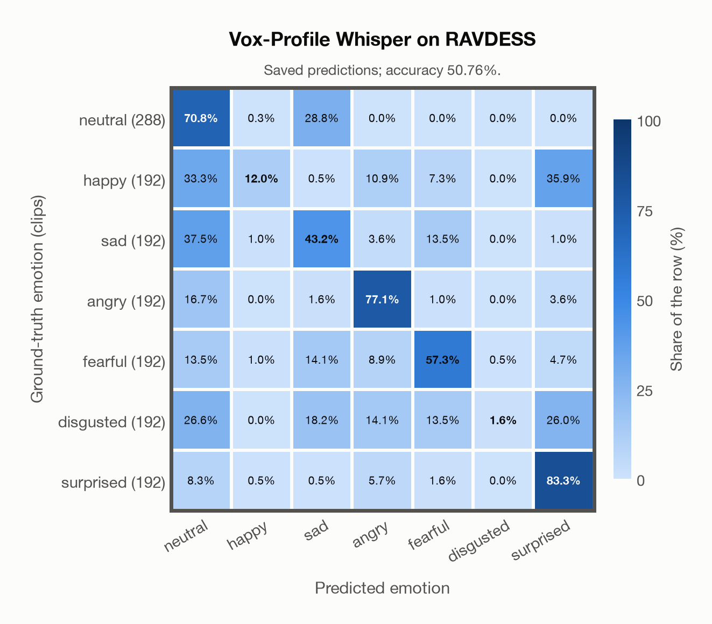

# Vox-Profile Whisper on RAVDESS

Regenerated offline from saved CSV/JSON by `scripts/evaluation/refresh_reports.py`. This refresh performs no model inference or API requests.

## Summary

| Metric | Recomputed value |
|---|---:|
| Clips | 1,440 |
| Accuracy: acted emotion | 50.76% |
| UAR: mean ground-truth-row recall | 49.33% |
| Macro F1 | 44.50% |
| Weighted F1: true-support weighted | 45.15% |
| Accuracy: all model classes | 50.62% |

## Imported run and verification

- Source: [prediction CSV](../../outputs/vox_profile_whisper/ravdess_predictions.csv) and [metadata JSON](../../outputs/vox_profile_whisper/ravdess_predictions.json); both remain byte-for-byte unchanged.
- Original execution date recorded in JSON: `2026-10-29`.
- Dataset scope recorded in JSON: **RAVDESS**, English; 1,440 / 1,440 clips.
- Ground-truth column: `acted_emotion`. Candidate classes: neutral, happy, sad, angry, fearful, disgusted, surprised.
- Row counts, unique audio paths, correctness flags and saved metrics were checked against the CSV. Metric agreement tolerance is 0.000001 (six-decimal metadata).
- Weighted F1 weights each class's F1 by its true support, using the same resolved truth as macro F1; invalid answers remain errors. New metrics absent from the source JSON are recorded in the offline audit and summaries; the source JSON is preserved.
- Original execution/client runtime metadata (reported by the imported run, not measured by this refresh): `{"device": "mps", "hardware": "Apple M4 Max", "seconds": 292.2, "ms_per_clip": 202.9, "on_cpu": 0}`.

## Results per emotion

| Ground-truth emotion | Clips | Recall | Acted-or-listener recall |
|---|---:|---:|---:|
| neutral | 288 | 70.83% | — |
| happy | 192 | 11.98% | — |
| sad | 192 | 43.23% | — |
| angry | 192 | 77.08% | — |
| fearful | 192 | 57.29% | — |
| disgusted | 192 | 1.56% | — |
| surprised | 192 | 83.33% | — |

Precision/F1 use the same resolved-truth convention as the evaluation script. Weighted F1 uses the resolved-truth clip counts below as weights.

| Predicted emotion | Resolved-truth clips | Precision | Recall | F1 |
|---|---:|---:|---:|---:|
| neutral | 288 | 43.87% | 70.83% | 54.18% |
| happy | 192 | 79.31% | 11.98% | 20.81% |
| sad | 192 | 35.62% | 43.23% | 39.06% |
| angry | 192 | 64.07% | 77.08% | 69.98% |
| fearful | 192 | 60.77% | 57.29% | 58.98% |
| disgusted | 192 | 75.00% | 1.56% | 3.06% |
| surprised | 192 | 53.87% | 83.33% | 65.44% |

## Confusion matrix: acted emotion

| Ground truth \ Predicted | neutral | happy | sad | angry | fearful | disgusted | surprised |
|---|---|---|---|---|---|---|---|
| neutral (288) | **70.8%** | 0.3% | 28.8% | 0.0% | 0.0% | 0.0% | 0.0% |
| happy (192) | 33.3% | **12.0%** | 0.5% | 10.9% | 7.3% | 0.0% | 35.9% |
| sad (192) | 37.5% | 1.0% | **43.2%** | 3.6% | 13.5% | 0.0% | 1.0% |
| angry (192) | 16.7% | 0.0% | 1.6% | **77.1%** | 1.0% | 0.0% | 3.6% |
| fearful (192) | 13.5% | 1.0% | 14.1% | 8.9% | **57.3%** | 0.5% | 4.7% |
| disgusted (192) | 26.6% | 0.0% | 18.2% | 14.1% | 13.5% | **1.6%** | 26.0% |
| surprised (192) | 8.3% | 0.5% | 0.5% | 5.7% | 1.6% | 0.0% | **83.3%** |

## Caveats

- **Training involvement for Vox-Profile Whisper: No corpus-specific evidence**. Source: SER adaptation on MSP-Podcast v1.12; retained Whisper-large-v3 pretraining sources incompletely disclosed. Direct use and upstream teacher use both count as training involvement. No pattern: no corpus-specific evidence, not verified unseen. Corpus use is not test-clip leakage.
- Internal CSV/JSON consistency does not authenticate the original model or remote request logs.

[Offline validation audit](ravdess_offline_audit.json)
