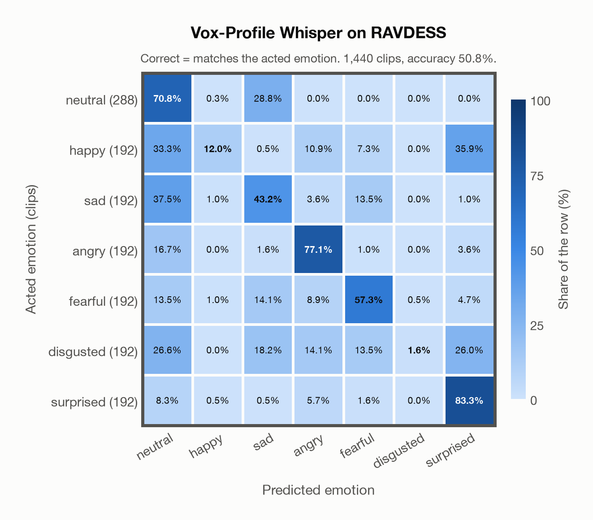

# Vox-Profile Whisper on RAVDESS

Generated by `scripts/evaluation/evaluate.py` on 2026-10-29.

## Summary

| Metric | Value |
|---|---|
| Clips evaluated | 1,440 (English) |
| **Accuracy: prediction matches the acted emotion** | **50.8%** |
| Unweighted accuracy (mean recall of the 7 acted emotions) | 49.3% |
| Macro F1 (acted emotion) | 44.5% |
| Accuracy, all 9 model classes (acted emotion) | 50.6% |
| Chance level (7 emotions) | 14.3% |

## Setup

- **Model**: Vox-Profile Whisper (`tiantiaf/whisper-large-v3-msp-podcast-emotion`) as released (no fine-tuning), transformers 5.18.0, loaded by `scripts/models/vox_profile.py`. Each clip (at most 15 s) becomes Whisper log-mel features padded with silence to 15 s, the model's fixed input; the encoder output is averaged over the clip's own frames only, as in the official code. float32 on every device. The model card warns that clips shorter than 3 s give unreliable predictions (it was trained on clips of 3-15 s); clips are used as they are, not padded to 3 s.
- **Data**: 1,440 clips of RAVDESS (English) from `data/ravdess/`.
- **Ground truth (acted emotion)**: the emotion each actor was asked to portray, from the third number in the file name (01 neutral, 02 calm, 03 happy, 04 sad, 05 angry, 06 fearful, 07 disgust, 08 surprised).
- Label mapping: neutral, happy, sad, angry, fearful and surprised keep their names; disgust = disgusted, and **calm = neutral** (the project's emotions have no *calm*), so neutral has 288 clips: 96 acted neutral and 192 acted calm.
- 24 professional actors (12 female, 12 male) say two sentences, "Kids are talking by the door" and "Dogs are sitting by the door", twice in each emotion, at two intensities (normal and strong) except for neutral.
- **7 emotions**: the prediction is the most probable of the 7 emotions in this dataset (neutral, happy, sad, angry, fearful, disgusted, surprised); the model's other classes (`contempt`, `other`) are ignored. **All 9 model classes**: the prediction is the most probable of all 9 model classes, so choosing a class that the dataset does not have counts as wrong.
- **Hardware**: Apple M4 Max, device `mps`, PyTorch 2.5.1. Inference took 4.9 min (203 ms per clip).
- **Per-clip predictions**: `outputs/vox_profile_whisper/ravdess_predictions.csv` (in git, so the results can be checked clip by clip). The JSON file next to it describes the columns.

## Results per emotion

Rows: acted emotion. Precision, recall and F1 compare the prediction with the acted emotion.

| Emotion | Clips | Precision | Recall | F1 |
|---|---|---|---|---|
| neutral | 288 | 43.9% | 70.8% | 54.2% |
| happy | 192 | 79.3% | 12.0% | 20.8% |
| sad | 192 | 35.6% | 43.2% | 39.1% |
| angry | 192 | 64.1% | 77.1% | 70.0% |
| fearful | 192 | 60.8% | 57.3% | 59.0% |
| disgusted | 192 | 75.0% | 1.6% | 3.1% |
| surprised | 192 | 53.9% | 83.3% | 65.4% |

## Confusion matrix: acted emotion

The same numbers as a table. Rows: acted emotion. Columns: predicted emotion. Each row adds up to 100%.

| Acted \ Predicted | neutral | happy | sad | angry | fearful | disgusted | surprised |
|---|---|---|---|---|---|---|---|
| neutral (288) | **70.8%** | 0.3% | 28.8% | 0.0% | 0.0% | 0.0% | 0.0% |
| happy (192) | 33.3% | **12.0%** | 0.5% | 10.9% | 7.3% | 0.0% | 35.9% |
| sad (192) | 37.5% | 1.0% | **43.2%** | 3.6% | 13.5% | 0.0% | 1.0% |
| angry (192) | 16.7% | 0.0% | 1.6% | **77.1%** | 1.0% | 0.0% | 3.6% |
| fearful (192) | 13.5% | 1.0% | 14.1% | 8.9% | **57.3%** | 0.5% | 4.7% |
| disgusted (192) | 26.6% | 0.0% | 18.2% | 14.1% | 13.5% | **1.6%** | 26.0% |
| surprised (192) | 8.3% | 0.5% | 0.5% | 5.7% | 1.6% | 0.0% | **83.3%** |

Most frequent confusions: sad predicted as neutral (37.5%), happy predicted as surprised (35.9%), happy predicted as neutral (33.3%).

## Predictions outside the 7 emotions

With all 9 model classes, the model chose a class that this dataset does not have for 11 clips (0.8%): `contempt` 11, `other` 0.

## Caveats

- **Not in Vox-Profile Whisper's training data** (MSP-Podcast).
- *Calm* is not quite *neutral*: calm clips predicted as neutral count as correct.
- Listeners rated every file 10 times (247 listeners). The paper publishes their ratings as recognition rates per file, not as a vote for an emotion, so this report has no listeners' labels.
- Audio: 48 kHz WAV, resampled to 16 kHz; 5 files are stereo, and their channels are averaged.
