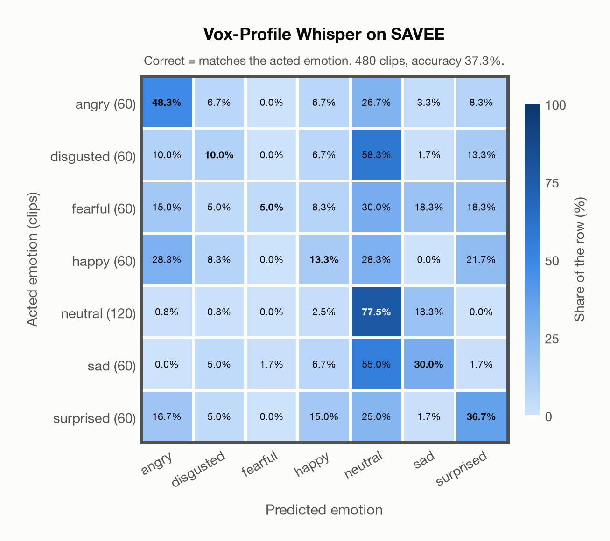

# Vox-Profile Whisper on SAVEE

Generated by `scripts/evaluation/evaluate.py` on 2026-11-06.

## Summary

| Metric | Value |
|---|---|
| Clips evaluated | 480 (English (British)) |
| **Accuracy: prediction matches the acted emotion** | **37.3%** |
| Unweighted accuracy (mean recall of the 7 acted emotions) | 31.5% |
| Macro F1 (acted emotion) | 29.4% |
| Accuracy, all 9 model classes (acted emotion) | 36.2% |
| Chance level (7 emotions) | 14.3% |

## Setup

- **Model**: Vox-Profile Whisper (`tiantiaf/whisper-large-v3-msp-podcast-emotion`) as released (no fine-tuning), transformers 5.18.0, loaded by `scripts/models/vox_profile.py`. Each clip (at most 15 s) becomes Whisper log-mel features padded with silence to 15 s, the model's fixed input; the encoder output is averaged over the clip's own frames only, as in the official code. float32 on every device. The model card warns that clips shorter than 3 s give unreliable predictions (it was trained on clips of 3-15 s); clips are used as they are, not padded to 3 s.
- **Data**: 480 clips of SAVEE (English (British)) from `data/savee/`.
- **Ground truth (acted emotion)**: the emotion each actor was asked to portray, from the letters after the speaker in the file name (`a`nger, `d`isgust, `f`ear, `h`appiness, `n`eutral, `sa`dness, `su`rprise).
- Label mapping: anger = angry, disgust = disgusted, fear = fearful, happiness = happy, neutral = neutral, sadness = sad, surprise = surprised.
- 4 male speakers (DC, JE, JK, KL) say 15 sentences in each emotion (only 3 of them are the same in every emotion) and 30 in neutral: 480 clips. Audio: 44.1 kHz mono WAV, resampled to 16 kHz.
- **7 emotions**: the prediction is the most probable of the 7 emotions in this dataset (angry, disgusted, fearful, happy, neutral, sad, surprised); the model's other classes (`contempt`, `other`) are ignored. **All 9 model classes**: the prediction is the most probable of all 9 model classes, so choosing a class that the dataset does not have counts as wrong.
- **Hardware**: Apple M4 Max, device `mps`, PyTorch 2.7.1. Inference took 1.9 min (234 ms per clip).
- **Per-clip predictions**: `outputs/vox_profile_whisper/savee_predictions.csv` (in git, so the results can be checked clip by clip). The JSON file next to it describes the columns.

## Results per emotion

Rows: acted emotion. Precision, recall and F1 compare the prediction with the acted emotion.

| Emotion | Clips | Precision | Recall | F1 |
|---|---|---|---|---|
| angry | 60 | 40.3% | 48.3% | 43.9% |
| disgusted | 60 | 24.0% | 10.0% | 14.1% |
| fearful | 60 | 75.0% | 5.0% | 9.4% |
| happy | 60 | 21.6% | 13.3% | 16.5% |
| neutral | 120 | 41.0% | 77.5% | 53.6% |
| sad | 60 | 32.7% | 30.0% | 31.3% |
| surprised | 60 | 36.7% | 36.7% | 36.7% |

## Confusion matrix: acted emotion

The same numbers as a table. Rows: acted emotion. Columns: predicted emotion. Each row adds up to 100%.

| Acted \ Predicted | angry | disgusted | fearful | happy | neutral | sad | surprised |
|---|---|---|---|---|---|---|---|
| angry (60) | **48.3%** | 6.7% | 0.0% | 6.7% | 26.7% | 3.3% | 8.3% |
| disgusted (60) | 10.0% | **10.0%** | 0.0% | 6.7% | 58.3% | 1.7% | 13.3% |
| fearful (60) | 15.0% | 5.0% | **5.0%** | 8.3% | 30.0% | 18.3% | 18.3% |
| happy (60) | 28.3% | 8.3% | 0.0% | **13.3%** | 28.3% | 0.0% | 21.7% |
| neutral (120) | 0.8% | 0.8% | 0.0% | 2.5% | **77.5%** | 18.3% | 0.0% |
| sad (60) | 0.0% | 5.0% | 1.7% | 6.7% | 55.0% | **30.0%** | 1.7% |
| surprised (60) | 16.7% | 5.0% | 0.0% | 15.0% | 25.0% | 1.7% | **36.7%** |

Most frequent confusions: disgusted predicted as neutral (58.3%), sad predicted as neutral (55.0%), fearful predicted as neutral (30.0%).

## Predictions outside the 7 emotions

With all 9 model classes, the model chose a class that this dataset does not have for 13 clips (2.7%): `contempt` 13, `other` 0.

## Caveats

- **Not in Vox-Profile Whisper's training data** (MSP-Podcast).
- **Unofficial copy.** The official corpus is free for research after registration and its licence forbids redistribution; the files come from an unofficial copy on Kaggle (ejlok1/surrey-audiovisual-expressed-emotion-savee), checked only against the file names and counts of the corpus.
- Only 4 speakers, all male. 10 evaluators validated the recordings originally; their results per clip are not published, so there is one way of counting a prediction as correct.
- Most sentences differ between emotions, and some of them are emotion-specific, so their words can hint at the emotion.
- SAVEE is in EmoBox, so it is in the training data of emotion2vec+.
