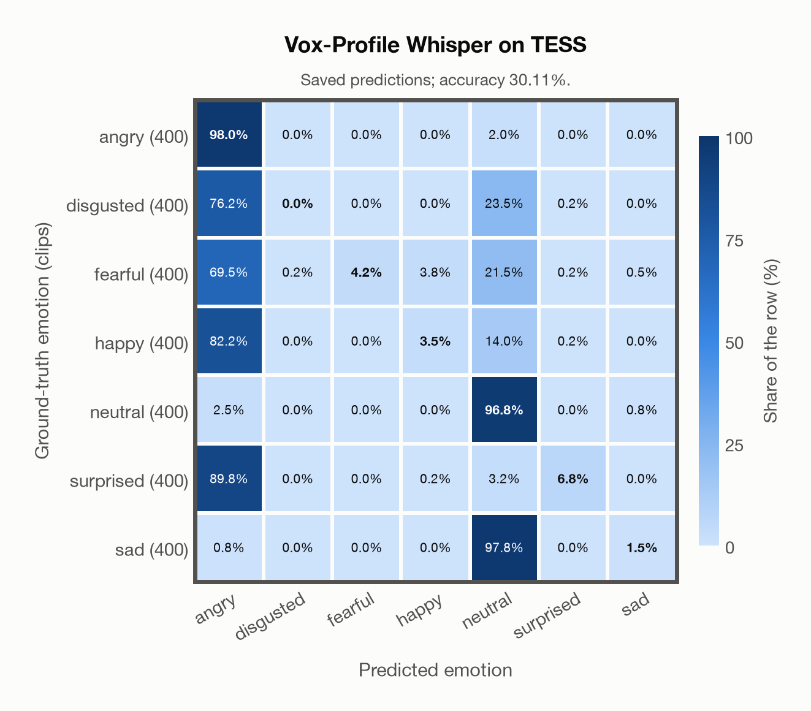

# Vox-Profile Whisper on TESS

Regenerated offline from saved CSV/JSON by `scripts/evaluation/refresh_reports.py`. This refresh performs no model inference or API requests.

## Summary

| Metric | Recomputed value |
|---|---:|
| Clips | 2,800 |
| Accuracy: acted emotion | 30.11% |
| UAR: mean ground-truth-row recall | 30.11% |
| Macro F1 | 17.41% |
| Weighted F1: true-support weighted | 17.41% |
| Accuracy: all model classes | 29.93% |

## Imported run and verification

- Source: [prediction CSV](../../outputs/vox_profile_whisper/tess_predictions.csv) and [metadata JSON](../../outputs/vox_profile_whisper/tess_predictions.json); both remain byte-for-byte unchanged.
- Original execution date recorded in JSON: `2026-10-29`.
- Dataset scope recorded in JSON: **TESS**, English; 2,800 / 2,800 clips.
- Ground-truth column: `acted_emotion`. Candidate classes: angry, disgusted, fearful, happy, neutral, surprised, sad.
- Row counts, unique audio paths, correctness flags and saved metrics were checked against the CSV. Metric agreement tolerance is 0.000001 (six-decimal metadata).
- Weighted F1 weights each class's F1 by its true support, using the same resolved truth as macro F1; invalid answers remain errors. New metrics absent from the source JSON are recorded in the offline audit and summaries; the source JSON is preserved.
- Original execution/client runtime metadata (reported by the imported run, not measured by this refresh): `{"device": "mps", "hardware": "Apple M4 Max", "seconds": 580.1, "ms_per_clip": 207.2, "on_cpu": 0}`.

## Results per emotion

| Ground-truth emotion | Clips | Recall | Acted-or-listener recall |
|---|---:|---:|---:|
| angry | 400 | 98.00% | — |
| disgusted | 400 | 0.00% | — |
| fearful | 400 | 4.25% | — |
| happy | 400 | 3.50% | — |
| neutral | 400 | 96.75% | — |
| surprised | 400 | 6.75% | — |
| sad | 400 | 1.50% | — |

Precision/F1 use the same resolved-truth convention as the evaluation script. Weighted F1 uses the resolved-truth clip counts below as weights.

| Predicted emotion | Resolved-truth clips | Precision | Recall | F1 |
|---|---:|---:|---:|---:|
| angry | 400 | 23.39% | 98.00% | 37.76% |
| disgusted | 400 | 0.00% | 0.00% | 0.00% |
| fearful | 400 | 100.00% | 4.25% | 8.15% |
| happy | 400 | 46.67% | 3.50% | 6.51% |
| neutral | 400 | 37.39% | 96.75% | 53.94% |
| surprised | 400 | 90.00% | 6.75% | 12.56% |
| sad | 400 | 54.55% | 1.50% | 2.92% |

## Confusion matrix: acted emotion

| Ground truth \ Predicted | angry | disgusted | fearful | happy | neutral | surprised | sad |
|---|---|---|---|---|---|---|---|
| angry (400) | **98.0%** | 0.0% | 0.0% | 0.0% | 2.0% | 0.0% | 0.0% |
| disgusted (400) | 76.2% | **0.0%** | 0.0% | 0.0% | 23.5% | 0.2% | 0.0% |
| fearful (400) | 69.5% | 0.2% | **4.2%** | 3.8% | 21.5% | 0.2% | 0.5% |
| happy (400) | 82.2% | 0.0% | 0.0% | **3.5%** | 14.0% | 0.2% | 0.0% |
| neutral (400) | 2.5% | 0.0% | 0.0% | 0.0% | **96.8%** | 0.0% | 0.8% |
| surprised (400) | 89.8% | 0.0% | 0.0% | 0.2% | 3.2% | **6.8%** | 0.0% |
| sad (400) | 0.8% | 0.0% | 0.0% | 0.0% | 97.8% | 0.0% | **1.5%** |

## Caveats

- **Training involvement for Vox-Profile Whisper: No corpus-specific evidence**. Source: SER adaptation on MSP-Podcast v1.12; retained Whisper-large-v3 pretraining sources incompletely disclosed. Direct use and upstream teacher use both count as training involvement. No pattern: no corpus-specific evidence, not verified unseen. Corpus use is not test-clip leakage.
- Internal CSV/JSON consistency does not authenticate the original model or remote request logs.

[Offline validation audit](tess_offline_audit.json)
