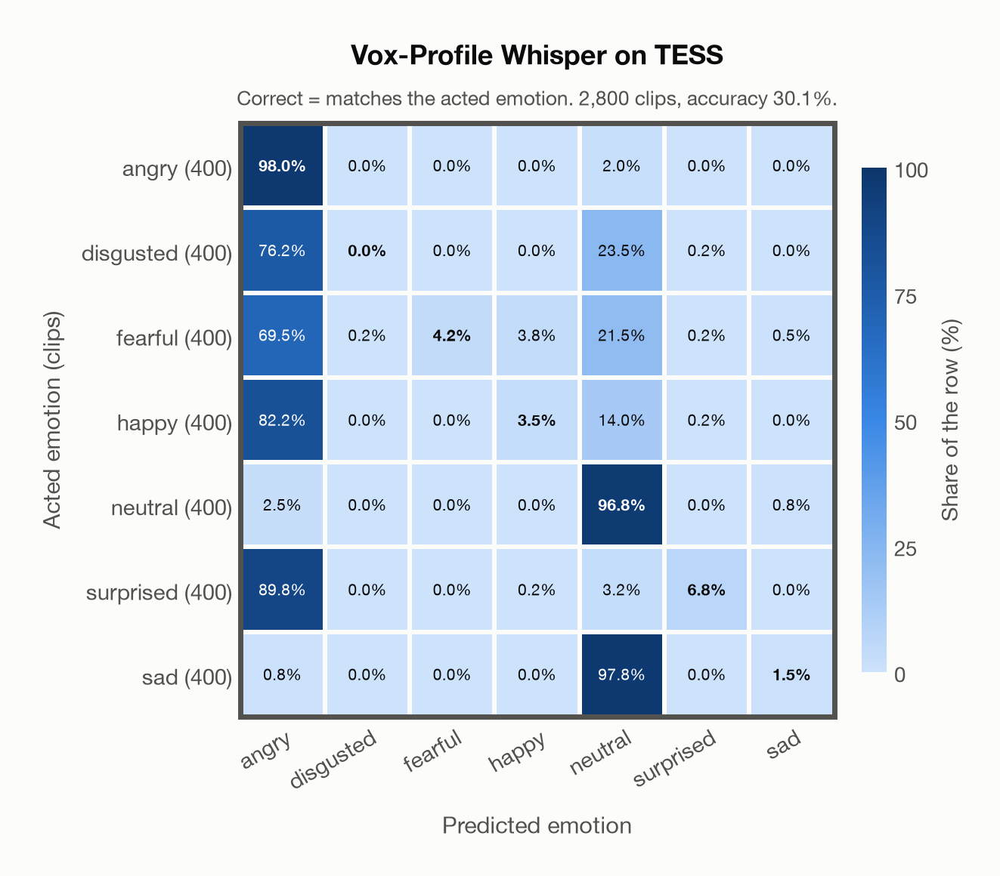

# Vox-Profile Whisper on TESS

Generated by `scripts/evaluation/evaluate.py` on 2026-10-29.

## Summary

| Metric | Value |
|---|---|
| Clips evaluated | 2,800 (English) |
| **Accuracy: prediction matches the acted emotion** | **30.1%** |
| Unweighted accuracy (mean recall of the 7 acted emotions) | 30.1% |
| Macro F1 (acted emotion) | 17.4% |
| Accuracy, all 9 model classes (acted emotion) | 29.9% |
| Chance level (7 emotions) | 14.3% |

## Setup

- **Model**: Vox-Profile Whisper (`tiantiaf/whisper-large-v3-msp-podcast-emotion`) as released (no fine-tuning), transformers 5.18.0, loaded by `scripts/models/vox_profile.py`. Each clip (at most 15 s) becomes Whisper log-mel features padded with silence to 15 s, the model's fixed input; the encoder output is averaged over the clip's own frames only, as in the official code. float32 on every device. The model card warns that clips shorter than 3 s give unreliable predictions (it was trained on clips of 3-15 s); clips are used as they are, not padded to 3 s.
- **Data**: 2,800 clips of TESS (English) from `data/tess/`.
- **Ground truth (acted emotion)**: the emotion each actress was asked to portray, from the last word of the file name (`angry`, `disgust`, `fear`, `happy`, `neutral`, `ps` for pleasant surprise, `sad`).
- Label mapping: angry, happy, neutral and sad keep their names; disgust = disgusted, fear = fearful, **pleasant surprise = surprised**.
- Two actresses, aged 26 and 64, say "Say the word ..." with the same 200 target words in each of the seven emotions.
- **7 emotions**: the prediction is the most probable of the 7 emotions in this dataset (angry, disgusted, fearful, happy, neutral, surprised, sad); the model's other classes (`contempt`, `other`) are ignored. **All 9 model classes**: the prediction is the most probable of all 9 model classes, so choosing a class that the dataset does not have counts as wrong.
- **Hardware**: Apple M4 Max, device `mps`, PyTorch 2.5.1. Inference took 9.7 min (207 ms per clip).
- **Per-clip predictions**: `outputs/vox_profile_whisper/tess_predictions.csv` (in git, so the results can be checked clip by clip). The JSON file next to it describes the columns.

## Results per emotion

Rows: acted emotion. Precision, recall and F1 compare the prediction with the acted emotion.

| Emotion | Clips | Precision | Recall | F1 |
|---|---|---|---|---|
| angry | 400 | 23.4% | 98.0% | 37.8% |
| disgusted | 400 | 0.0% | 0.0% | 0.0% |
| fearful | 400 | 100.0% | 4.2% | 8.2% |
| happy | 400 | 46.7% | 3.5% | 6.5% |
| neutral | 400 | 37.4% | 96.8% | 53.9% |
| surprised | 400 | 90.0% | 6.8% | 12.6% |
| sad | 400 | 54.5% | 1.5% | 2.9% |

## Confusion matrix: acted emotion

The same numbers as a table. Rows: acted emotion. Columns: predicted emotion. Each row adds up to 100%.

| Acted \ Predicted | angry | disgusted | fearful | happy | neutral | surprised | sad |
|---|---|---|---|---|---|---|---|
| angry (400) | **98.0%** | 0.0% | 0.0% | 0.0% | 2.0% | 0.0% | 0.0% |
| disgusted (400) | 76.2% | **0.0%** | 0.0% | 0.0% | 23.5% | 0.2% | 0.0% |
| fearful (400) | 69.5% | 0.2% | **4.2%** | 3.8% | 21.5% | 0.2% | 0.5% |
| happy (400) | 82.2% | 0.0% | 0.0% | **3.5%** | 14.0% | 0.2% | 0.0% |
| neutral (400) | 2.5% | 0.0% | 0.0% | 0.0% | **96.8%** | 0.0% | 0.8% |
| surprised (400) | 89.8% | 0.0% | 0.0% | 0.2% | 3.2% | **6.8%** | 0.0% |
| sad (400) | 0.8% | 0.0% | 0.0% | 0.0% | 97.8% | 0.0% | **1.5%** |

Most frequent confusions: sad predicted as neutral (97.8%), surprised predicted as angry (89.8%), happy predicted as angry (82.2%).

## Predictions outside the 7 emotions

With all 9 model classes, the model chose a class that this dataset does not have for 59 clips (2.1%): `contempt` 59, `other` 0.

## Caveats

- **Not in Vox-Profile Whisper's training data** (MSP-Podcast).
- Only two speakers, so the result says little about other voices; models often score close to 100% on TESS.
- No listeners' labels are published with the dataset. Audio: 24,414 Hz WAV (one file, `OAF_food_fear.wav`, is 96 kHz), resampled to 16 kHz.
