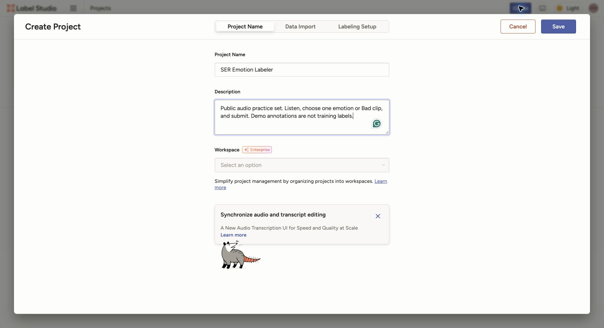
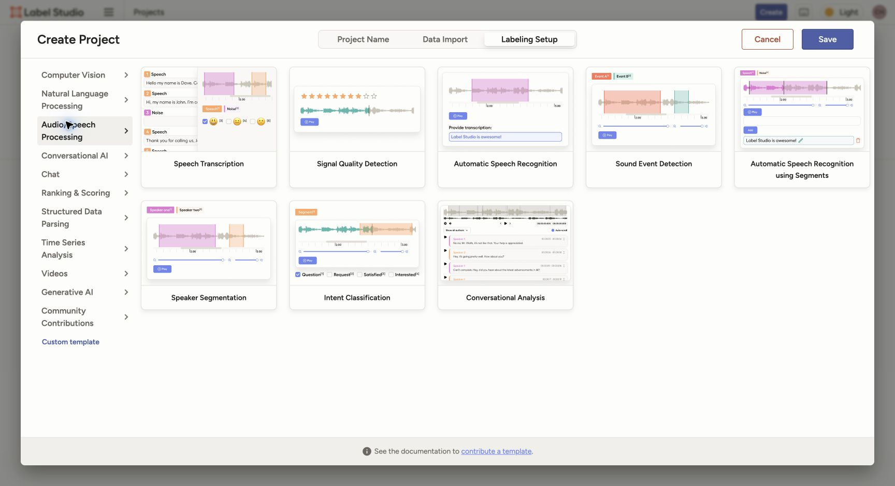
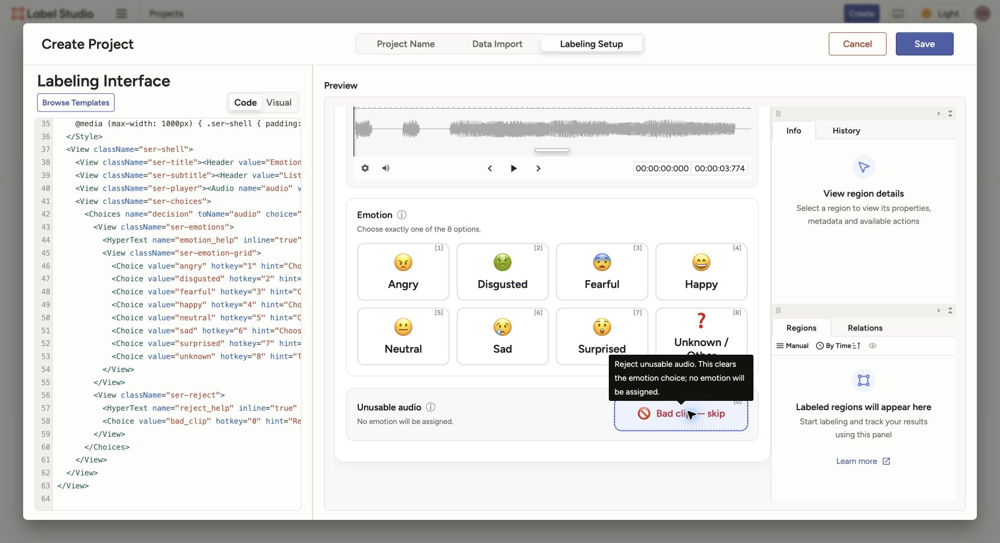
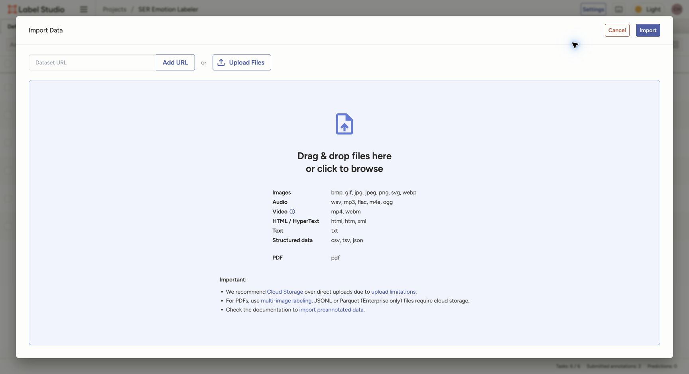
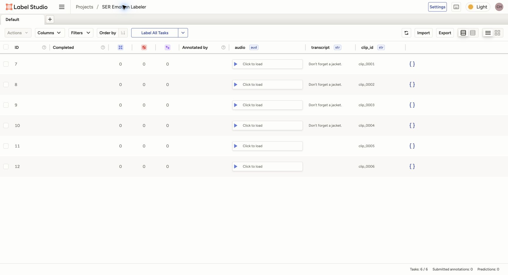
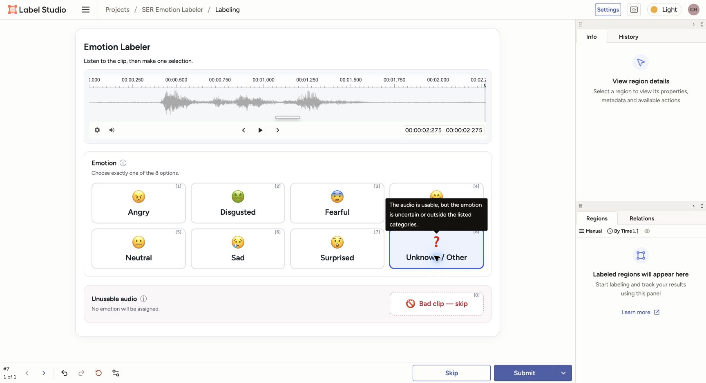
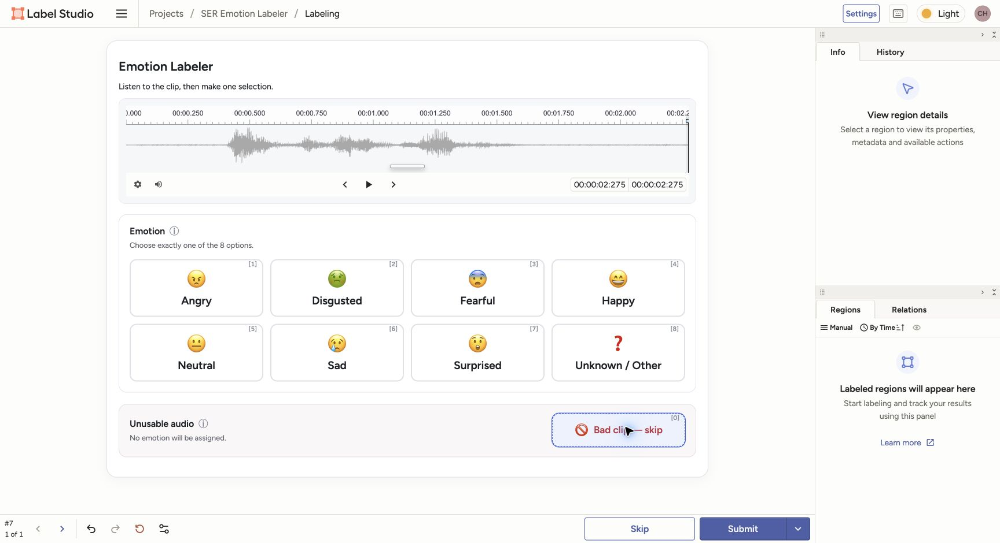
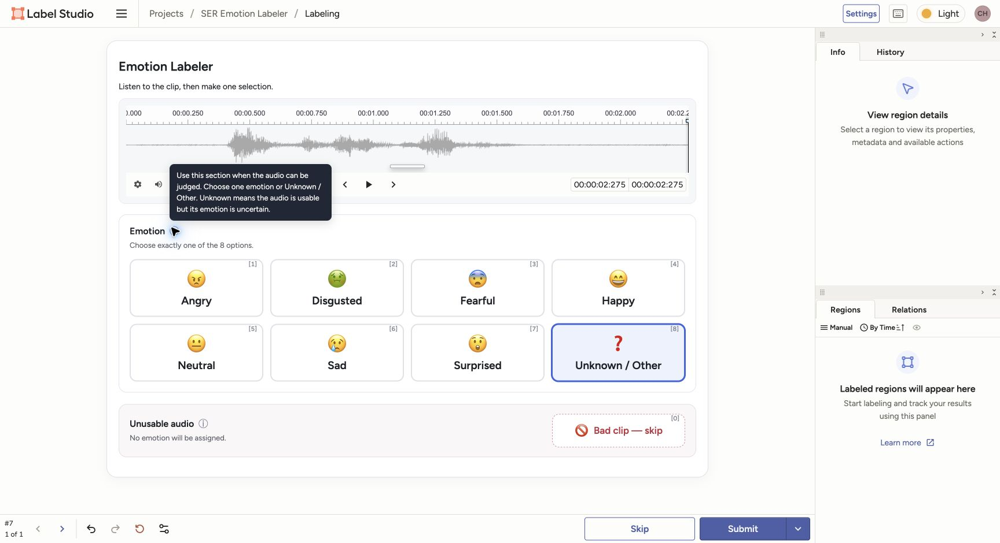
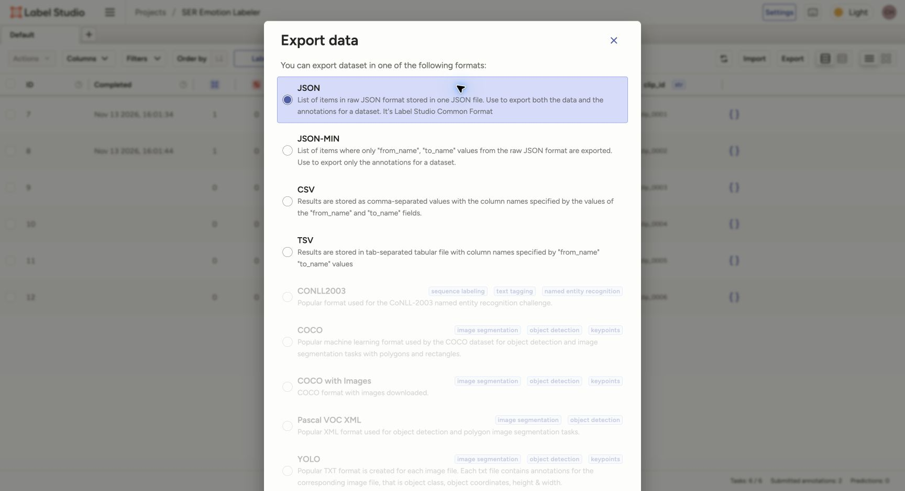
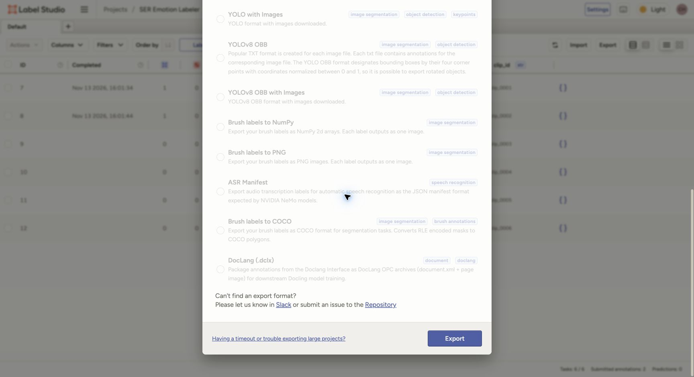

# 客户语音情绪标注操作手册

中文 | [English](README_en.md)

本子项目使用 Label Studio，对**已完成切分的客户音频 clip**做情绪分类：每个 clip 由 **3 个不同账号各标一次**，
不需要重新转写，也不需要画说话人或事件时间区间。

操作导航：

- **项目负责人**：[1. 建立项目](#1-建立项目) → [2. 配置模板](#2-配置模板) → [3. 挑选片段](#3-如何挑选待标注片段) → [4. 导入任务](#4-导入任务)
- **标注员日常操作**：[5. 日常标注](#5-日常标注)
- **项目负责人收集结果**：[6. 导出结果](#6-导出结果)
- **三人标注与自动补齐**：[7. 设置每段三位听众](#7-设置每段三位听众)
- 详细配置：[完整可复制 XML 与字段解释](template_configuration.md) · [数据准备与导入接口](data_import.md)

本机演示项目为 [SER Emotion Labeler](http://localhost:8082/projects/3/data)，首页为 <http://localhost:8082>。
以下截图来自本机 Label Studio **1.23.2** 的实际操作。
演示项目使用 **6 条公开音频**；截图中的选择值仅用于展示操作，不是人工听音结论。

截图保留了旧版演示界面，其中 `unknown` 曾显示为 **Unknown / Other**。当前 XML 为新批次提供
**8 种情绪（含 Other）＋ Unknown / Uncertain ＋ Bad clip**；本文没有修改在线项目或历史标注。

## 1. 建立项目

**由项目负责人完成。** 登录后点击 **Create Project / Create new project**，填写项目名称，例如 `SER Emotion Labeler`。
先用公开演示数据确认界面与流程，标签定义确认后再开始正式批次。



## 2. 配置模板

**由项目负责人完成。** 本机版本的 **Audio/Speech Processing** 模板列表没有显示 Audio Classification，
因此不要继续寻找这个选项。点击左下角 **Custom template（创建自定义模板）**，再进入 **Code**。
不要选 **Speech Transcription** 或 **Speaker Segmentation**，它们不对应当前的 clip 级情绪分类任务。



1. 选定下表的一种协议，复制对应 XML 的**全部内容**。
2. 在 **Code** 编辑器中替换原有内容，不要追加在旧模板后面。
3. 检查预览：上区有 9 个选项（8 种情绪，含 Other，另加 Unknown / Uncertain），下区独立显示 Bad clip 弃用入口，再点击 **Save**。
4. 已建项目的入口是 **Settings → Labeling Interface → Code**。

| 配置文件 | 标注员可见内容 |
|---|---|
| [config_audio_only.xml](config_audio_only.xml) | 音频、上区 8 种情绪与 1 个不确定选项、下区独立 Bad clip 弃用入口 |
| [config_with_transcript.xml](config_with_transcript.xml) | 上述内容加只读的已有转写 |



完整代码、每个字段的作用及任务 JSON 配对，见 [自定义模板配置详解](template_configuration.md)。
官方 [Audio Classification](https://labelstud.io/templates/audio_classification.html) 是语义等价的参考模板，
不是本机列表中可见的按钮。

初次 SER 标注建议先采用 audio-only。若决定允许文字辅助，整批使用 with-transcript，并先听声音再参考文字。
同一批独立 gold labels 不应混用两种协议，也不展示模型预测。当前新批次采用 8 种情绪，包含独立的
`other`；`unknown` 仅表示无法确定情绪，不是这 8 个训练类别之一。正式标注后冻结配置版本。

**已有正式标注项目不要原地改变标签含义。** 保留旧项目配置快照和完整导出，为新协议建立独立、注明配置版本的
新批次或新项目。历史 `unknown` 可能混合“不确定”和“其他”两种判断；标准化脚本会原样保留，不能自动改成 `other`。

## 3. 如何挑选待标注片段

**由数据准备人员完成。** [prepare_tasks.py](prepare_tasks.py) 从多个批次中挑出一轮 1,000 段，复制音频并生成任务文件；
命令和设置见[数据导入说明](data_import.md#1-生成一轮任务)。

**为什么不直接随机抽？** 客服录音大多是中性语气。随机抽 1,000 段，带情绪的可能只有几十段，恐惧、厌恶等更少，
标完也学不到这些情绪。所以先看三个模型的预测，多抽"可能有情绪"的片段，同时保留一部分随机样本作对照。

**三个预测列。** 每个批次的 `manifest_with_predictions.parquet` 是原 manifest 加三列：emotion2vec、GPT Realtime
和 Gemini 的预测（默认列名 `pred_e2v`、`pred_gpt`、`pred_gemini`）。每格一个标签，不区分大小写：

- 有效票：`angry`、`disgusted`、`fearful`、`happy`、`sad`、`surprised`、`neutral`；
- 不算票：空值、`invalid`、`other`、`unknown`、`none`；
- 其他任何值都会报错，用来发现合并错误。

模型不预测 `other`，所以 `other` 只会来自人工标注。

**分层。** 只数有效票，每段恰好属于下表的一层：

| 分层 | 条件 | 例子（e2v / GPT / Gemini） |
|---|---|---|
| `agree3[情绪]` | 三票是同一种情绪 | angry / angry / angry |
| `agree2[情绪]` | 两票是同一种情绪 | sad / sad / neutral；sad / sad / 空 |
| `single[情绪]` | 只有一票是情绪，其余是 neutral | happy / neutral / neutral |
| `conflict` | 两票或以上是情绪，且各不相同 | angry / sad / neutral |
| `neutral` | 有效票全是 neutral | neutral / neutral / 空 |
| `unassigned` | 有效票少于两张 | angry / 空 / invalid |

`unassigned` 只参与随机层和最后的补齐。

**每轮配额（共 1,000 段）。** 数字写在 [config/prepare_tasks.yaml](config/prepare_tasks.yaml) 的 `quotas`，两轮之间可以调整：

| 层 | 数量 | 从哪里抽 |
|---|---:|---|
| `random` 随机 | 150 | 全部合格片段，均匀随机，反映真实分布 |
| `emotion` 情绪 | 560 | 6 种情绪各约 93 段（94、94、93、93、93、93）；每种情绪再平分给 agree3、agree2、single 三层 |
| `conflict` 分歧 | 140 | `conflict` 层 |
| `neutral` 全中性 | 150 | `neutral` 层 |

**不够时怎么补：**

1. 某种情绪的某一层不够：用同一情绪的其他层补，顺序是 agree2 → single → agree3。
2. 这种情绪三层加起来仍不够：差额转给 `conflict`。
3. 总数仍不到 1,000：从剩下的合格片段中均匀随机补齐，标为 `fill`。
4. 合格片段总数不够一轮时报错，不生成任何文件。

**其他规则：**

- 只用 10 秒以内的片段（`is_longer_than_10_seconds` 为 false）；10–15 秒的片段暂不使用。
- 同一通电话在一轮里最多 3 段，避免少数通话占满名额；已满的电话会跳过。
- 选好的 1,000 段最后整体打乱，各层混在一起，标注员看不出某段是怎么选中的。
- 数据、设置和轮号相同时，结果完全相同，与 manifest 的行顺序无关。

**标注员看不到预测。** 任务 JSON 只有 `audio`、`transcript`、`clip_id`。预测、分层和来源层只写在同一轮的
`manifest.parquet` 和 `summary.json` 中，供以后使用：

- 标完后按分层统计命中率，例如 agree3 和 single 中，人工也判为这种情绪的比例；
- 以后从中划测试集时按分层加权，还原真实分布（情绪层是多抽的）。

**一轮 = 一个 `tasks_NNN`。** 每次运行生成下一轮：`tasks_001`、`tasks_002` …，每轮 1,000 段，
并自动排除前面各轮已选的片段，各轮互不重叠。输出目录：

```text
selected_data_for_human_labeling/     # output_root
└── tasks_001/
    ├── audio/
    │   ├── part_01/                   # 复制的音频，每个文件夹 100 个，按任务顺序
    │   └── … part_10/
    ├── tasks_001.json                 # 任务：只有 audio、transcript、clip_id
    ├── manifest.parquet               # 入选片段：原 manifest 全部列，加来源批次、层、分层（如 agree3:angry）、任务序号、part
    └── summary.json                   # 本轮设置、各分层片段数、目标与实际数量、缺口去向
```

## 4. 导入任务

**由项目负责人完成。** 本次演示的 6 条公开 clip 已通过 **Local Files → Tasks → Save & Sync** 导入，
可以直接进入步骤 5。存储方式的具体配置见 [数据导入说明](data_import.md)。
正式数据的任务由[第 3 节](#3-如何挑选待标注片段)的 `prepare_tasks.py` 生成：每轮一个 `tasks_NNN/` 文件夹，含 1,000 条任务和对应音频。

**只能用公司服务器版 Label Studio（不能用 Local Files / GCS）时**，改为逐个上传 `tasks_NNN/audio/` 下的 part 文件夹、再用脚本补上转写和 `clip_id`，
见[直接上传音频](data_import.md#4-服务器版-label-studio直接上传音频不用-local-files--gcs)；这时不导入任务 JSON。

日常导入新一轮时，也可以使用项目数据页的 **Import → Upload Files**：

1. 先只上传第一轮的 `tasks_001/tasks_001.json`，再点击 **Import**；生成方法见[数据导入说明](data_import.md#1-生成一轮任务)。
2. 每轮 1,000 条任务，每条任务对应一个 clip，带音频地址、已有转写和稳定的 `clip_id`；各轮互不重叠。
3. 上传前，负责人应确保这些音频地址已能被当前服务访问（本机版的 Local Files document root 即 `output_root`）。JSON 不会替你上传其引用的音频。
4. 完成后在同一个项目继续导入 `tasks_002/tasks_002.json` 等，原有结果保留；按需要停止。
5. **每份 JSON 只导入一次**：不要既通过 Local Files Sync 导入，又通过 Upload Files 再导入。



导入后检查任务数量，打开第一条确认能播放。带转写协议还需检查文字和音频是否对应。
下面是刚导入时的任务列表：6 条任务、0 条已提交；随后已完成两条操作演示提交，分别验证情绪和弃用分支。



真实公司音频、转写和任务 JSON 保留在公司授权目录，不提交到本仓库。无法播放或文字不匹配时，
交给数据准备人员检查；不要把本机绝对路径或 `file://` 直接填进音频字段。

## 5. 日常标注

**由标注员完成。** 用自己的账号登录负责人指定的项目，点击 **Label All Tasks** 进入标注队列，按以下顺序操作：

1. 听完整段音频，必要时重播。
2. 音频可用时，在上方 **Emotion** 区选择一个情绪；能确定存在情绪但不属于七种具名情绪时选 **Other**，无法确定情绪时选 **Unknown / Uncertain**。
3. 音频本身无法可靠判断时，使用下方 **Unusable audio** 区的 **Bad clip — skip**，不再赋予情绪。
4. 两条路径互斥：选 Bad clip 会清除情绪，选情绪会取消 Bad clip。最后点击右下角 **Submit**。

需要帮助时，把鼠标移到两区标题旁的 **ⓘ** 或选项卡片上，查看英文说明；也可用键盘 Tab 聚焦 **ⓘ**。
七种具名情绪快捷键为 `1`–`7`，Unknown / Uncertain 保留 `8`，Other 使用 `9`，Bad clip 保留 `0`；选中后仍需 Submit，无需输入任何文字。

下图中的选择用于展示操作，**不是该音频的情绪答案**。界面文字使用英文，本手册用中文解释操作。



| 情绪值 | 含义 |
|---|---|
| `angry` | 生气 |
| `disgusted` | 厌恶 |
| `fearful` | 恐惧 |
| `happy` | 开心 |
| `neutral` | 中性：有足够声音线索支持中性判断 |
| `sad` | 难过 |
| `surprised` | 吃惊 |
| `other` | 有明确情绪，但不符合上述七种具名情绪；不是不确定判断 |
| `unknown` | 音频基本可用，但无法有把握地确定情绪；不是 `other` 或 `neutral` |

**Bad clip 是独立的弃用决策，不属于情绪类别。** 例如严重噪声、静音或多人重叠导致音频无法可靠判断时，
在下方选择 Bad clip。`unknown` 用于可用音频中的情绪不确定，不能代替坏音频弃用；它也不等于 `neutral`。

选择 **Bad clip — skip** 后仍需 **Submit**，才会保存弃用结果。Label Studio 原生的 **Skip** 是跳过当前任务，
不能代替这个弃用选择。

<details>
<summary>查看 Bad clip 互斥状态与英文帮助提示</summary>

旧版截图中选择 Bad clip 后，上区 8 个选项都未选中；新模板同样会清除全部 9 个上区选项。这也是操作演示，不是对样例音频质量的判断。



鼠标移到或用键盘聚焦标题旁的 ⓘ，会显示该区域的英文解释。



</details>

## 6. 导出结果

**由项目负责人完成。** 在项目数据页点击 **Export**，选择完整 **JSON** 格式。



然后向下滚动到窗口底部，点击 **Export** 下载。选择格式本身并不会完成下载。



默认导出已标注任务，未提交的任务不会默认包含在内。操作演示结果只用于验证流程，不作为训练或评测标签。
原生 JSON 把选择保存为 `decision`：它可能是 8 个情绪值之一（含 `other`）、`unknown` 不确定判断，或 `bad_clip` 弃用决策。
负责人使用标准化脚本后，Bad clip 对应 `status="bad_clip"`、`emotion=null`，不会成为情绪标签。
具体转换命令和字段见 [数据导入与导出接口](data_import.md#5-读取并标准化导出)。

保留完整原始 JSON，包括 `data.clip_id`、每条 annotation 的 `completed_by`、`lead_time`、`result` 和
`was_cancelled`。同一 clip 的多人标注先分别保存，分析一致性和分歧后再决定训练标签，不要直接覆盖为一个标签。
取消的标注单独处理；Community UI 导出不受当前 tab filter 限制，不能认为导出只包含当前筛选页面。

## 7. 设置每段三位听众

**由项目负责人完成，每个新项目都要设置。** 三人要求是项目设置，不在音频界面 XML 中。
本机固定版本 **Community 1.23.2** 的后端支持以下配置，已有任务也会更新；两份 XML 均可原样使用。
配置文件为 [project_settings.json](project_settings.json)：

```json
{
  "maximum_annotations": 3,
  "overlap_cohort_percentage": 100,
  "show_overlap_first": true,
  "enable_empty_annotation": false
}
```

`3` 表示每段需要三位不同标注员；`100` 表示全部任务都遵循这一要求；另两项启用重叠任务优先并关闭界面空提交。
Community 的设置页面可能没有相应控件，可用项目负责人账号的 API 凭据通过
[Update project API](https://api.labelstud.io/api-reference/api-reference/projects/update) 设置。
先按[官方令牌说明](https://labelstud.io/guide/access_tokens)将 Personal Access Token 换取短期 access token；
本机未开启 Legacy token 认证，直接使用旧 token 会返回 401。在仓库根目录运行：

```bash
# 填写目标服务、项目 ID，以及刚换取的短期 access token。
export LABEL_STUDIO_URL="http://localhost:8082"
export LABEL_STUDIO_PROJECT_ID="3"
export LABEL_STUDIO_AUTH_HEADER="Bearer <your-access-token>"
curl --fail-with-body --request PATCH \
  "$LABEL_STUDIO_URL/api/projects/$LABEL_STUDIO_PROJECT_ID/" \
  --header "Authorization: $LABEL_STUDIO_AUTH_HEADER" \
  --header "Content-Type: application/json" \
  --data-binary @label_studio/project_settings.json
```

负责人在 **Organization → Add Members** 获取注册链接，让至少三位实际听众各建一个账号，不共用账号。
使用 **Label All Tasks** 的正常队列时：

- 某段已有 A、B 两位听众提交，仍未完成；没有标过它的 C 可以继续领取。
- 已提交过该段的账号不会在正常队列中再次领取它；三位不同账号提交后，该段退出待标队列。
- 默认跳过策略下，草稿、原生 Skip / 取消标注不计为完成；提交的 Unknown 或 Bad clip 都是一位听众的有效决策。
- 每人每段只提交一份。不要在 Quick View 中点 `+` 重复新增；修改答案时编辑自己的原 annotation，不修改别人的结果。

这是正常队列的完成门槛，**不是限制所有 API / Quick View 操作的硬上限**。手工新增的重复 annotation
不会增加不同听众数，还可能占用队列容量；负责人应检查并清理误增项，再继续补齐。
导出验收时，按 clip 对未取消的有效决策统计 **不同 `completed_by` 的数量**，不能只数 annotation 行数。
公开演示提交不作为正式听众的标签；正式数据应使用干净项目。

### 是否让听众看到彼此的结果

保留当前默认行为：正常 **Label All Tasks** 队列在领取任务时不加载其他人的答案，方便先独立判断；
通过任务详情 / Quick View 仍可查看彼此结果，不额外增加隔离机制。建议先听音并提交，再查看和讨论其他结果。
Community 不能强制这一约定，也不能防止修改他人结果；`show_annotation_history` 不能作为盲标权限开关。
若后续需要严格盲标，再采用具有相应权限控制的版本或隔离部署。

官方[功能对比](https://labelstud.io/guide/enterprise_features)仍将 overlap 设置列为 Enterprise 功能。
上述 Community 行为已按本机 **1.23.2** 的代码和隔离数据库流程验证，依据包括
[不同标注员计数](https://github.com/HumanSignal/label-studio/blob/1.23.2/label_studio/tasks/mixins.py)
及[任务领取逻辑](https://github.com/HumanSignal/label-studio/blob/1.23.2/label_studio/projects/functions/next_task.py)。
升级或更换部署版本后，先验证两人未完成、第三人完成、同一账号不重复领取，再开始正式批次。

## 多人使用前先确认部署方式

本机演示与公司多人部署是两件事。`localhost` 指当前电脑，不能把这个地址发给远程标注员使用；
公司多人使用需要可访问的公司服务器及持久存储。

Community Edition 允许多人建账号，但所有用户可见所有项目、功能权限相同；不能真正分配特定任务，
也不能阻止用户修改别人的 annotation。按 tab/filter 分工只是操作约定，不能作为盲标或权限隔离。
三人补齐使用上节已验证的正常队列。严格的角色、人工任务分配、review 和强制盲标仍需要另行选择版本或隔离部署，
不能直接照搬 Enterprise 教程。

## 官方参考

- [配置界面与 Code](https://labelstud.io/guide/setup.html)
- [JSON 导出](https://labelstud.io/guide/export.html)
- [Community 用户权限](https://labelstud.io/guide/signup) 与 [Data Manager 分工限制](https://labelstud.io/guide/manage_data.html)
- [官方支持：Community 无防覆盖权限](https://community.labelstud.io/t/preventing-annotation-overwrite-in-label-studio-community-edition/217)
