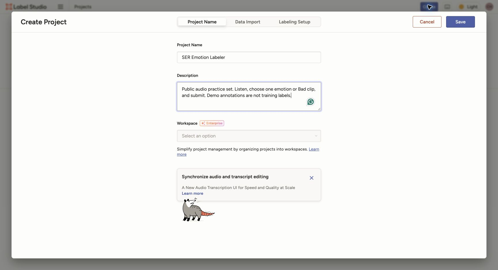
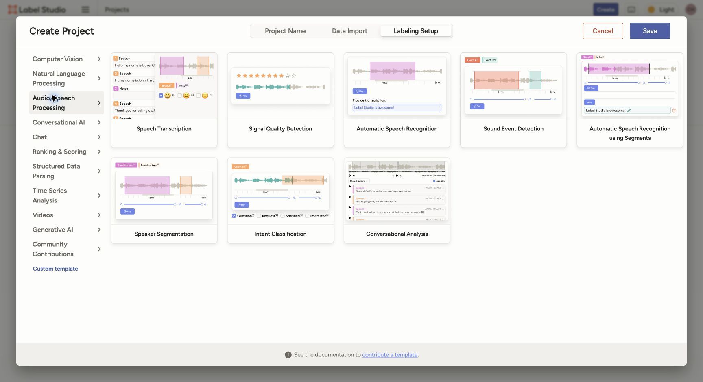
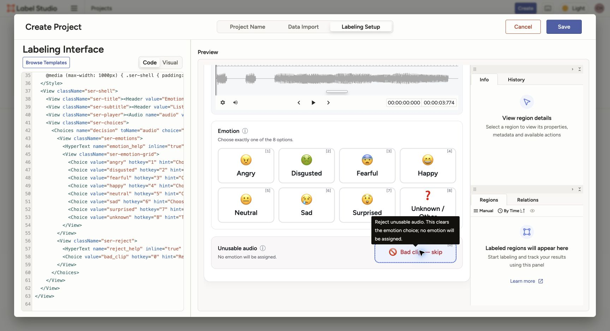
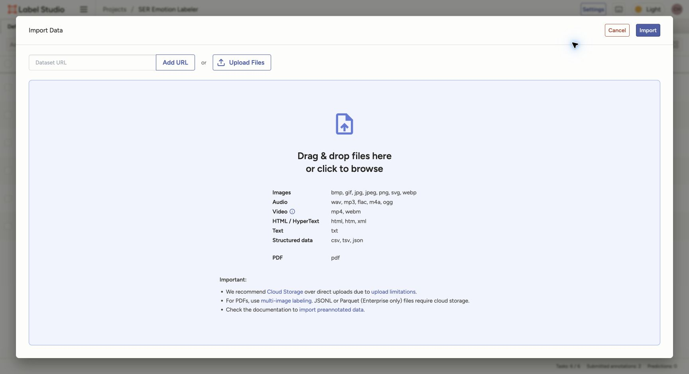
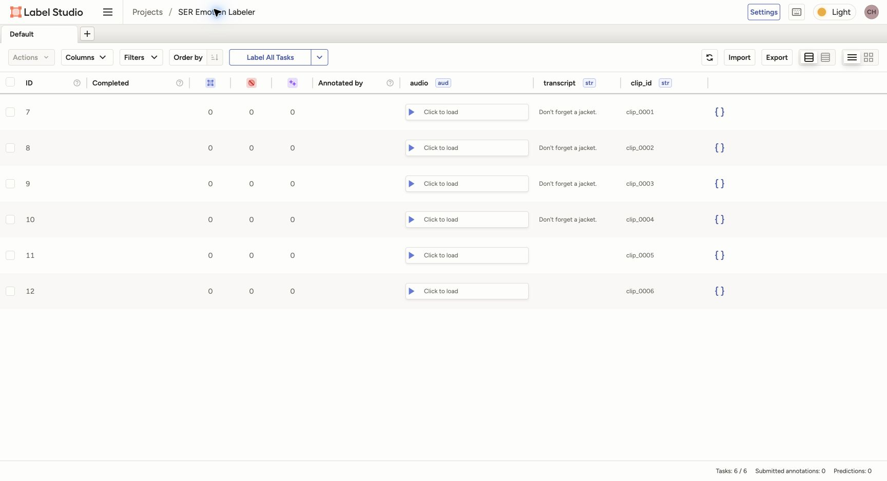
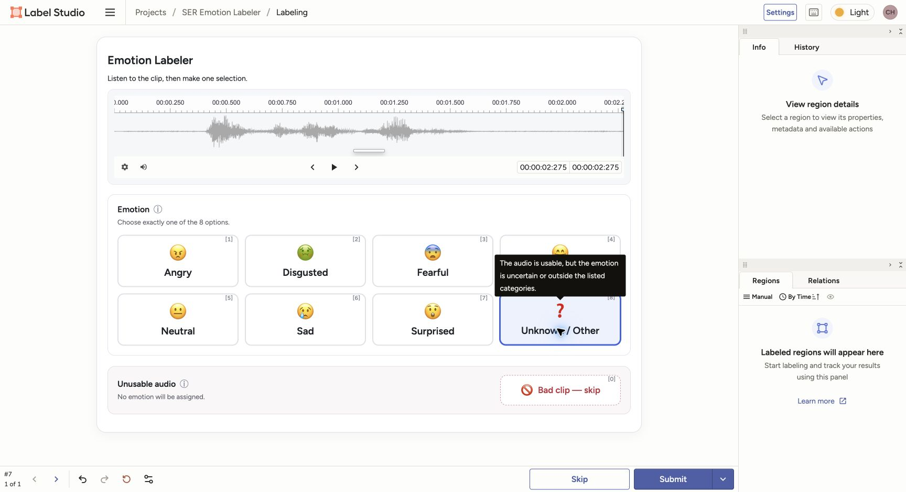
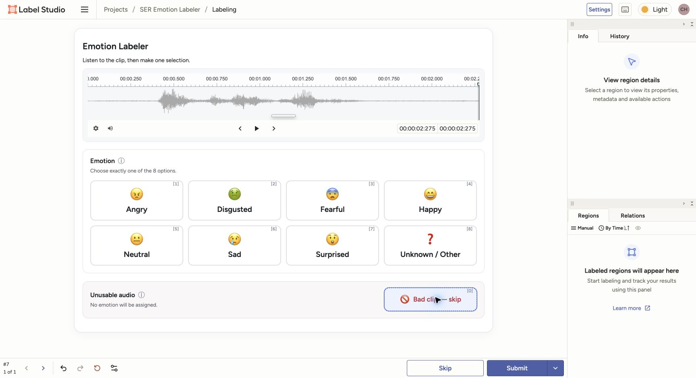
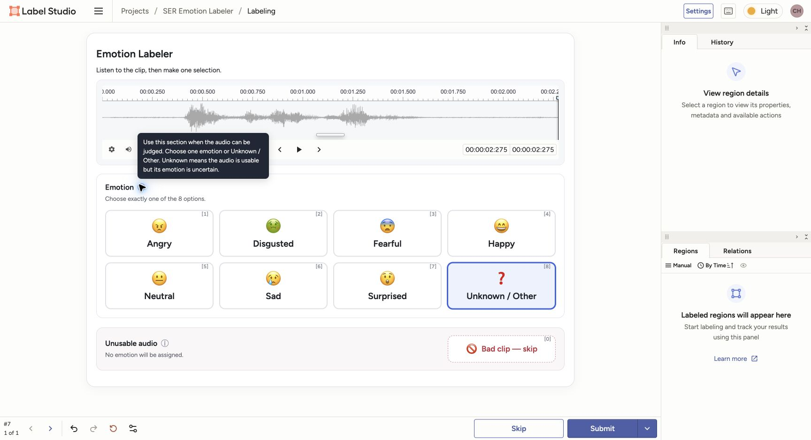
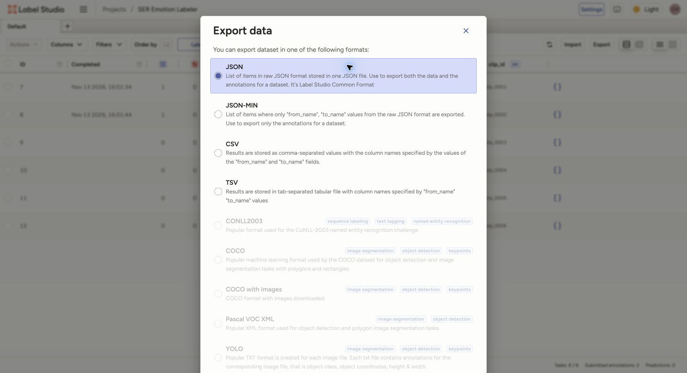
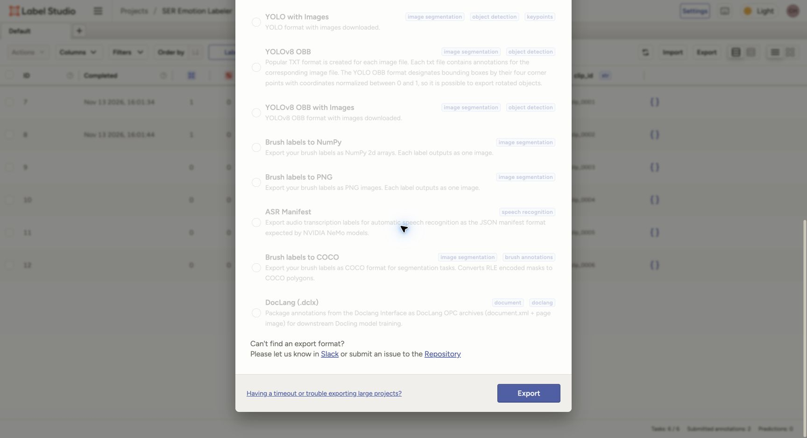

# 客户语音情绪标注操作手册

中文 | [English](README_en.md)

本子项目使用 Label Studio，对**已完成切分的客户音频 clip**做情绪分类：每个 clip 由 **5 个不同账号各标一次**，
不需要重新转写，也不需要画说话人或事件时间区间。

操作导航：

- **项目负责人**：[1. 建立项目](#1-建立项目) → [2. 配置模板](#2-配置模板) → [3. 导入任务](#3-导入任务)
- **标注员日常操作**：[4. 日常标注](#4-日常标注)
- **项目负责人收集结果**：[5. 导出结果](#5-导出结果)
- **五人标注与自动补齐**：[6. 设置每段五位听众](#6-设置每段五位听众)
- 详细配置：[完整可复制 XML 与字段解释](template_configuration.md) · [数据准备与导入接口](data_import.md)

本机演示项目为 [SER Emotion Labeler](http://localhost:8082/projects/3/data)，首页为 <http://localhost:8082>。
以下截图来自本机 Label Studio **1.23.2** 的实际操作。
演示项目使用 **6 条公开音频**；截图中的选择值仅用于展示操作，不是人工听音结论。

## 1. 建立项目

**由项目负责人完成。** 登录后点击 **Create Project / Create new project**，填写项目名称，例如 `SER Emotion Labeler`。
先用公开演示数据确认界面与流程，标签定义确认后再开始正式批次。



## 2. 配置模板

**由项目负责人完成。** 本机版本的 **Audio/Speech Processing** 模板列表没有显示 Audio Classification，
因此不要继续寻找这个选项。点击左下角 **Custom template（创建自定义模板）**，再进入 **Code**。
不要选 **Speech Transcription** 或 **Speaker Segmentation**，它们不对应当前的 clip 级情绪分类任务。



1. 选定下表的一种协议，复制对应 XML 的**全部内容**。
2. 在 **Code** 编辑器中替换原有内容，不要追加在旧模板后面。
3. 检查预览：上区有 8 个情绪选项（7 种情绪加 Unknown / Other），下区独立显示 Bad clip 弃用入口，再点击 **Save**。
4. 已建项目的入口是 **Settings → Labeling Interface → Code**。

| 配置文件 | 标注员可见内容 |
|---|---|
| [config_audio_only.xml](config_audio_only.xml) | 音频、上区 8 个情绪选项、下区独立 Bad clip 弃用入口 |
| [config_with_transcript.xml](config_with_transcript.xml) | 上述内容加只读的已有转写 |



完整代码、每个字段的作用及任务 JSON 配对，见 [自定义模板配置详解](template_configuration.md)。
官方 [Audio Classification](https://labelstud.io/templates/audio_classification.html) 是语义等价的参考模板，
不是本机列表中可见的按钮。

初次 SER 标注建议先采用 audio-only。若决定允许文字辅助，整批使用 with-transcript，并先听声音再参考文字。
同一批独立 gold labels 不应混用两种协议，也不展示模型预测。现有 7 情绪加 `unknown` 是 pilot 起点，
最终内部标签集仍待确认；正式标注后冻结配置，不能随意改字段名或标签值。

## 3. 导入任务

**由项目负责人完成。** 本次演示的 6 条公开 clip 已通过 **Local Files → Tasks → Save & Sync** 导入，
可以直接进入步骤 4。存储方式的具体配置见 [数据导入说明](data_import.md)。

日常导入新批次时，也可以使用项目数据页的 **Import → Upload Files**：

1. 上传数据准备人员提供的 `tasks.json`，再点击 **Import**。
2. 一条 JSON 任务对应一个 clip，带音频地址、已有转写和稳定的 `clip_id`。
3. 上传前，负责人应确保这些音频地址已能被当前服务访问。JSON 不会替你上传其引用的音频。
4. **同一批 JSON 只导入一次**：不要既通过 Local Files Sync 导入，又通过 Upload Files 再导入。



导入后检查任务数量，打开第一条确认能播放。带转写协议还需检查文字和音频是否对应。
下面是刚导入时的任务列表：6 条任务、0 条已提交；随后已完成两条操作演示提交，分别验证情绪和弃用分支。



真实公司音频、转写和任务 JSON 保留在公司授权目录，不提交到本仓库。无法播放或文字不匹配时，
交给数据准备人员检查；不要把本机绝对路径或 `file://` 直接填进音频字段。

## 4. 日常标注

**由标注员完成。** 用自己的账号登录负责人指定的项目，点击 **Label All Tasks** 进入标注队列，按以下顺序操作：

1. 听完整段音频，必要时重播。
2. 音频可用时，在上方 **Emotion** 区选择一个情绪；情绪不确定或不属于既定类别时选 **Unknown / Other**。
3. 音频本身无法可靠判断时，使用下方 **Unusable audio** 区的 **Bad clip — skip**，不再赋予情绪。
4. 两条路径互斥：选 Bad clip 会清除情绪，选情绪会取消 Bad clip。最后点击右下角 **Submit**。

需要帮助时，把鼠标移到两区标题旁的 **ⓘ** 或选项卡片上，查看英文说明；也可用键盘 Tab 聚焦 **ⓘ**。
情绪选项快捷键为 `1`–`8`，Bad clip 为 `0`；选中后仍需 Submit，无需输入任何文字。

下图中的选择用于展示操作，**不是该音频的情绪答案**。界面文字使用英文，本手册用中文解释操作。



| 情绪值 | 含义 |
|---|---|
| `angry` | 生气 |
| `disgusted` | 厌恶 |
| `fearful` | 恐惧 |
| `happy` | 开心 |
| `neutral` | 中性：有足够声音线索支持中性判断 |
| `sad` | 难过 |
| `surprised` | 吃惊 |
| `unknown` | 音频基本可用，但情绪不确定或不属于当前类别 |

**Bad clip 是独立的弃用决策，不是第 9 种情绪。** 例如严重噪声、静音或多人重叠导致音频无法可靠判断时，
在下方选择 Bad clip。`unknown` 用于可用音频中的情绪不确定，不能代替坏音频弃用；它也不等于 `neutral`。

选择 **Bad clip — skip** 后仍需 **Submit**，才会保存弃用结果。Label Studio 原生的 **Skip** 是跳过当前任务，
不能代替这个弃用选择。

<details>
<summary>查看 Bad clip 互斥状态与英文帮助提示</summary>

下图选择 Bad clip 后，上区 8 个情绪都未选中；这也是操作演示，不是对样例音频质量的判断。



鼠标移到或用键盘聚焦标题旁的 ⓘ，会显示该区域的英文解释。



</details>

## 5. 导出结果

**由项目负责人完成。** 在项目数据页点击 **Export**，选择完整 **JSON** 格式。



然后向下滚动到窗口底部，点击 **Export** 下载。选择格式本身并不会完成下载。



默认导出已标注任务，未提交的任务不会默认包含在内。操作演示结果只用于验证流程，不作为训练或评测标签。
原生 JSON 把选择保存为 `decision`：它可能是 8 个情绪值之一，也可能是 `bad_clip` 弃用决策。
负责人使用标准化脚本后，Bad clip 对应 `status="bad_clip"`、`emotion=null`，不会成为情绪标签。
具体转换命令和字段见 [数据导入与导出接口](data_import.md#4-读取并标准化导出)。

保留完整原始 JSON，包括 `data.clip_id`、每条 annotation 的 `completed_by`、`lead_time`、`result` 和
`was_cancelled`。同一 clip 的多人标注先分别保存，分析一致性和分歧后再决定训练标签，不要直接覆盖为一个标签。
取消的标注单独处理；Community UI 导出不受当前 tab filter 限制，不能认为导出只包含当前筛选页面。

## 6. 设置每段五位听众

**由项目负责人完成，每个新项目都要设置。** 五人要求是项目设置，不在音频界面 XML 中。
本机固定版本 **Community 1.23.2** 的后端支持以下配置，已有任务也会更新；两份 XML 均可原样使用。
配置文件为 [project_settings.json](project_settings.json)：

```json
{
  "maximum_annotations": 5,
  "overlap_cohort_percentage": 100,
  "show_overlap_first": true,
  "enable_empty_annotation": false
}
```

`5` 表示每段需要五位不同标注员；`100` 表示全部任务都遵循这一要求；另两项启用重叠任务优先并关闭界面空提交。
Community 的设置页面可能没有相应控件，可用项目负责人账号的 API 凭据通过
[Update project API](https://api.labelstud.io/api-reference/api-reference/projects/update) 设置。
先按[官方令牌说明](https://labelstud.io/guide/access_tokens)将 Personal Access Token 换取短期 access token；
本机未开启 Legacy token 认证，直接使用旧 token 会返回 401。在仓库根目录运行：

```bash
# 填写目标服务、项目 ID，以及刚换取的短期 access token。
export LABEL_STUDIO_URL="http://localhost:8082"
export LABEL_STUDIO_PROJECT_ID="3"
export LABEL_STUDIO_AUTH_HEADER="Bearer <your-access-token>"
curl --fail-with-body --request PATCH \
  "$LABEL_STUDIO_URL/api/projects/$LABEL_STUDIO_PROJECT_ID/" \
  --header "Authorization: $LABEL_STUDIO_AUTH_HEADER" \
  --header "Content-Type: application/json" \
  --data-binary @label_studio/project_settings.json
```

负责人在 **Organization → Add Members** 获取注册链接，让至少五位实际听众各建一个账号，不共用账号。
使用 **Label All Tasks** 的正常队列时：

- 某段已有 A、B、C 三位听众提交，仍未完成；没有标过它的 D、E 可以继续领取。
- 已提交过该段的账号不会在正常队列中再次领取它；五位不同账号提交后，该段退出待标队列。
- 默认跳过策略下，草稿、原生 Skip / 取消标注不计为完成；提交的 Unknown 或 Bad clip 都是一位听众的有效决策。
- 每人每段只提交一份。不要在 Quick View 中点 `+` 重复新增；修改答案时编辑自己的原 annotation，不修改别人的结果。

这是正常队列的完成门槛，**不是限制所有 API / Quick View 操作的硬上限**。手工新增的重复 annotation
不会增加不同听众数，还可能占用队列容量；负责人应检查并清理误增项，再继续补齐。
导出验收时，按 clip 对未取消的有效决策统计 **不同 `completed_by` 的数量**，不能只数 annotation 行数。
公开演示提交不作为正式听众的标签；正式数据应使用干净项目。

### 是否让听众看到彼此的结果

保留当前默认行为：正常 **Label All Tasks** 队列在领取任务时不加载其他人的答案，方便先独立判断；
通过任务详情 / Quick View 仍可查看彼此结果，不额外增加隔离机制。建议先听音并提交，再查看和讨论其他结果。
Community 不能强制这一约定，也不能防止修改他人结果；`show_annotation_history` 不能作为盲标权限开关。
若后续需要严格盲标，再采用具有相应权限控制的版本或隔离部署。

官方[功能对比](https://labelstud.io/guide/enterprise_features)仍将 overlap 设置列为 Enterprise 功能。
上述 Community 行为已按本机 **1.23.2** 的代码和隔离数据库流程验证，依据包括
[不同标注员计数](https://github.com/HumanSignal/label-studio/blob/1.23.2/label_studio/tasks/mixins.py)
及[任务领取逻辑](https://github.com/HumanSignal/label-studio/blob/1.23.2/label_studio/projects/functions/next_task.py)。
升级或更换部署版本后，先验证三人未完成、第五人完成、同一账号不重复领取，再开始正式批次。

## 多人使用前先确认部署方式

本机演示与公司多人部署是两件事。`localhost` 指当前电脑，不能把这个地址发给远程标注员使用；
公司多人使用需要可访问的公司服务器及持久存储。

Community Edition 允许多人建账号，但所有用户可见所有项目、功能权限相同；不能真正分配特定任务，
也不能阻止用户修改别人的 annotation。按 tab/filter 分工只是操作约定，不能作为盲标或权限隔离。
五人补齐使用上节已验证的正常队列。严格的角色、人工任务分配、review 和强制盲标仍需要另行选择版本或隔离部署，
不能直接照搬 Enterprise 教程。

## 官方参考

- [配置界面与 Code](https://labelstud.io/guide/setup.html)
- [JSON 导出](https://labelstud.io/guide/export.html)
- [Community 用户权限](https://labelstud.io/guide/signup) 与 [Data Manager 分工限制](https://labelstud.io/guide/manage_data.html)
- [官方支持：Community 无防覆盖权限](https://community.labelstud.io/t/preventing-annotation-overwrite-in-label-studio-community-edition/217)
