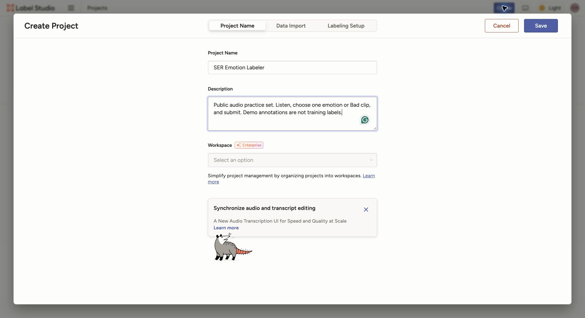
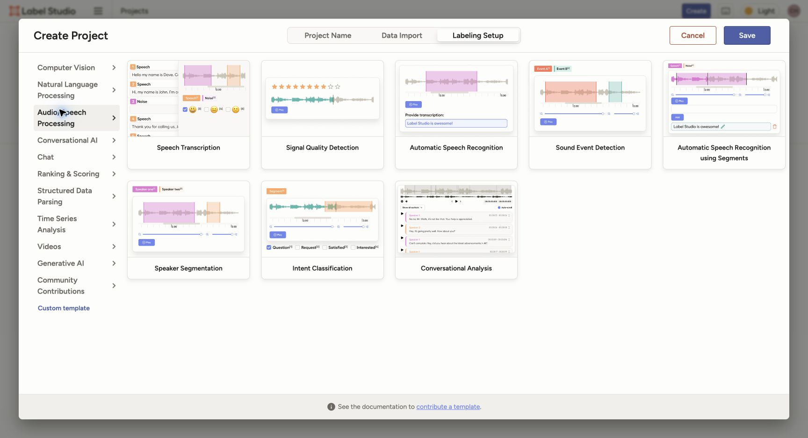
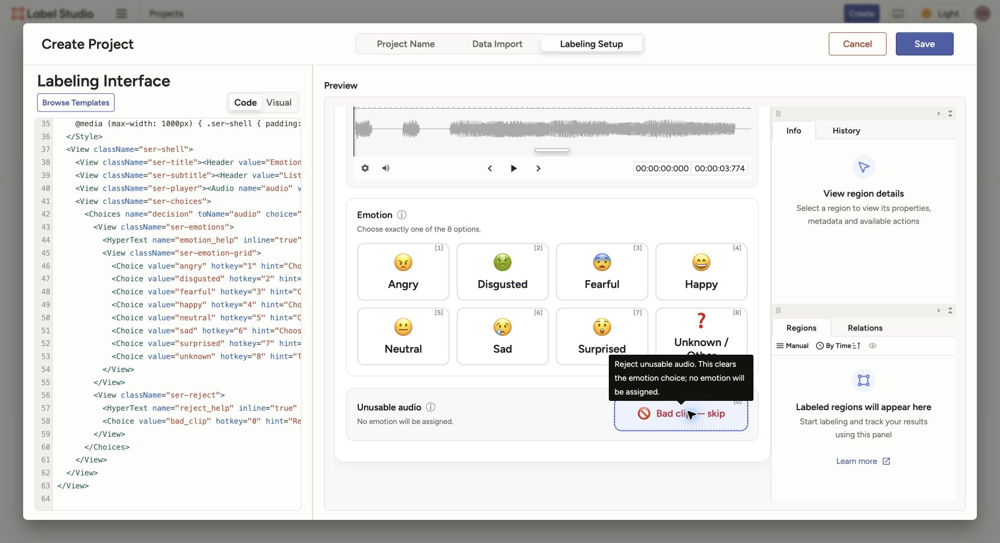
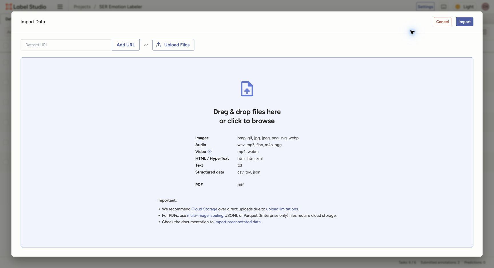
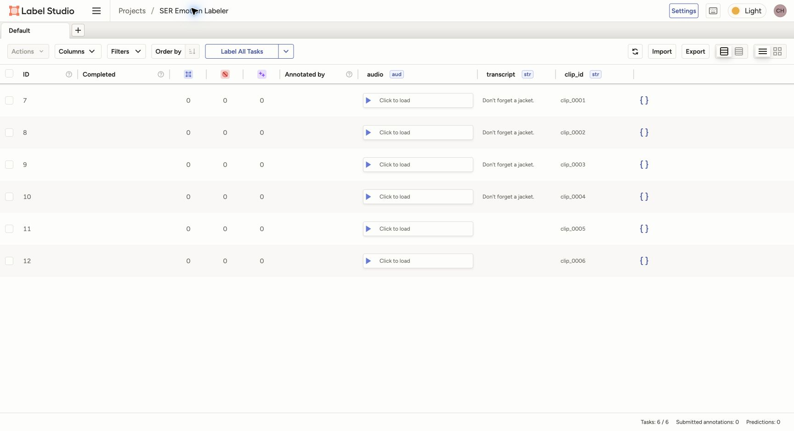
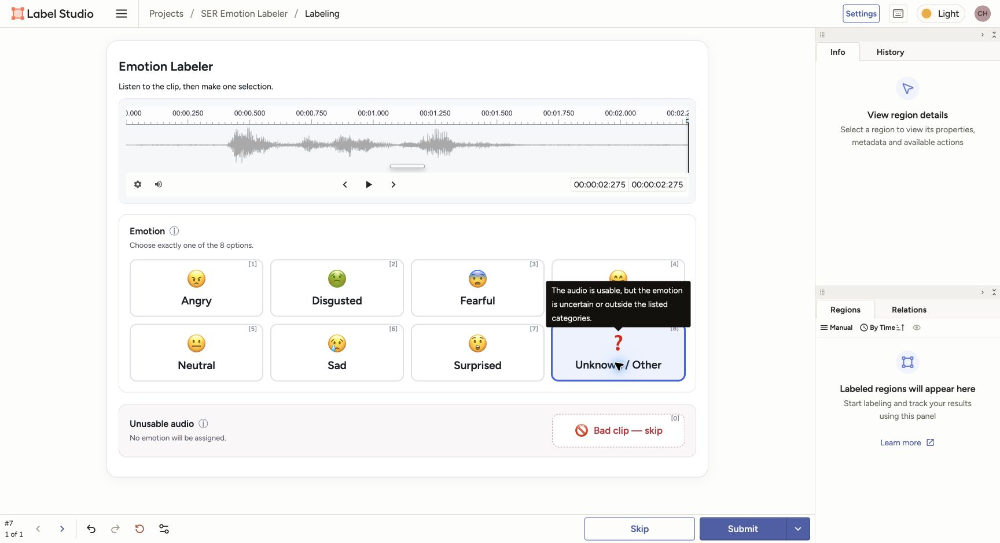
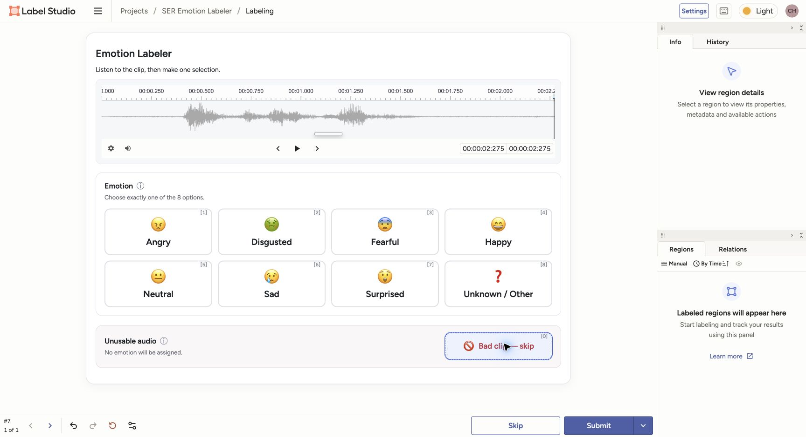
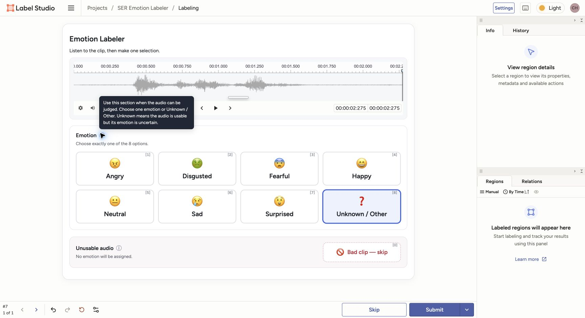
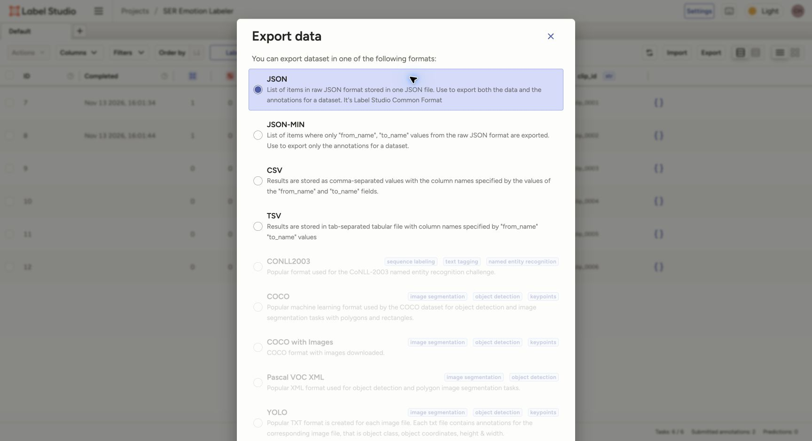
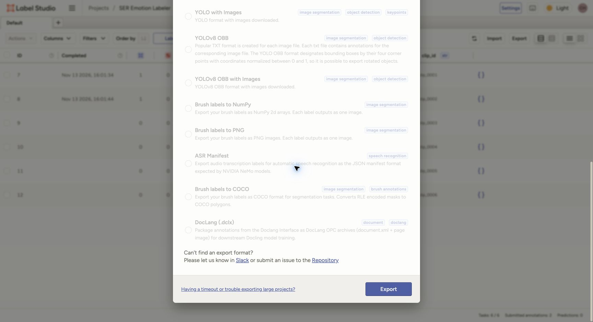

# Customer Speech Emotion Labeling Guide

[中文](README.md) | English

This subproject uses Label Studio to classify the emotion in **customer audio clips that have already been segmented**.
Each clip is one labeling task, with **one submission from each of three different accounts**; there is no need to transcribe it again or draw speaker or event boundaries.

Navigation:

- **Project lead**: [1. Create a project](#1-create-a-project) → [2. Configure the template](#2-configure-the-template) → [3. Select clips](#3-how-clips-are-selected-for-labelling) → [4. Import tasks](#4-import-tasks)
- **Annotators' daily workflow**: [5. Label clips](#5-label-clips)
- **Project lead collecting results**: [6. Export results](#6-export-results)
- **Three listeners and automatic gap filling**: [7. Require three listeners per clip](#7-require-three-listeners-per-clip)
- Configuration details: [Complete XML and field explanations](template_configuration_en.md) · [Data preparation and import](data_import_en.md)

The local demo project is [SER Emotion Labeler](http://localhost:8082/projects/3/data); the home page is <http://localhost:8082>.
The screenshots below show actual use of the local Label Studio **1.23.2** instance.
The demo uses **6 public audio clips**. Selections in the screenshots demonstrate the workflow and are not human judgments of the clips' emotions.

The screenshots retain the older demo interface, where `unknown` was displayed as **Unknown / Other**.
The current XML provides **8 emotions, including Other, plus Unknown / Uncertain and Bad clip** for new batches.
This repository update does not change the running project or historical annotations.

## 1. Create a project

**Completed by the project lead.** After logging in, click **Create Project / Create new project** and enter a name, such as `SER Emotion Labeler`.
First use public demo data to check the interface and workflow. Start the production batch after the label definitions have been agreed.



## 2. Configure the template

**Completed by the project lead.** The local version does not show Audio Classification in its **Audio/Speech Processing** template list,
so there is no need to keep looking for that option. Click **Custom template** in the lower-left corner, then open **Code**.
Do not choose **Speech Transcription** or **Speaker Segmentation**; those templates do not match this clip-level emotion classification task.



1. Choose one of the protocols below and copy the **entire XML configuration** from its file.
2. Replace the existing content in the **Code** editor. Do not append it to another template.
3. Check the preview: the upper section should contain 9 options: 8 emotions, including Other, plus Unknown / Uncertain. The lower section should have a separate Bad clip rejection option. Then click **Save**.
4. For an existing project, use **Settings → Labeling Interface → Code**.

| Configuration file | What annotators see |
|---|---|
| [config_audio_only.xml](config_audio_only.xml) | Audio, 8 emotions plus 1 uncertainty option above, and a separate Bad clip rejection option below |
| [config_with_transcript.xml](config_with_transcript.xml) | The same interface, with the existing transcript displayed as read-only text |



For the complete code, explanations of each field, and task JSON mapping, see [Custom template configuration](template_configuration_en.md).
The official [Audio Classification](https://labelstud.io/templates/audio_classification.html) template is an equivalent reference for the task type;
it is not a visible button in the local template gallery.

For an initial SER labeling round, start with audio-only. If text assistance is allowed, use with-transcript throughout the batch and ask annotators to listen before referring to the text.
Do not mix the two protocols within the same batch of independent gold labels, or show model predictions.
New batches use 8 emotions, including a distinct `other`. The `unknown` decision means uncertainty and is not one
of these 8 training classes. Freeze the configuration version when production labeling begins.

**Do not change label meanings in an existing production project.** Preserve its configuration snapshot and full
exports, and use a separate new batch or project with an explicitly recorded configuration version.
Historical `unknown` votes may mix uncertainty with other emotions; normalization preserves them as `unknown`
and never automatically relabels them as `other`.

## 3. How clips are selected for labelling

**Completed by the person preparing the data.** [prepare_tasks.py](prepare_tasks.py) picks one round of 1,000 clips
from several batches, copies their audio and writes the tasks file. For the command and settings, see
[Data preparation and import](data_import_en.md#1-generate-one-round-of-tasks).

**Why not a plain random sample?** Most customer-call audio sounds neutral. A random 1,000 clips may hold only a few
dozen emotional ones, with even fewer fearful or disgusted clips, too few to learn from. So the script looks at three
model predictions first and draws more of the clips that are likely emotional, while keeping a random share as a check.

**The three prediction columns.** Each batch's `manifest_with_predictions.parquet` is the original manifest plus three
columns: the predictions of emotion2vec, GPT Realtime and Gemini (default names `pred_e2v`, `pred_gpt`, `pred_gemini`).
Each cell holds one label; case does not matter:

- valid votes: `angry`, `disgusted`, `fearful`, `happy`, `sad`, `surprised`, `neutral`;
- no vote: empty, `invalid`, `other`, `unknown`, `none`;
- any other value is an error, to catch merge mistakes.

The models never predict `other`, so `other` can only come from human labels.

**Strata.** Only valid votes count; each clip falls into exactly one stratum:

| Stratum | Rule | Example (e2v / GPT / Gemini) |
|---|---|---|
| `agree3[emotion]` | all three votes name the same emotion | angry / angry / angry |
| `agree2[emotion]` | two votes name the same emotion | sad / sad / neutral; sad / sad / empty |
| `single[emotion]` | one emotional vote, the rest neutral | happy / neutral / neutral |
| `conflict` | two or more emotional votes, all different | angry / sad / neutral |
| `neutral` | all valid votes neutral | neutral / neutral / empty |
| `unassigned` | fewer than two valid votes | angry / empty / invalid |

`unassigned` clips are used only by the random layer and the final fill.

**Quotas per round (1,000 clips).** They are `quotas` in [config/prepare_tasks.yaml](config/prepare_tasks.yaml) and can be changed between rounds:

| Layer | Clips | Drawn from |
|---|---:|---|
| `random` | 150 | all eligible clips, uniformly; shows the real distribution |
| `emotion` | 560 | 6 emotions × about 93 (94, 94, 93, 93, 93, 93); each emotion split evenly over agree3, agree2 and single |
| `conflict` | 140 | the `conflict` stratum |
| `neutral` | 150 | the `neutral` stratum |

**When a stratum runs short:**

1. One tier of an emotion is short: take the rest from the same emotion's other tiers, in the order agree2 → single → agree3.
2. The emotion as a whole is still short: the missing number moves to `conflict`.
3. The round still has fewer than 1,000: fill it uniformly from the remaining eligible clips, labelled `fill`.
4. If there are fewer eligible clips than one round, the script stops and creates nothing.

**Other rules:**

- Only clips of 10 seconds or less are used (`is_longer_than_10_seconds` false); 10–15 s clips are left out for now.
- At most 3 clips from one call per round, so a few long calls cannot fill the round; clips of a full call are skipped.
- The 1,000 clips are shuffled at the end, so the layers are mixed and annotators cannot tell how a clip was chosen.
- The same data, settings and round number always give the same result, whatever the manifest row order.

**Annotators never see the predictions.** The tasks JSON holds only `audio`, `transcript` and `clip_id`. Predictions,
strata and layers are written only to the round's `manifest.parquet` and `summary.json`, for later use:

- after labelling, the hit rate per stratum, e.g. how often humans confirm the emotion in agree3 versus single;
- when a test set is drawn from these clips later, weights per stratum that restore the real distribution (the
  emotion layer is oversampled).

**One round = one `tasks_NNN`.** Each run makes the next round, `tasks_001`, `tasks_002`, …, with 1,000 clips, and
leaves out every clip of earlier rounds, so rounds never overlap. The output:

```text
selected_data_for_human_labeling/     # output_root
└── tasks_001/
    ├── audio/
    │   ├── part_01/                   # copied audio, 100 files per folder, in task order
    │   └── … part_10/
    ├── tasks_001.json                 # tasks: only audio, transcript and clip_id
    ├── manifest.parquet               # selected clips: all original columns plus batch, layer, stratum (e.g. agree3:angry), task index, part
    └── summary.json                   # settings, clips per stratum, targets and drawn counts, where shortfalls went
```

## 4. Import tasks

**Completed by the project lead.** The demo's 6 public clips have already been imported through **Local Files → Tasks → Save & Sync**,
so you can go directly to step 5. Storage configuration is explained in [Data preparation and import](data_import_en.md).
Production tasks come from `prepare_tasks.py` ([section 3](#3-how-clips-are-selected-for-labelling)): one `tasks_NNN/` folder per round, with 1,000 tasks and their audio.

**If only a company-hosted Label Studio is available (no Local Files / GCS)**, upload the part folders under `tasks_NNN/audio/` one by one and add
transcript and `clip_id` with a script instead: see [Upload audio directly](data_import_en.md#4-server-label-studio-upload-audio-directly-no-local-files--gcs). No task JSON is imported then.

For new rounds, you can also use **Import → Upload Files** on the project's data page:

1. Upload only the first round's `tasks_001/tasks_001.json`, then click **Import**. See [Data preparation and import](data_import_en.md#1-generate-one-round-of-tasks) for the generation command.
2. Each round has 1,000 tasks, with no overlap between rounds. Each task represents one clip and includes its audio URL, existing transcript, and stable `clip_id`.
3. Before uploading, the project lead must ensure that the current service can access the audio URLs (for a local instance, the Local Files document root is `output_root`). Uploading JSON does not upload the audio files it references.
4. When complete, import `tasks_002/tasks_002.json` and later rounds into the same project; existing results are retained. Stop when sufficient clips are labeled.
5. **Import each JSON file once**: do not import it through both Local Files Sync and Upload Files.



After importing, check the task count and open the first task to confirm that the audio plays.
For the with-transcript protocol, also check that the text matches the audio.
The screenshot below was taken immediately after import: 6 tasks and 0 submissions. Two workflow demonstrations were subsequently submitted to verify the emotion and rejection paths.



Keep company audio, transcripts, and task JSON in an authorized company data directory, outside this repository.
If audio will not play or a transcript does not match, ask the person preparing the data to check it.
Do not put a bare local filesystem path or `file://` URL in the audio field.

## 5. Label clips

**Completed by annotators.** Log in with your own account, open the project specified by the project lead, and click **Label All Tasks** to enter the labeling queue, then:

1. Listen to the entire clip. Replay it if needed.
2. If the audio is usable, choose one option in the upper **Emotion** section. Choose **Other** for a clear emotion outside the seven named emotions, or **Unknown / Uncertain** when you cannot confidently identify the emotion.
3. If the audio itself cannot be judged reliably, choose **Bad clip — skip** in the lower **Unusable audio** section. No emotion will be assigned.
4. The two paths are mutually exclusive: selecting Bad clip clears the emotion selection, and selecting an emotion clears Bad clip. Finally, click **Submit** in the lower-right corner.

For help, hover over **ⓘ** beside either section title or over an option card to read the English explanation.
You can also use Tab to focus **ⓘ**. The seven named emotions retain shortcuts `1`–`7`, Unknown / Uncertain retains `8`, Other uses `9`, and Bad clip retains `0`.
You still need to click Submit after selecting an option. No text entry is required.

The selection below demonstrates the workflow; **it is not a ground-truth emotion label for this clip**. The interface uses English text.



| Emotion value | Meaning |
|---|---|
| `angry` | Angry |
| `disgusted` | Disgusted |
| `fearful` | Fearful |
| `happy` | Happy |
| `neutral` | Neutral: there are sufficient vocal cues to support a neutral judgment |
| `sad` | Sad |
| `surprised` | Surprised |
| `other` | A clear emotion is audible but does not fit the seven named emotions; not an uncertain judgment |
| `unknown` | Usable audio, but the emotion cannot be confidently identified; distinct from `other` and `neutral` |

**Bad clip is a separate rejection decision, not an emotion category.** Use the lower Bad clip option when severe noise, silence, overlapping speakers,
or a similar issue means the audio cannot be judged reliably. `unknown` means an uncertain emotion in usable audio;
it does not replace rejection of unusable audio, and it is not the same as `neutral`.

After selecting **Bad clip — skip**, you must still click **Submit** to save the rejection decision.
Label Studio's native **Skip** action skips the current task and is not a substitute for this rejection option.

<details>
<summary>View the Bad clip selection state and English help tooltip</summary>

In the older screenshot below, selecting Bad clip clears all 8 upper options. The new template similarly clears all 9 upper options.
This also demonstrates the workflow; it is not a judgment of the sample's audio quality.



Hover over, or use the keyboard to focus, **ⓘ** beside a section title to show its English explanation.



</details>

## 6. Export results

**Completed by the project lead.** On the project's data page, click **Export** and choose the full **JSON** format.



Then scroll to the bottom of the dialog and click **Export** to download the file. Selecting a format alone does not download it.



The default export includes annotated tasks; unsubmitted tasks are not included by default.
Workflow demonstration results are only for checking the process and must not be used as training or evaluation labels.
The native JSON stores the selection as `decision`: one of the 8 emotion values, including `other`, the `unknown`
uncertainty decision, or the `bad_clip` rejection decision.
After the project lead runs the normalization script, Bad clip becomes `status="bad_clip"` and `emotion=null`, rather than an emotion label.
For the conversion command and fields, see [Data import and export](data_import_en.md#5-read-and-normalize-exports).

Keep the complete original JSON, including `data.clip_id` and each annotation's `completed_by`, `lead_time`, `result`, and `was_cancelled`.
Keep different annotators' votes for the same clip separately. Examine agreement and disagreements before deciding on training labels;
do not overwrite them with a single label immediately. Handle cancelled annotations separately.
Community Edition's UI export does not respect the current tab filters, so do not assume that it exports only the currently filtered view.

## 7. Require three listeners per clip

**Completed by the project lead for every new project.** The three-listener requirement is a project setting, separate from the audio interface XML.
The backend in the pinned local **Community 1.23.2** version supports the following settings, including updates to existing tasks.
Both XML interfaces can be used as they are. The configuration is in [project_settings.json](project_settings.json):

```json
{
  "maximum_annotations": 3,
  "overlap_cohort_percentage": 100,
  "show_overlap_first": true,
  "enable_empty_annotation": false
}
```

`3` requires three distinct annotators per clip; `100` applies this requirement to all tasks; the other settings prioritize overlap tasks and disable empty UI submissions.
Community may not expose these controls in its settings UI. Use the project lead's API credentials with the
[Update project API](https://api.labelstud.io/api-reference/api-reference/projects/update).
First exchange a Personal Access Token for a short-lived access token following the [official token instructions](https://labelstud.io/guide/access_tokens).
Legacy token authentication is disabled in this local instance, so using an old token directly returns 401. Run from the repository root:

```bash
# Set the target server, project ID, and the short-lived access token just obtained.
export LABEL_STUDIO_URL="http://localhost:8082"
export LABEL_STUDIO_PROJECT_ID="3"
export LABEL_STUDIO_AUTH_HEADER="Bearer <your-access-token>"
curl --fail-with-body --request PATCH \
  "$LABEL_STUDIO_URL/api/projects/$LABEL_STUDIO_PROJECT_ID/" \
  --header "Authorization: $LABEL_STUDIO_AUTH_HEADER" \
  --header "Content-Type: application/json" \
  --data-binary @label_studio/project_settings.json
```

Under **Organization → Add Members**, obtain the registration link and have at least three real listeners create separate accounts.
Do not share accounts. In the normal **Label All Tasks** queue:

- A clip submitted by listeners A and B remains incomplete; C can receive it if C has not labeled it.
- An account that has submitted a clip will not receive it again in the normal queue. After three distinct accounts submit, the clip leaves the pending queue.
- With the default skip policy, drafts and native Skip / cancelled annotations do not count as completed decisions. A submitted Unknown or Bad clip counts as one listener's decision.
- Submit only one annotation per person per clip. Do not use Quick View's `+` to add duplicates. Correct your answer by editing your own original annotation, without changing another person's results.

This is a completion threshold for the normal queue, **not a hard cap on every API or Quick View operation**.
Manually added duplicate annotations do not increase the distinct-listener count and can consume queue capacity.
The lead should check for and remove accidental duplicates before continuing.
For export acceptance, count **distinct `completed_by` values** among valid, non-cancelled decisions for each clip, rather than counting annotation rows.
Public demonstration submissions are not production listener labels; use a clean project for production data.

### Can listeners see each other's results?

Keep the current defaults: the normal **Label All Tasks** queue does not load other people's answers when delivering a task,
which helps listeners judge independently. Task details / Quick View still allow access to each other's results, without adding isolation mechanisms.
Listeners should first listen and submit their own decision, then view or discuss other results.
Community cannot enforce this convention or prevent changes to another person's results; `show_annotation_history` is not a blind-labeling permission switch.
If strict blind labeling becomes necessary, use an edition with the relevant permissions or isolated deployments.

The official [feature comparison](https://labelstud.io/guide/enterprise_features) still lists overlap settings as an Enterprise feature.
The Community behavior above was verified against the local **1.23.2** code and an isolated database workflow, including
[distinct annotator counting](https://github.com/HumanSignal/label-studio/blob/1.23.2/label_studio/tasks/mixins.py)
and [task selection](https://github.com/HumanSignal/label-studio/blob/1.23.2/label_studio/projects/functions/next_task.py).
After an upgrade or deployment change, verify that two listeners leave a clip incomplete, the third completes it, and an account does not receive its own submitted clip again before starting production work.

## Confirm the deployment before adding a team

A local demo and a company deployment for multiple annotators serve different purposes.
`localhost` refers to the current computer; sending that address to remote annotators will not give them access to your instance.
A company team needs an accessible company server and persistent storage.

Community Edition supports multiple user accounts, but all users can see all projects and have the same functionality.
It does not provide actual task assignment or prevent users from changing another person's annotations.
Dividing work through tabs and filters is a working convention, not permission isolation or a way to enforce blind annotation.
Three-listener gap filling uses the verified normal queue described above. Strict roles, manual task assignment, review, and enforced blind labeling still require an appropriate edition or an isolated deployment;
do not assume Enterprise instructions apply to Community Edition.

## Official references

- [Labeling interface configuration and Code](https://labelstud.io/guide/setup.html)
- [JSON export](https://labelstud.io/guide/export.html)
- [Community user permissions](https://labelstud.io/guide/signup) and [Data Manager assignment limitations](https://labelstud.io/guide/manage_data.html)
- [Official support: Community Edition does not prevent annotation overwrites](https://community.labelstud.io/t/preventing-annotation-overwrite-in-label-studio-community-edition/217)
