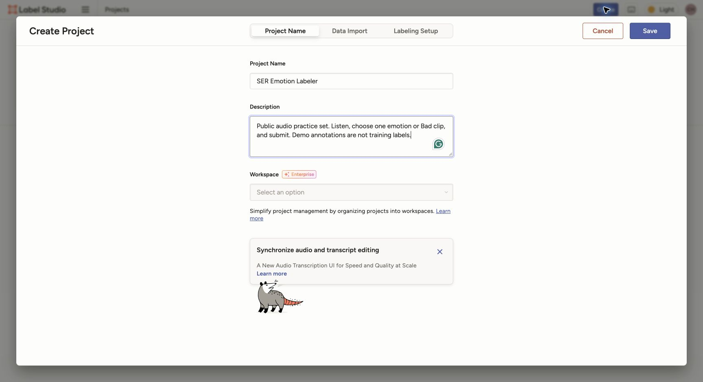
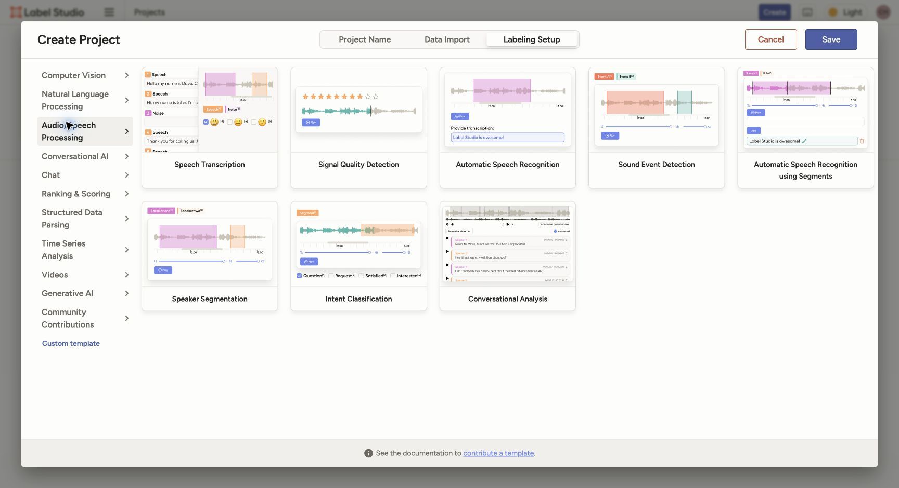
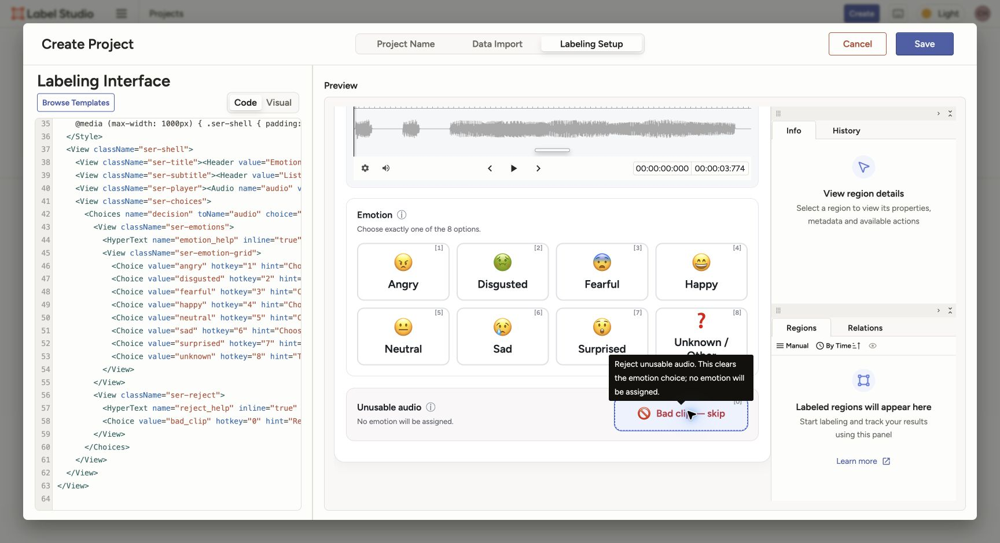
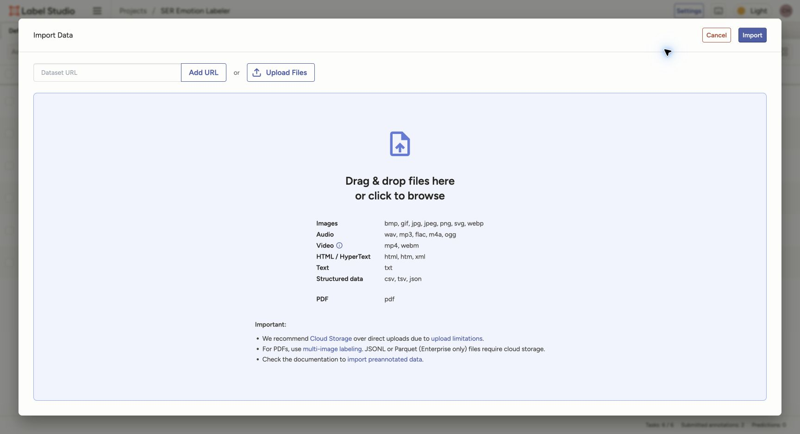
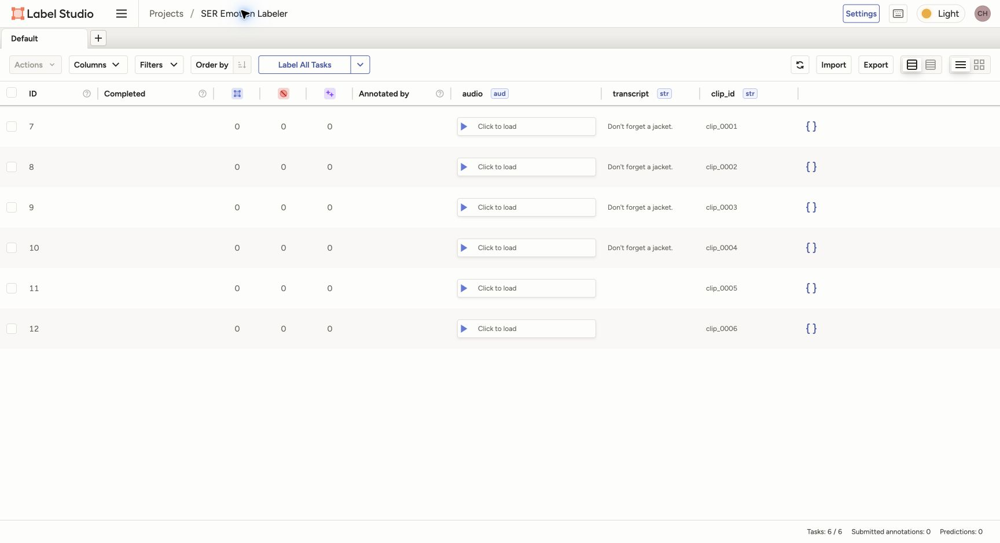
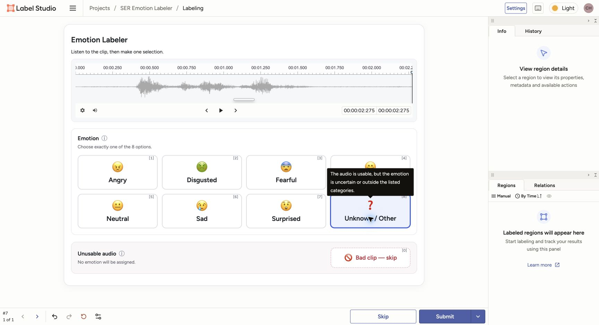
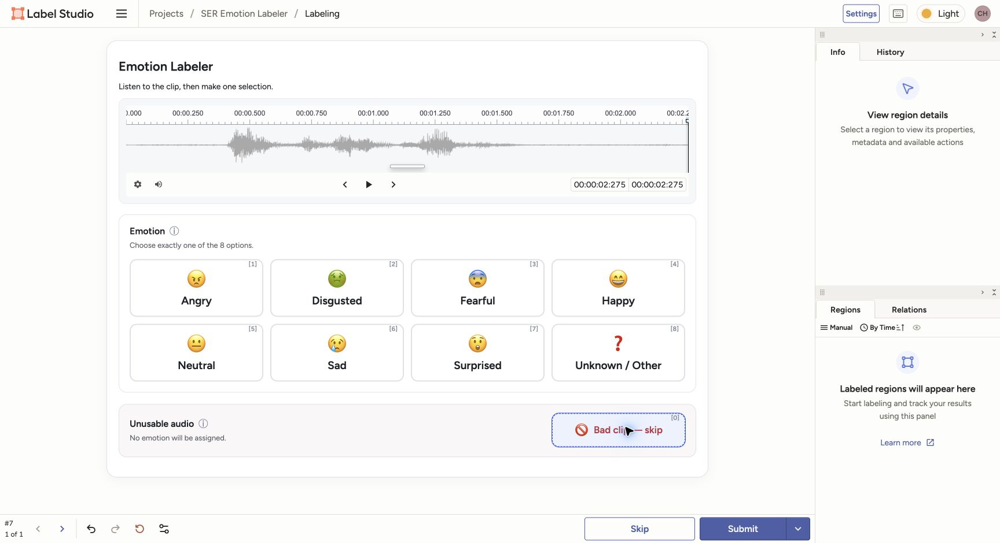
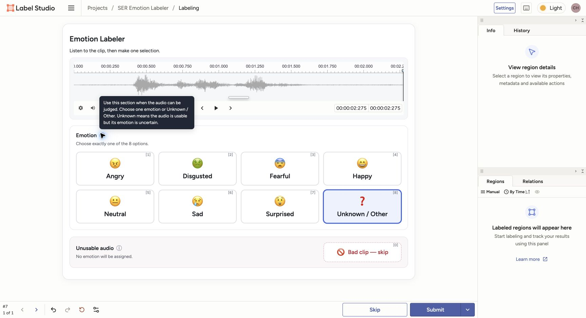
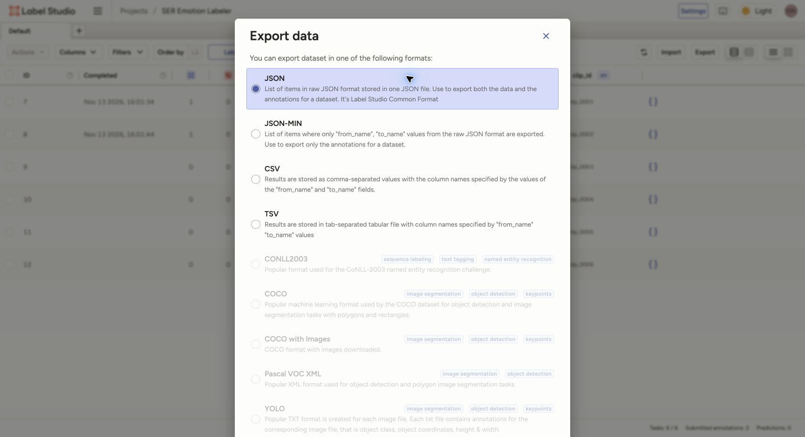
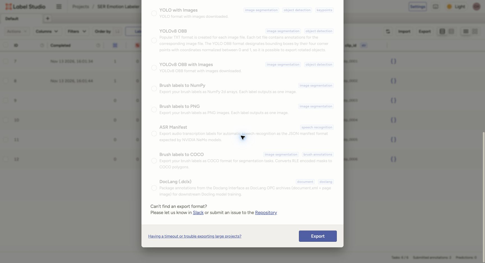

# Customer Speech Emotion Labeling Guide

[中文](README.md) | English

This subproject uses Label Studio to classify the emotion in **customer audio clips that have already been segmented**.
Each clip is one labeling task; there is no need to transcribe it again or draw speaker or event boundaries.

Navigation:

- **Project lead**: [1. Create a project](#1-create-a-project) → [2. Configure the template](#2-configure-the-template) → [3. Import tasks](#3-import-tasks)
- **Annotators' daily workflow**: [4. Label clips](#4-label-clips)
- **Project lead collecting results**: [5. Export results](#5-export-results)
- Configuration details: [Complete XML and field explanations](template_configuration_en.md) · [Data preparation and import](data_import_en.md)

The local demo project is [SER Emotion Labeler](http://localhost:8082/projects/3/data); the home page is <http://localhost:8082>.
The screenshots below show actual use of the local Label Studio **1.23.2** instance.
The demo uses **6 public audio clips**. Selections in the screenshots demonstrate the workflow and are not human judgments of the clips' emotions.

## 1. Create a project

**Completed by the project lead.** After logging in, click **Create Project / Create new project** and enter a name, such as `SER Emotion Labeler`.
First use public demo data to check the interface and workflow. Start the production batch after the label definitions have been agreed.

## 2. Configure the template

**Completed by the project lead.** The local version does not show Audio Classification in its **Audio/Speech Processing** template list,
so there is no need to keep looking for that option. Click **Custom template** in the lower-left corner, then open **Code**.
Do not choose **Speech Transcription** or **Speaker Segmentation**; those templates do not match this clip-level emotion classification task.

1. Choose one of the protocols below and copy the **entire XML configuration** from its file.
2. Replace the existing content in the **Code** editor. Do not append it to another template.
3. Check the preview: the upper section should contain 8 emotion options—7 emotions plus Unknown / Other—and the lower section should have a separate Bad clip rejection option. Then click **Save**.
4. For an existing project, use **Settings → Labeling Interface → Code**.

| Configuration file | What annotators see |
|---|---|
| [config_audio_only.xml](config_audio_only.xml) | Audio, 8 emotion options in the upper section, and a separate Bad clip rejection option below |
| [config_with_transcript.xml](config_with_transcript.xml) | The same interface, with the existing transcript displayed as read-only text |

For the complete code, explanations of each field, and task JSON mapping, see [Custom template configuration](template_configuration_en.md).
The official [Audio Classification](https://labelstud.io/templates/audio_classification.html) template is an equivalent reference for the task type;
it is not a visible button in the local template gallery.

For an initial SER labeling round, start with audio-only. If text assistance is allowed, use with-transcript throughout the batch and ask annotators to listen before referring to the text.
Do not mix the two protocols within the same batch of independent gold labels, or show model predictions.
The current 7 emotions plus `unknown` are a starting point for the pilot; the final internal label set still needs to be confirmed.
Freeze the configuration when production labeling begins, and do not casually change field names or label values.

## 3. Import tasks

**Completed by the project lead.** The demo's 6 public clips have already been imported through **Local Files → Tasks → Save & Sync**,
so you can go directly to step 4. Storage configuration is explained in [Data preparation and import](data_import_en.md).

For new batches, you can also use **Import → Upload Files** on the project's data page:

1. Upload the `tasks.json` supplied by the person preparing the data, then click **Import**.
2. Each JSON task represents one clip and includes its audio URL, existing transcript, and stable `clip_id`.
3. Before uploading, the project lead must ensure that the current service can access the audio URLs. Uploading JSON does not upload the audio files it references.
4. **Import each JSON batch once**: do not import it through both Local Files Sync and Upload Files.

After importing, check the task count and open the first task to confirm that the audio plays.
For the with-transcript protocol, also check that the text matches the audio.
The screenshot below was taken immediately after import: 6 tasks and 0 submissions. Two workflow demonstrations were subsequently submitted to verify the emotion and rejection paths.

Keep company audio, transcripts, and task JSON in an authorized company data directory, outside this repository.
If audio will not play or a transcript does not match, ask the person preparing the data to check it.
Do not put a bare local filesystem path or `file://` URL in the audio field.

## 4. Label clips

**Completed by annotators.** Open the project and tasks specified by the project lead, then:

1. Listen to the entire clip. Replay it if needed.
2. If the audio is usable, choose one option in the upper **Emotion** section. Choose **Unknown / Other** if the emotion is uncertain or outside the defined categories.
3. If the audio itself cannot be judged reliably, choose **Bad clip — skip** in the lower **Unusable audio** section. No emotion will be assigned.
4. The two paths are mutually exclusive: selecting Bad clip clears the emotion selection, and selecting an emotion clears Bad clip. Finally, click **Submit** in the lower-right corner.

For help, hover over **ⓘ** beside either section title or over an option card to read the English explanation.
You can also use Tab to focus **ⓘ**. Emotion shortcuts are `1`–`8`; Bad clip is `0`.
You still need to click Submit after selecting an option. No text entry is required.

The selection below demonstrates the workflow; **it is not a ground-truth emotion label for this clip**. The interface uses English text.

| Emotion value | Meaning |
|---|---|
| `angry` | Angry |
| `disgusted` | Disgusted |
| `fearful` | Fearful |
| `happy` | Happy |
| `neutral` | Neutral: there are sufficient vocal cues to support a neutral judgment |
| `sad` | Sad |
| `surprised` | Surprised |
| `unknown` | The audio is usable, but the emotion is uncertain or outside the current categories |

**Bad clip is a separate rejection decision, not a ninth emotion.** Use the lower Bad clip option when severe noise, silence, overlapping speakers,
or a similar issue means the audio cannot be judged reliably. `unknown` means an uncertain emotion in usable audio;
it does not replace rejection of unusable audio, and it is not the same as `neutral`.

After selecting **Bad clip — skip**, you must still click **Submit** to save the rejection decision.
Label Studio's native **Skip** action skips the current task and is not a substitute for this rejection option.

View the Bad clip selection state and English help tooltip

After Bad clip is selected below, none of the 8 emotion options is selected.
This also demonstrates the workflow; it is not a judgment of the sample's audio quality.

Hover over, or use the keyboard to focus, **ⓘ** beside a section title to show its English explanation.

## 5. Export results

**Completed by the project lead.** On the project's data page, click **Export** and choose the full **JSON** format.

Then scroll to the bottom of the dialog and click **Export** to download the file. Selecting a format alone does not download it.

The default export includes annotated tasks; unsubmitted tasks are not included by default.
Workflow demonstration results are only for checking the process and must not be used as training or evaluation labels.
The native JSON stores the selection as `decision`: either one of the 8 emotion values or the `bad_clip` rejection decision.
After the project lead runs the normalization script, Bad clip becomes `status="bad_clip"` and `emotion=null`, rather than an emotion label.
For the conversion command and fields, see [Data import and export](data_import_en.md#4-read-and-normalize-exports).

Keep the complete original JSON, including `data.clip_id` and each annotation's `completed_by`, `lead_time`, `result`, and `was_cancelled`.
Keep different annotators' votes for the same clip separately. Examine agreement and disagreements before deciding on training labels;
do not overwrite them with a single label immediately. Handle cancelled annotations separately.
Community Edition's UI export does not respect the current tab filters, so do not assume that it exports only the currently filtered view.

## Confirm the deployment before adding a team

A local demo and a company deployment for multiple annotators serve different purposes.
`localhost` refers to the current computer; sending that address to remote annotators will not give them access to your instance.
A company team needs an accessible company server and persistent storage.

Community Edition supports multiple user accounts, but all users can see all projects and have the same functionality.
It does not provide actual task assignment or prevent users from changing another person's annotations.
Dividing work through tabs and filters is a working convention, not permission isolation or a way to enforce blind annotation.
Strict roles, task assignment, review, and independent annotation workflows require an appropriate edition or an isolated deployment;
do not assume Enterprise instructions apply to Community Edition.

## Official references

- [Labeling interface configuration and Code](https://labelstud.io/guide/setup.html)
- [JSON export](https://labelstud.io/guide/export.html)
- [Community user permissions](https://labelstud.io/guide/signup) and [Data Manager assignment limitations](https://labelstud.io/guide/manage_data.html)
- [Official support: Community Edition does not prevent annotation overwrites](https://community.labelstud.io/t/preventing-annotation-overwrite-in-label-studio-community-edition/217)
