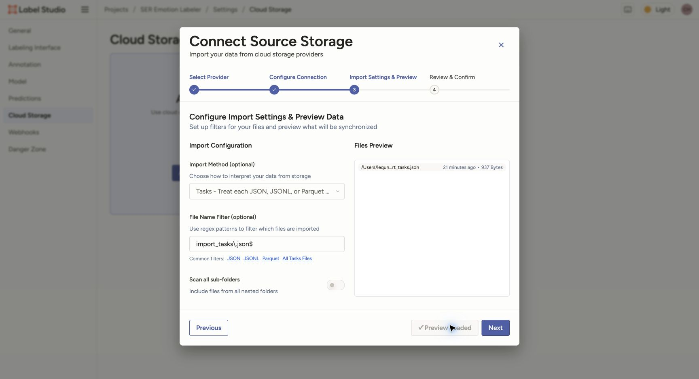

# 数据准备人员：导入接口

中文 | [English](data_import_en.md)

给每个已切分的客户 clip 建一条任务。音频和转写通过同一 stem 配对，各自保持扁平目录。
本机服务的 document root 已由负责人配置；下方使用通用路径说明，不涉及安装或启动步骤。

## 1. 准备一个批次目录

将批次放在 document root 的**严格子目录**中，例如：

```text
/absolute/path/to/dataset/        # 服务已配置的 document root
└── batch/                       # Local Files 的 Source path
    ├── audio/                   # clip_0001.wav、clip_0002.mp3 …
    ├── transcripts/             # clip_0001.txt、clip_0002.txt …
    └── tasks.json
```

Local Files 的 Source path 必须是 document root 内的严格子目录，**不能与 document root 相等**。
这也是将任务 JSON 放进 `batch/` 的原因。

在仓库根目录生成任务：

```bash
python3 label_studio/prepare_tasks.py \
  --audio-dir /absolute/path/to/dataset/batch/audio \
  --transcript-dir /absolute/path/to/dataset/batch/transcripts \
  --document-root /absolute/path/to/dataset \
  --output /absolute/path/to/dataset/batch/tasks.json
```

支持 WAV、MP3、FLAC、OGG、M4A，不递归扫描、不复制音频。省略 `--transcript-dir` 时在音频目录找同名 UTF-8
`.txt`。缺失转写用空字符串并报告数量；音频 stem 必须唯一。音频、转写目录及文件的真实路径都必须位于
document root 内；指向根目录外的 symlink 被拒绝。已有 output 不会覆盖，重复生成时请换文件名。

输出形态：

```json
[
  {
    "data": {
      "audio": "/data/local-files/?d=batch/audio/clip_0001.wav",
      "transcript": "已有的 clip 转写",
      "clip_id": "clip_0001"
    }
  }
]
```

脚本对 URL 中的特殊字符编码。`?d=` 后是相对 **document root** 的路径，不是相对 Source path；
因此这里必须保留 `batch/`。不要使用 `file://` 或裸本机绝对路径。
原始 call/turn/segment 时间戳保留在数据准备 manifest 中，通过稳定的 `clip_id` 与标注导出关联。
公司音频、转写、任务 JSON 和导出均保留在公司授权目录，不写入本仓库。

## 2. 用 Local Files / Tasks 同步导入

项目内进入 **Settings → Cloud Storage → Add Source Storage → Local Files**：

1. Source path / Absolute local path 填 `/absolute/path/to/dataset/batch`，是 document root 的严格子目录。
2. 点击 **Test Connection**；成功后点 **Next**。
3. **Import Method** 选 **Tasks**，文件过滤填 `tasks\.json$`。
4. 点击 **Load Preview**，确认预览读取到任务而不是把 JSON 当成音频文件。
5. 点击 **Next → Save & Sync**，回到数据页核对任务数，并试播一条。

本次公开演示采用的就是 Tasks 同步导入。下图中的文件名是 `import_tasks.json`，所以过滤条件实际为
`import_tasks\.json$`；使用上面的通用目录时，请对应使用 `tasks\.json$`。



音频加转写需要 JSON 将它们配对，不能扫描一堆 WAV/TXT 后期待系统自动配对。

## 3. 或通过 Import 上传 JSON

如果负责人已配置好音频的本地文件访问，也可以在项目数据页 **Import → Upload Files** 上传同一个 `tasks.json`。
上传 JSON 只导入任务字段，不会上传 JSON 中引用的音频。

**同一批次在 Tasks Sync 和 Upload Files 中二选一**，不要两种方式重复导入。

## 4. 读取并标准化导出

先在 Label Studio **Export → JSON** 下载并保留完整原生文件。以 `data.clip_id` 关联 manifest。
原生 `result` 中 `from_name="decision"`、`type="choices"` 的 `value.choices` 保存唯一决策，
包括 8 个情绪值或 `bad_clip` 弃用决策；Bad clip 不是情绪类别。

使用本项目标准化脚本生成业务数据，保留原生文件：

```bash
python3 label_studio/normalize_export.py \
  --input /absolute/path/to/exports/label-studio.json \
  --output /absolute/path/to/exports/emotion-votes.json
```

脚本按每条 annotation 输出一行记录，**保留每位标注员的 vote，不聚合、不覆盖为一个最终标签**。
保留 `clip_id`、`task_id`、`annotation_id`、`annotator_id`、`lead_time`、`decision`、`status` 和 `emotion`。
`completed_by` 是用户对象时只取其 ID，不输出邮箱。

- 8 个情绪决策，包括 `unknown`：`status="accepted"`，`emotion` 为相应情绪值。
- Bad clip 决策：`status="bad_clip"`，`emotion` 为 JSON `null`，例如：

```json
[
  {
    "clip_id": "clip_0001",
    "task_id": 1,
    "annotation_id": 1,
    "annotator_id": 1,
    "lead_time": 3.5,
    "decision": "bad_clip",
    "status": "bad_clip",
    "emotion": null
  }
]
```

`accepted` 只表示选择了情绪分支，不代表该 vote 已经多人裁决为 gold；`unknown` 仍单独保留。
音频可用但情绪不确定时选 Unknown；音频本身无法可靠判断时选 Bad clip，后处理排除这类音频。

取消的 annotation（`was_cancelled`）和无 annotation 的任务会跳过，并报告数量。
Label Studio 默认导出已标注任务，未提交任务不默认包含在内。
缺失 `clip_id` 或 `decision`、多个决策/多个选择、未知值均会报错，验证全部成功后才写输出；已有输出不会被覆盖。

官方依据：[本地存储](https://labelstud.io/guide/storage_local)、[Choices](https://labelstud.io/tags/choices)、
[只读 Text](https://labelstud.io/tags/text)、[导出字段](https://labelstud.io/guide/export.html)。
