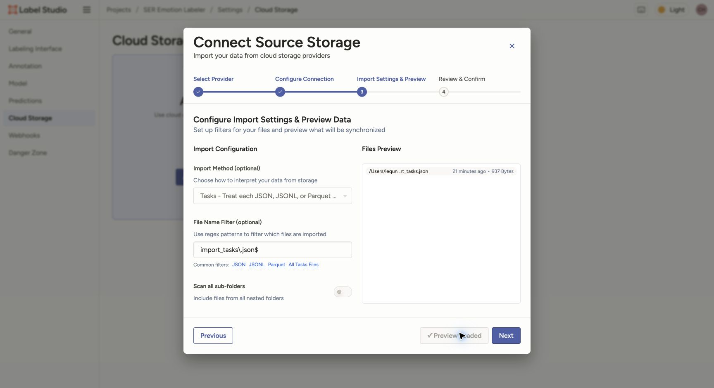

# Data preparation: import and export interface

[中文](data_import.md) | English · [User guide](README_en.md)

Create one task for each segmented customer clip. Pair audio and transcripts by the same filename stem, keeping
both directories flat. The project owner has already configured the local service's document root. The generic
paths below explain the data interface, without installation or startup steps.

## 1. Prepare a batch directory

Place each batch in a **strict subdirectory** of the document root, for example:

```text
/absolute/path/to/dataset/        # Configured service document root
└── batch/                       # Local Files Source path
    ├── audio/                   # clip_0001.wav, clip_0002.mp3 …
    ├── transcripts/             # clip_0001.txt, clip_0002.txt …
    └── tasks.json
```

The Local Files Source path must be a strict subdirectory of the document root; **it cannot equal the document root**.
This is why the task JSON is placed inside `batch/`.

Generate tasks from the repository root:

```bash
python3 label_studio/prepare_tasks.py \
  --audio-dir /absolute/path/to/dataset/batch/audio \
  --transcript-dir /absolute/path/to/dataset/batch/transcripts \
  --document-root /absolute/path/to/dataset \
  --output /absolute/path/to/dataset/batch/tasks.json
```

The script supports WAV, MP3, FLAC, OGG, and M4A. It does not scan recursively or copy audio. If `--transcript-dir`
is omitted, it looks for same-stem UTF-8 `.txt` files in the audio directory. Missing transcripts become empty
strings, and their count is reported. Audio stems must be unique. The resolved paths of the audio and transcript
directories and files must all be within the document root; symlinks pointing outside it are rejected.
Existing output files are never overwritten. Use a new filename when generating another task file.

Output structure:

```json
[
  {
    "data": {
      "audio": "/data/local-files/?d=batch/audio/clip_0001.wav",
      "transcript": "Existing transcript for this clip.",
      "clip_id": "clip_0001"
    }
  }
]
```

The script URL-encodes special characters. The path after `?d=` is relative to the **document root**, not the Source
path, so it must retain `batch/` in this example. Do not use `file://` or a bare absolute local path.
Keep original call/turn/segment timestamps in the data preparation manifest and join them to annotation exports
using the stable `clip_id`. Company audio, transcripts, task JSON, and exports remain in authorized company
directories and are not written into this repository.

## 2. Import with Local Files / Tasks

Within the project, open **Settings → Cloud Storage → Add Source Storage → Local Files**:

1. Set Source path / Absolute local path to `/absolute/path/to/dataset/batch`, a strict subdirectory of the document root.
2. Click **Test Connection**, then **Next** after it succeeds.
3. Set **Import Method** to **Tasks** and the filename filter to `tasks\.json$`.
4. Click **Load Preview** and confirm that the preview reads tasks rather than treating the JSON as an audio file.
5. Click **Next → Save & Sync**, return to the data page, check the task count, and play one clip.

The public demo uses this Tasks synchronization method. In the screenshot, the filename is `import_tasks.json`, so
the actual filter is `import_tasks\.json$`. Use `tasks\.json$` for the generic directory example above.



Audio and transcripts must be paired through JSON. Scanning a collection of WAV/TXT files does not automatically pair them.

## 3. Or upload JSON through Import

If the project owner has already configured local file access for the audio, upload the same `tasks.json` from the
project data page using **Import → Upload Files**. Uploading JSON imports task fields; it does not upload the audio
referenced by that JSON.

**Choose either Tasks Sync or Upload Files for each batch.** Do not import the same batch through both methods.

## 4. Read and normalize exports

First download and retain the complete native file using Label Studio **Export → JSON**. Join it to the manifest
using `data.clip_id`. In the native `result`, the entry with `from_name="decision"` and `type="choices"` stores the
single decision in `value.choices`: one of the 8 emotion values or the `bad_clip` rejection decision.
Bad clip is not an emotion category.

Use this project's normalization script to generate business data, retaining the native file:

```bash
python3 label_studio/normalize_export.py \
  --input /absolute/path/to/exports/label-studio.json \
  --output /absolute/path/to/exports/emotion-votes.json
```

The script outputs one record per annotation, **preserving every annotator's vote without aggregating or replacing
votes with a single final label**. It retains `clip_id`, `task_id`, `annotation_id`, `annotator_id`, `lead_time`,
`decision`, `status`, and `emotion`. When `completed_by` is a user object, only its ID is used; email addresses are
not included.

- For any of the 8 emotion decisions, including `unknown`: `status="accepted"`, and `emotion` is the corresponding emotion value.
- For a Bad clip decision: `status="bad_clip"`, and `emotion` is JSON `null`, for example:

```json
[
  {
    "clip_id": "clip_0001",
    "task_id": 1,
    "annotation_id": 1,
    "annotator_id": 1,
    "lead_time": 3.5,
    "decision": "bad_clip",
    "status": "bad_clip",
    "emotion": null
  }
]
```

`accepted` only means that the emotion branch was selected. It does not mean the vote has been adjudicated into a
gold label; `unknown` remains distinct. Select Unknown when the audio is usable but the emotion is uncertain.
Select Bad clip when the audio itself cannot be judged reliably; exclude these clips during downstream processing.

Cancelled annotations (`was_cancelled`) and tasks with no annotations are skipped, and their counts are reported.
Label Studio exports annotated tasks by default; unsubmitted tasks are not included by default.
Missing `clip_id` or `decision`, multiple decisions or selections, and unknown values cause errors. Output is written
only after all validation succeeds, and existing output files are never overwritten.

Official references: [Local storage](https://labelstud.io/guide/storage_local), [Choices](https://labelstud.io/tags/choices),
[read-only Text](https://labelstud.io/tags/text), and [export fields](https://labelstud.io/guide/export.html).
