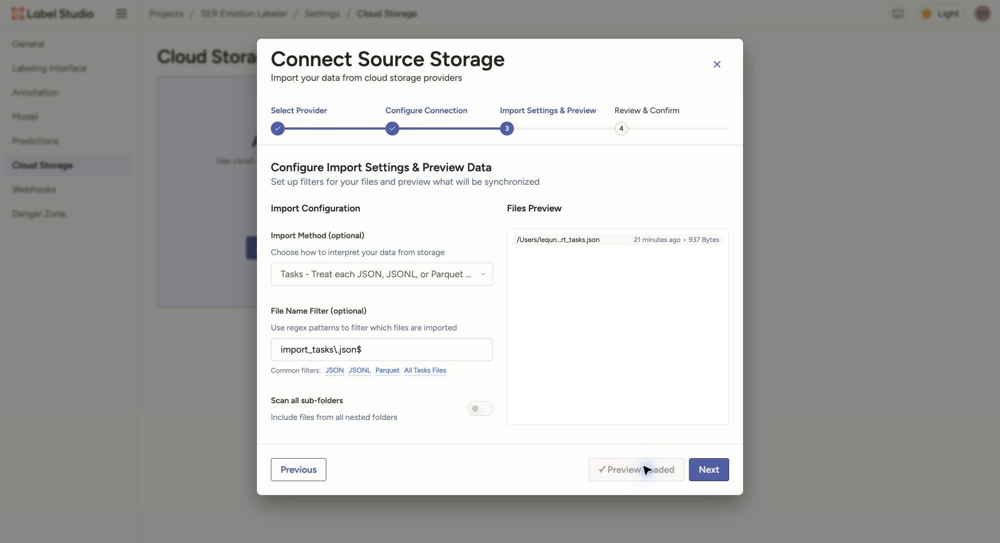

# Data preparation: import and export interface

[中文](data_import.md) | English · [User guide](README_en.md)

[prepare_tasks.py](prepare_tasks.py) picks one round of 1,000 customer clips from several batches, copies their audio
and writes the Label Studio tasks file. Transcripts come directly from the manifest's `text` column. The selection rules
(strata, quotas, shortfalls) are explained in [section 3 of the user guide](README_en.md#3-how-clips-are-selected-for-labelling).
This page covers the input, settings and output, and three ways to import; it does not cover installing or starting
Label Studio.

## 1. Generate one round of tasks

### 1.1 Input

```text
/absolute/path/to/curated_dataset/              # curated_root
├── batch_01/
│   ├── audio/                                  # flat audio folder, e.g. <UUID>.wav
│   └── manifest_with_predictions.parquet       # original manifest + three prediction columns
├── batch_02/
└── …                                           # about 40 random batches
```

Each `manifest_with_predictions.parquet` needs these columns; rename them under `columns` in the YAML:

| Default column | Content | Key under `columns` |
|---|---|---|
| `clip_id` | Stable ID, written to `data.clip_id`; unique across all batches | `clip_id` |
| `audio_clip_file` | Audio file name or path | `audio` |
| `text` | Existing transcript, written to `data.transcript`; blank or null becomes `""` | `text` |
| `is_longer_than_10_seconds` | `true` excludes the clip, `false` keeps it | `long_clip` |
| `external_call_id` | Call ID, for "at most 3 clips per call" | `call_id` |
| `pred_e2v`, `pred_gpt`, `pred_gemini` | Predictions of emotion2vec, GPT Realtime and Gemini | `predictions` |

**Prediction label format**: one label per cell; case and surrounding spaces are ignored.

- Valid votes: `angry`, `disgusted`, `fearful`, `happy`, `sad`, `surprised`, `neutral`.
- No vote: empty (null, NaN, empty string), `invalid`, `other`, `unknown`, `none`.
- Any other value is an error that lists up to 10 unexpected values per column, to catch merge mistakes.

All other manifest columns are kept as they are in the output `manifest.parquet`.

### 1.2 Settings and run

The settings are in [config/prepare_tasks.yaml](config/prepare_tasks.yaml); there are no command-line arguments:

```yaml
curated_root: /absolute/path/to/curated_dataset
batches: [batch_01, batch_02, batch_03]          # batch folders that take part
manifest_name: manifest_with_predictions.parquet
output_root: /absolute/path/to/selected_data_for_human_labeling
columns:
  clip_id: clip_id
  audio: audio_clip_file
  text: text
  long_clip: is_longer_than_10_seconds
  call_id: external_call_id
  predictions: [pred_e2v, pred_gpt, pred_gemini]
quotas:                  # clips per round = the sum = 1,000
  random: 150
  emotion: 560
  conflict: 140
  neutral: 150
max_clips_per_call: 3
files_per_folder: 100    # files per part folder = files per upload
seed: 42
```

Run from the repository root with a Python that has [requirements.txt](requirements.txt) installed (the
`emotion_recognition_llm` environment already has it):

```bash
python3 label_studio/prepare_tasks.py
```

Each run makes the next round (`tasks_001`, `tasks_002`, …) and leaves out every clip already in an earlier round's
`tasks_NNN/tasks_NNN.json`. The random seed is `seed` plus the round number, so the same data and settings always give
the same round.

### 1.3 Checks

The script finishes every check before it copies anything. Any failed check stops the run, and nothing is created.

- `output_root` must not be inside `curated_root`, nor the reverse.
- Long-clip flags can be booleans, numeric `1/0`, or strings `true/false` and `1/0` (case and surrounding spaces are
  ignored); missing or invalid flags are errors. Filtering uses only this flag; audio duration is not measured.
- `clip_id` must be unique across all listed batches; eligible clips need a non-empty call ID.
- Audio paths: a bare file name is looked up in `<batch>/audio/`; a relative path with folders is relative to the batch
  folder; an absolute path must lie inside `curated_root`. Symlinks that point outside `curated_root` are rejected.
  WAV, MP3, FLAC, OGG and M4A are supported.
- File names must be unique across the eligible clips (ignoring case and the characters Label Studio drops) and at most
  70 characters long: server Label Studio matches tasks by file name and shortens longer names.
- Every selected audio file must exist; otherwise the missing files are listed.

While running, the script shows per batch the rows, long clips, clips used in earlier rounds and eligible clips; the
votes per model (including no votes); the clips per stratum; the target and drawn count per layer; where shortfalls
went; and finally the next steps.

### 1.4 Output

```text
/absolute/path/to/selected_data_for_human_labeling/   # output_root
├── tasks_001/                        # round 1
│   ├── audio/part_01/ … part_10/     # audio copies, 100 per folder, in task order; originals unchanged
│   ├── tasks_001.json                # the tasks file
│   ├── manifest.parquet              # selected rows: all original columns + source and position
│   └── summary.json                  # record of the round
└── tasks_002/                        # the next run makes round 2
```

- `manifest.parquet` adds `source_batch`, `layer` (random, emotion, conflict, neutral, fill), `target_class`,
  `stratum` (e.g. `agree3:angry`), `task_index`, `part` and `copied_audio` after the original columns.
- `summary.json` records the settings, round number, seed, clips per stratum, targets and drawn counts, where
  shortfalls went, the number of blank transcripts, and when it was created.
- Files are written into `tasks_NNN.partial/`, which is renamed to `tasks_NNN/` only at the end and removed on any
  error. Existing rounds are never overwritten.

The tasks JSON:

```json
[
  {
    "data": {
      "audio": "/data/local-files/?d=tasks_001/audio/part_01/<clip>.wav",
      "transcript": "Existing transcript for this clip.",
      "clip_id": "<clip_id>"
    }
  }
]
```

Only these three fields: predictions, strata and votes never enter the tasks JSON, so annotators cannot see them.
The script URL-encodes special characters. The path after `?d=` is relative to `output_root`, so a local Label Studio
uses `output_root` as its document root. Do not use `file://` or a bare absolute local path. Company audio,
transcripts, task JSON and exports stay in authorized company directories and are not written into this repository.

## 2. Import with Local Files / Tasks

Set the local Label Studio's Local Files **document root** to `output_root`. Within the project, open
**Settings → Cloud Storage → Add Source Storage → Local Files**:

1. Set Source path / Absolute local path to `/absolute/path/to/selected_data_for_human_labeling/tasks_001`.
   It must be a strict subdirectory of the document root; **it cannot equal the document root**.
2. Click **Test Connection**, then **Next** after it succeeds.
3. Set **Import Method** to **Tasks** and the filename filter to `^tasks_001\.json$`.
4. Click **Load Preview** and confirm that the preview reads tasks rather than treating the JSON as an audio file.
5. Click **Next → Save & Sync**, return to the data page, check the task count, and play one clip.

For the next round, add another Source Storage with Source path `…/tasks_002` and filter `^tasks_002\.json$`.

The public demo uses this Tasks synchronization method. In the screenshot, the filename is `import_tasks.json`, so
the actual filter is `import_tasks\.json$`. Use `^tasks_001\.json$` for the round folder above.



Sync only the filtered task JSON. Do not also scan the audio folders using **Files** mode, which would bypass the
selection. Updating JSON does not automatically remove tasks that were imported previously.

## 3. Or upload JSON through Import

If the project owner has already configured local file access for the audio, the recommended incremental workflow
is **Import → Upload Files** on the project data page:

1. Upload only `tasks_001/tasks_001.json` and complete its labeling.
2. Upload `tasks_002/tasks_002.json` to the same project to continue; existing annotations are retained.
3. Continue as needed, stopping after a few thousand clips if sufficient.

Uploading JSON imports task fields, not the referenced audio. **Choose either Tasks Sync or Upload Files for each
JSON, and import each file only once.** Do not duplicate imports.

## 4. Server Label Studio: upload audio directly (no Local Files / GCS)

**When to use this**: only a company-hosted Label Studio Enterprise (LSE) is allowed, Local Files is not available,
and GCS cannot be set up in time. The project lead then uploads the audio files through **Import → Upload Files**.
`tasks_NNN.json` is **not imported**: it is the list of audio files to upload and the source of `transcript` and
`clip_id`.

**Why the template must be switched**: the with-transcript template has two data keys, `$audio` and `$transcript`,
and Label Studio refuses direct audio uploads for it:

> Your label config has more than one data key and direct file upload supports only one data key.
> To import data with multiple data keys, use a JSON or CSV file.

So upload with the audio-only template (only `$audio`), add transcript and `clip_id` with a script, then switch to
with-transcript.

| Step | Action | Check |
|---|---|---|
| 1 | Locally, run `prepare_tasks.py` ([section 1](#1-generate-one-round-of-tasks)); the audio is already split into `tasks_NNN/audio/part_01/`, `part_02/`, … | Files per part |
| 2 | Create the LSE project with [config_audio_only.xml](config_audio_only.xml) | Preview shows only the audio and choices |
| 3 | Open **Import**; each time, select all files of one part folder and drag them in | Task count equals files uploaded |
| 4 | Run `attach_task_data.py` as a dry run (`write: false`) | No errors; `To update` equals the file count |
| 5 | Set `write: true` (`limit: 3`) to write 3 tasks | The Data Manager shows `transcript` and `clip_id` columns filled for those 3 |
| 6 | Set `limit: null` to write all | It prints `All tasks of this file are done` |
| 7 | In **Settings → Labeling Interface → Code**, switch to [config_with_transcript.xml](config_with_transcript.xml) | Open a task: the audio plays and the text matches |
| 8 | Only now let the annotators start | |

Run both scripts from the repository root with a Python that has [requirements.txt](requirements.txt) installed
(the `emotion_recognition_llm` environment already has it). They take no command-line arguments; their settings are
YAML files in `label_studio/config/`.

- Each part holds at most `files_per_folder` files. Open-source Label Studio accepts 100 files per upload by default
  (`DATA_UPLOAD_MAX_NUMBER_FILES`); on LSE the admin's setting applies. If an upload is refused, lower the value,
  delete that round's folder and run again: with unchanged settings, the same clips are selected in smaller parts.
- Label Studio replaces spaces with `_`, drops characters such as `#`, and adds an 8-character random prefix;
  `attach_task_data.py` handles this. `prepare_tasks.py` has already checked that file names are unique and at most
  70 characters long.

### 4.1 Add transcript and clip_id

`label_studio/config/attach_task_data.yaml`:

```yaml
project_id: 1      # the number in the project address: https://<your-label-studio-host>/projects/<id>/data
tasks_file: /absolute/path/to/selected_data_for_human_labeling/tasks_001/tasks_001.json
write: false       # false = dry run (read and match only); true = write
limit: 3           # most tasks written per run; once checked, set null = all
```

The server address and token live only in environment variables, never in YAML (the repository is public):

```bash
export LABEL_STUDIO_URL="https://<your-label-studio-host>"
read -rs LABEL_STUDIO_API_KEY && export LABEL_STUDIO_API_KEY   # paste the token, press Enter: hidden, not in history
python3 label_studio/attach_task_data.py
```

- Where the token is: avatar (top right) → **Account & Settings** → **Legacy Token**. A Personal Access Token also
  works; the script exchanges it for a short-lived access token.
- Treat the token like a password: never put it in a file or send it to anyone. If it leaks, reset it on the same page.
- On HTTP 401, check the token; if the admin disabled legacy tokens, use a Personal Access Token.
- If the company network uses its own certificate authority, first set
  `export REQUESTS_CA_BUNDLE=/absolute/path/to/company-ca.pem`.
- The script prints counts, file names, and `clip_id` values only, never transcripts or the token.
- Problems such as an uploaded file with no match or a file uploaded twice stop the run before anything is written,
  and the tasks are listed. For a double upload, delete the extra task in the Data Manager and run again. Finished
  tasks are skipped, so re-running is safe.

### 4.2 Later rounds in the same project

Only between rounds, while nobody is labeling:

1. Switch the template back to `config_audio_only.xml`. Both templates have the same choices, so existing annotations stay.
2. Run `prepare_tasks.py` again to make the next round, `tasks_002/`, and upload its part folders.
3. Set `tasks_file` in `attach_task_data.yaml` to `…/tasks_002/tasks_002.json` and follow steps 4–6 of the table.
   Tasks of earlier rounds appear as `other batches (ignored)` and are left unchanged.
4. Switch back to `config_with_transcript.xml`, then let the annotators continue.

## 5. Read and normalize exports

First download and retain the complete native file using Label Studio **Export → JSON**. Join it to the manifest
using `data.clip_id`. In the native `result`, the entry with `from_name="decision"` and `type="choices"` stores the
single decision in `value.choices`: one of the 8 emotion values, including `other`, the `unknown` uncertainty
decision, or the `bad_clip` rejection decision.
Bad clip is not an emotion category.

Use this project's normalization script to generate business data, retaining the native file:

```bash
python3 label_studio/normalize_export.py \
  --input /absolute/path/to/exports/label-studio.json \
  --output /absolute/path/to/exports/emotion-votes.json
```

The script outputs one record per annotation, **preserving every annotator's vote without aggregating or replacing
votes with a single final label**. It retains `clip_id`, `task_id`, `annotation_id`, `annotator_id`, `lead_time`,
`decision`, `status`, and `emotion`. When `completed_by` is a user object, only its ID is used; email addresses are
not included.

- For any of the 8 emotion decisions, including `other`, or the `unknown` uncertainty decision: `status="accepted"`, and `emotion` preserves the original value.
- For a Bad clip decision: `status="bad_clip"`, and `emotion` is JSON `null`, for example:

```json
[
  {
    "clip_id": "clip_0001",
    "task_id": 1,
    "annotation_id": 1,
    "annotator_id": 1,
    "lead_time": 3.5,
    "decision": "bad_clip",
    "status": "bad_clip",
    "emotion": null
  }
]
```

`accepted` only means that the emotion branch was selected. It does not mean the vote has been adjudicated into a
gold label; `unknown` remains distinct. Select Unknown when the audio is usable but the emotion is uncertain.
`other` means a clear other emotion. Historical `unknown` votes came from a combined Unknown / Other display,
so never automatically convert them to `other`. Record a separate configuration version for new batches and
retain the original exports.
Select Bad clip when the audio itself cannot be judged reliably; exclude these clips during downstream processing.

Cancelled annotations (`was_cancelled`) and tasks with no annotations are skipped, and their counts are reported.
Label Studio exports annotated tasks by default; unsubmitted tasks are not included by default.
Missing `clip_id` or `decision`, multiple decisions or selections, and unknown values cause errors. Output is written
only after all validation succeeds, and existing output files are never overwritten.

Official references: [Local storage](https://labelstud.io/guide/storage_local), [Choices](https://labelstud.io/tags/choices),
[read-only Text](https://labelstud.io/tags/text), and [export fields](https://labelstud.io/guide/export.html).
