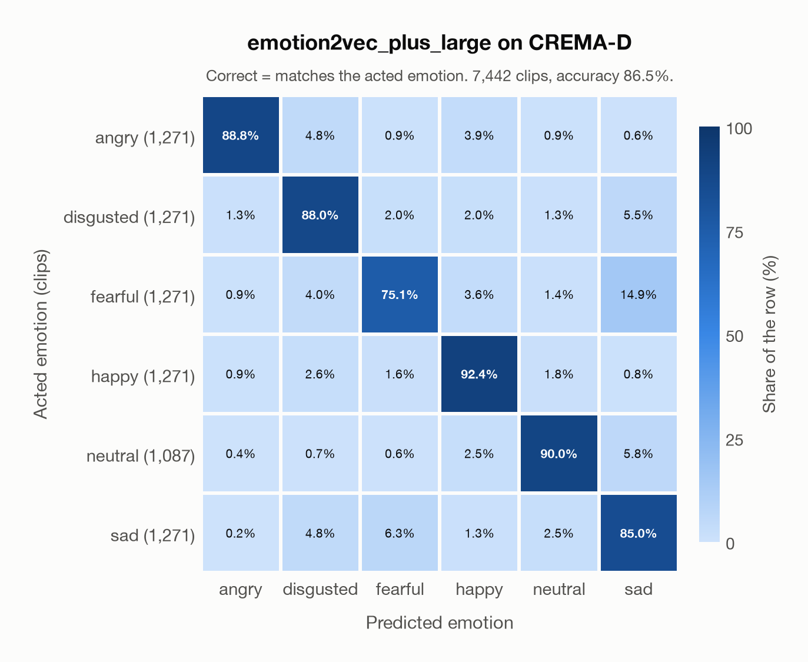
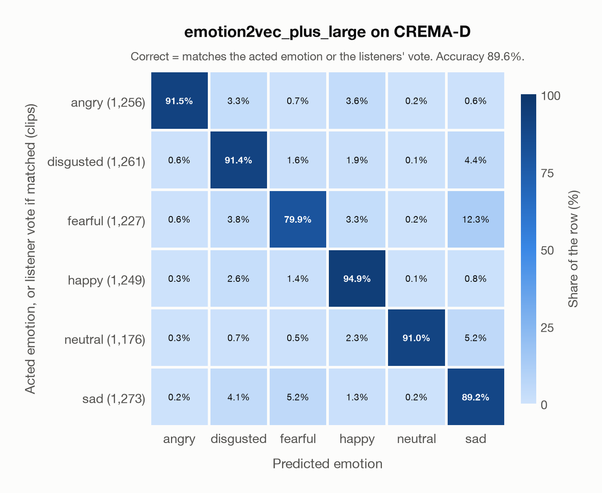

# emotion2vec_plus_large on CREMA-D

Generated by `scripts/evaluate_crema_d.py` on 2026-10-23.

## Summary

| Metric | Value |
|---|---|
| Clips evaluated | 7,442 (91 actors) |
| **Accuracy: prediction matches the acted emotion** | **86.5%** |
| **Accuracy: prediction matches the acted emotion or the listeners' vote** | **89.6%** |
| Unweighted accuracy (mean recall of the 6 acted emotions) | 86.5% |
| Macro F1 (acted emotion) | 86.6% |
| Accuracy, all 9 model classes (acted emotion) | 86.4% |
| Human listeners, voice only: majority vote vs acted emotion | 45.6% |

## Setup

- **Model**: `emotion2vec_plus_large` as released (no fine-tuning), FunASR 1.4.16, one prediction per clip.
- **Data**: 7,442 clips from `data/crema_d/AudioWAV` (16 kHz mono WAV, CREMA-D commit `1658cd3`).
- **Ground truth**: the emotion each actor was asked to portray, taken from the file name (`ANG`, `DIS`, `FEA`, `HAP`, `NEU`, `SAD`).
- **Label mapping**: `ANG` = angry, `DIS` = disgusted, `FEA` = fearful, `HAP` = happy, `NEU` = neutral, `SAD` = sad.
- **6 emotions**: the prediction is the most probable of the six CREMA-D emotions; the model's other classes (`other`, `surprised`, `<unk>`) are ignored. **All 9 classes**: the prediction is the most probable of all nine classes, so choosing a class that CREMA-D does not have counts as wrong.
- **Two ways to count a prediction as correct.** *Acted emotion*: it must match the emotion the actor portrayed (the usual way to report CREMA-D). *Acted emotion or listeners' vote*: it also counts when it matches the majority vote of the listeners who heard the voice only (for a tied vote, any of the tied emotions). The second credits the model when it agrees with what people heard. Both are reported.
- **Hardware**: Apple M4 Max, device `mps`, PyTorch 2.5.1. Inference took 2.2 min (18 ms per clip).
- **Per-clip predictions**: `outputs/crema_d_emotion2vec_plus_large_predictions.csv` (not in git; re-run the script to recreate it). Its columns are described in the JSON file next to it and in `docs/crema_d.md`.

## Results per emotion

Rows: acted emotion. Precision, recall and F1 compare the prediction with the acted emotion; the last column also accepts the listeners' vote.

| Emotion | Clips | Precision | Recall | F1 | Correct, acted or listeners' vote |
|---|---|---|---|---|---|
| angry | 1,271 | 96.2% | 88.8% | 92.4% | 91.6% |
| disgusted | 1,271 | 83.9% | 88.0% | 85.9% | 91.4% |
| fearful | 1,271 | 86.9% | 75.1% | 80.5% | 80.6% |
| happy | 1,271 | 87.8% | 92.4% | 90.0% | 95.0% |
| neutral | 1,087 | 90.6% | 90.0% | 90.3% | 90.2% |
| sad | 1,271 | 76.0% | 85.0% | 80.2% | 89.1% |

## Confusion matrix: acted emotion

The same numbers as a table. Rows: acted emotion. Columns: predicted emotion. Each row adds up to 100%.

| Acted \ Predicted | angry | disgusted | fearful | happy | neutral | sad |
|---|---|---|---|---|---|---|
| angry (1,271) | **88.8%** | 4.8% | 0.9% | 3.9% | 0.9% | 0.6% |
| disgusted (1,271) | 1.3% | **88.0%** | 2.0% | 2.0% | 1.3% | 5.5% |
| fearful (1,271) | 0.9% | 4.0% | **75.1%** | 3.6% | 1.4% | 14.9% |
| happy (1,271) | 0.9% | 2.6% | 1.6% | **92.4%** | 1.8% | 0.8% |
| neutral (1,087) | 0.4% | 0.7% | 0.6% | 2.5% | **90.0%** | 5.8% |
| sad (1,271) | 0.2% | 4.8% | 6.3% | 1.3% | 2.5% | **85.0%** |

Most frequent confusions: fearful predicted as sad (14.9%), sad predicted as fearful (6.3%), neutral predicted as sad (5.8%).

## Confusion matrix: acted emotion or listeners' vote

Here a prediction is correct when it matches the acted emotion or the listeners' vote. A clip goes into the row of the label its prediction matched, otherwise into the row of its acted emotion. The diagonal therefore holds every correct prediction, and the rows differ in size from the matrix above. 237 clips (3.2%) count as correct only because of the listeners' vote; the most common are acted fearful predicted as sad (39), acted sad predicted as neutral (30), acted happy predicted as neutral (22).

| Ground truth \ Predicted | angry | disgusted | fearful | happy | neutral | sad |
|---|---|---|---|---|---|---|
| angry (1,256) | **91.5%** | 3.3% | 0.7% | 3.6% | 0.2% | 0.6% |
| disgusted (1,261) | 0.6% | **91.4%** | 1.6% | 1.9% | 0.1% | 4.4% |
| fearful (1,227) | 0.6% | 3.8% | **79.9%** | 3.3% | 0.2% | 12.3% |
| happy (1,249) | 0.3% | 2.6% | 1.4% | **94.9%** | 0.1% | 0.8% |
| neutral (1,176) | 0.3% | 0.7% | 0.5% | 2.3% | **91.0%** | 5.2% |
| sad (1,273) | 0.2% | 4.1% | 5.2% | 1.3% | 0.2% | **89.2%** |

Most frequent confusions: fearful predicted as sad (12.3%), neutral predicted as sad (5.2%), sad predicted as fearful (5.2%).

## Predictions outside the six emotions

With all nine classes, the model chose a class that CREMA-D does not have for 4 clips (0.1%): `other` 1, `surprised` 1, `<unk>` 2.

## Comparison with human listeners

CREMA-D's crowd-sourced listeners also rated every clip from the voice alone (`processedResults/summaryTable.csv`). Their majority vote matches the acted emotion for 45.6% of the 6,798 clips without a tied vote. The model agrees with that majority vote for 44.8% of the same clips.

## Caveats

- **Not a held-out test.** CREMA-D is one of the datasets in [EmoBox](https://github.com/emo-box/EmoBox). EmoBox data fine-tuned emotion2vec+ seed, the first model in the chain that led to emotion2vec+ large (see the model card). The model has probably seen these clips, or labels derived from them, during training, so these numbers are likely higher than on unseen data.
- **Acted labels are not perceived emotions.** The ground truth is what the actor intended. Listeners often heard something else, as the comparison above shows.
- **One clip is silent.** `1076_MTI_SAD_XX.wav` contains no audio (a known CREMA-D issue); it is kept so that every clip is counted.
