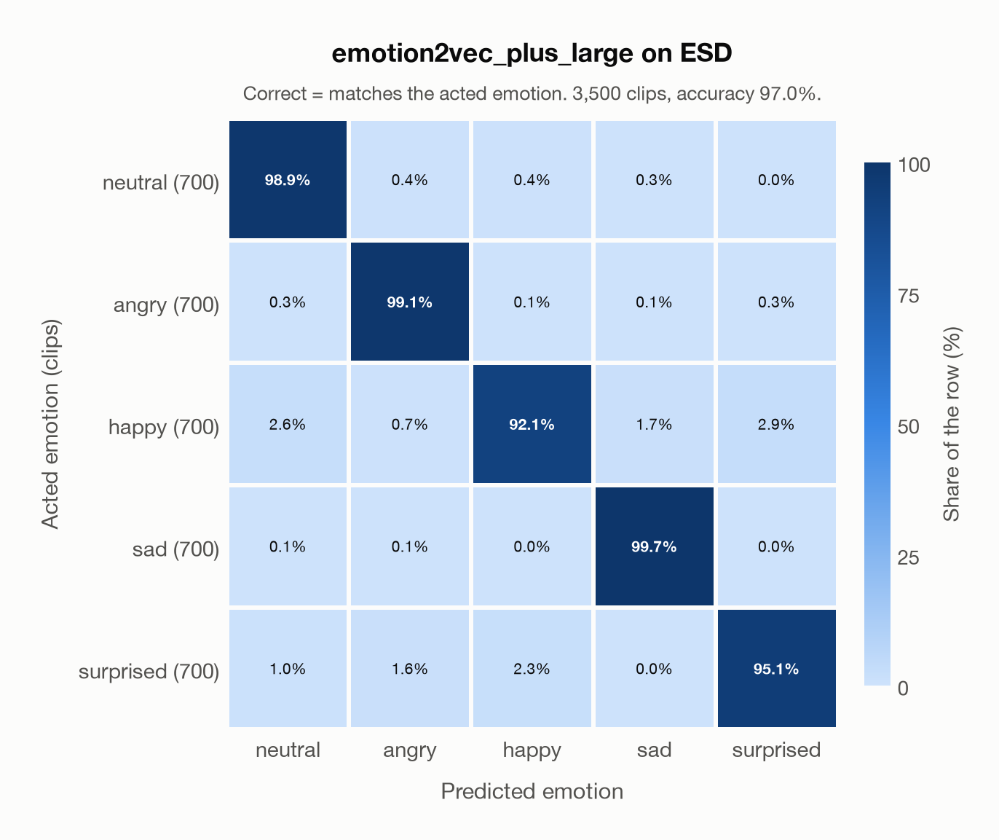

# emotion2vec_plus_large on ESD

Generated by `scripts/evaluate.py` on 2026-10-26. **Sample**: 3,500 of the 35,000 clips, taken at even intervals in file order (`evaluation.limit` in config/config.yaml).

## Summary

| Metric | Value |
|---|---|
| Clips evaluated | 3,500 (English, Mandarin) |
| **Accuracy: prediction matches the acted emotion** | **97.0%** |
| Unweighted accuracy (mean recall of the 5 acted emotions) | 97.0% |
| Macro F1 (acted emotion) | 97.0% |
| Accuracy, all 9 model classes (acted emotion) | 97.0% |
| Chance level (5 emotions) | 20.0% |

## Setup

- **Model**: `emotion2vec_plus_large` as released (no fine-tuning), FunASR 1.4.16, one prediction per clip.
- **Data**: 3,500 clips of ESD (English, Mandarin) from `data/esd/`, a sample of its 35,000 clips taken at even intervals in file order.
- **Ground truth (acted emotion)**: the emotion each speaker was asked to portray, from the folder name (`Neutral`, `Angry`, `Happy`, `Sad`, `Surprise`; the transcripts give the same labels).
- Label mapping: Neutral = neutral, Angry = angry, Happy = happy, Sad = sad, Surprise = surprised.
- Speakers 0001–0010 speak Mandarin and 0011–0020 English. Each says the same 350 sentences in all five emotions (for about 3.5% of them the wording differs slightly between emotions).
- **5 emotions**: the prediction is the most probable of the 5 emotions in this dataset (neutral, angry, happy, sad, surprised); the model's other classes (`disgusted`, `fearful`, `other`, `<unk>`) are ignored. **All 9 classes**: the prediction is the most probable of all nine classes, so choosing a class that the dataset does not have counts as wrong.
- **Hardware**: Apple M4 Max, device `cpu`, PyTorch 2.5.1. Inference took 6.1 min (104 ms per clip).
- **Per-clip predictions**: `outputs/esd_emotion2vec_plus_large_sample3500_predictions.csv` (not in git; re-run the script to recreate it). The JSON file next to it describes the columns.

## Results per emotion

Rows: acted emotion. Precision, recall and F1 compare the prediction with the acted emotion.

| Emotion | Clips | Precision | Recall | F1 |
|---|---|---|---|---|
| neutral | 700 | 96.1% | 98.9% | 97.5% |
| angry | 700 | 97.2% | 99.1% | 98.2% |
| happy | 700 | 97.0% | 92.1% | 94.5% |
| sad | 700 | 97.9% | 99.7% | 98.8% |
| surprised | 700 | 96.8% | 95.1% | 96.0% |

## Confusion matrix: acted emotion

The same numbers as a table. Rows: acted emotion. Columns: predicted emotion. Each row adds up to 100%.

| Acted \ Predicted | neutral | angry | happy | sad | surprised |
|---|---|---|---|---|---|
| neutral (700) | **98.9%** | 0.4% | 0.4% | 0.3% | 0.0% |
| angry (700) | 0.3% | **99.1%** | 0.1% | 0.1% | 0.3% |
| happy (700) | 2.6% | 0.7% | **92.1%** | 1.7% | 2.9% |
| sad (700) | 0.1% | 0.1% | 0.0% | **99.7%** | 0.0% |
| surprised (700) | 1.0% | 1.6% | 2.3% | 0.0% | **95.1%** |

Most frequent confusions: happy predicted as surprised (2.9%), happy predicted as neutral (2.6%), surprised predicted as happy (2.3%).

## Predictions outside the 5 emotions

With all nine classes, the model chose a class that this dataset does not have for 0 clips (0.0%): `disgusted` 0, `fearful` 0, `other` 0, `<unk>` 0.

## Caveats

- **In EmoBox.** EmoBox data fine-tuned emotion2vec+ seed, the first model in the chain that led to emotion2vec+ large, so the model has probably seen these clips or labels derived from them. Treat these numbers as optimistic.
- No listeners' labels are published, so there is one way of counting a prediction as correct.
- Audio: 16 kHz WAV, the model's own sampling rate.
