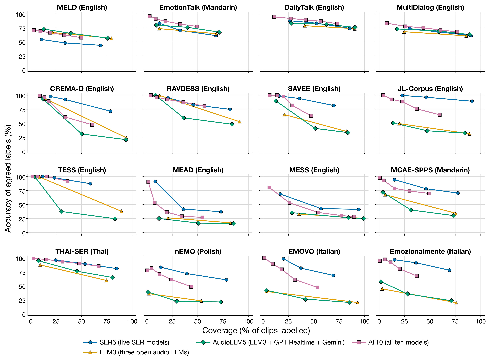
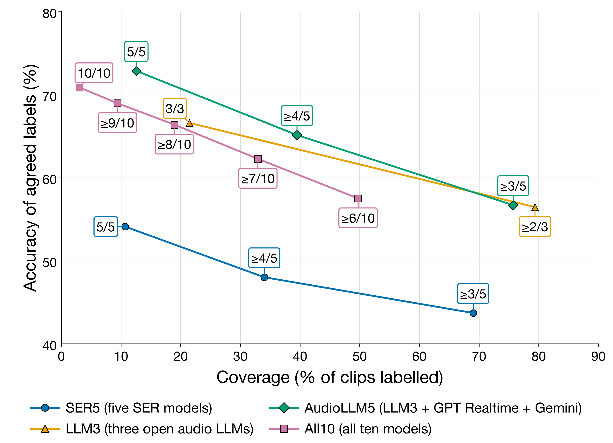
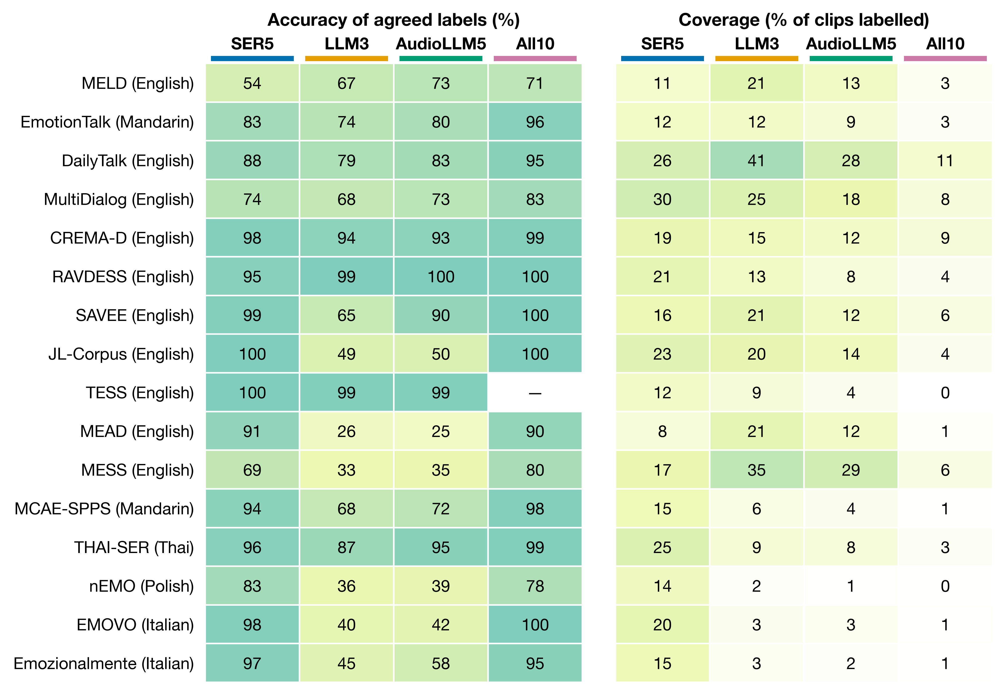
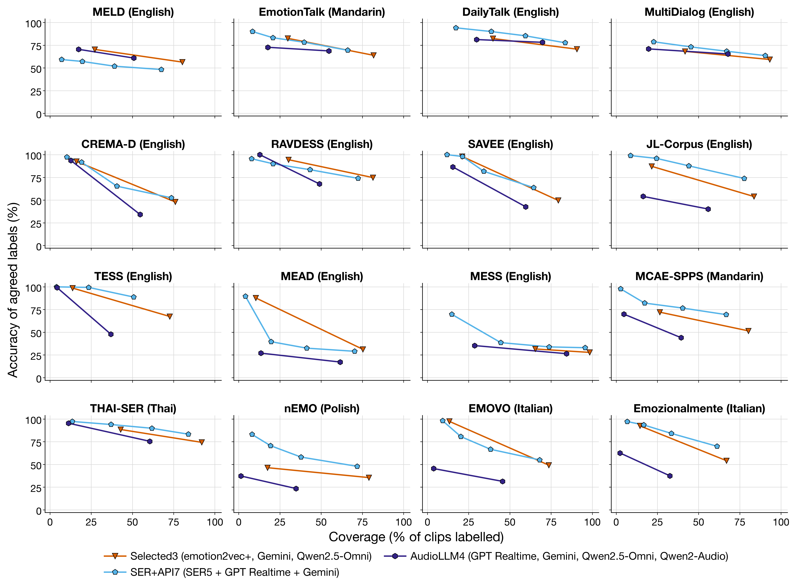

# Can model agreement help select pseudo-labels?

Updated: 2026-11-15 21:12 SGT.

This analysis reuses 160 compatible saved prediction runs across 16 public datasets; no model was rerun.
Model completion (datasets with a full run in the current evaluation scope / 16): Gemini 3.8 Flash 16/16; GPT Realtime 16/16; Each of the five SER models 16/16; Each of the three local audio LLMs 16/16.
Datasets with every target member available: five-SER group 16; audio-LLM group 16; selected-model group 16. Group completeness requires results from every target member; available and missing members are listed below.
On the same MELD samples, unanimous accepted-label accuracy / coverage is: Five SER models 54.12% / 10.70%; Audio LLMs (including APIs) 72.87% / 12.58%; Selected models 70.38% / 27.19%.
The selected models retain more samples, while their accepted-label accuracy is not the highest of the three groups.
Public-data results do not establish accuracy on company calls; calibrate the group and threshold on a small manually labelled call sample first.

Coverage is the accepted share of common samples; accepted-label accuracy is the correct share of accepted labels. Majority means strictly more than half of the current model count. Invalid answers abstain without reducing that denominator; top-vote ties are rejected. With two models, majority equals unanimity; with five models, majority requires at least three votes. Accuracy is — when no samples are accepted.

## Reading the figures: one model group plus one vote rule defines a point

The x-axis, Coverage (% of clips labelled), is the share of the common audio cohort that passes the vote rule and receives an agreed label: accepted / common samples. The y-axis, Accuracy of agreed labels (%), is the share of those labels matching the dataset reference: correct accepted / accepted. This is neither full-dataset accuracy nor a model's confidence score. Auto-labelling here is a simulated selection on benchmark data.

A point at 20% x and 97% y means that out of 1,000 clips, about 200 receive candidate labels: 194 correct and six wrong, with 800 unselected. Unlabelled internal audio has no known y-value; independent human verification is needed.

A model group alone does not define the result: the minimum vote count must also be fixed. The three five-SER points mean at least 3/5, at least 4/5 and all 5/5 agreeing. They are not repetitions of one rule, and their common-cohort denominator is unchanged. The 3/5 rule includes four- and five-vote cases; 4/5 includes five-vote cases. Raising the threshold cannot increase coverage, but need not improve accuracy. The leftmost point of each line is unanimity and the rightmost is strict majority. Lines only guide the eye between discrete rules; intermediate coverage is not an evaluated rule.

CREMA-D, always the same 7,442 clips:

| Five-SER rule | Selected | Correct / wrong | x: coverage | y: accuracy of agreed labels |
|---|---:|---:|---:|---:|
| ≥3/5 | 5,843 | 4,177 / 1,666 | 78.51% | 71.49% |
| ≥4/5 | 2,523 | 2,331 / 192 | 33.90% | 92.39% |
| 5/5 | 1,448 | 1,415 / 33 | 19.46% | 97.72% |

Colour identifies members, not a quality ranking; colours are colour-blind-safe Okabe–Ito hues and each group also has a fixed marker shape. Main groups: blue circles SER5 (the five SER models); orange triangles LLM3 (Qwen2.5-Omni, Qwen2-Audio, Gemma 4); green diamonds AudioLLM5 (LLM3 + GPT Realtime + Gemini); reddish-purple squares All10 (all ten models). Appendix groups: vermillion Selected3 (emotion2vec+, Gemini, Qwen2.5-Omni); sky-blue SER+API7 (SER5 + GPT Realtime + Gemini); indigo AudioLLM4 (GPT, Gemini, Qwen2.5-Omni, Qwen2-Audio). Selected3 is a legacy name, not an optimality claim. Hollow markers and dashed lines mark a group with missing members on that dataset (voting with the available members); tables mark it with *.

Align the rules before comparing colours. Strict majority means 3/5, 2/3, 4/7 or 6/10: different agreement fractions, potentially different selected samples and labels. If five SER models vote three for the correct label and two for a wrong label, two APIs voting for that wrong label turn the result into three correct votes against four wrong votes. Adding models can change the answer, and majority acceptance sets need not shrink.

On the same common cohort, 7/7 unanimity is a subset of 5/5, and 10/10 is a subset of both 7/7 and 3/3: coverage cannot increase. Selected-label accuracy improves only when added models preferentially reject wrong labels rather than correct ones; shared errors or label preferences can prevent that.

For example, CREMA-D SER5 ≥3/5 selects 5,843 clips at 71.49% accuracy; SER+API7 ≥4/7 selects 5,481 at 52.51%. This changes the voters and minimum vote count rather than simply applying a tighter version of the same filter.

An observed CREMA-D example: 5/5 selects 1,448 clips (1,415 correct, 33 wrong). Requiring both APIs to agree leaves 758 (738 correct, 20 wrong). The added condition retains 52.16% of the original correct cases but 60.61% of the errors, changing precision from 97.72% to 97.36%.

Matched MELD endpoints: unanimity of the four main groups, all members present, identical common cohort.

| Group | Rule | Selected | Correct / wrong | Coverage | Accuracy of agreed labels |
|---|---|---:|---:|---:|---:|
| SER5 | 5/5 | 279 | 151 / 128 | 10.70% | 54.12% |
| LLM3 | 3/3 | 560 | 373 / 187 | 21.47% | 66.61% |
| AudioLLM5 | 5/5 | 328 | 239 / 89 | 12.58% | 72.87% |
| All10 | 10/10 | 79 | 56 / 23 | 3.03% | 70.89% |

All10 is not an average of the other curves: every point recounts all ten model votes. MELD 10/10 selects only 79 clips (3.03% coverage), including 23 errors. The highest unanimous accuracy of the four groups is AudioLLM5 5/5: 72.87% at 12.58% coverage. Adding members lowers coverage but does not by itself guarantee higher accuracy; intermediate points (e.g. 6/10 to 9/10) are different rules from another group's unanimous endpoint.

Five-SER unanimity reaches an observed 95% accepted-label accuracy on 8/16 datasets. Agreement can select reliable labels in some domains, but does not guarantee high accuracy across datasets, and adding members need not improve it. The supplement adds 4/5 votes, fixed mixed-family groups, error counts and class distributions; every threshold is retained without selecting a best rule on these evaluation labels.

Results use each dataset's configured evaluation scope, not necessarily the entire source corpus: THAI-SER uses high_agreement and MEAD uses stratified_8000. Member availability does not imply full-source-corpus coverage. Every target member of AudioLLM5, LLM3 and All10 now covers all 16 datasets, so each group's model membership is fixed across datasets. Selected3 is the legacy group name, not a claim that it is optimal in this refresh.

## Main groups: unanimous coverage and accuracy

The four groups are fixed by model family: SER5 = the five SER models; LLM3 = the three open audio LLMs (Qwen2.5-Omni 7B, Qwen2-Audio 7B Instruct, Gemma 4 E4B); AudioLLM5 = LLM3 + GPT Realtime + Gemini 3.8 Flash; All10 = all ten models. When members are missing, LLM3, AudioLLM5 and All10 vote with the available members (at least two); the rule shows the participating count (e.g. 2/2, 4/4, 9/9) and * marks it. Datasets with every member: SER5 16/16; LLM3 16/16; AudioLLM5 16/16; All10 16/16.

| Dataset | SER5 rule | Coverage | Accuracy | LLM3 rule | Coverage | Accuracy | AudioLLM5 rule | Coverage | Accuracy | All10 rule | Coverage | Accuracy |
|---|---:|---:|---:|---:|---:|---:|---:|---:|---:|---:|---:|---:|
| CREMA-D | 5/5 | 19.46% | 97.72% | 3/3 | 14.59% | 93.65% | 5/5 | 11.95% | 93.36% | 10/10 | 8.86% | 98.79% |
| MCAE-SPPS | 5/5 | 15.13% | 94.46% | 3/3 | 6.05% | 67.57% | 5/5 | 3.63% | 71.90% | 10/10 | 0.63% | 97.62% |
| THAI-SER | 5/5 | 24.59% | 96.02% | 3/3 | 9.34% | 87.44% | 5/5 | 7.64% | 94.92% | 10/10 | 2.62% | 99.04% |
| nEMO | 5/5 | 13.68% | 83.36% | 3/3 | 1.92% | 36.05% | 5/5 | 1.03% | 39.13% | 10/10 | 0.20% | 77.78% |
| MESS | 5/5 | 17.06% | 68.73% | 3/3 | 35.22% | 33.12% | 5/5 | 28.56% | 35.41% | 10/10 | 6.22% | 80.36% |
| RAVDESS | 5/5 | 20.83% | 95.33% | 3/3 | 12.71% | 99.45% | 5/5 | 8.40% | 100.00% | 10/10 | 3.75% | 100.00% |
| TESS | 5/5 | 11.79% | 100.00% | 3/3 | 8.61% | 99.17% | 5/5 | 4.25% | 99.16% | 10/10 | 0.00% | — |
| JL-Corpus | 5/5 | 22.67% | 99.63% | 3/3 | 19.83% | 49.16% | 5/5 | 13.92% | 50.30% | 10/10 | 3.92% | 100.00% |
| MEAD | 5/5 | 8.22% | 91.19% | 3/3 | 20.61% | 26.20% | 5/5 | 11.85% | 25.00% | 10/10 | 1.31% | 90.48% |
| MELD | 5/5 | 10.70% | 54.12% | 3/3 | 21.47% | 66.61% | 5/5 | 12.58% | 72.87% | 10/10 | 3.03% | 70.89% |
| EMOVO | 5/5 | 20.24% | 98.32% | 3/3 | 3.40% | 40.00% | 5/5 | 3.23% | 42.11% | 10/10 | 1.02% | 100.00% |
| Emozionalmente | 5/5 | 15.27% | 96.68% | 3/3 | 2.98% | 44.66% | 5/5 | 1.71% | 57.63% | 10/10 | 0.57% | 94.87% |
| SAVEE | 5/5 | 15.83% | 98.68% | 3/3 | 21.04% | 65.35% | 5/5 | 12.50% | 90.00% | 10/10 | 6.46% | 100.00% |
| EmotionTalk | 5/5 | 12.13% | 83.33% | 3/3 | 11.98% | 73.59% | 5/5 | 9.33% | 80.00% | 10/10 | 2.70% | 96.15% |
| DailyTalk | 5/5 | 26.40% | 87.66% | 3/3 | 41.10% | 78.86% | 5/5 | 27.74% | 83.13% | 10/10 | 10.86% | 94.62% |
| MultiDialog | 5/5 | 30.03% | 73.57% | 3/3 | 24.52% | 68.10% | 5/5 | 17.74% | 73.03% | 10/10 | 7.59% | 83.33% |

## Five SER models

Target members: emotion2vec+, MERaLiON, Melati, Vox-Profile Whisper, Vox-Profile WavLM.

16 datasets: all target members.

This group waits until every member is available.

| Dataset | Participating / target members | Common samples | Unanimous coverage | Unanimous accuracy | Majority coverage | Majority accuracy |
|---|---:|---:|---:|---:|---:|---:|
| CREMA-D | 5/5 | 7,442 | 19.46% | 97.72% | 78.51% | 71.49% |
| MCAE-SPPS | 5/5 | 6,675 | 15.13% | 94.46% | 77.50% | 70.52% |
| THAI-SER | 5/5 | 11,848 | 24.59% | 96.02% | 84.72% | 80.93% |
| nEMO | 5/5 | 4,481 | 13.68% | 83.36% | 78.40% | 60.77% |
| MESS | 5/5 | 1,800 | 17.06% | 68.73% | 94.39% | 41.38% |
| RAVDESS | 5/5 | 1,440 | 20.83% | 95.33% | 81.88% | 74.72% |
| TESS | 5/5 | 2,800 | 11.79% | 100.00% | 58.46% | 87.35% |
| JL-Corpus | 5/5 | 1,200 | 22.67% | 99.63% | 91.50% | 89.25% |
| MEAD | 5/5 | 8,000 | 8.22% | 91.19% | 73.02% | 37.18% |
| MELD | 5/5 | 2,608 | 10.70% | 54.12% | 69.02% | 43.72% |
| EMOVO | 5/5 | 588 | 20.24% | 98.32% | 69.22% | 68.80% |
| Emozionalmente | 5/5 | 6,902 | 15.27% | 96.68% | 69.21% | 78.02% |
| SAVEE | 5/5 | 480 | 15.83% | 98.68% | 69.79% | 81.49% |
| EmotionTalk | 5/5 | 1,929 | 12.13% | 83.33% | 68.12% | 61.04% |
| DailyTalk | 5/5 | 1,197 | 26.40% | 87.66% | 85.46% | 74.10% |
| MultiDialog | 5/5 | 7,672 | 30.03% | 73.57% | 90.50% | 61.17% |

## Audio LLMs (including APIs)

Target members: GPT Realtime, Gemini 3.8 Flash, Qwen2.5-Omni, Qwen2-Audio, Gemma 4.

16 datasets: all target members.

* marks a group missing other members; available members are included. Consensus is calculated when at least two members are available.

| Dataset | Participating / target members | Common samples | Unanimous coverage | Unanimous accuracy | Majority coverage | Majority accuracy |
|---|---:|---:|---:|---:|---:|---:|
| CREMA-D | 5/5 | 7,442 | 11.95% | 93.36% | 93.72% | 20.59% |
| MCAE-SPPS | 5/5 | 6,675 | 3.63% | 71.90% | 73.27% | 30.22% |
| THAI-SER | 5/5 | 11,848 | 7.64% | 94.92% | 80.46% | 65.02% |
| nEMO | 5/5 | 4,481 | 1.03% | 39.13% | 72.68% | 21.19% |
| MESS | 5/5 | 1,800 | 28.56% | 35.41% | 99.17% | 25.04% |
| RAVDESS | 5/5 | 1,440 | 8.40% | 100.00% | 83.82% | 48.05% |
| TESS | 5/5 | 2,800 | 4.25% | 99.16% | 82.93% | 24.63% |
| JL-Corpus | 5/5 | 1,200 | 13.92% | 50.30% | 84.42% | 32.28% |
| MEAD | 5/5 | 8,000 | 11.85% | 25.00% | 85.39% | 16.02% |
| MELD | 5/5 | 2,608 | 12.58% | 72.87% | 75.73% | 56.71% |
| EMOVO | 5/5 | 588 | 3.23% | 42.11% | 85.20% | 20.36% |
| Emozionalmente | 5/5 | 6,902 | 1.71% | 57.63% | 71.08% | 23.46% |
| SAVEE | 5/5 | 480 | 12.50% | 90.00% | 83.54% | 33.17% |
| EmotionTalk | 5/5 | 1,929 | 9.33% | 80.00% | 71.38% | 67.39% |
| DailyTalk | 5/5 | 1,197 | 27.74% | 83.13% | 90.56% | 75.74% |
| MultiDialog | 5/5 | 7,672 | 17.74% | 73.03% | 89.31% | 62.92% |

## Selected models

Target members: emotion2vec+, Gemini 3.8 Flash, Qwen2.5-Omni.

16 datasets: all target members.

* marks a group missing other members; available members are included. Consensus is calculated when at least two members are available.

| Dataset | Participating / target members | Common samples | Unanimous coverage | Unanimous accuracy | Majority coverage | Majority accuracy |
|---|---:|---:|---:|---:|---:|---:|
| CREMA-D | 3/3 | 7,442 | 16.07% | 92.56% | 75.96% | 47.97% |
| MCAE-SPPS | 3/3 | 6,675 | 26.49% | 72.12% | 80.19% | 51.54% |
| THAI-SER | 3/3 | 11,848 | 42.84% | 88.46% | 92.06% | 74.31% |
| nEMO | 3/3 | 4,481 | 17.41% | 46.41% | 78.93% | 35.51% |
| MESS | 3/3 | 1,800 | 65.39% | 31.61% | 98.44% | 27.82% |
| RAVDESS | 3/3 | 1,440 | 30.21% | 94.48% | 81.46% | 74.77% |
| TESS | 3/3 | 2,800 | 13.64% | 98.69% | 72.61% | 67.39% |
| JL-Corpus | 3/3 | 1,200 | 21.50% | 87.21% | 83.58% | 53.94% |
| MEAD | 3/3 | 8,000 | 10.35% | 87.80% | 75.28% | 31.25% |
| MELD | 3/3 | 2,608 | 27.19% | 70.38% | 80.25% | 56.43% |
| EMOVO | 3/3 | 588 | 13.27% | 97.44% | 73.64% | 49.19% |
| Emozionalmente | 3/3 | 6,902 | 14.43% | 92.47% | 66.94% | 54.11% |
| SAVEE | 3/3 | 480 | 21.04% | 98.02% | 79.38% | 49.61% |
| EmotionTalk | 3/3 | 1,929 | 29.76% | 82.58% | 81.75% | 63.92% |
| DailyTalk | 3/3 | 1,197 | 39.77% | 82.35% | 90.64% | 70.69% |
| MultiDialog | 3/3 | 7,672 | 41.76% | 68.26% | 93.17% | 59.28% |

## Vote thresholds, accepted labels and errors

The supplement enumerates every integer threshold from strict majority to unanimity; it does not select an optimal group or threshold on these evaluation labels. This table adds the 4/5 SER threshold and makes the cost of erroneous accepted labels explicit.

| Dataset | ≥4/5 accepted | Errors | Coverage | Accuracy | 5/5 accepted | Errors |
|---|---:|---:|---:|---:|---:|---:|
| CREMA-D | 2,523 | 192 | 33.90% | 92.39% | 1,448 | 33 |
| MCAE-SPPS | 3,083 | 669 | 46.19% | 78.30% | 1,010 | 56 |
| THAI-SER | 6,361 | 682 | 53.69% | 89.28% | 2,914 | 116 |
| nEMO | 1,764 | 494 | 39.37% | 72.00% | 613 | 102 |
| MESS | 1,029 | 589 | 57.17% | 42.76% | 307 | 96 |
| RAVDESS | 661 | 113 | 45.90% | 82.90% | 300 | 14 |
| TESS | 647 | 14 | 23.11% | 97.84% | 330 | 0 |
| JL-Corpus | 555 | 20 | 46.25% | 96.40% | 272 | 1 |
| MEAD | 2,867 | 1,669 | 35.84% | 41.79% | 658 | 58 |
| MELD | 887 | 461 | 34.01% | 48.03% | 279 | 128 |
| EMOVO | 219 | 40 | 37.24% | 81.74% | 119 | 2 |
| Emozionalmente | 2,508 | 217 | 36.34% | 91.35% | 1,054 | 35 |
| SAVEE | 171 | 10 | 35.62% | 94.15% | 76 | 1 |
| EmotionTalk | 630 | 186 | 32.66% | 70.48% | 234 | 39 |
| DailyTalk | 634 | 106 | 52.97% | 83.28% | 316 | 39 |
| MultiDialog | 4,502 | 1,456 | 58.68% | 67.66% | 2,304 | 609 |

## Consensus of four fixed audio LLM/API models

AudioLLM4 = GPT Realtime, Gemini, Qwen2.5-Omni and Qwen2-Audio. This supplemental group fixes membership by availability, not evaluation accuracy, and waits for every member. With Qwen2-Audio complete on all 16 datasets, the same four members can be compared at ≥3/4 and 4/4 votes. Gemma is excluded; 4/4 must not be described as unanimity of all five audio LLMs.

| Dataset | Common samples | ≥3/4 coverage | ≥3/4 accuracy | 4/4 accepted / errors | 4/4 coverage | 4/4 accuracy |
|---|---:|---:|---:|---:|---:|---:|
| CREMA-D | 7,442 | 54.64% | 34.19% | 942 / 60 | 12.66% | 93.63% |
| MCAE-SPPS | 6,675 | 39.36% | 44.04% | 313 / 94 | 4.69% | 69.97% |
| THAI-SER | 11,848 | 60.53% | 75.46% | 1,327 / 61 | 11.20% | 95.40% |
| nEMO | 4,481 | 34.72% | 23.46% | 59 / 37 | 1.32% | 37.29% |
| MESS | 1,800 | 84.33% | 26.42% | 515 / 333 | 28.61% | 35.34% |
| RAVDESS | 1,440 | 48.96% | 67.80% | 184 / 0 | 12.78% | 100.00% |
| TESS | 2,800 | 36.89% | 47.92% | 120 / 1 | 4.29% | 99.17% |
| JL-Corpus | 1,200 | 55.83% | 40.15% | 196 / 90 | 16.33% | 54.08% |
| MEAD | 8,000 | 61.51% | 17.21% | 1,073 / 783 | 13.41% | 27.03% |
| MELD | 2,608 | 50.84% | 60.86% | 451 / 133 | 17.29% | 70.51% |
| EMOVO | 588 | 45.58% | 31.34% | 22 / 12 | 3.74% | 45.45% |
| Emozionalmente | 6,902 | 32.54% | 37.49% | 163 / 61 | 2.36% | 62.58% |
| SAVEE | 480 | 59.58% | 42.66% | 74 / 10 | 15.42% | 86.49% |
| EmotionTalk | 1,929 | 54.69% | 68.72% | 341 / 93 | 17.68% | 72.73% |
| DailyTalk | 1,197 | 69.76% | 78.20% | 357 / 67 | 29.82% | 81.23% |
| MultiDialog | 7,672 | 67.86% | 65.39% | 1,508 / 438 | 19.66% | 70.95% |

## Fixed groups across model families

SER+API7 = five SER models + GPT Realtime + Gemini and waits for every member. All10 = five SER models + all five audio LLM/API models; like AudioLLM5 and LLM3 it votes with the available members (at least two), so the rule shows the participating count (e.g. 9/9) and * marks missing members. The table reports unanimity; the CSV contains all integer thresholds. Direct group comparisons require identical common audio-path cohorts.

| Dataset | SER+API7 common | 7/7 accepted / errors | Coverage | Accuracy | All10 rule | All10 common | Unanimous accepted / errors | Coverage | Accuracy |
|---|---:|---:|---:|---:|---:|---:|---:|---:|---:|
| CREMA-D | 7,442 | 758 / 20 | 10.19% | 97.36% | 10/10 | 7,442 | 659 / 8 | 8.86% | 98.79% |
| MCAE-SPPS | 6,675 | 181 / 4 | 2.71% | 97.79% | 10/10 | 6,675 | 42 / 1 | 0.63% | 97.62% |
| THAI-SER | 11,848 | 1,595 / 43 | 13.46% | 97.30% | 10/10 | 11,848 | 311 / 3 | 2.62% | 99.04% |
| nEMO | 4,481 | 360 / 61 | 8.03% | 83.06% | 10/10 | 4,481 | 9 / 2 | 0.20% | 77.78% |
| MESS | 1,800 | 265 / 80 | 14.72% | 69.81% | 10/10 | 1,800 | 112 / 22 | 6.22% | 80.36% |
| RAVDESS | 1,440 | 112 / 5 | 7.78% | 95.54% | 10/10 | 1,440 | 54 / 0 | 3.75% | 100.00% |
| TESS | 2,800 | 0 / 0 | 0.00% | — | 10/10 | 2,800 | 0 / 0 | 0.00% | — |
| JL-Corpus | 1,200 | 104 / 1 | 8.67% | 99.04% | 10/10 | 1,200 | 47 / 0 | 3.92% | 100.00% |
| MEAD | 8,000 | 327 / 34 | 4.09% | 89.60% | 10/10 | 8,000 | 105 / 10 | 1.31% | 90.48% |
| MELD | 2,608 | 184 / 75 | 7.06% | 59.24% | 10/10 | 2,608 | 79 / 23 | 3.03% | 70.89% |
| EMOVO | 588 | 54 / 1 | 9.18% | 98.15% | 10/10 | 588 | 6 / 0 | 1.02% | 100.00% |
| Emozionalmente | 6,902 | 463 / 13 | 6.71% | 97.19% | 10/10 | 6,902 | 39 / 2 | 0.57% | 94.87% |
| SAVEE | 480 | 57 / 0 | 11.88% | 100.00% | 10/10 | 480 | 31 / 0 | 6.46% | 100.00% |
| EmotionTalk | 1,929 | 161 / 16 | 8.35% | 90.06% | 10/10 | 1,929 | 52 / 2 | 2.70% | 96.15% |
| DailyTalk | 1,197 | 206 / 12 | 17.21% | 94.17% | 10/10 | 1,197 | 130 / 7 | 10.86% | 94.62% |
| MultiDialog | 7,672 | 1,745 / 370 | 22.75% | 78.80% | 10/10 | 7,672 | 582 / 97 | 7.59% | 83.33% |

## Figures

Four figures, each as PNG (300 dpi) and SVG. Every group keeps its colour and marker shape in all figures and slides; hollow markers and dashed lines mark a group with missing members on that dataset, voting with the available members (* in the heat map). Points on a line are minimum vote counts: the leftmost is unanimity and the rightmost strict majority. All panels share the axes Coverage (% of clips labelled) and Accuracy of agreed labels (%). Explanations stay in this report and the slides, not inside the figures.

Heat-map values round to whole percentages; tables and CSVs retain full precision. With zero selected clips, coverage is 0% but accuracy is undefined (shown as —), not 0%.

## Interpretation for labelling and the paper

Coverage = accepted / common_samples; accepted-label accuracy = accepted_correct / accepted; selective risk = 1 − accuracy; correct accepted fraction = accepted_correct / common_samples. accepted / union_samples also exposes missing model overlap, but the union is still only the available prediction pool, not the entire intended labelling pool.

The per-predicted-class file reports accepted/error counts, class precision and share of accepted labels to reveal dominance by neutral or another class. Individual-model baselines are recomputed on exactly the same within-group cohort. These are observed fixed-prediction point estimates, without confidence intervals or accuracy guarantees; 100% on a small accepted set does not establish zero risk.

For internal labelling, set a tolerated error rate using independently labelled calibration data, freeze the model group and vote threshold, then validate by class, language and recording condition on held-out samples. Audit accepted labels and route rejected samples to humans. Public-data coverage is potential automatic acceptance, while realised effort savings also depend on internal errors, auditing and correction.

For the paper, this can be a supporting selective-prediction accuracy–coverage / risk–coverage analysis of fixed groups and thresholds across public datasets, without claiming a new algorithm or internal labelling benefit. The framework has precedent: [Geifman & El-Yaniv, NeurIPS 2017](https://papers.neurips.cc/paper/2017/file/4a8423d5e91fda00bb7e46540e2b0cf1-Paper.pdf). Formal inference would additionally need speaker/dialogue-cluster uncertainty estimates and training provenance disclosure; those intervals are not supplied here.

Supplementary results: [vote thresholds](../output/consensus_thresholds.csv) · [per predicted class](../output/consensus_by_class.csv) · [matched individual baselines](../output/consensus_baselines.csv) · [reproducibility manifest](../output/consensus_manifest.json)

Excluded 0 runs with old inference protocols. Each group is scored on its common audio-path intersection; composite gold labels keep their existing acceptance rules. Performed and dialogue corpora also differ in language, class distribution and recording source, so their differences cannot be attributed to context alone. Shared training sources and errors mean agreement votes are not independent evidence.

[Full counts, membership and source files](../output/consensus.csv). Rerun the script after more model results arrive to update both reports and the CSV.
