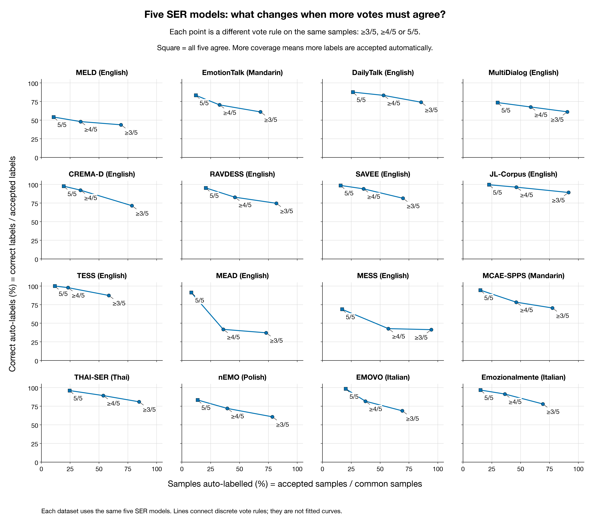
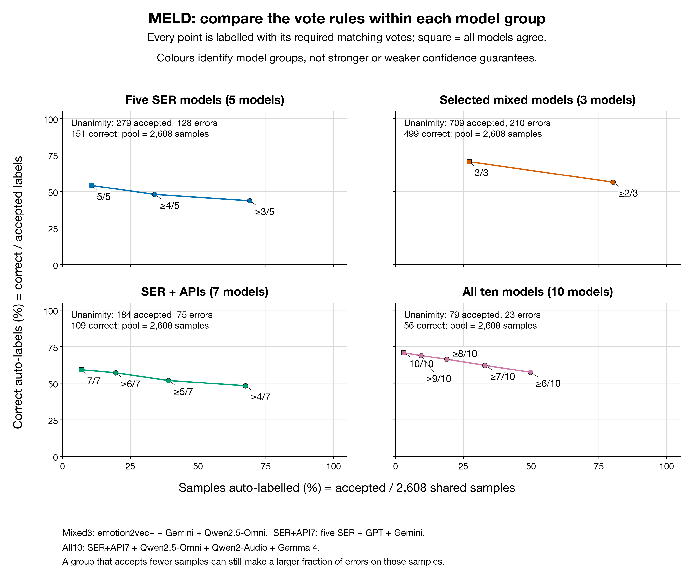
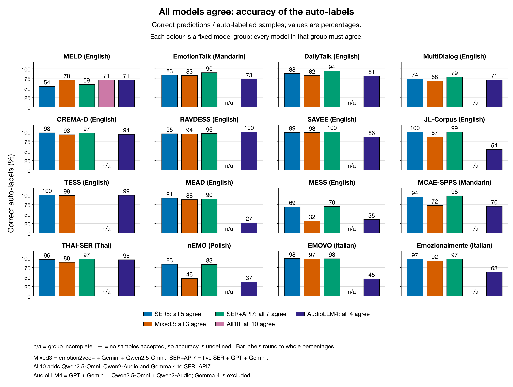
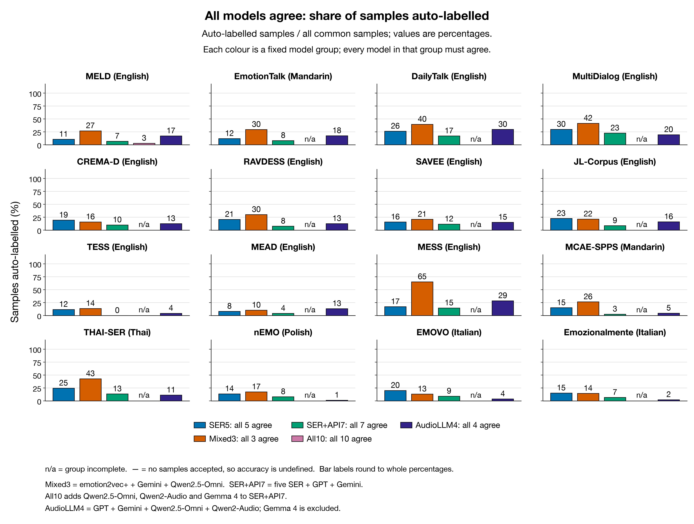
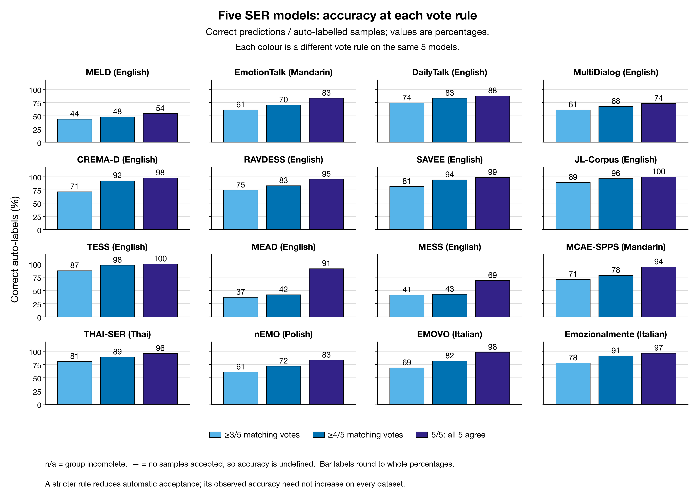
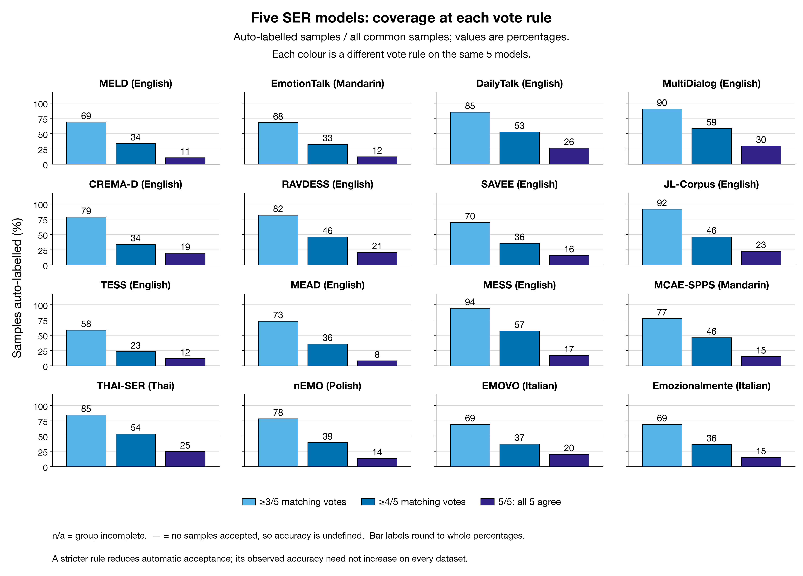
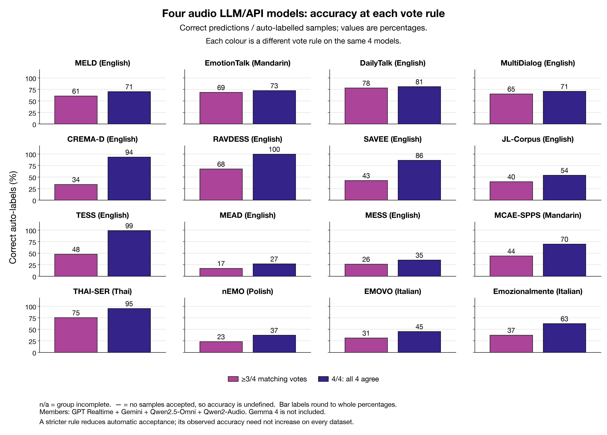
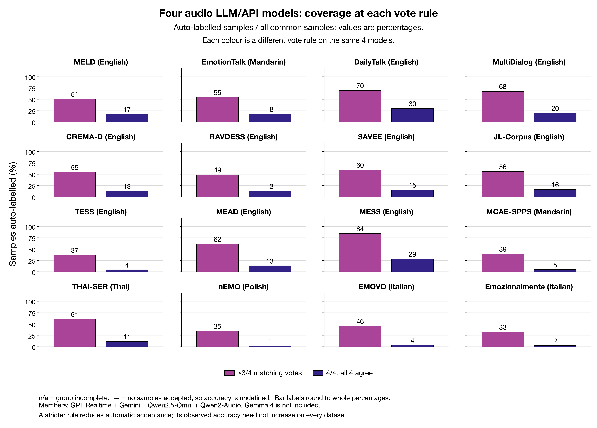

# 模型共识能帮助筛选标签吗？

更新时间：2026-11-14 13:24 SGT.

这次直接使用 145 组兼容的现有预测，比较 16 个公开数据集，没有重新运行模型。
模型完成情况（已完成当前评估范围的数据集数 / 16）：Gemini 3.8 Flash 16/16；GPT Realtime 16/16；五个 SER 模型各 16/16；Qwen2.5-Omni 16/16；Qwen2-Audio 16/16；Gemma 4 1/16。
整组成员齐备的数据集数：五个 SER 模型 16；Audio LLM 组 1；精选模型组 16。‘组齐备’要求目标成员都有结果；下表会分别列出现有和待补成员。
同一批 MELD 样本上，全部一致的候选标签正确率／覆盖率分别为：五个 SER 模型 54.12%／10.70%；Audio LLM（含 API） 72.87%／12.58%；精选模型 70.38%／27.19%。
精选模型保留了更多样本，但候选标签正确率不是三组最高。
这些公开数据与公司电话存在领域差异；用于 pseudo-label 前，应先用小批人工通话标注校准组合和阈值。

覆盖率是共同样本中有多少被接受；候选标签正确率是被接受的标签中有多少正确。表中的‘过半数’要求严格大于当前模型数的一半；invalid 不投票但仍占分母，最高票并列时不接受。只有两个模型时，过半数与全部一致相同；五个模型时，过半数至少需要三票。没有接受样本时，正确率记为 —。

## 图怎么读：一个点是一组模型加一条投票规则

横轴 Samples auto-labelled (%) 表示：同一批可比较音频中，有多少比例通过投票规则，可以作为自动标签候选。它等于接受数 / 共同样本数。纵轴 Correct auto-labels (%) 表示：这些候选标签里，有多少与数据集参考标签相符。它等于正确接受数 / 接受数，不是整个数据集的准确率，也不是模型自己给出的置信度。这里的‘自动标注’是对基准数据的模拟筛选。

例如横轴 20%、纵轴 97% 的点，可以读作：每 1,000 条音频约筛出 200 条候选标签，其中约 194 条正确、6 条错误，其余 800 条未通过筛选。参考标签来自数据集；内部未标注音频没有现成的这个纵轴，需要独立人工核验。

固定模型组合之后，还需要指定至少几票同意，才能确定一个结果。五个 SER 的三个点分别是至少 3/5、至少 4/5、5/5 一致；不是同一规则被重复测了三次，也没有改变共同样本分母。3/5 包含 4 票和 5 票样本，4/5 包含 5 票样本。收紧票数后覆盖率一定不增加，但正确率不保证上升。连线仅帮助看离散票数的变化，不表示任意覆盖率都有可实现的规则。

CREMA-D，始终使用同一批 7,442 条音频：

| 五 SER 规则 | 筛出数 | 正确 / 错误 | 横轴：筛出比例 | 纵轴：筛出标签正确率 |
|---|---:|---:|---:|---:|
| ≥3/5 | 5,843 | 4,177 / 1,666 | 78.51% | 71.49% |
| ≥4/5 | 2,523 | 2,331 / 192 | 33.90% | 92.39% |
| ≥5/5 | 1,448 | 1,415 / 33 | 19.46% | 97.72% |

颜色只表示模型成员，不表示性能高低：蓝色 SER5 是五个 SER；橙色 Selected3 是 emotion2vec+、Gemini、Qwen2.5-Omni；绿色 SER+API7 是五 SER 加 GPT Realtime、Gemini；粉色 All10 是全部十个模型；深紫色 AudioLLM4 是 GPT、Gemini、Qwen2.5-Omni、Qwen2-Audio。Selected3 是沿用的组名，不代表最优组合。

比较不同颜色时要先对齐规则。过半数分别是 3/5、2/3、4/7、6/10，要求的同意比例不同，通过筛选的样本和投票标签都可能不同。例如五 SER 投出 3 票正确、2 票错误时，如果两个 API 都投给原来的错误标签，七模型会变为 3 票正确、4 票错误。因此加入模型可能改变答案，过半数接受集也不一定变小。

在相同共同样本上比较全体一致时，7/7 是 5/5 的子集，10/10 又是 7/7 和 3/3 的子集；覆盖率因此不会增加。但只有新增模型更容易淘汰错误标签、而不是正确标签时，筛出标签的正确率才会上升；相关错误、共同偏好都可能破坏这个条件。

例如 CREMA-D，蓝色 3/5 筛出 5,843 条，正确率 71.49%；绿色 4/7 筛出 5,481 条，正确率 52.51%。这不是在蓝色已接受标签上做同一种更严格筛选，而是换了投票组合和最低票数。

CREMA-D 的实际例子：5/5 接受 1,448 条（正确 1,415、错误 33）；要求两个 API 也同意后，7/7 剩下 758 条（正确 738、错误 20）。新增条件保留原先正确样本的 52.16%，却保留错误样本的 60.61%，所以正确率从 97.72% 变为 97.36%。

MELD 的公平端点比较：全部一致，且共同样本完全相同。

| 组合 | 规则 | 筛出数 | 正确 / 错误 | 筛出比例 | 筛出标签正确率 |
|---|---|---:|---:|---:|---:|
| SER5 | 5/5 | 279 | 151 / 128 | 10.70% | 54.12% |
| Selected3 | 3/3 | 709 | 499 / 210 | 27.19% | 70.38% |
| SER_API7 | 7/7 | 184 | 109 / 75 | 7.06% | 59.24% |
| All10 | 10/10 | 79 | 56 / 23 | 3.03% | 70.89% |

粉色曲线不是其他曲线的平均值，每个点都重新对十个模型计票。MELD 的 10/10 只筛出 79 条，其中 23 条仍错误；它以更低覆盖率换来与 Selected3 的 3/3 相近的观测正确率，而非自动成为最优组合。粉色曲线中间的点是 6/10 到 9/10，不能与其他颜色的全体一致端点混作同一规则比较。

当前五 SER 全部一致的观测正确率在 8/16 个数据集上达到 95%，说明共识在部分领域有筛选价值，但不能跨数据集统一保证高准确率。增加成员也不保证更准确。下文补充 4/5 票、跨家族固定组、错误数与类别分布，所有阈值均保留，不用测试标签自动选最佳规则。

下列结果是在各数据集既定评估范围内计算，不代表整个原始语料；THAI-SER 使用 high_agreement，MEAD 使用 stratified_8000。组成员齐备不等于成员已预测整个原始语料。Audio LLM 组在不同数据集的参与成员不同，不汇总为一个固定 ensemble；Selected3 是沿用旧分析的组合，名称不表示它在本轮表现最佳。

## 五个 SER 模型

目标成员：emotion2vec+, MERaLiON, Melati, Vox-Profile Whisper, Vox-Profile WavLM。

当前 16 个数据集：全组。

缺任何成员就等待完整结果。

| 数据集 | 参与 / 目标成员 | 共同样本 | 全部一致覆盖率 | 一致正确率 | 过半数覆盖率 | 过半数正确率 |
|---|---:|---:|---:|---:|---:|---:|
| CREMA-D | 5/5 | 7,442 | 19.46% | 97.72% | 78.51% | 71.49% |
| MCAE-SPPS | 5/5 | 6,675 | 15.13% | 94.46% | 77.50% | 70.52% |
| THAI-SER | 5/5 | 11,848 | 24.59% | 96.02% | 84.72% | 80.93% |
| nEMO | 5/5 | 4,481 | 13.68% | 83.36% | 78.40% | 60.77% |
| MESS | 5/5 | 1,800 | 17.06% | 68.73% | 94.39% | 41.38% |
| RAVDESS | 5/5 | 1,440 | 20.83% | 95.33% | 81.88% | 74.72% |
| TESS | 5/5 | 2,800 | 11.79% | 100.00% | 58.46% | 87.35% |
| JL-Corpus | 5/5 | 1,200 | 22.67% | 99.63% | 91.50% | 89.25% |
| MEAD | 5/5 | 8,000 | 8.22% | 91.19% | 73.02% | 37.18% |
| MELD | 5/5 | 2,608 | 10.70% | 54.12% | 69.02% | 43.72% |
| EMOVO | 5/5 | 588 | 20.24% | 98.32% | 69.22% | 68.80% |
| Emozionalmente | 5/5 | 6,902 | 15.27% | 96.68% | 69.21% | 78.02% |
| SAVEE | 5/5 | 480 | 15.83% | 98.68% | 69.79% | 81.49% |
| EmotionTalk | 5/5 | 1,929 | 12.13% | 83.33% | 68.12% | 61.04% |
| DailyTalk | 5/5 | 1,197 | 26.40% | 87.66% | 85.46% | 74.10% |
| MultiDialog | 5/5 | 7,672 | 30.03% | 73.57% | 90.50% | 61.17% |

## Audio LLM（含 API）

目标成员：GPT Realtime, Gemini 3.8 Flash, Qwen2.5-Omni, Qwen2-Audio, Gemma 4。

当前 MELD 以外的 15 个数据集：GPT Realtime, Gemini 3.8 Flash, Qwen2.5-Omni, Qwen2-Audio；待补：Gemma 4。
当前 MELD：全组。

* 表示这组仍缺其他成员；已有成员的结果已纳入。至少有两个成员时，先按现有成员计算共识。

| 数据集 | 参与 / 目标成员 | 共同样本 | 全部一致覆盖率 | 一致正确率 | 过半数覆盖率 | 过半数正确率 |
|---|---:|---:|---:|---:|---:|---:|
| CREMA-D | 4/5* | 7,442 | 12.66% | 93.63% | 54.64% | 34.19% |
| MCAE-SPPS | 4/5* | 6,675 | 4.69% | 69.97% | 39.36% | 44.04% |
| THAI-SER | 4/5* | 11,848 | 11.20% | 95.40% | 60.53% | 75.46% |
| nEMO | 4/5* | 4,481 | 1.32% | 37.29% | 34.72% | 23.46% |
| MESS | 4/5* | 1,800 | 28.61% | 35.34% | 84.33% | 26.42% |
| RAVDESS | 4/5* | 1,440 | 12.78% | 100.00% | 48.96% | 67.80% |
| TESS | 4/5* | 2,800 | 4.29% | 99.17% | 36.89% | 47.92% |
| JL-Corpus | 4/5* | 1,200 | 16.33% | 54.08% | 55.83% | 40.15% |
| MEAD | 4/5* | 8,000 | 13.41% | 27.03% | 61.51% | 17.21% |
| MELD | 5/5 | 2,608 | 12.58% | 72.87% | 75.73% | 56.71% |
| EMOVO | 4/5* | 588 | 3.74% | 45.45% | 45.58% | 31.34% |
| Emozionalmente | 4/5* | 6,902 | 2.36% | 62.58% | 32.54% | 37.49% |
| SAVEE | 4/5* | 480 | 15.42% | 86.49% | 59.58% | 42.66% |
| EmotionTalk | 4/5* | 1,929 | 17.68% | 72.73% | 54.69% | 68.72% |
| DailyTalk | 4/5* | 1,197 | 29.82% | 81.23% | 69.76% | 78.20% |
| MultiDialog | 4/5* | 7,672 | 19.66% | 70.95% | 67.86% | 65.39% |

## 精选模型

目标成员：emotion2vec+, Gemini 3.8 Flash, Qwen2.5-Omni。

当前 16 个数据集：全组。

* 表示这组仍缺其他成员；已有成员的结果已纳入。至少有两个成员时，先按现有成员计算共识。

| 数据集 | 参与 / 目标成员 | 共同样本 | 全部一致覆盖率 | 一致正确率 | 过半数覆盖率 | 过半数正确率 |
|---|---:|---:|---:|---:|---:|---:|
| CREMA-D | 3/3 | 7,442 | 16.07% | 92.56% | 75.96% | 47.97% |
| MCAE-SPPS | 3/3 | 6,675 | 26.49% | 72.12% | 80.19% | 51.54% |
| THAI-SER | 3/3 | 11,848 | 42.84% | 88.46% | 92.06% | 74.31% |
| nEMO | 3/3 | 4,481 | 17.41% | 46.41% | 78.93% | 35.51% |
| MESS | 3/3 | 1,800 | 65.39% | 31.61% | 98.44% | 27.82% |
| RAVDESS | 3/3 | 1,440 | 30.21% | 94.48% | 81.46% | 74.77% |
| TESS | 3/3 | 2,800 | 13.64% | 98.69% | 72.61% | 67.39% |
| JL-Corpus | 3/3 | 1,200 | 21.50% | 87.21% | 83.58% | 53.94% |
| MEAD | 3/3 | 8,000 | 10.35% | 87.80% | 75.28% | 31.25% |
| MELD | 3/3 | 2,608 | 27.19% | 70.38% | 80.25% | 56.43% |
| EMOVO | 3/3 | 588 | 13.27% | 97.44% | 73.64% | 49.19% |
| Emozionalmente | 3/3 | 6,902 | 14.43% | 92.47% | 66.94% | 54.11% |
| SAVEE | 3/3 | 480 | 21.04% | 98.02% | 79.38% | 49.61% |
| EmotionTalk | 3/3 | 1,929 | 29.76% | 82.58% | 81.75% | 63.92% |
| DailyTalk | 3/3 | 1,197 | 39.77% | 82.35% | 90.64% | 70.69% |
| MultiDialog | 3/3 | 7,672 | 41.76% | 68.26% | 93.17% | 59.28% |

## 投票阈值、接受数与错误数

补充文件枚举从严格过半到全部一致的每个整数票数，没有根据这些测试结果挑选最佳组合或阈值。下表补上五 SER 的 4/5 票；错误数可以直接反映自动接受标签的代价。

| 数据集 | ≥4/5 接受数 | 错误数 | 覆盖率 | 正确率 | 5/5 接受数 | 错误数 |
|---|---:|---:|---:|---:|---:|---:|
| CREMA-D | 2,523 | 192 | 33.90% | 92.39% | 1,448 | 33 |
| MCAE-SPPS | 3,083 | 669 | 46.19% | 78.30% | 1,010 | 56 |
| THAI-SER | 6,361 | 682 | 53.69% | 89.28% | 2,914 | 116 |
| nEMO | 1,764 | 494 | 39.37% | 72.00% | 613 | 102 |
| MESS | 1,029 | 589 | 57.17% | 42.76% | 307 | 96 |
| RAVDESS | 661 | 113 | 45.90% | 82.90% | 300 | 14 |
| TESS | 647 | 14 | 23.11% | 97.84% | 330 | 0 |
| JL-Corpus | 555 | 20 | 46.25% | 96.40% | 272 | 1 |
| MEAD | 2,867 | 1,669 | 35.84% | 41.79% | 658 | 58 |
| MELD | 887 | 461 | 34.01% | 48.03% | 279 | 128 |
| EMOVO | 219 | 40 | 37.24% | 81.74% | 119 | 2 |
| Emozionalmente | 2,508 | 217 | 36.34% | 91.35% | 1,054 | 35 |
| SAVEE | 171 | 10 | 35.62% | 94.15% | 76 | 1 |
| EmotionTalk | 630 | 186 | 32.66% | 70.48% | 234 | 39 |
| DailyTalk | 634 | 106 | 52.97% | 83.28% | 316 | 39 |
| MultiDialog | 4,502 | 1,456 | 58.68% | 67.66% | 2,304 | 609 |

## 固定四个 Audio LLM/API 的共识

AudioLLM4 = GPT Realtime、Gemini、Qwen2.5-Omni、Qwen2-Audio。这个补充组依据成员完成情况固定，不按测试正确率挑选；缺任何成员都等待。Qwen2-Audio 完成 16 个数据集后，可以在相同四个成员之间比较至少 3/4 票与 4/4 一致。它不含 Gemma，不能把 4/4 的结果称为五个 Audio LLM 全部一致。

| 数据集 | 共同样本 | ≥3/4 覆盖率 | ≥3/4 正确率 | 4/4 接受数 / 错误数 | 4/4 覆盖率 | 4/4 正确率 |
|---|---:|---:|---:|---:|---:|---:|
| CREMA-D | 7,442 | 54.64% | 34.19% | 942 / 60 | 12.66% | 93.63% |
| MCAE-SPPS | 6,675 | 39.36% | 44.04% | 313 / 94 | 4.69% | 69.97% |
| THAI-SER | 11,848 | 60.53% | 75.46% | 1,327 / 61 | 11.20% | 95.40% |
| nEMO | 4,481 | 34.72% | 23.46% | 59 / 37 | 1.32% | 37.29% |
| MESS | 1,800 | 84.33% | 26.42% | 515 / 333 | 28.61% | 35.34% |
| RAVDESS | 1,440 | 48.96% | 67.80% | 184 / 0 | 12.78% | 100.00% |
| TESS | 2,800 | 36.89% | 47.92% | 120 / 1 | 4.29% | 99.17% |
| JL-Corpus | 1,200 | 55.83% | 40.15% | 196 / 90 | 16.33% | 54.08% |
| MEAD | 8,000 | 61.51% | 17.21% | 1,073 / 783 | 13.41% | 27.03% |
| MELD | 2,608 | 50.84% | 60.86% | 451 / 133 | 17.29% | 70.51% |
| EMOVO | 588 | 45.58% | 31.34% | 22 / 12 | 3.74% | 45.45% |
| Emozionalmente | 6,902 | 32.54% | 37.49% | 163 / 61 | 2.36% | 62.58% |
| SAVEE | 480 | 59.58% | 42.66% | 74 / 10 | 15.42% | 86.49% |
| EmotionTalk | 1,929 | 54.69% | 68.72% | 341 / 93 | 17.68% | 72.73% |
| DailyTalk | 1,197 | 69.76% | 78.20% | 357 / 67 | 29.82% | 81.23% |
| MultiDialog | 7,672 | 67.86% | 65.39% | 1,508 / 438 | 19.66% | 70.95% |

## 跨模型家族的固定组合

SER+API7 = 五个 SER + GPT Realtime + Gemini；All10 = 五个 SER + 五个 Audio LLM/API。这两个补充组合缺任何成员都等待，不缩小组合。下表为全部一致结果；完整整数阈值见 CSV。不同组只有在共同样本路径完全相同时才能直接比较。

| 数据集 | SER+API7 共同样本 | 7/7 接受数 / 错误数 | 覆盖率 | 正确率 | All10 共同样本 | 10/10 接受数 / 错误数 | 覆盖率 | 正确率 |
|---|---:|---:|---:|---:|---:|---:|---:|---:|
| CREMA-D | 7,442 | 758 / 20 | 10.19% | 97.36% | 待齐备 | — | — | — |
| MCAE-SPPS | 6,675 | 181 / 4 | 2.71% | 97.79% | 待齐备 | — | — | — |
| THAI-SER | 11,848 | 1,595 / 43 | 13.46% | 97.30% | 待齐备 | — | — | — |
| nEMO | 4,481 | 360 / 61 | 8.03% | 83.06% | 待齐备 | — | — | — |
| MESS | 1,800 | 265 / 80 | 14.72% | 69.81% | 待齐备 | — | — | — |
| RAVDESS | 1,440 | 112 / 5 | 7.78% | 95.54% | 待齐备 | — | — | — |
| TESS | 2,800 | 0 / 0 | 0.00% | — | 待齐备 | — | — | — |
| JL-Corpus | 1,200 | 104 / 1 | 8.67% | 99.04% | 待齐备 | — | — | — |
| MEAD | 8,000 | 327 / 34 | 4.09% | 89.60% | 待齐备 | — | — | — |
| MELD | 2,608 | 184 / 75 | 7.06% | 59.24% | 2,608 | 79 / 23 | 3.03% | 70.89% |
| EMOVO | 588 | 54 / 1 | 9.18% | 98.15% | 待齐备 | — | — | — |
| Emozionalmente | 6,902 | 463 / 13 | 6.71% | 97.19% | 待齐备 | — | — | — |
| SAVEE | 480 | 57 / 0 | 11.88% | 100.00% | 待齐备 | — | — | — |
| EmotionTalk | 1,929 | 161 / 16 | 8.35% | 90.06% | 待齐备 | — | — | — |
| DailyTalk | 1,197 | 206 / 12 | 17.21% | 94.17% | 待齐备 | — | — | — |
| MultiDialog | 7,672 | 1,745 / 370 | 22.75% | 78.80% | 待齐备 | — | — | — |

## 图表：分开看票数与模型组合

票数图只画五 SER，逐点标明至少几票同意。MELD 细图将四种组合分成独立面板。柱状图沿用 benchmark 的数据集顺序、彩色柱和数值标注；文字使用更大的黑色字体。全体一致柱状图比较固定完整组合，包含现已完整的 AudioLLM4，不混入缺成员的 AudioLLM5。

柱顶数字按整数百分比显示，精确数值见表格和 CSV。n/a 表示组合成员尚未齐备；筛出数为 0 时，覆盖率是 0%，正确率未定义，不能画成 0% 正确率。

## 用于标注与论文时如何解释

覆盖率 = accepted / common_samples；候选标签正确率 = accepted_correct / accepted；selective risk = 1 − 正确率；正确接受占比 = accepted_correct / common_samples。另导出 accepted / union_samples，显示模型样本交集缺失的影响；union 也只是现有预测的并集，不能替代整个待标注池的分母。

逐预测类别文件同时给出接受数、错误数、该类别 precision 及其在接受标签中的占比，用于检查高总体正确率是否主要来自 neutral 等类别；单模型基线也在完全相同的组内交集上重新计分。这些是固定预测的观测点估计，没有置信区间或准确率保证，小样本上的 100% 不能等同于零风险。

内部标注可先用独立人工标注样本确定允许的错误率，再校准固定模型组合和票数，在未参与校准的样本上按类别、语言和录音条件验证。接受样本仍应抽检，拒绝样本交人工处理。公开数据中的覆盖率只是潜在自动接受比例，实际节省的人力还取决于内部错误率、抽检和纠错成本。

论文中可将这一部分作为 selective prediction 的 accuracy–coverage / risk–coverage 分析，比较固定组合与阈值在各公开数据集上的可靠性，不据此宣称新算法或内部标注收益。这一分析框架已有先例：[Geifman & El-Yaniv, NeurIPS 2017](https://papers.neurips.cc/paper/2017/file/4a8423d5e91fda00bb7e46540e2b0cf1-Paper.pdf)。正式推断还需按 speaker/dialogue 分组估计不确定性，并披露已知训练来源；当前实验不提供这些区间。

补充结果：[vote thresholds](../output/consensus_thresholds.csv) · [per predicted class](../output/consensus_by_class.csv) · [matched individual baselines](../output/consensus_baselines.csv) · [reproducibility manifest](../output/consensus_manifest.json)

已过滤 0 组旧推理协议；各组均按相同 audio_path 的交集计分，复合标签沿用原来的接受规则。表演与对话的语言、类别分布、录音来源不同，上述差异不能只归因于对话上下文。模型可能共享训练来源和错误，不能把同意票数当作独立证据。

[完整计数、成员和源文件记录](../output/consensus.csv)。后续模型完成后，重新运行脚本即可更新这两份报告和 CSV。
