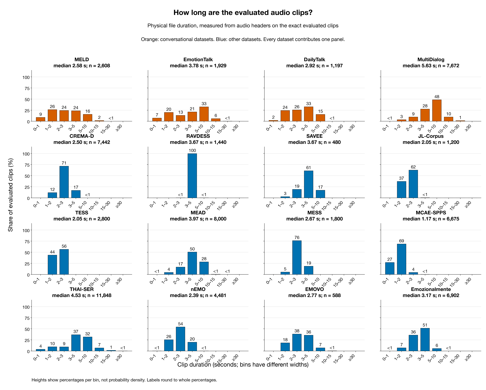
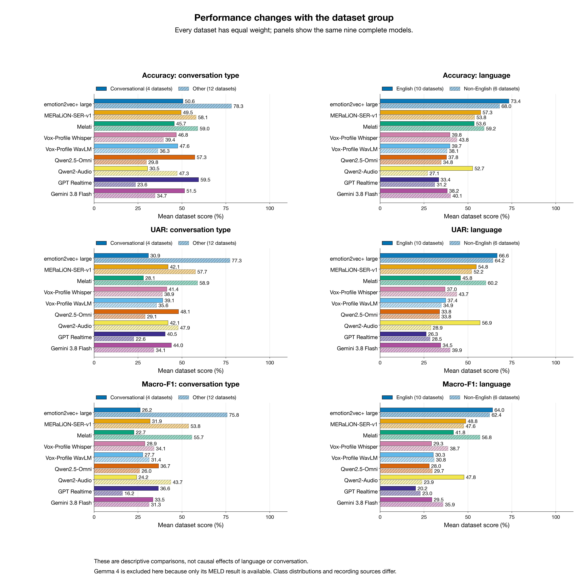
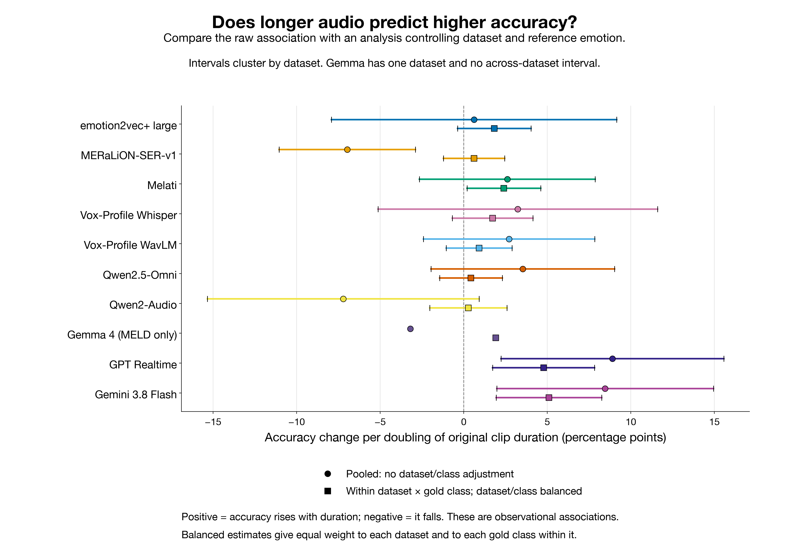
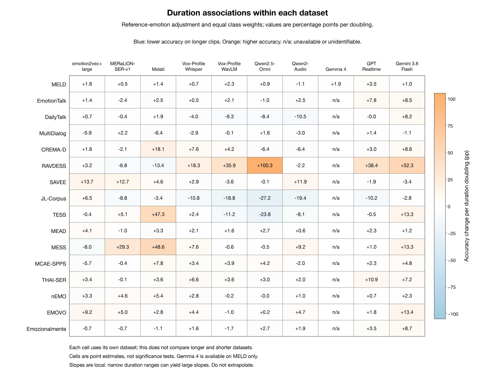
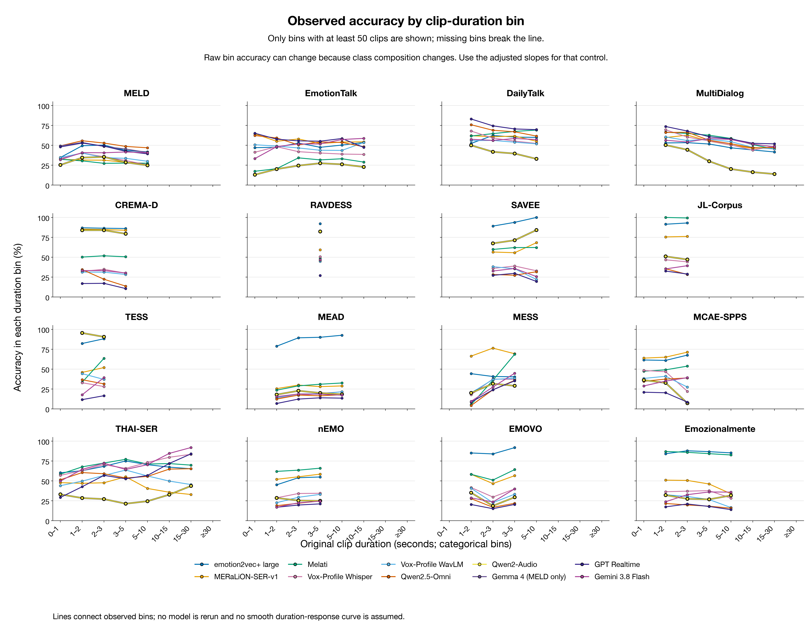

# Model differences, language, conversational setting and audio duration across sixteen datasets

Generated: 2026-11-14 14:29 SGT (Singapore). This report audits 16 datasets, 67,062 distinct clips and 145 selected model–dataset runs. 9 models cover all datasets; Gemma 4 currently contributes MELD only. All results use saved predictions and audio-file metadata; this analysis runs no new inference or API requests.

## 1. First, refine the observation about the four conversational datasets

Qwen2.5-Omni's advantage depends on the metric: it exceeds every one of the five SER models on Accuracy in 2/4 datasets and on macro-F1 in 4/4. A high Accuracy therefore does not imply four across-the-board wins. The best SER is selected separately for each displayed metric and can be a different model.

| Dataset | Omni Accuracy | Best SER Accuracy | Omni UAR | Omni macro-F1 | Best SER macro-F1 | Always neutral |
| --- | --- | --- | --- | --- | --- | --- |
| MELD | 51.27% | 45.59% (emotion2vec+) | 43.45% | 40.43% | 28.49% (emotion2vec+) | 48.16% |
| EmotionTalk | 54.74% | 55.21% (MERaLiON) | 54.37% | 48.16% | 47.36% (MERaLiON) | 48.94% |
| DailyTalk | 68.76% | 65.08% (Melati) | 58.33% | 31.26% | 29.82% (MERaLiON) | 77.78% |
| MultiDialog | 54.55% | 59.67% (Melati) | 36.11% | 26.94% | 26.46% (Vox-Profile Whisper) | 68.87% |

The always-neutral baseline is 77.78% on DailyTalk, higher than every completed model (best model: 74.52%). The always-neutral baseline is 68.87% on MultiDialog, higher than every completed model (best model: 59.67%). Accuracy is the fraction of all clips classified correctly and can be dominated by a majority class. UAR averages recall equally across gold classes; macro-F1 averages class F1 equally; weighted-F1 weights it by gold support. Better macro-F1 can coexist with lower Accuracy because majority/minority-class tradeoffs differ. Neither result establishes reliable performance for every emotion.

JL-Corpus is another useful correction: Qwen2-Audio Accuracy is 48.58%, versus a best observed 99.50% from Melati. Its relative strength on some acted corpora does not mean it matches the leading SER model throughout that group.

## 2. Actual duration distributions and model input windows

| Dataset | Language | Setting | N | Median s | Q25–Q75 s | Q95 s | <3 s | >10 s |
| --- | --- | --- | --- | --- | --- | --- | --- | --- |
| CREMA-D | English | Other | 7,442 | 2.50 | 2.20–2.84 | 3.47 | 83.2% | 0.0% |
| MCAE-SPPS | Mandarin | Other | 6,675 | 1.17 | 0.99–1.40 | 1.96 | 99.9% | 0.0% |
| THAI-SER | Thai | Other | 11,848 | 4.53 | 3.17–6.23 | 11.97 | 22.9% | 8.7% |
| nEMO | Polish | Other | 4,481 | 2.39 | 1.99–2.87 | 3.65 | 80.0% | 0.0% |
| MESS | English | Other | 1,800 | 2.67 | 2.38–2.93 | 3.26 | 81.4% | 0.0% |
| RAVDESS | English | Other | 1,440 | 3.67 | 3.47–3.87 | 4.31 | 0.1% | 0.0% |
| TESS | English | Other | 2,800 | 2.05 | 1.84–2.28 | 2.59 | 100.0% | 0.0% |
| JL-Corpus | English | Other | 1,200 | 2.05 | 1.90–2.30 | 2.60 | 99.6% | 0.0% |
| MEAD | English | Other | 8,000 | 3.97 | 3.12–5.23 | 7.24 | 21.1% | 0.4% |
| MELD | English | Conversational | 2,608 | 2.58 | 1.62–4.13 | 7.76 | 59.0% | 1.8% |
| EMOVO | Italian | Other | 588 | 2.77 | 2.13–3.84 | 5.38 | 56.6% | 0.5% |
| Emozionalmente | Italian | Other | 6,902 | 3.17 | 2.57–3.86 | 5.10 | 43.0% | 0.0% |
| SAVEE | English | Other | 480 | 3.67 | 3.08–4.52 | 5.86 | 21.9% | 0.0% |
| EmotionTalk | Mandarin | Conversational | 1,929 | 3.78 | 1.86–6.77 | 10.36 | 40.3% | 6.2% |
| DailyTalk | English | Conversational | 1,197 | 2.92 | 1.96–4.21 | 6.75 | 51.8% | 0.1% |
| MultiDialog | English | Conversational | 7,672 | 5.63 | 3.94–7.72 | 11.84 | 13.1% | 11.0% |

Dataset medians range from 1.17 s on MCAE-SPPS to 5.63 s on MultiDialog. Across clips, 50.2% are shorter than 3 s and 3.1% exceed 10 s. Quantiles expose the distribution instead of replacing a corpus with one average. Durations come from file frames and sample rates; they include silence, pauses and background sound and are not voice-activity-detected speaking time.

Effective local windows differ: both Vox-Profile models take at most the first 15 s; Qwen2-Audio, Gemma 4, MERaLiON and Melati use at most the first 30 s. Qwen2.5-Omni has no explicit loader crop, but its bundled processor configuration has a 300 s window; emotion2vec+ has no explicit fixed crop. Padding and pooling also differ: MERaLiON pads to 30 s and pools the whole representation, while Melati/Vox-Profile Whisper pool actual frames. The API outputs were imported from another runner and do not verify the complete server-side crop policy. Raw file duration therefore differs from effective heard duration; extra raw seconds beyond a model's cap need not add input evidence.

## 3. English/non-English and conversational/other settings: equal-dataset comparisons

This comparison includes only the 9 models covering all 16 datasets and gives each dataset equal weight within a group; larger corpora do not dominate through clip count. Gemma 4 is excluded. Each cell is Accuracy / UAR / macro-F1. These are descriptive means for the selected corpora. Grouping does not remove differences in class inventory, label meaning, annotation or training exposure, so a group difference is not an isolated language effect at matched task difficulty.

| Model | English | Non-English | Conversational | Other |
| --- | --- | --- | --- | --- |
| emotion2vec+ | 73.4% / 66.6% / 64.0% | 68.0% / 64.2% / 62.4% | 50.6% / 30.9% / 26.2% | 78.3% / 77.3% / 75.8% |
| MERaLiON | 57.3% / 54.8% / 48.8% | 53.8% / 52.2% / 47.6% | 49.5% / 42.1% / 31.9% | 58.1% / 57.7% / 53.8% |
| Melati | 53.6% / 45.8% / 41.8% | 59.2% / 60.2% / 56.8% | 45.7% / 28.1% / 22.7% | 59.0% / 58.9% / 55.7% |
| Vox-Profile Whisper | 39.8% / 37.0% / 29.3% | 43.8% / 43.7% / 38.7% | 46.8% / 41.4% / 28.9% | 39.4% / 38.9% / 34.1% |
| Vox-Profile WavLM | 39.7% / 37.4% / 30.3% | 38.1% / 34.9% / 30.8% | 47.6% / 39.1% / 27.7% | 36.3% / 35.6% / 31.4% |
| Qwen2.5-Omni | 37.8% / 33.8% / 28.0% | 34.8% / 33.8% / 29.7% | 57.3% / 48.1% / 36.7% | 29.8% / 29.1% / 26.0% |
| Qwen2-Audio | 52.7% / 56.9% / 47.8% | 27.1% / 28.9% / 23.9% | 30.5% / 42.1% / 24.2% | 47.3% / 47.9% / 43.7% |
| GPT Realtime | 33.4% / 26.3% / 20.2% | 31.2% / 28.5% / 23.0% | 59.5% / 40.5% / 36.6% | 23.6% / 22.6% / 16.2% |
| Gemini 3.8 Flash | 38.2% / 34.5% / 29.5% | 40.1% / 39.9% / 35.9% | 51.5% / 44.0% / 33.5% | 34.7% / 34.1% / 31.3% |

Every model receives one utterance without neighboring turns, speaker history or video. A conversational corpus does not mean that contextual conversational emotion recognition was evaluated. MELD uses television dialogue; DailyTalk and MultiDialog contain performed scripted conversations, and EmotionTalk includes scenario-based acting. The four are not all spontaneous speech. DailyTalk's emotion classes inherit text-dialogue labels; MultiDialog includes intended delivery and human quality control. These labels do not all measure purely acoustic perception. English and non-English groups are also different corpora rather than translated versions of the same recordings. Language understanding, performance style, label origin and duration are consequently entangled.

## 4. Primary test: is longer audio associated with higher correctness?

The primary fit is `correct = dataset×gold-class intercept + β·log2(raw duration)`, estimated by weighted within-stratum demeaning. Weights give every dataset the same total weight and every gold class within a dataset the same total weight. This prevents large corpora and majority classes such as neutral from determining the slope. The tradeoff is greater per-clip weight for rare classes, making unbalanced estimates and dataset-specific results necessary checks. β is reported in percentage points (pp) of correctness per doubling: +2 pp uses the same association unit for 2→4 s and 4→8 s. It is not a probability prediction or evidence that lengthening a particular clip improves correctness by 2 pp.

Primary 95% intervals use dataset-clustered CR1 standard errors and t(G−1). Complete models have only sixteen dataset units, rather than tens of thousands of independent clips. This still depends on the cluster assumptions and does not guarantee generalization to arbitrary new corpora. Gemma 4 has one dataset, MELD, so its descriptive slope is retained without a dataset-clustered interval. Intervals and p-values are not multiplicity-adjusted; individual favorable results must not be selected as the conclusion.

| Model | Scope | β pp/doubling | 95% CI | p | Dataset clusters | Positive dataset slopes | Interpretation |
| --- | --- | --- | --- | --- | --- | --- | --- |
| emotion2vec+ | 16 datasets | +1.83 | [-0.37, +4.03] | 0.097 | 16 | 11/16 | Direction unresolved; interval crosses 0 |
| MERaLiON | 16 datasets | +0.62 | [-1.21, +2.45] | 0.482 | 16 | 7/16 | Direction unresolved; interval crosses 0 |
| Melati | 16 datasets | +2.40 | [+0.20, +4.61] | 0.035 | 16 | 12/16 | Positive; interval excludes 0 |
| Vox-Profile Whisper | 16 datasets | +1.72 | [-0.69, +4.14] | 0.148 | 16 | 13/16 | Direction unresolved; interval crosses 0 |
| Vox-Profile WavLM | 16 datasets | +0.92 | [-1.05, +2.89] | 0.336 | 16 | 7/16 | Direction unresolved; interval crosses 0 |
| Qwen2.5-Omni | 16 datasets | +0.43 | [-1.45, +2.31] | 0.630 | 16 | 8/16 | Direction unresolved; interval crosses 0 |
| Qwen2-Audio | 16 datasets | +0.27 | [-2.04, +2.58] | 0.805 | 16 | 8/16 | Direction unresolved; interval crosses 0 |
| Gemma 4 | MELD only | +1.92 | — | — | 1 | 1/1 | Interval unavailable |
| GPT Realtime | 16 datasets | +4.78 | [+1.73, +7.83] | 0.004 | 16 | 12/16 | Positive; interval excludes 0 |
| Gemini 3.8 Flash | 16 datasets | +5.10 | [+1.95, +8.26] | 0.004 | 16 | 13/16 | Positive; interval excludes 0 |

Among complete models, primary intervals are wholly positive for 3, wholly negative for 0, cross zero for 6, and unavailable for 0. Positive intervals excluding zero occur for Melati, GPT Realtime, Gemini 3.8 Flash. An interval crossing zero, including one around a positive estimate, leaves the direction unresolved rather than confirming a longer-is-better hypothesis.

| Model | Pooled | Within strata, unbalanced | Within strata, balanced (primary) | Speaker/dialogue clustering sensitivity |
| --- | --- | --- | --- | --- |
| emotion2vec+ | +0.62 [-7.91, +9.16] | +2.46 [+1.28, +3.65] | +1.83 [-0.37, +4.03] | +1.83 [+0.54, +3.12] |
| MERaLiON | -6.97 [-11.04, -2.90] | -0.75 [-1.76, +0.25] | +0.62 [-1.21, +2.45] | +0.62 [-0.90, +2.13] |
| Melati | +2.61 [-2.65, +7.86] | +2.83 [+1.34, +4.32] | +2.40 [+0.20, +4.61] | +2.40 [+0.90, +3.91] |
| Vox-Profile Whisper | +3.24 [-5.13, +11.61] | +1.88 [-2.60, +6.35] | +1.72 [-0.69, +4.14] | +1.72 [+0.59, +2.86] |
| Vox-Profile WavLM | +2.71 [-2.41, +7.83] | +2.01 [-0.49, +4.52] | +0.92 [-1.05, +2.89] | +0.92 [-0.57, +2.41] |
| Qwen2.5-Omni | +3.54 [-1.95, +9.02] | +0.48 [-2.18, +3.15] | +0.43 [-1.45, +2.31] | +0.43 [-0.66, +1.53] |
| Qwen2-Audio | -7.21 [-15.34, +0.92] | -1.70 [-6.11, +2.70] | +0.27 [-2.04, +2.58] | +0.27 [-1.25, +1.80] |
| Gemma 4 | -3.20 — | -2.19 — | +1.92 — | +1.92 [+0.32, +3.51] |
| GPT Realtime | +8.90 [+2.24, +15.56] | +4.13 [-2.28, +10.53] | +4.78 [+1.73, +7.83] | +4.78 [+3.10, +6.47] |
| Gemini 3.8 Flash | +8.46 [+1.98, +14.94] | +4.93 [+2.59, +7.27] | +5.10 [+1.95, +8.26] | +5.10 [+3.48, +6.73] |

Cells show slope and 95% CI in pp/doubling. The pooled fit does not control dataset or class and can exhibit a Simpson reversal: long clips may come from difficult corpora, producing a negative pooled slope despite positive within-dataset/class associations, or vice versa. Speaker/dialogue clustering uses recoverable IDs namespaced by dataset. It checks sensitivity to dependence within those groups; it does not create a new train/test split, evaluate new speakers, or replace the primary uncertainty across datasets.

The positive-dataset count describes the signs of identifiable point estimates, not the number of significant findings, and does not imply one direction in every corpus. The dataset-specific figure exposes this heterogeneity. One shared slope is a summary rather than a replacement for domain- and class-specific error analysis. A narrow observed duration range, as in RAVDESS, can produce a large unit slope. A coefficient above 100 pp/doubling is not accuracy above 100% and must not be extrapolated to an unobserved doubling.

Between-model differences require a direct slope comparison; one significant slope and one non-significant slope do not establish a difference. The following fits use paired per-clip correctness differences. Positive values mean an advantage relative to the reference grows with duration, still as an adjusted observational association.

| Model | Reference | Scope | Gap β pp/doubling | 95% CI |
| --- | --- | --- | --- | --- |
| emotion2vec+ | MERaLiON | 16 datasets | +1.21 | [-1.39, +3.81] |
| MERaLiON | emotion2vec+ | 16 datasets | -1.21 | [-3.81, +1.39] |
| Melati | emotion2vec+ | 16 datasets | +0.57 | [-1.19, +2.33] |
| Melati | MERaLiON | 16 datasets | +1.78 | [-1.18, +4.74] |
| Vox-Profile Whisper | emotion2vec+ | 16 datasets | -0.10 | [-2.13, +1.93] |
| Vox-Profile Whisper | MERaLiON | 16 datasets | +1.11 | [-1.83, +4.04] |
| Vox-Profile WavLM | emotion2vec+ | 16 datasets | -0.91 | [-3.70, +1.88] |
| Vox-Profile WavLM | MERaLiON | 16 datasets | +0.30 | [-2.85, +3.46] |
| Qwen2.5-Omni | emotion2vec+ | 16 datasets | -1.40 | [-4.16, +1.37] |
| Qwen2.5-Omni | MERaLiON | 16 datasets | -0.19 | [-2.54, +2.17] |
| Qwen2-Audio | emotion2vec+ | 16 datasets | -1.56 | [-3.72, +0.61] |
| Qwen2-Audio | MERaLiON | 16 datasets | -0.35 | [-3.43, +2.74] |
| Gemma 4 | emotion2vec+ | MELD only | +0.35 | — |
| Gemma 4 | MERaLiON | MELD only | +1.45 | — |
| GPT Realtime | emotion2vec+ | 16 datasets | +2.95 | [-0.33, +6.24] |
| GPT Realtime | MERaLiON | 16 datasets | +4.16 | [-0.19, +8.52] |
| Gemini 3.8 Flash | emotion2vec+ | 16 datasets | +3.28 | [+0.19, +6.36] |
| Gemini 3.8 Flash | MERaLiON | 16 datasets | +4.49 | [+0.23, +8.74] |

## 5. What raw bins and correlations of dataset medians can tell us

The bin plot puts raw-duration intervals on x and the fraction of correctly classified clips in each bin on y; only points supported by at least fifty clips are shown. It can locate concentrations of short- or long-clip errors, but gold-class and dataset composition still change across bins. It is not an experiment that adds information to the same recording, so an upward or downward curve does not establish a causal duration effect.

| Model | Median duration vs Accuracy ρ (p) | vs UAR ρ (p) | vs macro-F1 ρ (p) |
| --- | --- | --- | --- |
| emotion2vec+ | 0.03 (0.905) | -0.07 (0.787) | -0.06 (0.837) |
| MERaLiON | -0.44 (0.090) | -0.53 (0.035) | -0.42 (0.105) |
| Melati | -0.01 (0.983) | -0.24 (0.362) | -0.20 (0.464) |
| Vox-Profile Whisper | 0.37 (0.158) | 0.09 (0.737) | 0.04 (0.897) |
| Vox-Profile WavLM | 0.20 (0.458) | -0.15 (0.572) | -0.15 (0.587) |
| Qwen2.5-Omni | 0.21 (0.425) | 0.17 (0.535) | 0.14 (0.610) |
| Qwen2-Audio | -0.58 (0.019) | -0.26 (0.327) | -0.34 (0.192) |
| GPT Realtime | 0.39 (0.141) | 0.56 (0.024) | 0.56 (0.024) |
| Gemini 3.8 Flash | 0.42 (0.105) | 0.17 (0.535) | 0.17 (0.520) |

These Spearman correlations treat each corpus as one point, only sixteen points, asking whether corpora with longer typical clips are easier. That differs from the clip-level within-dataset/gold-class question. Corpus difficulty, label priors and language composition can generate such correlations. The unadjusted p-values are exploratory and do not establish a deployment duration threshold. Gemma 4 has one point and receives no cross-dataset correlation.

## 6. Testable explanations for model differences and the limits of current evidence

| Model | Datasets | Mean invalid | Maximum invalid | Valid-only Accuracy − overall (pp) |
| --- | --- | --- | --- | --- |
| emotion2vec+ | 16 | 0.00% | 0.00% | +0.00 |
| MERaLiON | 16 | 0.00% | 0.00% | +0.00 |
| Melati | 16 | 0.00% | 0.00% | +0.00 |
| Vox-Profile Whisper | 16 | 0.00% | 0.00% | +0.00 |
| Vox-Profile WavLM | 16 | 0.00% | 0.00% | +0.00 |
| Qwen2.5-Omni | 16 | 0.08% | 0.36% | +0.04 |
| Qwen2-Audio | 16 | 4.82% | 38.86% | +1.79 |
| Gemma 4 | 1 | 0.00% | 0.00% | +0.00 |
| GPT Realtime | 16 | 0.25% | 1.11% | +0.13 |
| Gemini 3.8 Flash | 16 | 0.03% | 0.12% | +0.01 |

These are equal-dataset averages over each model's completed runs. Gemma 4's one-corpus mean cannot fairly rank against sixteen-corpus means. Invalid outputs remain errors in the primary metrics. Valid-only Accuracy conditions on a potentially easier selected subset; it is not the expected Accuracy after fixing formatting. SER selects the highest score among candidates, while Audio LLMs generate text followed by protocol-specific one-word parsing. Candidate/format compliance can therefore affect the latter and must be distinguished from emotion discrimination.

| Dataset | Model | Neutral baseline | Predict neutral | Predict angry | Invalid |
| --- | --- | --- | --- | --- | --- |
| MELD | Qwen2.5-Omni | 48.16% | 40.57% | 11.23% | 0.23% |
| MELD | Qwen2-Audio | 48.16% | 10.58% | 33.40% | 0.61% |
| EmotionTalk | Qwen2.5-Omni | 48.94% | 29.60% | 23.22% | 0.36% |
| EmotionTalk | Qwen2-Audio | 48.94% | 4.15% | 29.39% | 21.98% |
| DailyTalk | Qwen2.5-Omni | 77.78% | 58.73% | 2.34% | 0.33% |
| DailyTalk | Qwen2-Audio | 77.78% | 33.58% | 26.15% | 1.17% |
| MultiDialog | Qwen2.5-Omni | 68.87% | 58.41% | 1.37% | 0.13% |
| MultiDialog | Qwen2-Audio | 68.87% | 24.17% | 21.39% | 2.91% |

Prediction frequencies reveal alignment between an output prior and corpus labels. Frequent neutral predictions are not inherently biased; gold prevalence, class recall and confusions must also be inspected. The DailyTalk/MultiDialog constant baselines show how a high Accuracy can arise from a majority class. Conversely, a single-emotion prior or invalid outputs can reduce scores on some short-utterance corpora. Frequencies alone do not identify the mechanism.

Where listener labels are available, the following adds agreement with perceived emotion. Intended-delivery and listener labels are different reference targets; their score difference cannot all be attributed to model ability. The listener-labeled sample count is retained. Only a single nonempty listener vote is scored here; tied votes are excluded.

| Dataset | Model | Listener N | Listener Accuracy | Listener UAR |
| --- | --- | --- | --- | --- |
| CREMA-D | emotion2vec+ | 6,798 | 44.81% | 62.93% |
| MCAE-SPPS | emotion2vec+ | 6,675 | 61.35% | 54.20% |
| THAI-SER | emotion2vec+ | 11,848 | 65.92% | 59.90% |
| Emozionalmente | emotion2vec+ | 6,187 | 77.49% | 78.75% |
| CREMA-D | MERaLiON | 6,798 | 46.45% | 63.18% |
| MCAE-SPPS | MERaLiON | 6,675 | 64.90% | 57.79% |
| THAI-SER | MERaLiON | 11,848 | 39.70% | 35.12% |
| Emozionalmente | MERaLiON | 6,187 | 52.58% | 48.02% |
| CREMA-D | Melati | 6,798 | 59.69% | 52.69% |
| MCAE-SPPS | Melati | 6,675 | 48.84% | 48.05% |
| THAI-SER | Melati | 11,848 | 63.38% | 59.95% |
| Emozionalmente | Melati | 6,187 | 78.18% | 79.62% |
| CREMA-D | Vox-Profile Whisper | 6,798 | 63.86% | 42.64% |
| MCAE-SPPS | Vox-Profile Whisper | 6,675 | 45.98% | 40.94% |
| THAI-SER | Vox-Profile Whisper | 11,848 | 65.27% | 61.10% |
| Emozionalmente | Vox-Profile Whisper | 6,187 | 44.79% | 39.20% |
| CREMA-D | Vox-Profile WavLM | 6,798 | 59.12% | 37.20% |
| MCAE-SPPS | Vox-Profile WavLM | 6,675 | 39.61% | 36.70% |
| THAI-SER | Vox-Profile WavLM | 11,848 | 58.09% | 47.95% |
| Emozionalmente | Vox-Profile WavLM | 6,187 | 33.59% | 28.79% |
| CREMA-D | Qwen2.5-Omni | 6,798 | 60.08% | 28.82% |
| MCAE-SPPS | Qwen2.5-Omni | 6,675 | 36.70% | 32.26% |
| THAI-SER | Qwen2.5-Omni | 11,848 | 55.43% | 49.94% |
| Emozionalmente | Qwen2.5-Omni | 6,187 | 24.49% | 20.88% |
| CREMA-D | Qwen2-Audio | 6,798 | 44.40% | 60.84% |
| MCAE-SPPS | Qwen2-Audio | 6,675 | 32.40% | 31.90% |
| THAI-SER | Qwen2-Audio | 11,848 | 20.35% | 23.71% |
| Emozionalmente | Qwen2-Audio | 6,187 | 27.56% | 29.29% |
| CREMA-D | GPT Realtime | 6,798 | 58.55% | 18.91% |
| MCAE-SPPS | GPT Realtime | 6,675 | 19.85% | 16.70% |
| THAI-SER | GPT Realtime | 11,848 | 54.30% | 46.46% |
| Emozionalmente | GPT Realtime | 6,187 | 24.03% | 20.07% |
| CREMA-D | Gemini 3.8 Flash | 6,798 | 53.30% | 42.58% |
| MCAE-SPPS | Gemini 3.8 Flash | 6,675 | 33.48% | 30.07% |
| THAI-SER | Gemini 3.8 Flash | 11,848 | 64.78% | 59.49% |
| Emozionalmente | Gemini 3.8 Flash | 6,187 | 41.23% | 36.89% |

**Acoustics, lexical meaning and label origin.** Words may help emotion judgments in conversation, while acted fixed-text speech places more weight on delivery. A strict Audio-LLM=lexical / SER=acoustic division is too simple. VoxEmo finds substantial Qwen2-Audio prompt sensitivity and corpus-dependent benefits from lexical information. A controlled study changing emotional delivery while preserving words shows that emotional information can be represented without being reliably used in answers. These motivate acoustic/semantic readout tests rather than establishing the cause of our rankings. [VoxEmo](https://arxiv.org/html/2603.08936v1); [Encoded but Not Express](https://aclanthology.org/2026.aacl-long.262/).

**Qwen2-Audio and Omni differ in more than duration.** Both initialize their audio encoders from Whisper-large-v3, but their language backbones and training differ: Qwen2-Audio uses Qwen-7B, while Omni uses Qwen2.5 and multimodal training. Their technical reports list MELD Accuracy of 55.3% and 57.0%, respectively. These are not directly matched to our Instruct checkpoint, prompt, parser and candidate-label protocol. A published MELD evaluation is neither proof of a local reproduction nor evidence of training leakage inferred from a score. [Qwen2-Audio report](https://arxiv.org/html/2407.10759v1); [Qwen2.5-Omni report](https://arxiv.org/html/2503.20215v1).

For the TESS (Qwen2-Audio Accuracy 92.64%) versus MEAD (19.80%) contrast, training exposure or leakage is an unverified hypothesis. High and low scores do not establish which corpus entered training. Qwen2-Audio's authors state that their evaluation data were excluded; this scoped statement is not an independent file-level audit of all sixteen corpora and inherited components. Speech material, speakers, delivery, labels and parsing are alternative explanations that the current observations do not distinguish.

**Non-English is not one uniform failure mechanism.** Italian appears in Qwen2-Audio's official language examples, so low EMOVO/Emozionalmente scores cannot simply be explained as unsupported Italian. Language support does not guarantee transfer across emotion, accent, acting style or label mapping. Absence from an illustrative language list also does not prove absence from training. [Official Qwen2-Audio description](https://qwenlm.github.io/blog/qwen2-audio/).

**Training provenance matters.** Leading SER systems have documented training, development or upstream-teacher links to several acted corpora, including some of CREMA-D, RAVDESS, SAVEE and JL-Corpus; stages differ by model. Rankings can therefore mix transfer with adaptation to previously encountered domains. Current run-level provenance status counts are confirmed_exposure: 5; not_established: 124; probable_exposure: 16. These come from source review, not score-based inference. No documented link does not certify unseen data, and participation in a training pipeline does not establish leakage of these specific test clips. See the [project provenance audit](../../emotion_recognition/docs/training_provenance.md).

See the [intensity analysis](intensity_en.md) for native strength labels, class/duration-adjusted accuracy and class-specific MEAD errors.

## 7. Next steps: small controlled experiments that distinguish explanations

The following are proposed experiments, not executed runs or new model findings in this report. Prespecify clips, scoring and comparisons; preserve class coverage and prioritize the conversational corpora plus domains with the largest Qwen2-Audio performance differences.

1. **Paired crop/pad controls.** Compare original clips, 1/2/3/5/10 s crops retaining emotion cues, and silence-only padding, holding loudness, sample rate and prompt fixed. Cropping changes lexical and prosodic information together; padding adds no semantic evidence. Interpret them separately and log effective model windows.

2. **Free generation versus candidate constraints.** On identical clips, compare current parsing with candidate-label logits or constrained decoding; report invalids, class confusions and overall metrics separately. APIs lacking this capability require a separate comparison rather than an assumed equivalent intervention.

3. **Lexical and class-prior controls.** Use perceptually labeled clips to compare audio, transcript-only input and controlled acoustic/text cues. Include neutral baselines, per-class recall and intended-versus-listener labels. Synthesis or voice transformation adds confounds and is not automatically causal evidence for natural speech.

4. **A genuinely held-out deployment check.** In provenance-reviewed new domains, independent speakers and the internal target data, calibrate prespecified consensus rules on one manually labeled subset, then validate Accuracy/UAR, acceptance rate and class errors independently. Set tolerable auto-label error and manual-audit effort in advance rather than selecting favorable rules on these sixteen benchmarks.

These results support a paper's cross-corpus robustness and error analysis and guide the internal labeling study. Automatic acceptance ultimately depends on independently validated error and class coverage in the target domain, rather than a high benchmark score or duration correlation alone.
