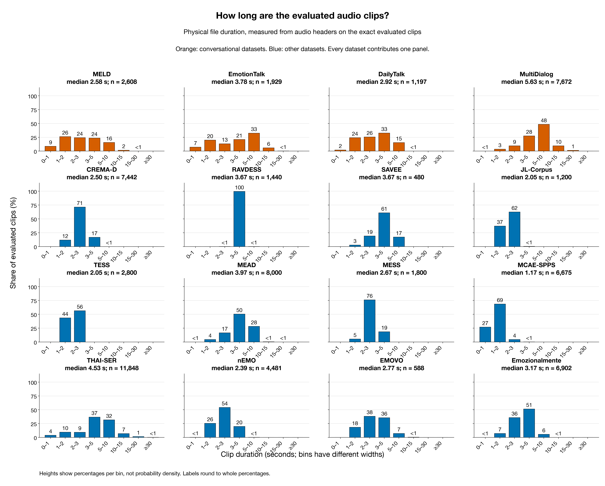
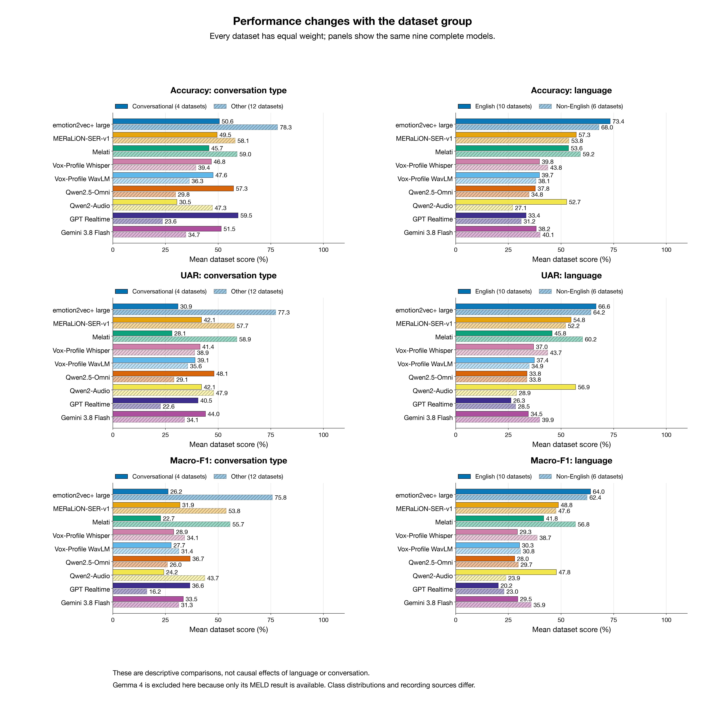
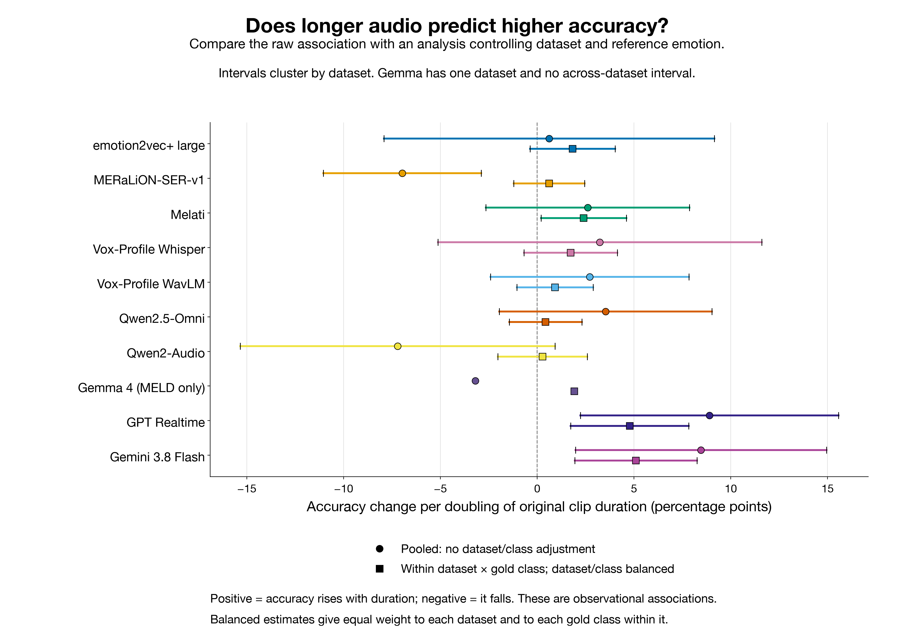
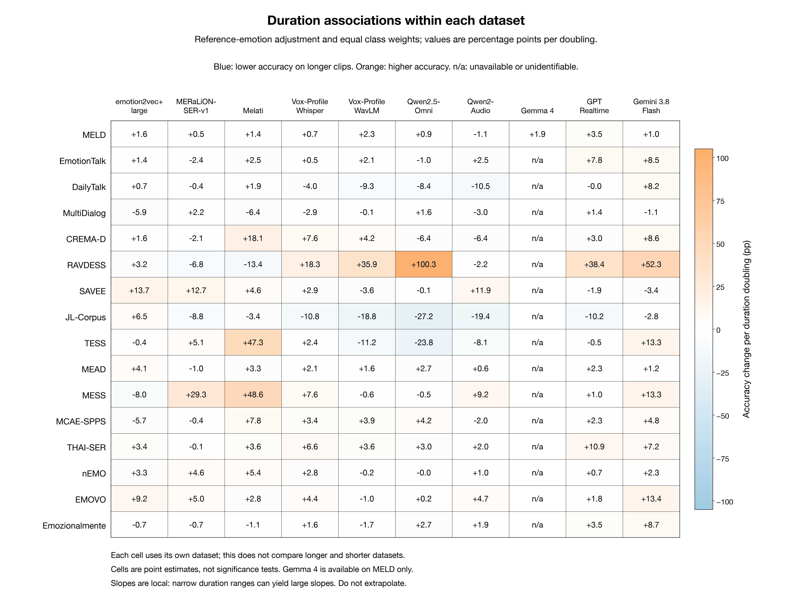
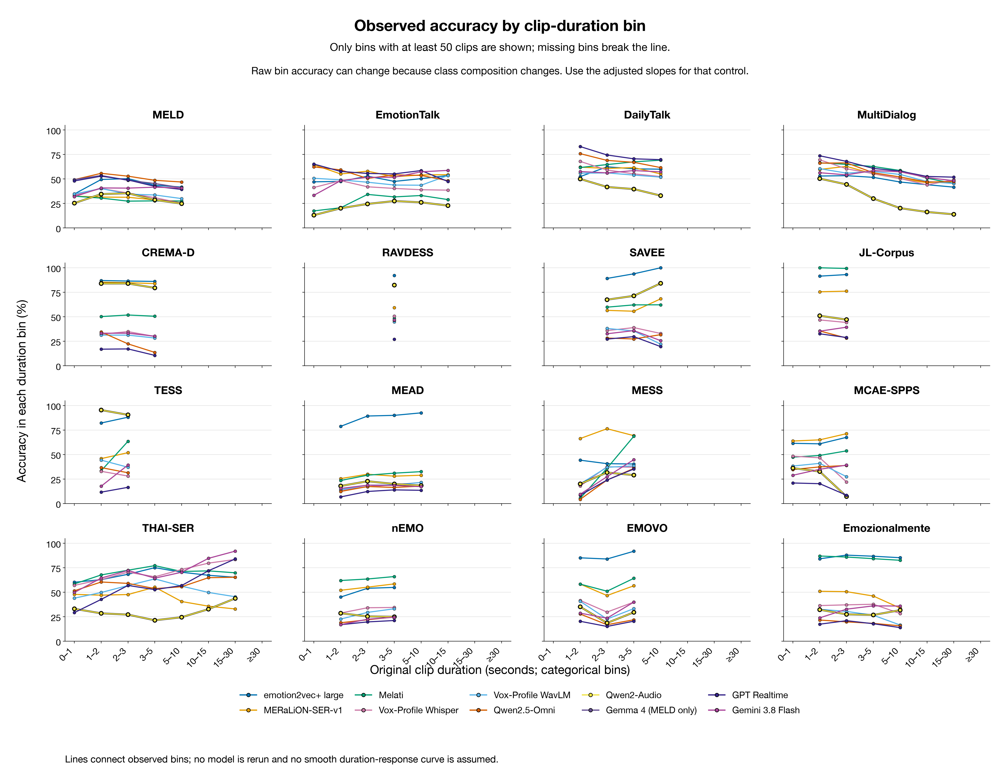

# 十六数据集的模型差异、语言、对话类型与音频时长分析

生成时间：2026-11-14 14:29 SGT（Singapore）。本报告复核 16 个数据集、67,062 条不同音频及 145 个采用的 model–dataset runs。9 个模型覆盖全部数据集；Gemma 4 当前只提供 MELD 结果。所有数字来自已经保存的预测与音频文件元数据，本次分析没有重新运行模型或调用 API。

## 1. 先校正对四个对话数据集的观察

Qwen2.5-Omni 的优势取决于评价指标：在这 4 个数据集上，它的 Accuracy 超过全部五个 SER 模型的有 2 个，macro-F1 超过全部 SER 的有 4 个。因此，不能把四个数据集上的较高 Accuracy 概括为四次全面领先。下表中 Accuracy 和 macro-F1 各自与该指标最好的 SER 相比，两个最佳 SER 可以不同。

| 数据集 | Omni Accuracy | 最佳 SER Accuracy | Omni UAR | Omni macro-F1 | 最佳 SER macro-F1 | 始终预测 neutral |
| --- | --- | --- | --- | --- | --- | --- |
| MELD | 51.27% | 45.59% (emotion2vec+) | 43.45% | 40.43% | 28.49% (emotion2vec+) | 48.16% |
| EmotionTalk | 54.74% | 55.21% (MERaLiON) | 54.37% | 48.16% | 47.36% (MERaLiON) | 48.94% |
| DailyTalk | 68.76% | 65.08% (Melati) | 58.33% | 31.26% | 29.82% (MERaLiON) | 77.78% |
| MultiDialog | 54.55% | 59.67% (Melati) | 36.11% | 26.94% | 26.46% (Vox-Profile Whisper) | 68.87% |

DailyTalk 的 neutral 常量基线为 77.78%，高于所有已完成模型（最好模型 74.52%）。 MultiDialog 的 neutral 常量基线为 68.87%，高于所有已完成模型（最好模型 59.67%）。 Accuracy 是全部样本中预测正确的比例；类别不均衡时可被多数类支配。UAR 是各真实类别 recall 的等权平均，macro-F1 是各类别 F1 的等权平均，weighted-F1 按真实类别数量加权。较好的 macro-F1 可以与较低 Accuracy 同时出现，意味着少数类与多数类之间的取舍不同，并不表示整体已足够可靠或每个情绪类别都已解决。

另一个需要校正的例子是 JL-Corpus：Qwen2-Audio Accuracy 为 48.58%，该数据集最高为 99.50%（Melati）。它在部分表演语料上的表现相对更好，不等于在这些语料上均与领先 SER 持平。

## 2. 实际音频时长分布与输入窗口

| 数据集 | 语言 | 类型 | N | 中位数 s | Q25–Q75 s | Q95 s | <3 s | >10 s |
| --- | --- | --- | --- | --- | --- | --- | --- | --- |
| CREMA-D | English | 非对话 | 7,442 | 2.50 | 2.20–2.84 | 3.47 | 83.2% | 0.0% |
| MCAE-SPPS | Mandarin | 非对话 | 6,675 | 1.17 | 0.99–1.40 | 1.96 | 99.9% | 0.0% |
| THAI-SER | Thai | 非对话 | 11,848 | 4.53 | 3.17–6.23 | 11.97 | 22.9% | 8.7% |
| nEMO | Polish | 非对话 | 4,481 | 2.39 | 1.99–2.87 | 3.65 | 80.0% | 0.0% |
| MESS | English | 非对话 | 1,800 | 2.67 | 2.38–2.93 | 3.26 | 81.4% | 0.0% |
| RAVDESS | English | 非对话 | 1,440 | 3.67 | 3.47–3.87 | 4.31 | 0.1% | 0.0% |
| TESS | English | 非对话 | 2,800 | 2.05 | 1.84–2.28 | 2.59 | 100.0% | 0.0% |
| JL-Corpus | English | 非对话 | 1,200 | 2.05 | 1.90–2.30 | 2.60 | 99.6% | 0.0% |
| MEAD | English | 非对话 | 8,000 | 3.97 | 3.12–5.23 | 7.24 | 21.1% | 0.4% |
| MELD | English | 对话 | 2,608 | 2.58 | 1.62–4.13 | 7.76 | 59.0% | 1.8% |
| EMOVO | Italian | 非对话 | 588 | 2.77 | 2.13–3.84 | 5.38 | 56.6% | 0.5% |
| Emozionalmente | Italian | 非对话 | 6,902 | 3.17 | 2.57–3.86 | 5.10 | 43.0% | 0.0% |
| SAVEE | English | 非对话 | 480 | 3.67 | 3.08–4.52 | 5.86 | 21.9% | 0.0% |
| EmotionTalk | Mandarin | 对话 | 1,929 | 3.78 | 1.86–6.77 | 10.36 | 40.3% | 6.2% |
| DailyTalk | English | 对话 | 1,197 | 2.92 | 1.96–4.21 | 6.75 | 51.8% | 0.1% |
| MultiDialog | English | 对话 | 7,672 | 5.63 | 3.94–7.72 | 11.84 | 13.1% | 11.0% |

最短与最长的数据集中位数分别是 MCAE-SPPS 1.17 s 和 MultiDialog 5.63 s；按音频条数汇总，50.2% 短于 3 s，3.1% 长于 10 s。分位数展示分布，而不是用单个平均值代表整套语料。这里的时长由实际文件帧数与采样率计算，包含静音、停顿和背景声；它不是语音活动检测后的有效说话时长。

本地 loader 的有效窗口不同：Vox-Profile 两个模型最多取前 15 s；Qwen2-Audio、Gemma 4、MERaLiON 和 Melati 最多使用前 30 s。Qwen2.5-Omni 的 loader 不显式裁切，但所附 processor 配置为 300 s 窗口；emotion2vec+ 未设显式固定截断。padding 与 pooling 也不同：MERaLiON 会把短音频补至 30 s 并对整段 pooling，Melati/Vox-Profile Whisper 只汇总实际帧。API 结果来自另一执行器，现存结果不足以核实服务端的完整裁切策略。因此，图中的原始时长不等于每个模型实际听到的长度，15/30 s 以上的延长对某些模型只会改变原始时长标签。

## 3. 英语与非英语、对话与非对话：等数据集比较

下面只比较覆盖全部 16 个数据集的 9 个模型，每套数据集在组内权重相同，而非让大数据集贡献更多样本权重；Gemma 4 不参加这项比较。每格依次为 Accuracy / UAR / macro-F1。这些是所选语料的描述统计，类别数、类别语义、标注方式和训练接触情况并未被分组消除，不同组的平均值不是同一任务难度下的语言效应。

| 模型 | 英语 | 非英语 | 对话 | 非对话 |
| --- | --- | --- | --- | --- |
| emotion2vec+ | 73.4% / 66.6% / 64.0% | 68.0% / 64.2% / 62.4% | 50.6% / 30.9% / 26.2% | 78.3% / 77.3% / 75.8% |
| MERaLiON | 57.3% / 54.8% / 48.8% | 53.8% / 52.2% / 47.6% | 49.5% / 42.1% / 31.9% | 58.1% / 57.7% / 53.8% |
| Melati | 53.6% / 45.8% / 41.8% | 59.2% / 60.2% / 56.8% | 45.7% / 28.1% / 22.7% | 59.0% / 58.9% / 55.7% |
| Vox-Profile Whisper | 39.8% / 37.0% / 29.3% | 43.8% / 43.7% / 38.7% | 46.8% / 41.4% / 28.9% | 39.4% / 38.9% / 34.1% |
| Vox-Profile WavLM | 39.7% / 37.4% / 30.3% | 38.1% / 34.9% / 30.8% | 47.6% / 39.1% / 27.7% | 36.3% / 35.6% / 31.4% |
| Qwen2.5-Omni | 37.8% / 33.8% / 28.0% | 34.8% / 33.8% / 29.7% | 57.3% / 48.1% / 36.7% | 29.8% / 29.1% / 26.0% |
| Qwen2-Audio | 52.7% / 56.9% / 47.8% | 27.1% / 28.9% / 23.9% | 30.5% / 42.1% / 24.2% | 47.3% / 47.9% / 43.7% |
| GPT Realtime | 33.4% / 26.3% / 20.2% | 31.2% / 28.5% / 23.0% | 59.5% / 40.5% / 36.6% | 23.6% / 22.6% / 16.2% |
| Gemini 3.8 Flash | 38.2% / 34.5% / 29.5% | 40.1% / 39.9% / 35.9% | 51.5% / 44.0% / 33.5% | 34.7% / 34.1% / 31.3% |

所有模型本次均输入单条 utterance，没有前后轮次、说话人历史或视频；“对话数据集”只描述录音来源，不表示模型在做带上下文的对话情绪识别。MELD 来自影视对话；DailyTalk 与 MultiDialog 为依据脚本表演的对话，EmotionTalk 也包含基于情境的演员表演，不能把四者都称为 spontaneous speech。DailyTalk 的情绪类别继承文本对话标签，MultiDialog 包含表演意图及人工质检，标签来源与纯声学感知并不完全相同。英语组与非英语组也不是同一语料的翻译版本。这些差异使语言理解、表演方式、标签来源和音频时长相互交织。

## 4. 核心检验：较长音频是否与更高正确率相关？

主分析拟合 `correct = 数据集×真实类别截距 + β·log2(原始时长)`，采用加权组内去均值。权重使每个数据集的总权重相同，并使一个数据集内各真实类别的总权重相同；这样既避免大语料主导，也避免 neutral 等多数类单独决定斜率。代价是稀有类别中每条样本会获得较大权重，所以必须同时查看未平衡估计与逐数据集结果。`β` 报告为原始时长翻倍对应正确率变化的百分点（pp）：例如 +2 pp 表示组内 2 s 与 4 s、4 s 与 8 s 具有同一线性关联单位。它不是预测概率，也不表示将同一条音频加长就能提高 2 pp。

主要 95% 区间使用以数据集为 cluster 的 CR1 标准误与 `t(G−1)` 分布；完整模型只有 16 个数据集单位，这比把数万条音频视为独立证据更保守，但仍依赖数据集 cluster 的建模假设，不自动推广到任意新语料。Gemma 4 只有 MELD 一个数据集，因此保留其描述性斜率，不生成数据集聚类区间。区间与 p 值未做多重比较校正，不应按单个显著结果挑选结论。

| 模型 | 范围 | β pp/翻倍 | 95% CI | p | 数据集 clusters | 正斜率数据集 | 解释 |
| --- | --- | --- | --- | --- | --- | --- | --- |
| emotion2vec+ | 16 datasets | +1.83 | [-0.37, +4.03] | 0.097 | 16 | 11/16 | 方向未确定，区间跨 0 |
| MERaLiON | 16 datasets | +0.62 | [-1.21, +2.45] | 0.482 | 16 | 7/16 | 方向未确定，区间跨 0 |
| Melati | 16 datasets | +2.40 | [+0.20, +4.61] | 0.035 | 16 | 12/16 | 正关联，区间不跨 0 |
| Vox-Profile Whisper | 16 datasets | +1.72 | [-0.69, +4.14] | 0.148 | 16 | 13/16 | 方向未确定，区间跨 0 |
| Vox-Profile WavLM | 16 datasets | +0.92 | [-1.05, +2.89] | 0.336 | 16 | 7/16 | 方向未确定，区间跨 0 |
| Qwen2.5-Omni | 16 datasets | +0.43 | [-1.45, +2.31] | 0.630 | 16 | 8/16 | 方向未确定，区间跨 0 |
| Qwen2-Audio | 16 datasets | +0.27 | [-2.04, +2.58] | 0.805 | 16 | 8/16 | 方向未确定，区间跨 0 |
| Gemma 4 | MELD only | +1.92 | — | — | 1 | 1/1 | 无可用区间 |
| GPT Realtime | 16 datasets | +4.78 | [+1.73, +7.83] | 0.004 | 16 | 12/16 | 正关联，区间不跨 0 |
| Gemini 3.8 Flash | 16 datasets | +5.10 | [+1.95, +8.26] | 0.004 | 16 | 13/16 | 正关联，区间不跨 0 |

在完整模型的主分析中，3 个模型的区间完全高于 0，0 个完全低于 0，6 个跨 0，0 个无可用区间。正关联区间不跨 0 的模型为 Melati、GPT Realtime、Gemini 3.8 Flash。区间跨 0 的模型，包含正点估计的情况，都应表述为方向尚未确定，而非已证实“长音频更好”。

| 模型 | 合并样本 | 组内未平衡 | 组内平衡（主分析） | 说话人/对话聚类敏感性 |
| --- | --- | --- | --- | --- |
| emotion2vec+ | +0.62 [-7.91, +9.16] | +2.46 [+1.28, +3.65] | +1.83 [-0.37, +4.03] | +1.83 [+0.54, +3.12] |
| MERaLiON | -6.97 [-11.04, -2.90] | -0.75 [-1.76, +0.25] | +0.62 [-1.21, +2.45] | +0.62 [-0.90, +2.13] |
| Melati | +2.61 [-2.65, +7.86] | +2.83 [+1.34, +4.32] | +2.40 [+0.20, +4.61] | +2.40 [+0.90, +3.91] |
| Vox-Profile Whisper | +3.24 [-5.13, +11.61] | +1.88 [-2.60, +6.35] | +1.72 [-0.69, +4.14] | +1.72 [+0.59, +2.86] |
| Vox-Profile WavLM | +2.71 [-2.41, +7.83] | +2.01 [-0.49, +4.52] | +0.92 [-1.05, +2.89] | +0.92 [-0.57, +2.41] |
| Qwen2.5-Omni | +3.54 [-1.95, +9.02] | +0.48 [-2.18, +3.15] | +0.43 [-1.45, +2.31] | +0.43 [-0.66, +1.53] |
| Qwen2-Audio | -7.21 [-15.34, +0.92] | -1.70 [-6.11, +2.70] | +0.27 [-2.04, +2.58] | +0.27 [-1.25, +1.80] |
| Gemma 4 | -3.20 — | -2.19 — | +1.92 — | +1.92 [+0.32, +3.51] |
| GPT Realtime | +8.90 [+2.24, +15.56] | +4.13 [-2.28, +10.53] | +4.78 [+1.73, +7.83] | +4.78 [+3.10, +6.47] |
| Gemini 3.8 Flash | +8.46 [+1.98, +14.94] | +4.93 [+2.59, +7.27] | +5.10 [+1.95, +8.26] | +5.10 [+3.48, +6.73] |

每格为斜率与 95% CI，单位均为 pp/时长翻倍。Pooled 不控制数据集或类别，可出现 Simpson reversal：较长录音来自更难语料，会让总斜率为负，即使同一数据集同一类别内为正，反向情况也可能出现。说话人/对话 cluster 使用带数据集命名空间的可恢复 ID，只检查同人/同对话相关性对区间的影响；它没有重新划分训练测试、没有测试新说话人，也不能替代主分析的跨数据集不确定性。

主表中的“正斜率数据集”仅为可识别点估计的方向计数，不是显著结果计数，也不保证每套数据集均有同方向关联。逐数据集图展示这种异质性；单一共同斜率只是摘要，不能代替各领域、各类别的错误分析。时长变化范围很窄的语料可产生很大的单位斜率，例如 RAVDESS；超过 100 pp/翻倍的系数不是预测正确率超过 100%，也不能外推到未观察到的时长翻倍。

模型之间的差异还需直接比较斜率，不能以“一个显著、另一个不显著”代替差异检验。下表对同一条音频的正确性差值建模；正值表示相对 reference 的优势随时长增加，但它仍是调整后的观察性关联。

| 模型 | Reference | 范围 | 差异 β pp/翻倍 | 95% CI |
| --- | --- | --- | --- | --- |
| emotion2vec+ | MERaLiON | 16 datasets | +1.21 | [-1.39, +3.81] |
| MERaLiON | emotion2vec+ | 16 datasets | -1.21 | [-3.81, +1.39] |
| Melati | emotion2vec+ | 16 datasets | +0.57 | [-1.19, +2.33] |
| Melati | MERaLiON | 16 datasets | +1.78 | [-1.18, +4.74] |
| Vox-Profile Whisper | emotion2vec+ | 16 datasets | -0.10 | [-2.13, +1.93] |
| Vox-Profile Whisper | MERaLiON | 16 datasets | +1.11 | [-1.83, +4.04] |
| Vox-Profile WavLM | emotion2vec+ | 16 datasets | -0.91 | [-3.70, +1.88] |
| Vox-Profile WavLM | MERaLiON | 16 datasets | +0.30 | [-2.85, +3.46] |
| Qwen2.5-Omni | emotion2vec+ | 16 datasets | -1.40 | [-4.16, +1.37] |
| Qwen2.5-Omni | MERaLiON | 16 datasets | -0.19 | [-2.54, +2.17] |
| Qwen2-Audio | emotion2vec+ | 16 datasets | -1.56 | [-3.72, +0.61] |
| Qwen2-Audio | MERaLiON | 16 datasets | -0.35 | [-3.43, +2.74] |
| Gemma 4 | emotion2vec+ | MELD only | +0.35 | — |
| Gemma 4 | MERaLiON | MELD only | +1.45 | — |
| GPT Realtime | emotion2vec+ | 16 datasets | +2.95 | [-0.33, +6.24] |
| GPT Realtime | MERaLiON | 16 datasets | +4.16 | [-0.19, +8.52] |
| Gemini 3.8 Flash | emotion2vec+ | 16 datasets | +3.28 | [+0.19, +6.36] |
| Gemini 3.8 Flash | MERaLiON | 16 datasets | +4.49 | [+0.23, +8.74] |

## 5. 分箱曲线与数据集均值相关性能说明什么

时长分箱图的 x 轴是原始音频时长区间，y 轴是该区间内预测正确的样本比例；只有至少 50 条音频的点才展示。它便于定位短音频或长音频的错误集中位置，但分箱后的真实类别和数据集混合比例仍会变化，不是在相同音频上增加信息的实验。不能把曲线的上升或下降直接解释为时长造成的改善或退化。

| 模型 | 中位时长 vs Accuracy ρ (p) | vs UAR ρ (p) | vs macro-F1 ρ (p) |
| --- | --- | --- | --- |
| emotion2vec+ | 0.03 (0.905) | -0.07 (0.787) | -0.06 (0.837) |
| MERaLiON | -0.44 (0.090) | -0.53 (0.035) | -0.42 (0.105) |
| Melati | -0.01 (0.983) | -0.24 (0.362) | -0.20 (0.464) |
| Vox-Profile Whisper | 0.37 (0.158) | 0.09 (0.737) | 0.04 (0.897) |
| Vox-Profile WavLM | 0.20 (0.458) | -0.15 (0.572) | -0.15 (0.587) |
| Qwen2.5-Omni | 0.21 (0.425) | 0.17 (0.535) | 0.14 (0.610) |
| Qwen2-Audio | -0.58 (0.019) | -0.26 (0.327) | -0.34 (0.192) |
| GPT Realtime | 0.39 (0.141) | 0.56 (0.024) | 0.56 (0.024) |
| Gemini 3.8 Flash | 0.42 (0.105) | 0.17 (0.535) | 0.17 (0.520) |

这些 Spearman 相关性把每套数据集作为一个点，仅有 16 个点，衡量“典型时长较长的语料是否更容易”。它与逐音频、控制数据集与真实类别的主检验回答不同问题；较高相关性可由语料难度、标签先验和语言构成造成。p 值为未校正的探索性描述，不能据此选择部署时长阈值；Gemma 4 只有一个点，不计算跨数据集相关性。

## 6. 模型差异的可检验解释与当前证据边界

| 模型 | 数据集数 | 平均 invalid | 最高 invalid | 仅有效输出 Accuracy − 总 Accuracy (pp) |
| --- | --- | --- | --- | --- |
| emotion2vec+ | 16 | 0.00% | 0.00% | +0.00 |
| MERaLiON | 16 | 0.00% | 0.00% | +0.00 |
| Melati | 16 | 0.00% | 0.00% | +0.00 |
| Vox-Profile Whisper | 16 | 0.00% | 0.00% | +0.00 |
| Vox-Profile WavLM | 16 | 0.00% | 0.00% | +0.00 |
| Qwen2.5-Omni | 16 | 0.08% | 0.36% | +0.04 |
| Qwen2-Audio | 16 | 4.82% | 38.86% | +1.79 |
| Gemma 4 | 1 | 0.00% | 0.00% | +0.00 |
| GPT Realtime | 16 | 0.25% | 1.11% | +0.13 |
| Gemini 3.8 Flash | 16 | 0.03% | 0.12% | +0.01 |

上表为各模型已完成数据集的等权均值，Gemma 4 的一套语料均值不能与其余模型的十六套语料均值公平排名。invalid 仍计入主指标的错误；valid-only Accuracy 只描述有效回答子集，可能选择性保留较容易样本，不是修复格式后的预期 Accuracy。SER 从候选类分数中选最高者，Audio LLM 在自由生成后按协议解析单词，所以格式/候选集遵从也会影响后者。需要把这类协议损失与情绪辨别错误分开验证。

| 数据集 | 模型 | neutral 基线 | 预测 neutral | 预测 angry | invalid |
| --- | --- | --- | --- | --- | --- |
| MELD | Qwen2.5-Omni | 48.16% | 40.57% | 11.23% | 0.23% |
| MELD | Qwen2-Audio | 48.16% | 10.58% | 33.40% | 0.61% |
| EmotionTalk | Qwen2.5-Omni | 48.94% | 29.60% | 23.22% | 0.36% |
| EmotionTalk | Qwen2-Audio | 48.94% | 4.15% | 29.39% | 21.98% |
| DailyTalk | Qwen2.5-Omni | 77.78% | 58.73% | 2.34% | 0.33% |
| DailyTalk | Qwen2-Audio | 77.78% | 33.58% | 26.15% | 1.17% |
| MultiDialog | Qwen2.5-Omni | 68.87% | 58.41% | 1.37% | 0.13% |
| MultiDialog | Qwen2-Audio | 68.87% | 24.17% | 21.39% | 2.91% |

预测频率显示模型输出的类别先验是否与语料相匹配；频繁预测 neutral 本身不等于偏差，必须同时看真实分布、逐类 recall 与混淆情况。DailyTalk/MultiDialog 的常量基线说明较高 Accuracy 可来自多数类；反过来，Audio LLM 在某些短句语料上偏向单一情绪或产生较多 invalid，也可拉低整体分数。目前这些是描述性诊断，不能单凭频率确定其错误机制。

对于另有 listener 标签的语料，下面补充模型与听者标注的一致性；它与表演意图标签的评分是两个参考目标，不能把差异全部归因于模型能力。两者标注覆盖的样本数量也须一并保留。这里只使用单一、非空的 listener vote；并列票不参与这项补充评分。

| 数据集 | 模型 | Listener N | Listener Accuracy | Listener UAR |
| --- | --- | --- | --- | --- |
| CREMA-D | emotion2vec+ | 6,798 | 44.81% | 62.93% |
| MCAE-SPPS | emotion2vec+ | 6,675 | 61.35% | 54.20% |
| THAI-SER | emotion2vec+ | 11,848 | 65.92% | 59.90% |
| Emozionalmente | emotion2vec+ | 6,187 | 77.49% | 78.75% |
| CREMA-D | MERaLiON | 6,798 | 46.45% | 63.18% |
| MCAE-SPPS | MERaLiON | 6,675 | 64.90% | 57.79% |
| THAI-SER | MERaLiON | 11,848 | 39.70% | 35.12% |
| Emozionalmente | MERaLiON | 6,187 | 52.58% | 48.02% |
| CREMA-D | Melati | 6,798 | 59.69% | 52.69% |
| MCAE-SPPS | Melati | 6,675 | 48.84% | 48.05% |
| THAI-SER | Melati | 11,848 | 63.38% | 59.95% |
| Emozionalmente | Melati | 6,187 | 78.18% | 79.62% |
| CREMA-D | Vox-Profile Whisper | 6,798 | 63.86% | 42.64% |
| MCAE-SPPS | Vox-Profile Whisper | 6,675 | 45.98% | 40.94% |
| THAI-SER | Vox-Profile Whisper | 11,848 | 65.27% | 61.10% |
| Emozionalmente | Vox-Profile Whisper | 6,187 | 44.79% | 39.20% |
| CREMA-D | Vox-Profile WavLM | 6,798 | 59.12% | 37.20% |
| MCAE-SPPS | Vox-Profile WavLM | 6,675 | 39.61% | 36.70% |
| THAI-SER | Vox-Profile WavLM | 11,848 | 58.09% | 47.95% |
| Emozionalmente | Vox-Profile WavLM | 6,187 | 33.59% | 28.79% |
| CREMA-D | Qwen2.5-Omni | 6,798 | 60.08% | 28.82% |
| MCAE-SPPS | Qwen2.5-Omni | 6,675 | 36.70% | 32.26% |
| THAI-SER | Qwen2.5-Omni | 11,848 | 55.43% | 49.94% |
| Emozionalmente | Qwen2.5-Omni | 6,187 | 24.49% | 20.88% |
| CREMA-D | Qwen2-Audio | 6,798 | 44.40% | 60.84% |
| MCAE-SPPS | Qwen2-Audio | 6,675 | 32.40% | 31.90% |
| THAI-SER | Qwen2-Audio | 11,848 | 20.35% | 23.71% |
| Emozionalmente | Qwen2-Audio | 6,187 | 27.56% | 29.29% |
| CREMA-D | GPT Realtime | 6,798 | 58.55% | 18.91% |
| MCAE-SPPS | GPT Realtime | 6,675 | 19.85% | 16.70% |
| THAI-SER | GPT Realtime | 11,848 | 54.30% | 46.46% |
| Emozionalmente | GPT Realtime | 6,187 | 24.03% | 20.07% |
| CREMA-D | Gemini 3.8 Flash | 6,798 | 53.30% | 42.58% |
| MCAE-SPPS | Gemini 3.8 Flash | 6,675 | 33.48% | 30.07% |
| THAI-SER | Gemini 3.8 Flash | 11,848 | 64.78% | 59.49% |
| Emozionalmente | Gemini 3.8 Flash | 6,187 | 41.23% | 36.89% |

**声学信息、词义与标签来源。** 对话中的词义有时能帮助判断情绪，固定文本的表演语料则更依赖韵律和音色。但“Audio LLM 必然依赖文本、SER 必然只用声学”过于简单。VoxEmo 的多语料实验发现，提示方式可大幅改变 Qwen2-Audio 的表现，词义信息的收益也随表演/自然语料而异；另一项控制词汇不变、改变情绪表达的研究说明，模型内部可包含情绪信息，却未必在回答中稳定利用。两者支持进一步测试声学/语义读出，而没有证明本项目差异的成因。[VoxEmo](https://arxiv.org/html/2603.08936v1)；[Encoded but Not Express](https://aclanthology.org/2026.aacl-long.262/)。

**Qwen2-Audio 与 Omni 不只差在音频长度。** 两者都使用 Whisper-large-v3 初始化音频编码器，但语言模型、预训练和后训练不同：Qwen2-Audio 使用 Qwen-7B，Omni 使用 Qwen2.5 并进行多模态训练。原论文 MELD 指标分别为 55.3% 与 57.0%，不能直接与本项目 Instruct checkpoint、提示、解析与候选标签协议下的结果对齐。这也提醒我们，MELD 出现在论文评测中既不是本地复现证明，也不能凭分数推断训练泄漏。[Qwen2-Audio 技术报告](https://arxiv.org/html/2407.10759v1)；[Qwen2.5-Omni 技术报告](https://arxiv.org/html/2503.20215v1)。

具体到 TESS（Qwen2-Audio Accuracy 92.64%）与 MEAD（19.80%）的差异，训练数据接触或泄漏只是尚未证实的假设，不能从高分推断前者被训练、从低分推断后者未被训练。Qwen2-Audio 作者声明排除其评测数据，这是有范围的作者声明，并非对本项目十六套语料及全部继承组件的独立逐文件审计。语音材料、说话人、表达方式、标签与解析协议也可能影响这一差异，当前数据不能区分这些解释。

**非英语并非一个统一失败原因。** Qwen2-Audio 官方列出的语言包括 Italian，因此不能把 EMOVO/Emozionalmente 的低分解释成“模型不支持意大利语”。语言支持也不保证情绪、口音、表演风格或标签映射的跨域泛化；官方示例没有列出某语言，也不是该语言完全未出现在训练中的证据。[Qwen2-Audio 官方说明](https://qwenlm.github.io/blog/qwen2-audio/)。

**训练来源不能忽略。** 领先 SER 与若干表演语料存在已记录的训练、开发或上游教师关系，包括部分 CREMA-D、RAVDESS、SAVEE、JL-Corpus 等；每个模型的关系与阶段不同。这使跨模型排名同时混合迁移能力和已接触领域的适配。当前 run 的来源状态计数为 confirmed_exposure: 5; not_established: 124; probable_exposure: 16。这些状态是来源审查，不是根据分数推测；没有记录不等于确认未见，参与训练流程也不等于本项目具体测试文件泄漏。详见[项目训练来源审查](../../emotion_recognition/docs/training_provenance.md)。

原生强度标签、控制情绪类别/时长后的正确率，以及 MEAD 的逐类错误另见[强度分析](intensity_zh.md)。

## 7. 下一步：能区分解释的小规模控制实验

以下是建议实验，尚未执行，不属于本报告的新模型结果。应预先固定样本、评价规则与比较方式，并保留每类样本，优先覆盖四个对话语料与 Qwen2-Audio 表现差异最大的几个语料。

1. **同一音频的 crop / pad 对照。** 对配对样本比较原音频、保留情绪线索的 1/2/3/5/10 s 裁切和仅补静音版本；固定 loudness、采样率与提示。裁切会同时改变词义和韵律，补静音不能代表增加语义信息，应分别解释，并显式记录各模型真正使用的窗口。

2. **自由生成与候选标签约束。** 同一批样本比较现有解析协议与候选标签 logit/受约束解码，分别记录 invalid、逐类混淆与总体分数。对不提供这种能力的 API 单独报告，避免把不等价接口当成同一干预。

3. **词义与类别先验对照。** 采用有声学感知标注的样本，配对比较音频、仅转写文本和受控声学/文本线索，报告 neutral 常量基线及每类 recall；核查 intended emotion 与 listener emotion 的差异。语音合成或变声会引入新混杂，不能直接当作自然语音的因果证据。

4. **真正留出的部署验证。** 在来源可审查的新领域、独立说话人和目标内部数据上，先用一部分人工标签校准每个 consensus 规则，再在独立部分验证 Accuracy/UAR、接受率和逐类错误。把自动标注可接受的误差与人工抽检量预先定好，而不是根据这十六套基准挑选最有利规则。

当前结果可以形成论文的跨语料稳健性与错误分析，并帮助设计内部标注策略；是否适合自动接受标签，最终取决于目标域独立验证的错误率与类别覆盖，而不是单个基准上的高分或时长相关性。
