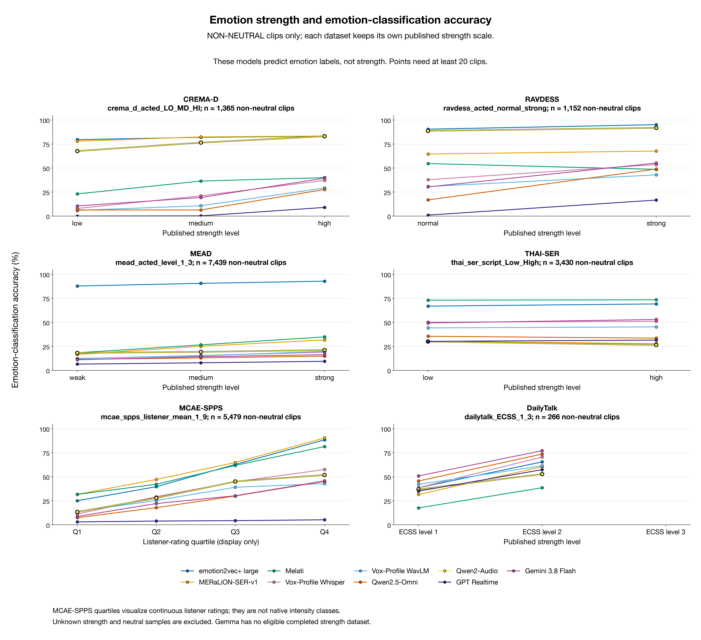
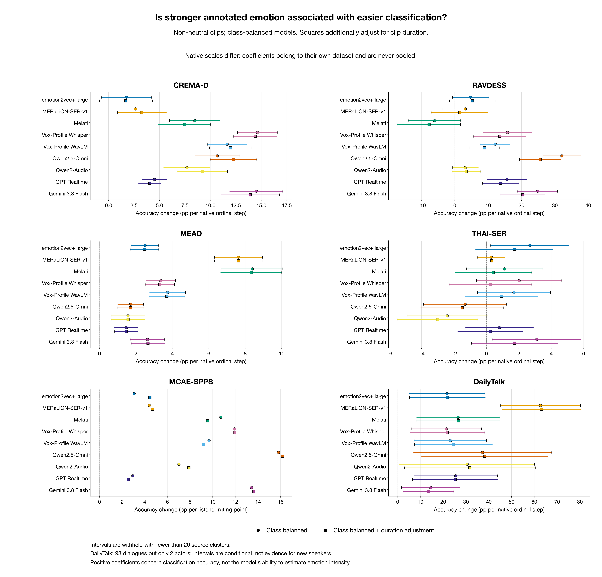
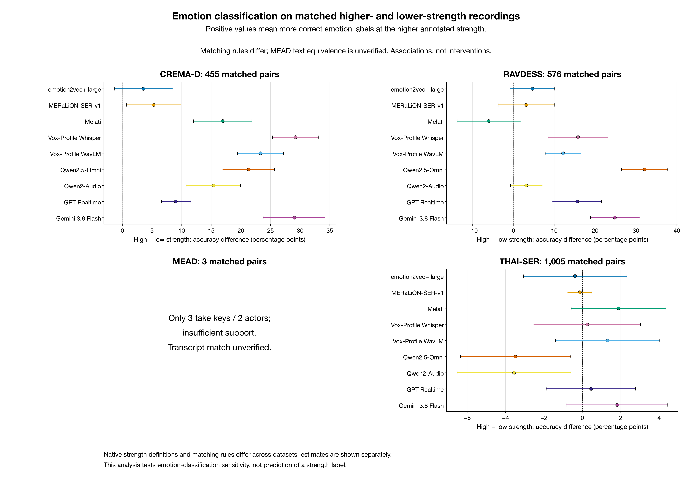

# Emotion intensity: are stronger expressions easier to classify?

Updated: 2026-11-14 14:30 SGT. Saved results from 145 model–dataset runs; no inference rerun.

There are two distinct questions. First, are existing emotion-category predictions more often correct when a clip has a higher native intensity annotation? Second, can a model accurately predict intensity itself? Saved category predictions support the first analysis here. Better category accuracy at higher strength does not demonstrate successful intensity estimation.

Intensity is not another name for class probability, loudness or clip duration. A high angry-class probability means the classifier prefers angry; it does not measure how strongly anger is expressed. Strong sadness need not be highly activated. We use explicit dataset annotations rather than inventing strength from classifier confidence, acoustic energy or rater agreement.

## Native annotation coverage

The table covers only the 6 intensity-analysable corpora, containing 36,602 clips; 23,689 have readable native intensity annotations. The primary analysis uses the 19,131 non-neutral clips among them. Missing intensity is not filled as low. Native neutral levels remain in the inventory but are not mixed into the primary emotional-strength comparison. Invalid model answers remain classification errors; answer-format failures do not remove examples.

| Dataset | All clips | Intensity known | Non-neutral analysis | Native scale / kind | Native levels |
|---|---:|---:|---:|---|---|
| CREMA-D | 7,442 | 1,365 | 1,365 | crema_d_acted_LO_MD_HI / ordinal | 1,2,3 |
| RAVDESS | 1,440 | 1,440 | 1,152 | ravdess_acted_normal_strong / ordinal | 1,2 |
| MEAD | 8,000 | 8,000 | 7,439 | mead_acted_level_1_3 / ordinal | 1,2,3 |
| THAI-SER | 11,848 | 5,012 | 3,430 | thai_ser_script_Low_High / ordinal | 1,2 |
| MCAE-SPPS | 6,675 | 6,675 | 5,479 | mcae_spps_listener_mean_1_9 / continuous | 1–9 listener means (continuous) |
| DailyTalk | 1,197 | 1,197 | 266 | dailytalk_ECSS_1_3 / ordinal | 1,2,3 |

The full benchmark contains 16 corpora and 67,062 clips. The other 10 corpora have no available native emotion-intensity annotation and therefore do not enter this intensity analysis. Their category predictions still exist; they are not zero-scoring corpora.

Models without current intensity-stratum results: Gemma 4. This indicates missing matching predictions or intensity annotations, not a score of zero.

The six scales require separate interpretations. CREMA-D LO/MD/HI covers only the IEO sentence; XX is unspecified. RAVDESS uses normal/strong, with native neutral only normal; this benchmark also merges calm into neutral. MEAD has three emotional levels but only a level_1 neutral reference. THAI-SER Low/High exists only for scripted speech and must not be assigned to improvised clips.

MCAE-SPPS supplies the mean of 40 listeners' strength ratings on 1–9; the continuous analysis retains the original values. This is not its meanIntensity acoustic-dB field. Display quantiles do not become invented native low/medium/high labels in the continuous fit. DailyTalk uses additional public ECSS 1–3 annotations, an observed rating rather than an acting condition randomized in our experiment. The authors describe weak/medium/strong levels, but these do not create an independent audio-only category-gold set. See the [ECSS paper](https://arxiv.org/html/2312.11947v1) and [author-supplied format](https://github.com/walker-hyf/ECSS).

## Controlling emotion class and duration

Fit each model and dataset separately, without pooling native scales. The first fit controls the reference emotion class and balances class weights; the second additionally controls clip duration. Effects are percentage points per native unit, specified below each dataset heading. This adjustment helps separate class composition and duration from the observed strength association; it does not turn observational data into a randomized experiment. Numeric ordinal coding also does not establish equal psychological distances from level 1 to 2 and 2 to 3.

Intervals follow the recorded speaker/dialogue clustering scheme. With fewer than 20 clusters, intervals are withheld as [—], even when a point estimate can be calculated. Few clusters, rare classes and sparse high-intensity cases limit stability. Dialogue clustering does not guarantee independent speakers. Exploratory comparisons across models and scales are not multiplicity-adjusted confirmatory tests.

## Model results at native intensity strata

Level columns report category Accuracy; n is the number of clips in that stratum. The two effect columns give class-balanced and additionally duration-adjusted percentage-point changes. They measure association with correct classification, not intensity-prediction accuracy.

### Qwen2-Audio and Qwen2.5-Omni across corpora

The following estimates balance emotion classes and adjust for duration. Their native units differ across corpora, so the magnitudes cannot be ranked across datasets. These models do not follow a universal rule that stronger emotion always improves classification:

- CREMA-D (per native ordinal step): Qwen2-Audio +9.23 pp, Qwen2.5-Omni +12.27 pp.
- RAVDESS (per native ordinal step): Qwen2-Audio +3.43 pp, Qwen2.5-Omni +25.60 pp.
- MEAD (per native ordinal step): Qwen2-Audio +1.57 pp, Qwen2.5-Omni +1.70 pp.
- THAI-SER (per native ordinal step): Qwen2-Audio -3.01 pp, Qwen2.5-Omni -1.49 pp.
- MCAE-SPPS (per listener-rating point): Qwen2-Audio +7.90 pp, Qwen2.5-Omni +16.18 pp.
- DailyTalk (per native ordinal step): Qwen2-Audio +31.72 pp, Qwen2.5-Omni +38.27 pp.

Despite positive intensity associations in MEAD, absolute category accuracy from the lowest to highest level is only Qwen2-Audio 18.22% → 21.24%; Qwen2.5-Omni 11.48% → 14.89%. Intensity sensitivity therefore does not explain away or eliminate poor overall MEAD accuracy.

MCAE-SPPS positive point estimates are supported by only six speakers, so cluster intervals are withheld. Continuous listener scores may also track how recognisable an expression is; this is not evidence for a causal intensity effect.

### MEAD: class-specific Qwen2-Audio errors

Class Recall below is the proportion correctly classified within each reference class, not class confidence. Parentheses show correct clips / class clips.

| Reference emotion | weak (n=2,492) | medium (n=2,475) | strong (n=2,472) |
|---|---:|---:|---:|
| angry | 46.97% (194/413) | 55.56% (225/405) | 70.62% (286/405) |
| disgusted | 29.74% (124/417) | 24.03% (99/412) | 22.43% (94/419) |
| fearful | 4.60% (19/413) | 6.08% (25/411) | 6.60% (27/409) |
| happy | 12.74% (53/416) | 12.89% (54/419) | 13.59% (56/412) |
| sad | 14.11% (59/418) | 15.22% (63/414) | 12.71% (53/417) |
| surprised | 1.20% (5/415) | 2.90% (12/414) | 2.20% (9/410) |

Predicted-label distribution by level: weak: angry 36.96%, angry + disgusted 62.52%; medium: angry 43.07%, angry + disgusted 66.34%; strong: angry 51.94%, angry + disgusted 72.78%.

At the highest level, true angry clips account for only 405/2472 (16.38%), while 51.94% of outputs are angry. Among the other 2067 clips, 998 (48.28%) are labelled angry, with only 239/2067 (11.56%) classified correctly. Invalid answers account for 52/2472 (2.10%), so answer format does not explain most errors. Improved angry recognition at higher strength does not mean other emotions improve together. This is concentration of predicted categories; the predictions cannot identify training-data sources, leakage or another causal mechanism.

DailyTalk contributes only 266 primary clips, with 12 at its highest level. The current subset has just one fearful and three disgusted clips. Class balancing gives these tiny classes the same total weight as large classes, so a few observations can strongly influence very large slopes; these are not stable extrapolations. Its 93 dialogue clusters still come from only two actors. Dialogue-cluster intervals do not establish generalisation to new speakers.

### CREMA-D

Native effect unit: per native ordinal step.

| Model | low (n=455) | medium (n=455) | high (n=455) | Class-balanced effect [interval] | + duration [interval] | Clusters |
|---|---:|---:|---:|---:|---:|---:|
| emotion2vec+ | 79.56% | 81.98% | 83.08% | +1.76 [-0.68, +4.20] | +1.71 [-0.89, +4.30] | 91 |
| MERaLiON | 78.02% | 82.42% | 83.30% | +2.64 [+0.33, +4.94] | +3.26 [+0.86, +5.66] | 91 |
| Melati | 23.08% | 36.48% | 40.00% | +8.46 [+5.99, +10.93] | +7.47 [+4.93, +10.02] | 91 |
| Vox-Profile Whisper | 7.91% | 21.10% | 37.14% | +14.62 [+12.67, +16.57] | +14.39 [+12.25, +16.54] | 91 |
| Vox-Profile WavLM | 5.93% | 10.77% | 29.23% | +11.65 [+9.70, +13.60] | +11.96 [+9.92, +14.00] | 91 |
| Qwen2.5-Omni | 6.37% | 6.37% | 27.69% | +10.66 [+8.49, +12.83] | +12.27 [+9.99, +14.55] | 91 |
| Qwen2-Audio | 67.69% | 76.48% | 83.08% | +7.69 [+5.43, +9.96] | +9.23 [+6.80, +11.67] | 91 |
| GPT Realtime | 0.00% | 0.22% | 9.01% | +4.51 [+3.29, +5.72] | +4.05 [+2.96, +5.14] | 91 |
| Gemini 3.8 Flash | 10.55% | 19.34% | 39.56% | +14.51 [+11.92, +17.09] | +13.91 [+11.03, +16.79] | 91 |

### RAVDESS

Native effect unit: per native ordinal step.

| Model | normal (n=576) | strong (n=576) | Class-balanced effect [interval] | + duration [interval] | Clusters |
|---|---:|---:|---:|---:|---:|
| emotion2vec+ | 90.45% | 95.14% | +4.69 [-0.65, +10.03] | +5.27 [-1.59, +12.13] | 24 |
| MERaLiON | 64.58% | 67.71% | +3.13 [-3.76, +10.01] | +1.52 [-6.91, +9.96] | 24 |
| Melati | 54.69% | 48.61% | -6.08 [-13.81, +1.66] | -7.71 [-17.11, +1.69] | 24 |
| Vox-Profile Whisper | 37.85% | 53.65% | +15.80 [+8.46, +23.14] | +13.51 [+5.66, +21.35] | 24 |
| Vox-Profile WavLM | 30.73% | 42.88% | +12.15 [+7.77, +16.53] | +8.90 [+4.34, +13.46] | 24 |
| Qwen2.5-Omni | 16.84% | 48.96% | +32.12 [+26.46, +37.78] | +25.60 [+19.38, +31.82] | 24 |
| Qwen2-Audio | 88.72% | 91.84% | +3.12 [-0.74, +6.99] | +3.43 [-0.76, +7.63] | 24 |
| GPT Realtime | 1.04% | 16.67% | +15.62 [+9.64, +21.61] | +13.66 [+8.31, +19.01] | 24 |
| Gemini 3.8 Flash | 30.38% | 55.21% | +24.83 [+18.86, +30.79] | +20.42 [+13.80, +27.03] | 24 |

### MEAD

Native effect unit: per native ordinal step.

| Model | weak (n=2,492) | medium (n=2,475) | strong (n=2,472) | Class-balanced effect [interval] | + duration [interval] | Clusters |
|---|---:|---:|---:|---:|---:|---:|
| emotion2vec+ | 87.88% | 90.67% | 92.88% | +2.51 [+1.77, +3.25] | +2.47 [+1.71, +3.23] | 48 |
| MERaLiON | 16.65% | 25.17% | 31.80% | +7.63 [+6.30, +8.95] | +7.63 [+6.31, +8.96] | 48 |
| Melati | 18.30% | 26.63% | 34.95% | +8.38 [+6.71, +10.05] | +8.33 [+6.67, +10.00] | 48 |
| Vox-Profile Whisper | 12.36% | 15.60% | 18.97% | +3.36 [+2.55, +4.16] | +3.32 [+2.51, +4.12] | 48 |
| Vox-Profile WavLM | 12.48% | 15.23% | 19.90% | +3.74 [+2.77, +4.72] | +3.70 [+2.73, +4.68] | 48 |
| Qwen2.5-Omni | 11.48% | 13.09% | 14.89% | +1.71 [+1.01, +2.42] | +1.70 [+1.00, +2.40] | 48 |
| Qwen2-Audio | 18.22% | 19.31% | 21.24% | +1.57 [+0.64, +2.49] | +1.57 [+0.64, +2.49] | 48 |
| GPT Realtime | 6.58% | 7.96% | 9.51% | +1.48 [+0.84, +2.11] | +1.47 [+0.83, +2.10] | 48 |
| Gemini 3.8 Flash | 11.12% | 14.30% | 16.38% | +2.64 [+1.71, +3.56] | +2.67 [+1.74, +3.59] | 48 |

### THAI-SER

Native effect unit: per native ordinal step.

| Model | low (n=1,701) | high (n=1,729) | Class-balanced effect [interval] | + duration [interval] | Clusters |
|---|---:|---:|---:|---:|---:|
| emotion2vec+ | 66.96% | 69.23% | +2.68 [+0.26, +5.09] | +1.73 [-0.65, +4.11] | 200 |
| MERaLiON | 30.28% | 27.94% | +0.30 [-0.54, +1.14] | +0.33 [-0.52, +1.19] | 200 |
| Melati | 73.13% | 73.51% | +1.12 [-1.24, +3.48] | +0.42 [-1.95, +2.79] | 200 |
| Vox-Profile Whisper | 50.21% | 51.19% | +2.02 [-0.61, +4.65] | +0.25 [-2.29, +2.79] | 200 |
| Vox-Profile WavLM | 44.27% | 45.34% | +1.70 [-0.55, +3.94] | +0.93 [-1.33, +3.18] | 200 |
| Qwen2.5-Omni | 35.57% | 33.60% | -1.32 [-3.89, +1.25] | -1.49 [-4.04, +1.06] | 200 |
| Qwen2-Audio | 30.10% | 26.49% | -2.42 [-4.89, +0.04] | -3.01 [-5.48, -0.53] | 200 |
| GPT Realtime | 30.28% | 31.58% | +0.80 [-1.28, +2.89] | +0.24 [-1.76, +2.24] | 200 |
| Gemini 3.8 Flash | 49.38% | 53.04% | +3.10 [+0.38, +5.83] | +1.74 [-0.93, +4.41] | 200 |

### MCAE-SPPS

Native effect unit: per listener-rating point.

| Model | Q1 (n=1,354) | Q2 (n=1,361) | Q3 (n=1,385) | Q4 (n=1,379) | Class-balanced effect [interval] | + duration [interval] | Clusters |
|---|---:|---:|---:|---:|---:|---:|---:|
| emotion2vec+ | 25.04% | 39.68% | 62.82% | 88.47% | +3.06 [—] | +4.46 [—] | 6 |
| MERaLiON | 31.76% | 47.17% | 64.84% | 90.43% | +4.40 [—] | +4.68 [—] | 6 |
| Melati | 31.68% | 42.17% | 61.81% | 81.44% | +10.73 [—] | +9.57 [—] | 6 |
| Vox-Profile Whisper | 11.23% | 29.24% | 44.69% | 57.58% | +11.92 [—] | +11.95 [—] | 6 |
| Vox-Profile WavLM | 13.88% | 25.35% | 39.06% | 42.86% | +9.67 [—] | +9.19 [—] | 6 |
| Qwen2.5-Omni | 7.39% | 17.85% | 29.96% | 45.25% | +15.81 [—] | +16.18 [—] | 6 |
| Qwen2-Audio | 13.37% | 27.85% | 45.05% | 51.85% | +7.02 [—] | +7.90 [—] | 6 |
| GPT Realtime | 3.03% | 3.89% | 4.33% | 5.22% | +2.95 [—] | +2.54 [—] | 6 |
| Gemini 3.8 Flash | 8.71% | 22.12% | 30.25% | 45.76% | +13.43 [—] | +13.63 [—] | 6 |

### DailyTalk

Native effect unit: per native ordinal step.

| Model | ECSS level 1 (n=57) | ECSS level 2 (n=197) | ECSS level 3 (n=12) | Class-balanced effect [interval] | + duration [interval] | Clusters |
|---|---:|---:|---:|---:|---:|---:|
| emotion2vec+ | 38.60% | 65.48% | 75.00% | +21.63 [+5.06, +38.20] | +21.77 [+5.17, +38.38] | 93 |
| MERaLiON | 31.58% | 60.41% | 83.33% | +62.69 [+45.09, +80.28] | +63.11 [+45.81, +80.41] | 93 |
| Melati | 17.54% | 38.58% | 91.67% | +26.50 [+8.41, +44.58] | +26.63 [+8.37, +44.89] | 93 |
| Vox-Profile Whisper | 38.60% | 70.56% | 83.33% | +21.35 [+5.96, +36.74] | +21.73 [+5.45, +38.00] | 93 |
| Vox-Profile WavLM | 42.11% | 61.42% | 75.00% | +23.13 [+7.29, +38.96] | +24.43 [+7.37, +41.48] | 93 |
| Qwen2.5-Omni | 45.61% | 73.60% | 75.00% | +37.24 [+7.07, +67.42] | +38.27 [+10.58, +65.96] | 93 |
| Qwen2-Audio | 36.84% | 52.79% | 83.33% | +30.48 [+0.90, +60.06] | +31.72 [+3.02, +60.43] | 93 |
| GPT Realtime | 35.09% | 57.36% | 100.00% | +25.48 [+7.18, +43.78] | +25.26 [+6.53, +44.00] | 93 |
| Gemini 3.8 Flash | 50.88% | 77.16% | 91.67% | +14.51 [+1.71, +27.30] | +13.52 [+2.43, +24.61] | 93 |

## Higher-versus-lower intensity within recorded keys

A supplementary comparison measures the category-correctness difference between higher and lower levels within a content key. CREMA-D fixes actor, IEO sentence and emotion. RAVDESS fixes actor, native emotion, statement and repetition. THAI-SER fixes session, actor, exact script_sent text, trial and assigned emotion. MEAD keys contain actor, emotion and file index only: cross-level lexical equivalence has not been independently verified locally, so these are index-matched cases, not a verified lexical control.

Only complete retained pairs enter this comparison. The 8,000-clip MEAD stratified subset may retain different sentence indices at different levels, leaving far fewer complete pairs than known-intensity clips. We do not add unscored predictions to increase pair counts. MCAE listener means and DailyTalk observed ratings do not provide natural same-utterance multi-intensity recordings.

MEAD currently has only 3 complete pairs from 2 actors, and lexical keys have not been verified individually. These are descriptive cases, not support for a general intensity effect or a new-speaker conclusion; no interval is shown.

| Dataset | Model | Complete pairs | Higher − lower: pp [interval] | Clusters |
|---|---|---:|---:|---:|
| CREMA-D | emotion2vec+ | 455 | +3.52 [-1.36, +8.39] | 91 |
| CREMA-D | Gemini 3.8 Flash | 455 | +29.01 [+23.84, +34.18] | 91 |
| CREMA-D | GPT Realtime | 455 | +9.01 [+6.59, +11.44] | 91 |
| CREMA-D | Melati | 455 | +16.92 [+12.00, +21.85] | 91 |
| CREMA-D | MERaLiON | 455 | +5.27 [+0.68, +9.87] | 91 |
| CREMA-D | Qwen2.5-Omni | 455 | +21.32 [+16.98, +25.66] | 91 |
| CREMA-D | Qwen2-Audio | 455 | +15.38 [+10.86, +19.91] | 91 |
| CREMA-D | Vox-Profile WavLM | 455 | +23.30 [+19.41, +27.19] | 91 |
| CREMA-D | Vox-Profile Whisper | 455 | +29.23 [+25.34, +33.12] | 91 |
| RAVDESS | emotion2vec+ | 576 | +4.69 [-0.64, +10.01] | 24 |
| RAVDESS | Gemini 3.8 Flash | 576 | +24.83 [+18.88, +30.78] | 24 |
| RAVDESS | GPT Realtime | 576 | +15.62 [+9.66, +21.59] | 24 |
| RAVDESS | Melati | 576 | -6.08 [-13.79, +1.64] | 24 |
| RAVDESS | MERaLiON | 576 | +3.12 [-3.74, +9.99] | 24 |
| RAVDESS | Qwen2.5-Omni | 576 | +32.12 [+26.47, +37.77] | 24 |
| RAVDESS | Qwen2-Audio | 576 | +3.12 [-0.73, +6.98] | 24 |
| RAVDESS | Vox-Profile WavLM | 576 | +12.15 [+7.78, +16.52] | 24 |
| RAVDESS | Vox-Profile Whisper | 576 | +15.80 [+8.48, +23.12] | 24 |
| MEAD | emotion2vec+ | 3 | +33.33 [—] | 2 |
| MEAD | Gemini 3.8 Flash | 3 | +0.00 [—] | 2 |
| MEAD | GPT Realtime | 3 | +0.00 [—] | 2 |
| MEAD | Melati | 3 | +0.00 [—] | 2 |
| MEAD | MERaLiON | 3 | +0.00 [—] | 2 |
| MEAD | Qwen2.5-Omni | 3 | +0.00 [—] | 2 |
| MEAD | Qwen2-Audio | 3 | +0.00 [—] | 2 |
| MEAD | Vox-Profile WavLM | 3 | +0.00 [—] | 2 |
| MEAD | Vox-Profile Whisper | 3 | +0.00 [—] | 2 |
| THAI-SER | emotion2vec+ | 1,005 | -0.38 [-3.08, +2.31] | 195 |
| THAI-SER | Gemini 3.8 Flash | 1,005 | +1.82 [-0.82, +4.45] | 195 |
| THAI-SER | GPT Realtime | 1,005 | +0.46 [-1.86, +2.77] | 195 |
| THAI-SER | Melati | 1,005 | +1.88 [-0.55, +4.32] | 195 |
| THAI-SER | MERaLiON | 1,005 | -0.13 [-0.75, +0.49] | 195 |
| THAI-SER | Qwen2.5-Omni | 1,005 | -3.49 [-6.35, -0.63] | 195 |
| THAI-SER | Qwen2-Audio | 1,005 | -3.56 [-6.53, -0.60] | 195 |
| THAI-SER | Vox-Profile WavLM | 1,005 | +1.31 [-1.40, +4.03] | 195 |
| THAI-SER | Vox-Profile Whisper | 1,005 | +0.25 [-2.52, +3.02] | 195 |

## Can MERaLiON directly estimate intensity?

The local official model has two outputs: seven-category emotion logits and sigmoid-bounded [0,1] Valence, Arousal and Dominance. The dimensional-head weights exist, but there is no separate generic emotion-intensity head. Arousal runs from calm to active; dominance concerns control, despite its weak/strong wording. Neither is interchangeable with the six native strength scales. See the [local model card](../../emotion_recognition/models/meralion_ser_v1/README.md) and [model forward code](../../emotion_recognition/models/meralion_ser_v1/modeling_ser_whisper_ecapa.py).

The current [project adapter](../../emotion_recognition/scripts/models/meralion_ser.py) selects logits and saves categorical probabilities only. Existing MERaLiON prediction CSVs have no valence, arousal or dominance columns. Discarded dims cannot be recovered from p_* values. No model was rerun, so this report supplies no direct intensity-estimation accuracy, VAD regression error or dimensional correlation.

A future direct evaluation would need newly saved native dims and references matching the intended dimension, annotation condition and scale. Within one emotion class, a rank correlation between arousal and native strength could test a proxy relationship; it would not calibrate arousal as universal emotion intensity across classes or corpora. These are proposals, not experiments performed here.

## Limits of the conclusion

A positive within-dataset association surviving emotion-class and duration adjustment supports an observation that stronger expressions are easier to classify under the present annotations. It does not establish that increasing intensity causally improves the model, explain every language or conversation difference, or demonstrate that the model understands and measures intensity. Training exposure, acting style, recording conditions, annotation reliability and sample selection may still vary.

Read this alongside duration: stronger delivery may change speaking length, pauses and expression. Comparing corpus-average duration or intensity cannot separate those factors. Reporting all model/scale results is more informative than choosing only examples that favour the hypothesis.

Reproduction and sources: [native inventory](../output/intensity_inventory.csv) · [inventory/source manifest](../output/intensity_inventory_manifest.json) · [analysis script](../scripts/intensity_analysis.py)

Read alongside the [cross-corpus language, conversation and duration analysis](cross_dataset_en.md) to distinguish overall dataset differences from within-corpus intensity associations.

### Additional recorded analysis notes

- Classification sensitivity to native strength is not a test of predicted intensity accuracy.
- Neutral references and unspecified XX are not weak-emotion examples.
- MERaLiON native VAD outputs are absent from saved predictions; no additional inference was performed.
- Perceived intensity can covary with rater agreement; acting-level comparisons are not randomized interventions.
