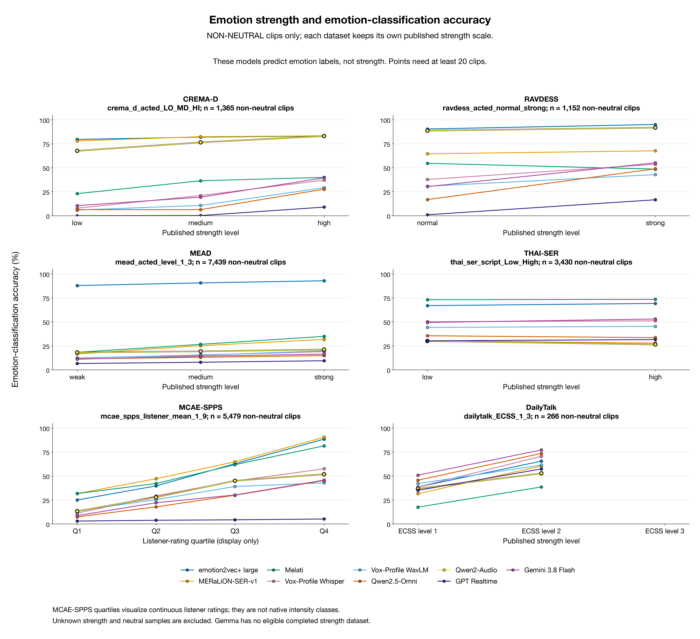
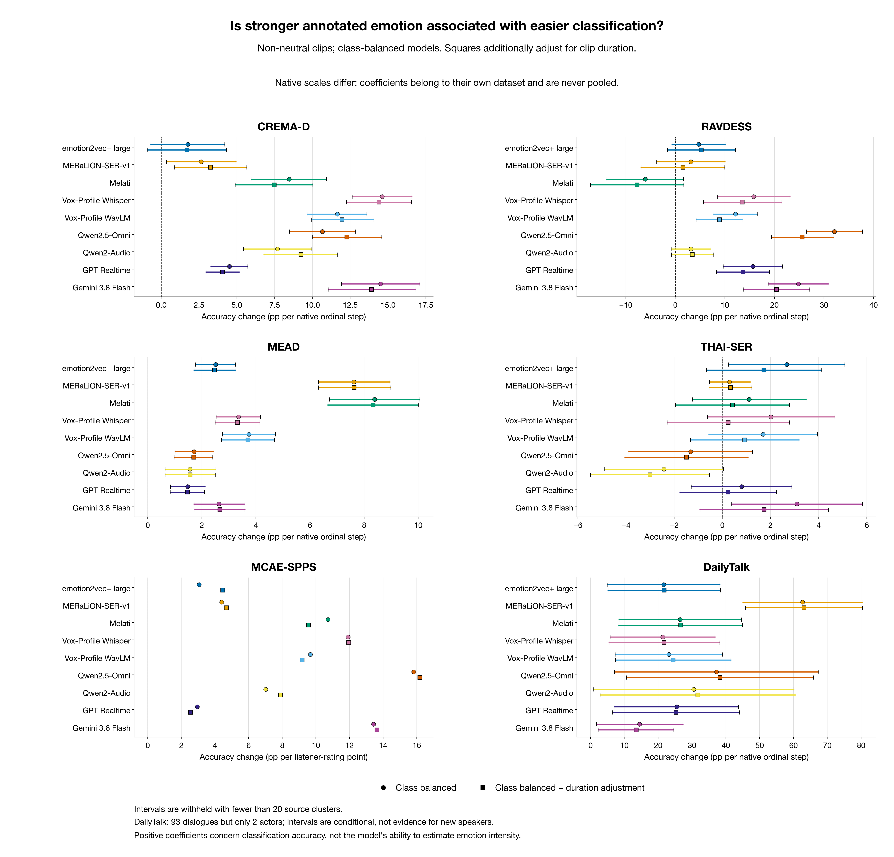
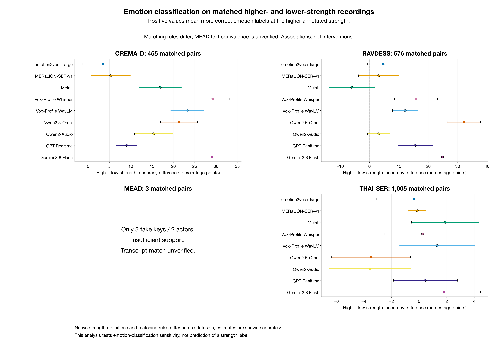

# 情绪强度：更强烈的表达是否更容易分类？

更新时间：2026-11-14 14:30 SGT。使用现有 145 组模型结果；没有重新推理。

本报告区分两个问题。第一，带有更高原生强度标签的音频，现有模型是否更容易预测对情绪类别？第二，模型能否准确预测情绪强度本身？这次可以用保存的类别预测分析第一个问题，不能把分类正确率的上升当成第二个问题已经解决。

强度不是类别概率、音量或时长的另一种写法。情绪分类器给 angry 的概率高，表示它偏向这个类别，并不表示表达得更强烈；强烈的悲伤也未必有高激活度。本次只读取数据集明确提供的强度字段，没有从模型置信度、声学能量或标注一致率补造强度标签。

## 原生标注覆盖范围

下表只覆盖 6 套可分析强度的语料，共 36,602 条音频；其中 23,689 条具有可读取的原生强度标注。主分析使用其中 19,131 条非 neutral 样本。未知强度不填成‘低’，neutral 的原始等级保留在 inventory，但不混入主分析。原模型的 invalid 回答仍计为分类错误，不因模型回答格式而移除样本。

| 数据集 | 总样本 | 强度已知 | 主分析：非 neutral | 原生尺度 / 类型 | 原生等级 |
|---|---:|---:|---:|---|---|
| CREMA-D | 7,442 | 1,365 | 1,365 | crema_d_acted_LO_MD_HI / ordinal | 1,2,3 |
| RAVDESS | 1,440 | 1,440 | 1,152 | ravdess_acted_normal_strong / ordinal | 1,2 |
| MEAD | 8,000 | 8,000 | 7,439 | mead_acted_level_1_3 / ordinal | 1,2,3 |
| THAI-SER | 11,848 | 5,012 | 3,430 | thai_ser_script_Low_High / ordinal | 1,2 |
| MCAE-SPPS | 6,675 | 6,675 | 5,479 | mcae_spps_listener_mean_1_9 / continuous | 1–9 listener means (continuous) |
| DailyTalk | 1,197 | 1,197 | 266 | dailytalk_ECSS_1_3 / ordinal | 1,2,3 |

完整 benchmark 是 16 套语料、67,062 条音频。其余 10 套没有找到可用的原生情绪强度标注，因此不进入本强度分析；这不表示那些语料缺少类别预测，也不表示模型得分为零。

没有当前可用强度分层结果的模型：Gemma 4。这表示缺少匹配预测或原生强度标注，不表示模型得分为零。

六种尺度必须分别解释。CREMA-D 的 LO/MD/HI 只覆盖 IEO 句子；XX 是未指定。RAVDESS 是 normal/strong，native neutral 只有 normal；benchmark 还把 calm 合并为 neutral。MEAD 的情绪有三级，neutral 只有 level_1 参考。THAI-SER 的 Low/High 只对 scripted 部分存在，不能给 improvised 音频指定同样的等级。

MCAE-SPPS 使用 40 位听众的平均强度评分，原尺度为 1–9，分析保留原始连续数值；它不是元数据里单位为 dB 的 meanIntensity。图中的分位数组仅用于展示，连续效应不使用人为制造的低/中/高标签。DailyTalk 使用 ECSS 的 1–3 级附加标注，是观察到的评分而非本实验随机分配的表演条件。作者论文将其描述为 weak/medium/strong，但它不创造新的独立音频情绪类别 gold。参见 [ECSS 原论文](https://arxiv.org/html/2312.11947v1) 和 [作者数据格式](https://github.com/walker-hyf/ECSS)。

## 怎样控制类别与时长

每个模型、每个数据集分别拟合，结果不跨原生尺度合并。先控制参考情绪类别，使用类别平衡权重，再在第二个拟合中加入音频时长。表里的系数用百分点表示，具体原生单位写在各数据集标题下。这种调整帮助识别类别构成和时长带来的混杂；它不会把观察性数据变成随机实验。等级 1→2 与 2→3 的数值编码也不证明心理强度恰好等距。

区间按数据中的 speaker/dialogue 聚类方案计算；少于 20 个聚类时不展示置信区间，记为 [—]，即使点估计仍可计算。少数聚类、稀少类别、很少的高强度样本，都会限制稳定性。对话聚类并不保证说话人独立，多个模型与多个尺度的探索也没有变成多重比较校正后的确认性检验。

## 各模型在原生强度层的表现

等级列显示分类 Accuracy；括号中的 n 是该层音频数。效应列分别为类别平衡、以及再调整时长后的百分点变化。它们描述正确分类与强度的关系，不是强度预测准确率。

### Qwen2-Audio 与 Qwen2.5-Omni 的跨语料观察

下列数值来自类别平衡并调整时长后的拟合，单位随原生尺度改变，不能跨数据集直接排序。这两个模型的表现并不遵循一个普遍的‘强度越高越准确’规则：

- CREMA-D (per native ordinal step): Qwen2-Audio +9.23 pp, Qwen2.5-Omni +12.27 pp.
- RAVDESS (per native ordinal step): Qwen2-Audio +3.43 pp, Qwen2.5-Omni +25.60 pp.
- MEAD (per native ordinal step): Qwen2-Audio +1.57 pp, Qwen2.5-Omni +1.70 pp.
- THAI-SER (per native ordinal step): Qwen2-Audio -3.01 pp, Qwen2.5-Omni -1.49 pp.
- MCAE-SPPS (per listener-rating point): Qwen2-Audio +7.90 pp, Qwen2.5-Omni +16.18 pp.
- DailyTalk (per native ordinal step): Qwen2-Audio +31.72 pp, Qwen2.5-Omni +38.27 pp.

MEAD 虽呈正向强度关联，最低至最高等级的绝对分类正确率仍只有 Qwen2-Audio 18.22% → 21.24%; Qwen2.5-Omni 11.48% → 14.89%。因此，强度敏感性不能解释或消除模型在 MEAD 的整体低正确率。

MCAE-SPPS 的正向点估计只有 6 位说话人的支持，因此不展示聚类置信区间；连续听众评分的关联也可能反映情绪表达是否清楚可辨，不能当成强度的因果作用。

### MEAD：Qwen2-Audio 的类别混淆

下面的逐类 Recall 是该参考类别中预测正确的比例，不是类别置信度。括号列出正确数/样本数。

| 参考情绪 | weak (n=2,492) | medium (n=2,475) | strong (n=2,472) |
|---|---:|---:|---:|
| angry | 46.97% (194/413) | 55.56% (225/405) | 70.62% (286/405) |
| disgusted | 29.74% (124/417) | 24.03% (99/412) | 22.43% (94/419) |
| fearful | 4.60% (19/413) | 6.08% (25/411) | 6.60% (27/409) |
| happy | 12.74% (53/416) | 12.89% (54/419) | 13.59% (56/412) |
| sad | 14.11% (59/418) | 15.22% (63/414) | 12.71% (53/417) |
| surprised | 1.20% (5/415) | 2.90% (12/414) | 2.20% (9/410) |

预测分布随等级变化：weak: angry 36.96%, angry + disgusted 62.52%; medium: angry 43.07%, angry + disgusted 66.34%; strong: angry 51.94%, angry + disgusted 72.78%.

最高等级真实 angry 只有 405/2472（16.38%），但 51.94% 的输出是 angry。其余 2067 条非 angry 音频中，998 条（48.28%）被判为 angry，正确数仅 239/2067（11.56%）。该等级 invalid 为 52/2472（2.10%），因此格式无效不能解释主要错误。更强表达下 angry 的识别改善，并不代表其他情绪同步改善。这里观察到的是输出类别集中；这些预测不能确定训练数据来源、泄漏或其他因果机制。

DailyTalk 的主分析只有 266 条，最高等级只有 12 条；当前子集中 fearful 仅 1 条、disgusted 仅 3 条。类别平衡把这些极小类别赋予与大类别相同的总权重，因此很大的斜率可能由少数样本强烈影响，不能稳定外推。93 个 dialogue 聚类仍只来自两位演员，按 dialogue 计算的区间不能支持新说话人的泛化结论。

### CREMA-D

原生效应单位：per native ordinal step。

| 模型 | low (n=455) | medium (n=455) | high (n=455) | 类别平衡效应 [区间] | 再调整时长 [区间] | 聚类数 |
|---|---:|---:|---:|---:|---:|---:|
| emotion2vec+ | 79.56% | 81.98% | 83.08% | +1.76 [-0.68, +4.20] | +1.71 [-0.89, +4.30] | 91 |
| MERaLiON | 78.02% | 82.42% | 83.30% | +2.64 [+0.33, +4.94] | +3.26 [+0.86, +5.66] | 91 |
| Melati | 23.08% | 36.48% | 40.00% | +8.46 [+5.99, +10.93] | +7.47 [+4.93, +10.02] | 91 |
| Vox-Profile Whisper | 7.91% | 21.10% | 37.14% | +14.62 [+12.67, +16.57] | +14.39 [+12.25, +16.54] | 91 |
| Vox-Profile WavLM | 5.93% | 10.77% | 29.23% | +11.65 [+9.70, +13.60] | +11.96 [+9.92, +14.00] | 91 |
| Qwen2.5-Omni | 6.37% | 6.37% | 27.69% | +10.66 [+8.49, +12.83] | +12.27 [+9.99, +14.55] | 91 |
| Qwen2-Audio | 67.69% | 76.48% | 83.08% | +7.69 [+5.43, +9.96] | +9.23 [+6.80, +11.67] | 91 |
| GPT Realtime | 0.00% | 0.22% | 9.01% | +4.51 [+3.29, +5.72] | +4.05 [+2.96, +5.14] | 91 |
| Gemini 3.8 Flash | 10.55% | 19.34% | 39.56% | +14.51 [+11.92, +17.09] | +13.91 [+11.03, +16.79] | 91 |

### RAVDESS

原生效应单位：per native ordinal step。

| 模型 | normal (n=576) | strong (n=576) | 类别平衡效应 [区间] | 再调整时长 [区间] | 聚类数 |
|---|---:|---:|---:|---:|---:|
| emotion2vec+ | 90.45% | 95.14% | +4.69 [-0.65, +10.03] | +5.27 [-1.59, +12.13] | 24 |
| MERaLiON | 64.58% | 67.71% | +3.13 [-3.76, +10.01] | +1.52 [-6.91, +9.96] | 24 |
| Melati | 54.69% | 48.61% | -6.08 [-13.81, +1.66] | -7.71 [-17.11, +1.69] | 24 |
| Vox-Profile Whisper | 37.85% | 53.65% | +15.80 [+8.46, +23.14] | +13.51 [+5.66, +21.35] | 24 |
| Vox-Profile WavLM | 30.73% | 42.88% | +12.15 [+7.77, +16.53] | +8.90 [+4.34, +13.46] | 24 |
| Qwen2.5-Omni | 16.84% | 48.96% | +32.12 [+26.46, +37.78] | +25.60 [+19.38, +31.82] | 24 |
| Qwen2-Audio | 88.72% | 91.84% | +3.12 [-0.74, +6.99] | +3.43 [-0.76, +7.63] | 24 |
| GPT Realtime | 1.04% | 16.67% | +15.62 [+9.64, +21.61] | +13.66 [+8.31, +19.01] | 24 |
| Gemini 3.8 Flash | 30.38% | 55.21% | +24.83 [+18.86, +30.79] | +20.42 [+13.80, +27.03] | 24 |

### MEAD

原生效应单位：per native ordinal step。

| 模型 | weak (n=2,492) | medium (n=2,475) | strong (n=2,472) | 类别平衡效应 [区间] | 再调整时长 [区间] | 聚类数 |
|---|---:|---:|---:|---:|---:|---:|
| emotion2vec+ | 87.88% | 90.67% | 92.88% | +2.51 [+1.77, +3.25] | +2.47 [+1.71, +3.23] | 48 |
| MERaLiON | 16.65% | 25.17% | 31.80% | +7.63 [+6.30, +8.95] | +7.63 [+6.31, +8.96] | 48 |
| Melati | 18.30% | 26.63% | 34.95% | +8.38 [+6.71, +10.05] | +8.33 [+6.67, +10.00] | 48 |
| Vox-Profile Whisper | 12.36% | 15.60% | 18.97% | +3.36 [+2.55, +4.16] | +3.32 [+2.51, +4.12] | 48 |
| Vox-Profile WavLM | 12.48% | 15.23% | 19.90% | +3.74 [+2.77, +4.72] | +3.70 [+2.73, +4.68] | 48 |
| Qwen2.5-Omni | 11.48% | 13.09% | 14.89% | +1.71 [+1.01, +2.42] | +1.70 [+1.00, +2.40] | 48 |
| Qwen2-Audio | 18.22% | 19.31% | 21.24% | +1.57 [+0.64, +2.49] | +1.57 [+0.64, +2.49] | 48 |
| GPT Realtime | 6.58% | 7.96% | 9.51% | +1.48 [+0.84, +2.11] | +1.47 [+0.83, +2.10] | 48 |
| Gemini 3.8 Flash | 11.12% | 14.30% | 16.38% | +2.64 [+1.71, +3.56] | +2.67 [+1.74, +3.59] | 48 |

### THAI-SER

原生效应单位：per native ordinal step。

| 模型 | low (n=1,701) | high (n=1,729) | 类别平衡效应 [区间] | 再调整时长 [区间] | 聚类数 |
|---|---:|---:|---:|---:|---:|
| emotion2vec+ | 66.96% | 69.23% | +2.68 [+0.26, +5.09] | +1.73 [-0.65, +4.11] | 200 |
| MERaLiON | 30.28% | 27.94% | +0.30 [-0.54, +1.14] | +0.33 [-0.52, +1.19] | 200 |
| Melati | 73.13% | 73.51% | +1.12 [-1.24, +3.48] | +0.42 [-1.95, +2.79] | 200 |
| Vox-Profile Whisper | 50.21% | 51.19% | +2.02 [-0.61, +4.65] | +0.25 [-2.29, +2.79] | 200 |
| Vox-Profile WavLM | 44.27% | 45.34% | +1.70 [-0.55, +3.94] | +0.93 [-1.33, +3.18] | 200 |
| Qwen2.5-Omni | 35.57% | 33.60% | -1.32 [-3.89, +1.25] | -1.49 [-4.04, +1.06] | 200 |
| Qwen2-Audio | 30.10% | 26.49% | -2.42 [-4.89, +0.04] | -3.01 [-5.48, -0.53] | 200 |
| GPT Realtime | 30.28% | 31.58% | +0.80 [-1.28, +2.89] | +0.24 [-1.76, +2.24] | 200 |
| Gemini 3.8 Flash | 49.38% | 53.04% | +3.10 [+0.38, +5.83] | +1.74 [-0.93, +4.41] | 200 |

### MCAE-SPPS

原生效应单位：per listener-rating point。

| 模型 | Q1 (n=1,354) | Q2 (n=1,361) | Q3 (n=1,385) | Q4 (n=1,379) | 类别平衡效应 [区间] | 再调整时长 [区间] | 聚类数 |
|---|---:|---:|---:|---:|---:|---:|---:|
| emotion2vec+ | 25.04% | 39.68% | 62.82% | 88.47% | +3.06 [—] | +4.46 [—] | 6 |
| MERaLiON | 31.76% | 47.17% | 64.84% | 90.43% | +4.40 [—] | +4.68 [—] | 6 |
| Melati | 31.68% | 42.17% | 61.81% | 81.44% | +10.73 [—] | +9.57 [—] | 6 |
| Vox-Profile Whisper | 11.23% | 29.24% | 44.69% | 57.58% | +11.92 [—] | +11.95 [—] | 6 |
| Vox-Profile WavLM | 13.88% | 25.35% | 39.06% | 42.86% | +9.67 [—] | +9.19 [—] | 6 |
| Qwen2.5-Omni | 7.39% | 17.85% | 29.96% | 45.25% | +15.81 [—] | +16.18 [—] | 6 |
| Qwen2-Audio | 13.37% | 27.85% | 45.05% | 51.85% | +7.02 [—] | +7.90 [—] | 6 |
| GPT Realtime | 3.03% | 3.89% | 4.33% | 5.22% | +2.95 [—] | +2.54 [—] | 6 |
| Gemini 3.8 Flash | 8.71% | 22.12% | 30.25% | 45.76% | +13.43 [—] | +13.63 [—] | 6 |

### DailyTalk

原生效应单位：per native ordinal step。

| 模型 | ECSS level 1 (n=57) | ECSS level 2 (n=197) | ECSS level 3 (n=12) | 类别平衡效应 [区间] | 再调整时长 [区间] | 聚类数 |
|---|---:|---:|---:|---:|---:|---:|
| emotion2vec+ | 38.60% | 65.48% | 75.00% | +21.63 [+5.06, +38.20] | +21.77 [+5.17, +38.38] | 93 |
| MERaLiON | 31.58% | 60.41% | 83.33% | +62.69 [+45.09, +80.28] | +63.11 [+45.81, +80.41] | 93 |
| Melati | 17.54% | 38.58% | 91.67% | +26.50 [+8.41, +44.58] | +26.63 [+8.37, +44.89] | 93 |
| Vox-Profile Whisper | 38.60% | 70.56% | 83.33% | +21.35 [+5.96, +36.74] | +21.73 [+5.45, +38.00] | 93 |
| Vox-Profile WavLM | 42.11% | 61.42% | 75.00% | +23.13 [+7.29, +38.96] | +24.43 [+7.37, +41.48] | 93 |
| Qwen2.5-Omni | 45.61% | 73.60% | 75.00% | +37.24 [+7.07, +67.42] | +38.27 [+10.58, +65.96] | 93 |
| Qwen2-Audio | 36.84% | 52.79% | 83.33% | +30.48 [+0.90, +60.06] | +31.72 [+3.02, +60.43] | 93 |
| GPT Realtime | 35.09% | 57.36% | 100.00% | +25.48 [+7.18, +43.78] | +25.26 [+6.53, +44.00] | 93 |
| Gemini 3.8 Flash | 50.88% | 77.16% | 91.67% | +14.51 [+1.71, +27.30] | +13.52 [+2.43, +24.61] | 93 |

## 同键高低强度对照

另检查同一内容键内较高与较低强度的分类正确率差。CREMA-D 的键固定演员、IEO 句子与情绪；RAVDESS 固定演员、原生情绪、句子与重复序号；THAI-SER 使用同一 session、actor、明确的script_sent 文本、trial 与 assigned emotion。MEAD 的键仅由演员、情绪和文件序号构成，本地尚未逐条验证跨 level 的词句完全一致，因此只能称同序号配对，不能当作严格词句控制。

只有保留下来的完整配对参与这个比较。MEAD 的 8,000 条分层子集可能在各强度留下不同句子序号，所以完整配对会远少于其强度已知样本数；不能为增加配对而补读未评测预测。MCAE 的听众均分及 DailyTalk 的观察性评级也没有天然同句多强度录音配对。

当前 MEAD 实际只有 3 个完整配对、来自 2 位演员，而且词句键未逐条验证。这些结果只能作为个案描述，不能支持一般的强度效应或新说话人结论；不展示置信区间。

| 数据集 | 模型 | 完整配对数 | 高 − 低：百分点 [区间] | 聚类数 |
|---|---|---:|---:|---:|
| CREMA-D | emotion2vec+ | 455 | +3.52 [-1.36, +8.39] | 91 |
| CREMA-D | Gemini 3.8 Flash | 455 | +29.01 [+23.84, +34.18] | 91 |
| CREMA-D | GPT Realtime | 455 | +9.01 [+6.59, +11.44] | 91 |
| CREMA-D | Melati | 455 | +16.92 [+12.00, +21.85] | 91 |
| CREMA-D | MERaLiON | 455 | +5.27 [+0.68, +9.87] | 91 |
| CREMA-D | Qwen2.5-Omni | 455 | +21.32 [+16.98, +25.66] | 91 |
| CREMA-D | Qwen2-Audio | 455 | +15.38 [+10.86, +19.91] | 91 |
| CREMA-D | Vox-Profile WavLM | 455 | +23.30 [+19.41, +27.19] | 91 |
| CREMA-D | Vox-Profile Whisper | 455 | +29.23 [+25.34, +33.12] | 91 |
| RAVDESS | emotion2vec+ | 576 | +4.69 [-0.64, +10.01] | 24 |
| RAVDESS | Gemini 3.8 Flash | 576 | +24.83 [+18.88, +30.78] | 24 |
| RAVDESS | GPT Realtime | 576 | +15.62 [+9.66, +21.59] | 24 |
| RAVDESS | Melati | 576 | -6.08 [-13.79, +1.64] | 24 |
| RAVDESS | MERaLiON | 576 | +3.12 [-3.74, +9.99] | 24 |
| RAVDESS | Qwen2.5-Omni | 576 | +32.12 [+26.47, +37.77] | 24 |
| RAVDESS | Qwen2-Audio | 576 | +3.12 [-0.73, +6.98] | 24 |
| RAVDESS | Vox-Profile WavLM | 576 | +12.15 [+7.78, +16.52] | 24 |
| RAVDESS | Vox-Profile Whisper | 576 | +15.80 [+8.48, +23.12] | 24 |
| MEAD | emotion2vec+ | 3 | +33.33 [—] | 2 |
| MEAD | Gemini 3.8 Flash | 3 | +0.00 [—] | 2 |
| MEAD | GPT Realtime | 3 | +0.00 [—] | 2 |
| MEAD | Melati | 3 | +0.00 [—] | 2 |
| MEAD | MERaLiON | 3 | +0.00 [—] | 2 |
| MEAD | Qwen2.5-Omni | 3 | +0.00 [—] | 2 |
| MEAD | Qwen2-Audio | 3 | +0.00 [—] | 2 |
| MEAD | Vox-Profile WavLM | 3 | +0.00 [—] | 2 |
| MEAD | Vox-Profile Whisper | 3 | +0.00 [—] | 2 |
| THAI-SER | emotion2vec+ | 1,005 | -0.38 [-3.08, +2.31] | 195 |
| THAI-SER | Gemini 3.8 Flash | 1,005 | +1.82 [-0.82, +4.45] | 195 |
| THAI-SER | GPT Realtime | 1,005 | +0.46 [-1.86, +2.77] | 195 |
| THAI-SER | Melati | 1,005 | +1.88 [-0.55, +4.32] | 195 |
| THAI-SER | MERaLiON | 1,005 | -0.13 [-0.75, +0.49] | 195 |
| THAI-SER | Qwen2.5-Omni | 1,005 | -3.49 [-6.35, -0.63] | 195 |
| THAI-SER | Qwen2-Audio | 1,005 | -3.56 [-6.53, -0.60] | 195 |
| THAI-SER | Vox-Profile WavLM | 1,005 | +1.31 [-1.40, +4.03] | 195 |
| THAI-SER | Vox-Profile Whisper | 1,005 | +0.25 [-2.52, +3.02] | 195 |

## MERaLiON 能否直接预测强度？

本地官方模型有两个输出：七类情绪 logits，以及经 sigmoid 映射到 [0,1] 的三维 Valence、Arousal、Dominance。维度头的真实权重存在，但没有一个名为通用‘emotion intensity’的独立头。Arousal 表示平静到活跃，Dominance 的 weak/strong 描述控制感；两者都不能直接当成上述六套强度量表。见 [本地模型说明](../../emotion_recognition/models/meralion_ser_v1/README.md) 和 [模型 forward](../../emotion_recognition/models/meralion_ser_v1/modeling_ser_whisper_ecapa.py)。

当前 [项目适配器](../../emotion_recognition/scripts/models/meralion_ser.py) 只取 logits 并保存情绪概率，现有 MERaLiON 预测 CSV 没有 valence/arousal/dominance 列。被丢弃的 dims 不能从 p_* 列反推。本次没有重新运行模型，因此没有直接的强度预测准确率、VAD 回归误差或维度相关性结果。

后续若评估维度预测，需要另行保存原生 dims，并取得与目标维度、标注条件和尺度匹配的参考值。可以在同一情绪类别内探索 arousal 与原生强度等级的秩相关，但这只是代理关系检验，不是把 arousal 校准为跨情绪、跨语料通用强度。这些是后续建议，本次未执行。

## 结论边界

同一数据集内，在控制情绪类别和时长后仍为正的效应，支持‘较强表达在当前标注条件下更容易分类’这一观察。它不证明增加表达强度会因果地改善模型，不解释全部语言或对话差异，也不证明模型已经理解或可量化强度。训练暴露、表演习惯、录音条件、标签可靠性与样本筛选仍可能同时变化。

强度分析应与时长分析一起读：声音更强烈时，音长、停顿和词句表达也可能变化；只比较六套数据集的平均时长或平均强度，无法区分这些因素。保留所有模型和尺度的结果比仅挑最支持假设的例子更有解释力。

复现与来源：[native inventory](../output/intensity_inventory.csv) · [inventory/source manifest](../output/intensity_inventory_manifest.json) · [analysis script](../scripts/intensity_analysis.py)

结合 [跨语料语言、对话与时长分析](cross_dataset_zh.md) 阅读，区分整体数据集差异和语料内强度关联。

### 运行记录中的补充说明

- Classification sensitivity to native strength is not a test of predicted intensity accuracy.
- Neutral references and unspecified XX are not weak-emotion examples.
- MERaLiON native VAD outputs are absent from saved predictions; no additional inference was performed.
- Perceived intensity can covary with rater agreement; acting-level comparisons are not randomized interventions.
